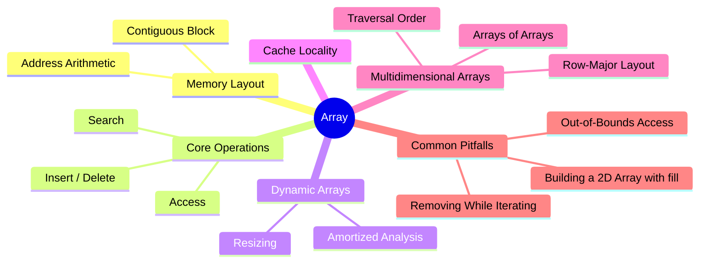
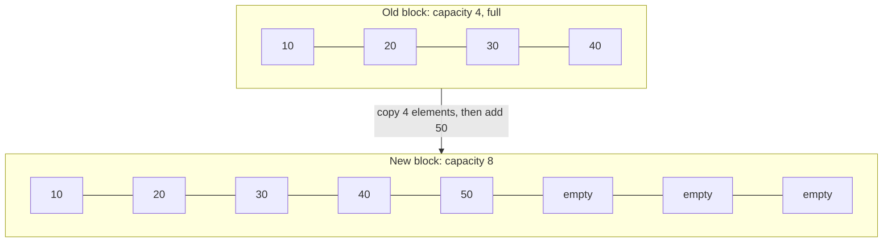
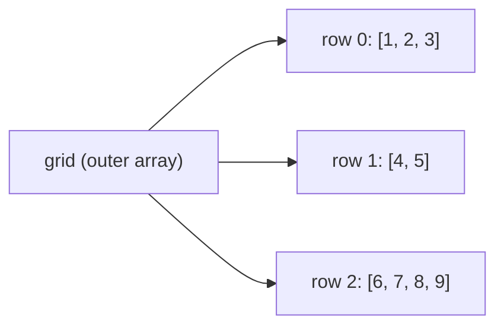

export const metadata = {
  title: 'Arrays: Sequences Laid Out in Contiguous Memory',
  date: '2026-09-13',
  excerpt: 'An in-depth guide to arrays: why contiguous memory makes indexing O(1), why inserting and deleting are expensive, how dynamic arrays grow while keeping push amortized O(1), why arrays are fast in practice, how multidimensional arrays are laid out, and the mistakes that trip people up most often.',
  tags: ['Programming', 'Data Structures', 'Algorithm'],
};

# Arrays: Sequences Laid Out in Contiguous Memory

An array is probably the first data structure you ever used, and still the one you use most: a row of elements, numbered from zero, where you can grab any one of them by its number. It's so simple it hardly feels like a "structure" at all.

Yet plenty of other data structures are built on top of one: stacks, queues, heaps, and hash tables are usually just an array underneath.

Everything arrays are good and bad at traces back to a single property: their elements sit side by side in one block of memory. That's what makes reading and iterating fast, and it's also what makes inserting in the middle and growing the array expensive. Understand that, and you can work out most of the rest yourself.



- [What Is an Array](#what-is-an-array)
- [Core Operations](#core-operations)
- [Static vs. Dynamic Arrays](#static-vs-dynamic-arrays)
- [Cache Locality](#cache-locality)
- [Multidimensional Arrays](#multidimensional-arrays)
- [Common Pitfalls](#common-pitfalls)
- [Conclusion](#conclusion)

---

## What Is an Array

An array is a collection of elements stored in order in one contiguous block of memory, each accessed by an integer index. When you create an array, the program asks for one chunk of memory big enough to hold everything, then lays the elements out one after another with no gaps in between.

Say you have an array of five integers, each taking 4 bytes, in a block that starts at address 1000:

| Index | 0 | 1 | 2 | 3 | 4 |
| - | - | - | - | - | - |
| Value | 10 | 20 | 30 | 40 | 50 |
| Address | 1000 | 1004 | 1008 | 1012 | 1016 |

Because every slot is the same size and the slots are packed together, the address of any element can be computed directly:

```text
address of element i = start address + i × element size
```

To read `arr[3]`, the computer doesn't count its way there from the front. It computes 1000 + 3 × 4 = 1012 and reads straight from that address. Whether the array holds 5 elements or 5 million, that calculation takes the same time. This is why random access on an array is O(1): reaching an element is arithmetic, not a search.

The formula also explains two things that tend to puzzle beginners:

- Why indexes start at 0. An index is really an offset: how many slots away from the start an element sits. The first element is right at the start, so its offset is 0.
- Why classic arrays require every element to have the same type. The formula only works if every slot is the same size. If some elements took 4 bytes and others took 8, a single multiplication couldn't tell you where anything is.

You might object that arrays in JavaScript and Python happily mix numbers, strings, and objects. They don't break the rule; they satisfy it differently. Each slot still holds one fixed-size value. A string or an object doesn't live in the slot; the slot holds a reference to it. Strings and objects vary in size, but references don't, so the formula still holds.

---

## Core Operations

### Access and Update

Reading or writing by index is O(1): compute the address, then read or write.

```javascript
const scores = [90, 85, 77, 92];

scores[2];      // 77, O(1)
scores[2] = 80; // O(1)
```

### Search

If what you're looking for is where a value lives, the index can't help you. In an unsorted array, the only option is to compare elements one at a time from the front, and in the worst case you check every one of them: O(n).

If the array is sorted, binary search can throw away half of the remaining range at each step, bringing that down to O(log n). Binary search is fast only because an array can jump to the middle element in O(1); on a linked list, just walking to the middle costs O(n). For an implementation, see [Understanding Big O Notation](/articles/big-o-notation).

### Insertion and Deletion

This is where arrays pay the price. Elements have to stay packed with no gaps, so inserting a new element at index `i` means every element from `i` onward has to shift one slot to the right to make room:

| | [0] | [1] | [2] | [3] | [4] |
| - | - | - | - | - | - |
| Before | 10 | 20 | 30 | 40 | |
| Insert 99 at index 1 | 10 | 99 | 20 | 30 | 40 |

Everything from index 1 onward moved one slot to the right. Write the process out and the cost is plain to see:

```javascript
// O(n): insert value at index
function insertAt(arr, index, value) {
  if (index < 0 || index > arr.length) return;

  // Shift from the back, so nothing is overwritten before it has moved
  for (let i = arr.length; i > index; i--) {
    arr[i] = arr[i - 1];
  }
  arr[index] = value;
}
```

Deletion is the mirror image: once the element at index `i` is gone, everything after it shifts one slot to the left to close the gap. Either way, the cost depends on how many elements come after that position. At the front, all of them have to move: O(n). At the end, there are none: O(1). JavaScript's `unshift`, `shift`, and `splice` are defined to do exactly this, which is why they aren't cheap on large arrays.

If you don't care about order, deletion can be O(1): move the last element into the slot you're deleting, then drop the last slot. Game engines often use this trick for their entity lists, and it works for any collection where order doesn't matter.

```javascript
// O(1): delete without preserving order
function removeUnordered(arr, index) {
  if (index < 0 || index >= arr.length) return;

  arr[index] = arr[arr.length - 1]; // fill the gap with the last element
  arr.pop();
}
```

### Complexity at a Glance

| Operation | Time Complexity |
| - | - |
| Access / update by index | O(1) |
| Search (unsorted) | O(n) |
| Search (sorted, binary search) | O(log n) |
| Insert / delete at the end | O(1)* |
| Insert / delete at the front or middle | O(n) |
| Delete without preserving order | O(1) |

\* On a dynamic array, appending is amortized O(1); the next section explains why.

---

## Static vs. Dynamic Arrays

Classic arrays have a hard limit: their size is fixed when they're created. Declare `int scores[5];` in C or write `new int[5]` in Java, and you get room for exactly five integers. The array can never grow past that.

The reason is memory itself. An array has to be contiguous, and the memory just past the end of its block may already belong to something else, so there's no extending it in place.

Real-world data, though, rarely comes with a known size. That's the problem dynamic arrays solve. Java's `ArrayList`, C++'s `std::vector`, Python's `list`, and JavaScript's `Array` are all dynamic arrays, and they work like this:

1. Allocate more space than you currently need. The number of slots in use is the length; the total number of slots is the capacity.
2. New elements go straight into the free slots at the end: O(1).
3. When the free slots run out, allocate a new, larger block (commonly 1.5× or 2× the old one), copy every element across, and release the old block.



Here's a simplified dynamic array in JavaScript. To keep it honest, the storage underneath is an `Int32Array`: a fixed-length block of contiguous memory that only holds 32-bit integers. It can't grow on its own, so resizing has to be done by hand.

```javascript
class DynamicArray {
  constructor() {
    this.capacity = 4;                         // total slots
    this.length = 0;                           // slots in use
    this.data = new Int32Array(this.capacity); // a fixed-size contiguous block
  }

  // Amortized O(1): append at the end, growing first if full
  push(value) {
    if (this.length === this.capacity) {
      this.grow();
    }
    this.data[this.length] = value;
    this.length++;
  }

  // O(1): spare capacity doesn't count; only indexes below length are valid
  get(index) {
    if (index < 0 || index >= this.length) {
      throw new RangeError(`Index ${index} is out of bounds`);
    }
    return this.data[index];
  }

  // O(n): allocate a block twice as big and copy everything over
  grow() {
    this.capacity *= 2;
    const bigger = new Int32Array(this.capacity);
    bigger.set(this.data);
    this.data = bigger; // nothing references the old block now; the GC reclaims it
  }
}
```

### Amortized Analysis: Why `push` Is Still O(1)

Growing copies every element, which is O(n). Doesn't that make `push` O(n)? The key is that growing is rare, and it gets rarer as the array gets bigger.

Start at capacity 4 and keep pushing, and only these pushes trigger a resize:

| Push | Capacity change | Elements copied |
| - | - | - |
| 5th | 4 → 8 | 4 |
| 9th | 8 → 16 | 8 |
| 17th | 16 → 32 | 16 |
| 33rd | 32 → 64 | 32 |

After 33 pushes, only 4 + 8 + 16 + 32 = 60 elements have been copied in total: fewer than 2 copies per push on average. That isn't luck. Because capacity doubles each time, every resize copies more elements than all the previous resizes combined, so the total number of copies is always less than twice the last one, and therefore always less than 2n.

So n pushes cost O(n) in total, which averages out to O(1) each. This way of reasoning, spreading the cost of an occasional expensive operation across many cheap ones, is called amortized analysis, and the result is amortized O(1).

Amortized O(1) doesn't mean every push is fast, though. The push that triggers a resize is still O(n). Most code never notices, but in latency-sensitive work, such as animation logic that has to finish within one frame, an occasional large resize can show up as a stutter.

### Why Growth Has to Be Proportional

Grow by a fixed number of slots instead, say 10 at a time, and the math falls apart. Capacity goes 10, 20, 30, and so on, with a full copy every 10 elements. Total copying comes to roughly n² / 20, which makes each `push` O(n) on average.

The exact growth factor varies: Java's `ArrayList` grows by 50% each time, while CPython's `list` over-allocates by only about 1/8. As long as growth is proportional, the amortized cost stays O(1). A larger factor means fewer resizes; a smaller one means less idle space.

If you know roughly how many elements you'll need, many languages let you reserve the capacity up front (Java's `new ArrayList<>(10000)`, C++'s `vector.reserve(10000)`) and skip the intermediate resizes entirely.

---

## Cache Locality

Big O counts operations, not how long each memory access takes, and that blind spot is where arrays win in practice.

Main memory is slow compared with the CPU, so the CPU doesn't fetch one value at a time; it pulls in a whole cache line (typically 64 bytes) at once. A cache line holds sixteen 4-byte integers, so reading one of them brings the other fifteen along for free. The CPU also watches for sequential access patterns and prefetches the next few cache lines before you ask for them.

An array's contiguous layout gets the full benefit of both: walk it from front to back and most reads hit the cache, so the CPU rarely waits on main memory. This is the advantage linked lists give up; [Linked Lists: Sequences Built from Nodes and Pointers](/articles/linked-list) shows what that costs them.

One caveat: in languages like Java, Python, and JavaScript, an array of objects stores references, while the objects themselves can end up anywhere on the heap. Walking the references is fast, but following each one to read a field can jump to a completely different part of memory. That's why performance-critical code (graphics, audio, heavy number crunching) often switches to arrays of raw numbers, such as JavaScript's typed arrays (the `Int32Array` from earlier is one), so the data itself is truly contiguous.

---

## Multidimensional Arrays

Memory has only one dimension: a long run of addresses. So a two-dimensional array (a matrix, a game board, an image) has to be flattened into one dimension somehow. The most common layout is row-major: one full row, then the next, and so on.

```text
Logical view (3 rows × 4 columns)       In memory (row-major)

[ 0  1  2  3 ]
[ 4  5  6  7 ]      →      0 1 2 3 4 5 6 7 8 9 10 11
[ 8  9 10 11 ]
```

Each number in the grid is that cell's index in the flat memory. The element at row `r`, column `c` sits at:

```text
index = r × columns + c
```

So `[1][2]` is at 1 × 4 + 2 = 6. That's still one multiplication and one addition, so access in a multidimensional array is still O(1). C and C++ multidimensional arrays and NumPy arrays (by default) are row-major; Fortran, MATLAB, and Julia are column-major, storing one column at a time.

### Arrays of Arrays

JavaScript's and Python's `[[...], [...]]`, and Java's `int[][]`, don't work this way. Their 2D arrays are really arrays of arrays: each slot of the outer array holds a reference to a separately allocated inner array. Each row is contiguous on its own, but the rows aren't necessarily next to each other, and they don't even need the same length, which is why these are also called jagged arrays.



When performance matters, the usual move is to flatten by hand: allocate one 1D array of length rows × columns and compute indexes with the formula above. The browser's Canvas API works this way. The pixel data returned by `getImageData()` is a flat `Uint8ClampedArray` in row-major order, with 4 bytes per pixel (R, G, B, A).

```javascript
const { data, width } = ctx.getImageData(0, 0, canvas.width, canvas.height);

// Read the pixel at (x, y)
function getPixel(x, y) {
  const i = (y * width + x) * 4; // which pixel it is, times 4 bytes per pixel
  return { r: data[i], g: data[i + 1], b: data[i + 2], a: data[i + 3] };
}
```

### Traversal Order Matters

Since memory is laid out row by row, an inner loop that moves along a row reads memory sequentially. Swap the two loops and every step of the inner loop jumps a full row ahead; on a large matrix, nearly every read lands on a different cache line.

```javascript
// Fast: the inner loop follows memory order
for (let r = 0; r < rows; r++) {
  for (let c = 0; c < cols; c++) {
    sum += grid[r * cols + c];
  }
}

// Slow: every step of the inner loop skips ahead by cols elements
for (let c = 0; c < cols; c++) {
  for (let r = 0; r < rows; r++) {
    sum += grid[r * cols + c];
  }
}
```

Both versions are O(rows × cols) and read the same elements, but they don't run at the same speed. Measured in Node.js 22 on a 2048 × 2048 `Float64Array`, the row-by-row loop ran about 6× faster than the column-by-column one (exact numbers depend on the hardware). Same Big O, very different running time.

---

## Common Pitfalls

### Out-of-Bounds Access

Valid indexes run from `0` to `length - 1`. Off-by-one errors are among the most common array bugs, and what happens when you step outside the bounds varies a lot by language:

| Language | Reading `arr[10]` (length 3) |
| - | - |
| C / C++ | Undefined behavior: reads memory outside the array, which may be garbage or may crash the program |
| Java | Throws `ArrayIndexOutOfBoundsException` |
| Python | Raises `IndexError` |
| JavaScript | No error; returns `undefined` |

Out-of-bounds writes in C are even worse: they silently overwrite neighboring data, which is where buffer overflow vulnerabilities come from. JavaScript sits at the other extreme. An out-of-bounds read quietly returns `undefined`, and a write like `arr[10] = 'x'` just stretches the array to length 11, leaving empty slots in between. Either way, the bug often doesn't surface until much later.

### Removing Elements While Iterating

```javascript
const nums = [1, 2, 2, 3];

for (let i = 0; i < nums.length; i++) {
  if (nums[i] === 2) nums.splice(i, 1);
}

console.log(nums); // [1, 2, 3]: one of the 2s survived
```

Removing the `2` at index 1 shifts everything after it one slot to the left, so the second `2` moves into index 1. But the loop then bumps `i` to 2 and skips right past it. It's the same shifting from earlier, this time causing a bug instead of a slowdown.

The fix is to iterate backward (a removal only shifts positions you've already visited), or to skip in-place mutation entirely and build a new array with `filter`:

```javascript
const result = nums.filter((n) => n !== 2); // [1, 3]
```

`filter` does it in a single pass, O(n); calling `splice` repeatedly inside a loop is O(n²) in the worst case.

### Building a 2D Array with `fill`

This looks like a reasonable way to create three empty rows:

```javascript
const grid = new Array(3).fill([]);
grid[0].push(1);
console.log(grid); // [[1], [1], [1]]
```

`fill` puts the same value into every slot, and here that value is a reference to a single array, so all three rows are the same array. The fix is to create each row separately:

```javascript
const grid = Array.from({ length: 3 }, () => []);
grid[0].push(1);
console.log(grid); // [[1], [], []]
```

---

## Conclusion

An array makes exactly one decision: put the elements right next to each other in one block of memory. Everything else follows from that:

- An element's position can be computed directly, so access by index is O(1).
- No gaps are allowed between elements, so inserting or deleting at the front or in the middle means shifting everything after it: O(n).
- The memory past the end of the block may already be taken, so an array can't just grow in place; dynamic arrays grow proportionally and get an amortized O(1) `push` in return.
- A contiguous layout is cache-friendly, so arrays are often faster in practice than Big O alone would suggest.

When you're not sure which data structure to use, start with an array. Reach for something else only when its weak spots (frequent insertion or deletion at the front or in the middle, or lookup by key) become a real bottleneck.
