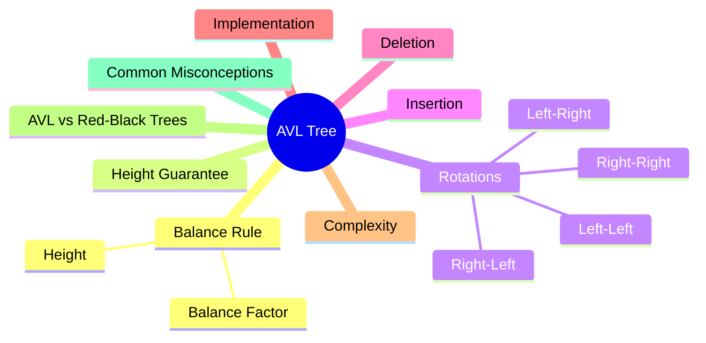

export const metadata = {
  title: 'AVL Tree',
  date: '2026-11-18',
  excerpt: 'How an AVL tree keeps a binary search tree from growing tall: the balance rule, why it guarantees logarithmic height, the four ways a node can fall out of balance and the rotations that fix each one, insert and delete step by step, and how AVL trees compare with red-black trees. Includes examples in TypeScript, Python, and Java.',
  tags: ['Data Structures'],
};

# AVL Tree

A binary search tree is only as fast as it is short. Every operation walks one path down from the root, and the order the values arrive in decides how long that path gets. Insert sorted data and the tree turns into a linked list, with every operation O(n).

An AVL tree is a binary search tree that doesn't let that happen. After every insert and delete, it checks each node on the path that just changed, and wherever one subtree is now two levels taller than the other, it fixes the shape with one or two rotations. Whatever order the data arrives in, the height stays O(log n).

It was the first self-balancing BST, published in 1962 by Georgy Adelson-Velsky and Evgenii Landis, whose initials give it its name. This article covers the balance rule, why it keeps the tree short, the four ways a node can fall out of balance and the rotations that fix each one, a complete implementation with insert and delete, and how AVL trees compare with red-black trees. It builds on [Binary Search Tree](./binary-search-tree), especially its section on rotations.



- [The Balance Rule](#the-balance-rule)
- [Why the Height Stays Logarithmic](#why-the-height-stays-logarithmic)
- [Rotations: The Four Cases](#rotations-the-four-cases)
- [Inserting](#inserting)
- [Deleting](#deleting)
- [Implementing an AVL Tree](#implementing-an-avl-tree)
- [Time and Space Complexity](#time-and-space-complexity)
- [AVL vs. Red-Black Trees](#avl-vs-red-black-trees)
- [Common Misconceptions](#common-misconceptions)
- [Conclusion](#conclusion)

---

## The Balance Rule

The AVL rule is about heights. A node's height is the number of edges on the longest path from it down to a leaf, and as in [Tree and Binary Tree Basics](./tree-and-binary-tree-basics), a leaf has height 0 and an empty subtree has height −1.

A node's balance factor is the height of its left subtree minus the height of its right subtree. The AVL rule says every node's balance factor must be −1, 0, or +1. In other words, at every node, the two subtrees differ in height by at most one. (Some sources subtract the other way around. The sign doesn't matter, as long as it's used consistently.)

Here's a valid AVL tree:

```text
        5
       / \
      3   8
     / \   \
    2   4   9
   /
  1
```

| Node | Left Subtree Height | Right Subtree Height | Balance Factor |
| :--- | :--- | :--- | :--- |
| 5 | 2 | 1 | +1 |
| 3 | 1 | 0 | +1 |
| 2 | 0 | −1 | +1 |
| 8 | −1 | 0 | −1 |
| 1, 4, 9 | −1 | −1 | 0 |

The rule doesn't ask for a perfect tree. Node 2 has a left child and no right child, and the left side of the tree reaches one level deeper than the right. What the rule forbids is a difference of two or more, anywhere in the tree.

"Anywhere" is the important part. Checking the root alone isn't enough:

```text
        4
       / \
      3   5
     /     \
    2       6
   /         \
  1           7
```

The root's two subtrees both have height 2, so its balance factor is 0. But node 3 has a left subtree of height 1 and no right subtree, a balance factor of +2, and node 5 is its mirror image, at −2. This isn't an AVL tree, and with longer chains it would be no better than two linked lists.

---

## Why the Height Stays Logarithmic

The rule only compares a node's two subtrees, yet it limits the height of the whole tree. To see by how much, ask the opposite question: what's the fewest nodes an AVL tree of height h can have?

Call that number N(h). A tree of height h needs one subtree of height h − 1. The other subtree can be shorter, but by one level at most, so the sparsest choice is height h − 2. Making both subtrees as sparse as possible gives N(h) = N(h − 1) + N(h − 2) + 1, starting from N(0) = 1 (a single node) and N(1) = 2 (a node with one child):

| Height h | 0 | 1 | 2 | 3 | 4 | 5 | 6 | 7 | 8 |
| :--- | :--- | :--- | :--- | :--- | :--- | :--- | :--- | :--- | :--- |
| Fewest nodes N(h) | 1 | 2 | 4 | 7 | 12 | 20 | 33 | 54 | 88 |

That's the Fibonacci recurrence with an extra 1, and in fact each N(h) is exactly one less than a Fibonacci number. Fibonacci numbers grow by a factor of about 1.618 (the golden ratio) at each step, so the fewest nodes a tree of height h can have grows exponentially with h. Turn that around and the height can only grow logarithmically with the number of nodes: an AVL tree with n nodes is never taller than about 1.44 log₂ n. The example tree in the previous section is one of these sparsest trees, with 7 nodes and height 3.

Here's what that means for 1,000 values, next to the plain BST from [Binary Search Tree](./binary-search-tree):

| Insertion Order | Plain BST Height | AVL Tree Height |
| :--- | :--- | :--- |
| Sorted (1, 2, 3, …, 1,000) | 999 | 9 |
| Random (average over 200 runs) | About 21 | About 11 |
| Worst possible order | 999 | 13 |

The lowest height any binary tree with 1,000 nodes can have is 9. Sorted input, the worst case for a plain BST, gives an AVL tree exactly that, random input gets within a couple of levels of it, and no insertion order can push the height past 13.

---

## Rotations: The Four Cases

An insert or delete changes heights only along one path, so only nodes on that path can fall out of balance, and only by one more level than the rule allows: a balance factor of +2 or −2. The fix depends on where the extra height is. Look at the unbalanced node and at its taller child:

| Case | Unbalanced Node | Its Taller Child | Fix |
| :--- | :--- | :--- | :--- |
| Left-Left | Left-heavy (+2) | Left-heavy or balanced | Right rotation at the node |
| Right-Right | Right-heavy (−2) | Right-heavy or balanced | Left rotation at the node |
| Left-Right | Left-heavy (+2) | Right-heavy | Left rotation at the child, then right rotation at the node |
| Right-Left | Right-heavy (−2) | Left-heavy | Right rotation at the child, then left rotation at the node |

The taller child can only be balanced after a delete. After an insert, it always leans one way or the other.

A right rotation lifts a node's left child into the node's place, as described in [Binary Search Tree](./binary-search-tree), and a left rotation is its mirror image. Each one changes only a few links, so even a double rotation takes O(1) time.

### Single Rotation

The smallest Left-Left case comes from inserting 3, 2, and 1. Node 3 ends up with a left subtree of height 1 and no right subtree, a balance factor of +2, and its left child 2 leans left too. One right rotation at 3 makes 2 the root:

```text
    3
   /          2
  2     →    / \
 /          1   3
1
```

Right-Right is the mirror image. Insert 1, 2, and 3, and a left rotation at 1 fixes it.

### Double Rotation

Now insert 3, 1, and 2 instead. Node 3 is still left-heavy, but its left child leans right, so the path from 3 down to the new node zigzags. A right rotation at 3 doesn't help here. It only turns the zigzag into its mirror image, with 1 at the top, 3 as its right child, and 2 as 3's left child, which is just as unbalanced.

It takes two rotations. A left rotation at 1 straightens the zigzag into a Left-Left line, and then a right rotation at 3 finishes the job:

```text
  3         3
 /         /        2
1    →    2    →   / \
 \       /        1   3
  2     1
```

Right-Left is the mirror image again: a right rotation at the child, then a left rotation at the node.

---

## Inserting

Insertion starts as an ordinary BST insert: search for the value, and attach a new leaf where the search runs out. Then walk back up the path toward the root. At each node, recompute its height from its children's heights and check its balance factor. If it's +2 or −2, apply the matching fix from the previous section.

An insert never needs more than one fix. The new leaf can make each subtree along its path at most one level taller, and the rotation at the lowest unbalanced node brings that subtree back to the height it had before the insert. Nothing above it sees any change, so a single insert costs at most one single or one double rotation.

Try sorted input, the kind that turned a plain BST into a linked list: 1 through 7, in order. Inserting 1, 2, and 4 leaves every node balanced. Each of the other inserts triggers one rotation:

| Insert | Unbalanced Node | Case | Fix |
| :--- | :--- | :--- | :--- |
| 3 | 1 | Right-Right | Left rotation at 1 |
| 5 | 3 | Right-Right | Left rotation at 3 |
| 6 | 2 | Right-Right | Left rotation at 2 |
| 7 | 5 | Right-Right | Left rotation at 5 |

When 6 goes in, the unbalanced node is 2, which is the root at that point, so the rotation makes 4 the new root. Here's the final tree, which happens to be perfect:

```text
      4
    /   \
   2     6
  / \   / \
 1   3 5   7
```

Every rotation here was Right-Right, because each new value went to the far right. Input in random order runs into all four cases.

---

## Deleting

Deletion also starts as an ordinary BST delete, with the same three cases: a leaf is simply removed, a node with one child is replaced by that child, and a node with two children takes its in-order successor's value, after which the successor is deleted instead. Then, as with insertion, walk back up from where the tree actually changed, updating heights and fixing any node that's out of balance.

Take the tree on the left and delete 6:

```text
      4
     / \            2
    2   6    →     / \
   / \            1   4
  1   3              /
                    3
```

Without 6, node 4 has a left subtree of height 1 and an empty right subtree, a balance factor of +2. Its taller child, 2, is perfectly balanced, which can't happen after an insert. It still counts as Left-Left, and one right rotation at 4 fixes it: 2 becomes the root, and 3 moves across to become 4's left child.

What happens next is where deletion differs from insertion. In this example, the subtree has height 2 after the rotation, the same as before the delete, so nothing above it is affected. But a rotation after a delete can also leave its subtree one level shorter than it was before, and a shorter subtree can unbalance a node further up. So the walk has to continue all the way to the root, and in the worst case a single delete rotates at every level. That's still only O(log n) rotations, each one O(1).

---

## Implementing an AVL Tree

Here's an AVL tree of integers with search, insert, and delete. Each node stores its height rather than its balance factor, since the balance factor is easy to compute from the children's heights. Insert and delete are recursive, and each call returns the new root of the subtree it was given. If a rotation replaces a subtree's root, the parent's `node.left = ...` or `node.right = ...` assignment picks up the new one. Recursion is safe here, unlike in a plain BST, because it only goes as deep as the tree is tall, and an AVL tree with a million values has a height of at most 27.

```typescript
// TypeScript
class AVLNode {
  left: AVLNode | null = null;
  right: AVLNode | null = null;
  height = 0; // a new node is a leaf

  constructor(public value: number) {}
}

function heightOf(node: AVLNode | null): number {
  return node === null ? -1 : node.height;
}

function updateHeight(node: AVLNode): void {
  node.height = 1 + Math.max(heightOf(node.left), heightOf(node.right));
}

function balanceFactor(node: AVLNode): number {
  return heightOf(node.left) - heightOf(node.right);
}

function rotateRight(y: AVLNode): AVLNode {
  const x = y.left!;
  y.left = x.right;
  x.right = y;
  updateHeight(y); // y is now below x, so it goes first
  updateHeight(x);
  return x;
}

function rotateLeft(x: AVLNode): AVLNode {
  const y = x.right!;
  x.right = y.left;
  y.left = x;
  updateHeight(x);
  updateHeight(y);
  return y;
}

// fixes one node's height and balance; returns the subtree's new root
function rebalance(node: AVLNode): AVLNode {
  updateHeight(node);
  const balance = balanceFactor(node);
  if (balance > 1) {
    // Left-Right: rotate the child first, turning it into Left-Left
    if (balanceFactor(node.left!) < 0) node.left = rotateLeft(node.left!);
    return rotateRight(node);
  }
  if (balance < -1) {
    // Right-Left: rotate the child first, turning it into Right-Right
    if (balanceFactor(node.right!) > 0) node.right = rotateRight(node.right!);
    return rotateLeft(node);
  }
  return node;
}

// both return the new root of the subtree they were given
function insertAt(node: AVLNode | null, value: number): AVLNode {
  if (node === null) return new AVLNode(value);
  if (value < node.value) node.left = insertAt(node.left, value);
  else if (value > node.value) node.right = insertAt(node.right, value);
  else return node; // no duplicates
  return rebalance(node);
}

function deleteAt(node: AVLNode | null, value: number): AVLNode | null {
  if (node === null) return null; // not found
  if (value < node.value) node.left = deleteAt(node.left, value);
  else if (value > node.value) node.right = deleteAt(node.right, value);
  else if (node.left === null) return node.right;
  else if (node.right === null) return node.left;
  else {
    // two children: copy the successor's value into this node,
    // then delete the successor from the right subtree
    let successor = node.right;
    while (successor.left !== null) successor = successor.left;
    node.value = successor.value;
    node.right = deleteAt(node.right, successor.value);
  }
  return rebalance(node);
}

class AVLTree {
  private root: AVLNode | null = null;

  get height(): number {
    return heightOf(this.root);
  }

  contains(value: number): boolean {
    let node = this.root;
    while (node !== null) {
      if (value < node.value) node = node.left;
      else if (value > node.value) node = node.right;
      else return true;
    }
    return false;
  }

  insert(value: number): void {
    this.root = insertAt(this.root, value);
  }

  delete(value: number): void {
    this.root = deleteAt(this.root, value);
  }
}

const tree = new AVLTree();
for (let v = 1; v <= 1000; v++) tree.insert(v);
console.log(tree.height);        // 9
console.log(tree.contains(500)); // true
tree.delete(500);
console.log(tree.contains(500)); // false
```

```python
# Python
from typing import Optional


class AVLNode:
    def __init__(self, value: int) -> None:
        self.value = value
        self.left: Optional[AVLNode] = None
        self.right: Optional[AVLNode] = None
        self.height = 0  # a new node is a leaf


def height_of(node: Optional[AVLNode]) -> int:
    return -1 if node is None else node.height


def update_height(node: AVLNode) -> None:
    node.height = 1 + max(height_of(node.left), height_of(node.right))


def balance_factor(node: AVLNode) -> int:
    return height_of(node.left) - height_of(node.right)


def rotate_right(y: AVLNode) -> AVLNode:
    x = y.left
    y.left = x.right
    x.right = y
    update_height(y)  # y is now below x, so it goes first
    update_height(x)
    return x


def rotate_left(x: AVLNode) -> AVLNode:
    y = x.right
    x.right = y.left
    y.left = x
    update_height(x)
    update_height(y)
    return y


# fixes one node's height and balance; returns the subtree's new root
def rebalance(node: AVLNode) -> AVLNode:
    update_height(node)
    balance = balance_factor(node)
    if balance > 1:
        # Left-Right: rotate the child first, turning it into Left-Left
        if balance_factor(node.left) < 0:
            node.left = rotate_left(node.left)
        return rotate_right(node)
    if balance < -1:
        # Right-Left: rotate the child first, turning it into Right-Right
        if balance_factor(node.right) > 0:
            node.right = rotate_right(node.right)
        return rotate_left(node)
    return node


# both return the new root of the subtree they were given
def insert_at(node: Optional[AVLNode], value: int) -> AVLNode:
    if node is None:
        return AVLNode(value)
    if value < node.value:
        node.left = insert_at(node.left, value)
    elif value > node.value:
        node.right = insert_at(node.right, value)
    else:
        return node  # no duplicates
    return rebalance(node)


def delete_at(node: Optional[AVLNode], value: int) -> Optional[AVLNode]:
    if node is None:
        return None  # not found
    if value < node.value:
        node.left = delete_at(node.left, value)
    elif value > node.value:
        node.right = delete_at(node.right, value)
    elif node.left is None:
        return node.right
    elif node.right is None:
        return node.left
    else:
        # two children: copy the successor's value into this node,
        # then delete the successor from the right subtree
        successor = node.right
        while successor.left is not None:
            successor = successor.left
        node.value = successor.value
        node.right = delete_at(node.right, successor.value)
    return rebalance(node)


class AVLTree:
    def __init__(self) -> None:
        self._root: Optional[AVLNode] = None

    @property
    def height(self) -> int:
        return height_of(self._root)

    def __contains__(self, value: int) -> bool:
        node = self._root
        while node is not None:
            if value < node.value:
                node = node.left
            elif value > node.value:
                node = node.right
            else:
                return True
        return False

    def insert(self, value: int) -> None:
        self._root = insert_at(self._root, value)

    def delete(self, value: int) -> None:
        self._root = delete_at(self._root, value)


tree = AVLTree()
for v in range(1, 1001):
    tree.insert(v)
print(tree.height)  # 9
print(500 in tree)  # True
tree.delete(500)
print(500 in tree)  # False
```

```java
// Java
public class AVLTree {
    private static class Node {
        int value;
        int height = 0; // a new node is a leaf
        Node left, right;

        Node(int value) {
            this.value = value;
        }
    }

    private Node root;

    public int height() {
        return heightOf(root);
    }

    public boolean contains(int value) {
        Node node = root;
        while (node != null) {
            if (value < node.value) node = node.left;
            else if (value > node.value) node = node.right;
            else return true;
        }
        return false;
    }

    public void insert(int value) {
        root = insertAt(root, value);
    }

    public void delete(int value) {
        root = deleteAt(root, value);
    }

    private static int heightOf(Node node) {
        return node == null ? -1 : node.height;
    }

    private static void updateHeight(Node node) {
        int left = heightOf(node.left);
        int right = heightOf(node.right);
        node.height = 1 + Math.max(left, right);
    }

    private static int balanceFactor(Node node) {
        return heightOf(node.left) - heightOf(node.right);
    }

    private static Node rotateRight(Node y) {
        Node x = y.left;
        y.left = x.right;
        x.right = y;
        updateHeight(y); // y is now below x, so it goes first
        updateHeight(x);
        return x;
    }

    private static Node rotateLeft(Node x) {
        Node y = x.right;
        x.right = y.left;
        y.left = x;
        updateHeight(x);
        updateHeight(y);
        return y;
    }

    // fixes one node's height and balance; returns the subtree's new root
    private static Node rebalance(Node node) {
        updateHeight(node);
        int balance = balanceFactor(node);
        if (balance > 1) {
            // Left-Right: rotate the child first, turning it into Left-Left
            if (balanceFactor(node.left) < 0) {
                node.left = rotateLeft(node.left);
            }
            return rotateRight(node);
        }
        if (balance < -1) {
            // Right-Left: rotate the child first, turning it into Right-Right
            if (balanceFactor(node.right) > 0) {
                node.right = rotateRight(node.right);
            }
            return rotateLeft(node);
        }
        return node;
    }

    // both return the new root of the subtree they were given
    private static Node insertAt(Node node, int value) {
        if (node == null) return new Node(value);
        if (value < node.value) node.left = insertAt(node.left, value);
        else if (value > node.value) node.right = insertAt(node.right, value);
        else return node; // no duplicates
        return rebalance(node);
    }

    private static Node deleteAt(Node node, int value) {
        if (node == null) return null; // not found
        if (value < node.value) node.left = deleteAt(node.left, value);
        else if (value > node.value) node.right = deleteAt(node.right, value);
        else if (node.left == null) return node.right;
        else if (node.right == null) return node.left;
        else {
            // two children: copy the successor's value into this node,
            // then delete the successor from the right subtree
            Node successor = node.right;
            while (successor.left != null) successor = successor.left;
            node.value = successor.value;
            node.right = deleteAt(node.right, successor.value);
        }
        return rebalance(node);
    }

    public static void main(String[] args) {
        AVLTree tree = new AVLTree();
        for (int v = 1; v <= 1000; v++) tree.insert(v);
        System.out.println(tree.height());      // 9
        System.out.println(tree.contains(500)); // true
        tree.delete(500);
        System.out.println(tree.contains(500)); // false
    }
}
```

The pieces fit together like this:

- `rebalance` does all of the balancing. Every node on the path back up passes through it: it updates the node's height, then applies whichever of the four cases fits
- The rotations update the heights of the two nodes that moved, the lower one first, because the upper one's height depends on it
- Insert and delete are the plain BST versions, with `rebalance` applied to each node on the way back up. After an insert, at most one of those calls actually rotates. The rest only update heights
- The demo inserts 1 to 1,000 in sorted order, the worst case for a plain BST, and the tree ends up with a height of just 9

---

## Time and Space Complexity

| Operation | Time | Notes |
| :--- | :--- | :--- |
| Search | O(log n) | The height stays below about 1.44 log₂ n |
| Insert | O(log n) | At most one single or one double rotation |
| Delete | O(log n) | May rotate at every level on the way back up |
| Minimum / maximum | O(log n) | The leftmost and rightmost nodes |
| Sorted iteration | O(n) | An inorder traversal, as in any BST |

Space is O(n). The only overhead compared with a plain BST is the height stored in each node, a small integer. Some implementations store the balance factor instead, which fits in two bits.

---

## AVL vs. Red-Black Trees

The red-black tree is the other well-known self-balancing BST, and it makes a different trade-off. Its rule is looser, so the tree can grow taller: up to 2 log₂(n + 1) instead of about 1.44 log₂ n. In exchange, it does less restructuring. A delete never needs more than three rotations, while an AVL delete may rotate at every level.

AVL trees suit data that's searched far more often than it changes, while red-black trees are the more common general-purpose choice. Java's `TreeMap` is a red-black tree, and so is `std::map` in the major C++ standard libraries. The next article explains how red-black trees work and compares the two side by side.

---

## Common Misconceptions

| Common Misconception | What's Actually True |
| :--- | :--- |
| An AVL tree is perfectly balanced. | Subtree heights can differ by 1 at every node, and those differences add up. An AVL tree can be about 1.44 times as tall as a perfectly balanced one. |
| Checking the root's balance factor is enough. | The rule applies at every node. A root with a long chain on each side has a balance factor of 0, while the nodes below it are badly out of balance. |
| The balance factor compares the number of nodes in each subtree. | It compares heights. One subtree can have far more nodes than the other and still be the same height. |
| A single insert can trigger rotations all the way up to the root. | An insert needs at most one fix, a single or a double rotation, because the fix restores the subtree's original height. Only deletes can need rotations at several levels. |
| Every node's height has to be recomputed after each change. | Only the nodes on the changed path need updating, and each takes O(1), using its children's stored heights. |
| AVL trees are always faster than red-black trees. | AVL trees are shorter, so lookups can take fewer steps, but they can do more restructuring on deletes. Which is faster depends on the mix of reads and writes. |

---

## Conclusion

An AVL tree is a binary search tree with one extra rule: at every node, the two subtrees differ in height by at most one. That rule alone keeps the height below about 1.44 log₂ n, because the fewest nodes a tree of a given height can have grows like the Fibonacci numbers.

Insert and delete work as they do in a plain BST, followed by a walk back up the path that fixes any node that's out of balance. There are only four cases, and each is fixed with one or two rotations. An insert needs at most one such fix, and a delete may need one at each level. Either way, search, insert, and delete are all O(log n) in the worst case, whatever order the data arrives in.
