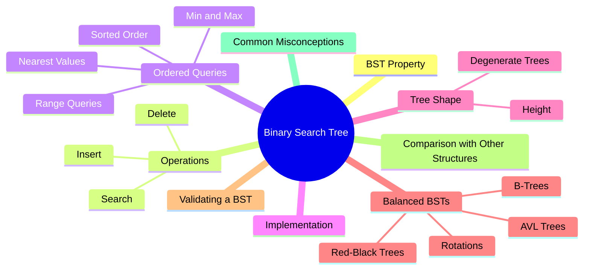

export const metadata = {
  title: 'Binary Search Tree',
  date: '2026-11-17',
  excerpt: 'How a binary search tree keeps its values in order, how search, insert, and delete work (including the two-children case), why insertion order can turn it into a linked list, how balanced trees prevent that, and how to check that a tree really is a BST. Includes examples in TypeScript, Python, and Java.',
  tags: ['Data Structures'],
};

# Binary Search Tree

A binary search tree (BST) is a binary tree that keeps its values in order. Every node follows one rule: smaller values go to its left, larger values go to its right. That rule lets you find, add, or remove a value by following a single path down from the root, and it gives you the values in sorted order for free.

A hash table finds a key faster, in O(1) on average, but it has no idea which keys are close to each other. A BST does. Ask it for the smallest value, the first value after 42, or everything between 10 and 20, and it answers by walking down the tree instead of scanning everything. That's what ordered maps and sets, like Java's `TreeMap` and `TreeSet`, are built on.

This article covers the BST rule, the three core operations, a complete implementation, why a BST can degrade into a linked list, how balanced trees prevent that, and how to check that a tree really is a BST. It builds on [Tree and Binary Tree Basics](./tree-and-binary-tree-basics) and [Binary Tree Traversal](./binary-tree-traversal).



- [The BST Property](#the-bst-property)
- [Searching](#searching)
- [Inserting](#inserting)
- [Deleting](#deleting)
- [Sorted Order and Range Queries](#sorted-order-and-range-queries)
- [Implementing a BST](#implementing-a-bst)
- [Why Shape Matters](#why-shape-matters)
- [Balanced Binary Search Trees](#balanced-binary-search-trees)
- [Validating a BST](#validating-a-bst)
- [BST vs. Other Data Structures](#bst-vs-other-data-structures)
- [Common Misconceptions](#common-misconceptions)
- [Conclusion](#conclusion)

---

## The BST Property

Every node in a binary search tree follows this rule:

- Every value in its left subtree is smaller than the node's value
- Every value in its right subtree is larger than the node's value

Here's a BST built by inserting 50, 30, 70, 20, 40, 60, 80, and 45, in that order. The rest of the article uses it as the running example:

```text
            50
          /    \
        30      70
       /  \    /  \
     20   40  60   80
            \
             45
```

The rule applies to whole subtrees, not only to a node's own children. 45 is the right child of 40, and 45 > 40. But 45 is also in 30's right subtree, so it has to be larger than 30, and in 50's left subtree, so it has to be smaller than 50. All three conditions hold.

As stated, the rule leaves no room for duplicates, and that's the most common choice: a BST used as a set ignores a value it already holds, and one used as a map updates the existing entry. If you do need duplicates, keep a count in each node, or consistently send equal values to the same side.

Because everything on the left is smaller and everything on the right is larger, an inorder traversal (left subtree, node, right subtree) visits the values in ascending order. For the example tree: 20 30 40 45 50 60 70 80.

---

## Searching

To find a value, start at the root and compare:

- If it equals the node's value, you've found it
- If it's smaller, go left
- If it's larger, go right
- If there's no child in that direction, the value isn't in the tree

Searching for 45: 45 < 50, so go left to 30. 45 > 30, so go right to 40. 45 > 40, so go right to 45. Found, after four comparisons.

Searching for 65: 65 > 50, so go right to 70. 65 < 70, so go left to 60. 65 > 60, so go right, but 60 has no right child. 65 isn't in the tree.

Each comparison moves down one level and rules out an entire subtree, the same idea as binary search on a sorted array. A search makes at most h + 1 comparisons, where h is the height of the tree.

---

## Inserting

Insertion is a search that comes up empty. Follow the same path, and where it runs out, attach the new node. To insert 65, the search ends at 60's empty right side, so 65 becomes 60's right child:

```text
            50
          /    \
        30      70
       /  \    /  \
     20   40  60   80
            \   \
             45  65
```

A new value always becomes a leaf, and the existing nodes never move. So the shape of a BST is decided by the order its values were inserted in, which turns out to matter a great deal (see [Why Shape Matters](#why-shape-matters)).

---

## Deleting

Deletion is the only operation with cases to work through, because removing a node can't be allowed to break the rule for the nodes below it. What to do depends on how many children the node has.

### No Children

A leaf can be removed outright. Deleting 20 from the example tree removes it from 30's left side, and nothing else changes.

### One Child

Replace the node with its only child, which brings the child's whole subtree up one level. Deleting 40, whose only child is 45, puts 45 where 40 was. That's safe: 45 was already in 30's right subtree and in 50's left subtree, and it still is.

### Two Children

This is the tricky case. Removing the node would leave two subtrees and only one place to attach them. Instead, find the node's in-order successor, the smallest value in its right subtree: go right once, then left as far as possible. Copy the successor's value into the node, then delete the successor from the right subtree.

Deleting 30 from the example tree: its right subtree is 40 with a right child 45. 40 has no left child, so 40 is the successor. Copy 40 into the node that held 30, then delete the old 40. It has one child, so 45 moves up into its place:

```text
            50
          /    \
        40      70
       /  \    /  \
     20   45  60   80
```

Two facts make this work. First, the successor is larger than everything in the left subtree and smaller than everything else in the right subtree, so it can take the deleted value's place without breaking the rule. Second, the successor never has a left child (that child would be smaller, so it would be the successor instead), which means deleting it is always one of the two easy cases. The in-order predecessor, the largest value in the left subtree, works just as well.

---

## Sorted Order and Range Queries

The ordering pays off in more ways than search:

- Sorted order: an inorder traversal visits every value in ascending order, in O(n)
- Minimum and maximum: the smallest value is the leftmost node (keep going left from the root), and the largest is the rightmost. Both take O(h)
- Nearest values: to find the smallest value that's at least x, search for x and remember the last node where the search turned left. If x isn't in the tree, that node is the answer. The largest value that's at most x works the same way, mirrored. Both take O(h)
- Range queries: every value between `low` and `high`, in order, in O(h + k), where k is the number of values returned

A range query could traverse the whole tree and filter, but a BST lets it skip most of the tree. If a node's value is below `low`, everything in its left subtree is smaller still, so there's no reason to go there. And once an inorder traversal reaches a value above `high`, every remaining value is larger, so it can stop. What's left is one path down to the start of the range, plus a walk through the values in it.

---

## Implementing a BST

Here's a BST of integers with search, insert, delete, and range queries. It reuses the `TreeNode` class from [Tree and Binary Tree Basics](./tree-and-binary-tree-basics). Like a set, it ignores duplicates: inserting a value that's already there returns `false`. All the methods use loops instead of recursion, so even a badly shaped tree can't overflow the call stack.

```typescript
// TypeScript
class BST {
  private root: TreeNode | null = null;
  private count = 0;

  get size(): number {
    return this.count;
  }

  contains(value: number): boolean {
    let node = this.root;
    while (node !== null) {
      if (value < node.value) node = node.left;
      else if (value > node.value) node = node.right;
      else return true;
    }
    return false;
  }

  insert(value: number): boolean {
    let parent: TreeNode | null = null;
    let node = this.root;
    while (node !== null) {
      if (value === node.value) return false; // no duplicates
      parent = node;
      node = value < node.value ? node.left : node.right;
    }
    const leaf = new TreeNode(value);
    if (parent === null) this.root = leaf;
    else if (value < parent.value) parent.left = leaf;
    else parent.right = leaf;
    this.count++;
    return true;
  }

  delete(value: number): boolean {
    let parent: TreeNode | null = null;
    let node = this.root;
    while (node !== null && node.value !== value) {
      parent = node;
      node = value < node.value ? node.left : node.right;
    }
    if (node === null) return false; // not found

    if (node.left !== null && node.right !== null) {
      // two children: copy the successor's value into this node,
      // then delete the successor instead
      let successorParent = node;
      let successor = node.right;
      while (successor.left !== null) {
        successorParent = successor;
        successor = successor.left;
      }
      node.value = successor.value;
      parent = successorParent;
      node = successor;
    }

    // node now has at most one child: put that child in node's place
    const child = node.left !== null ? node.left : node.right;
    if (parent === null) this.root = child;
    else if (parent.left === node) parent.left = child;
    else parent.right = child;
    this.count--;
    return true;
  }

  // every value v with low <= v <= high, in ascending order
  valuesBetween(low: number, high: number): number[] {
    const out: number[] = [];
    const stack: TreeNode[] = [];
    let node = this.root;
    while (node !== null || stack.length > 0) {
      if (node !== null) {
        if (node.value < low) {
          // node and its left subtree are all below low: skip them
          node = node.right;
        } else {
          // come back to it after its left subtree
          stack.push(node);
          node = node.left;
        }
      } else {
        node = stack.pop()!;
        if (node.value > high) break; // the rest are all larger
        out.push(node.value);
        node = node.right;
      }
    }
    return out;
  }
}

const tree = new BST();
for (const v of [50, 30, 70, 20, 40, 60, 80, 45]) tree.insert(v);
console.log(tree.contains(45));          // true
console.log(tree.contains(65));          // false
tree.delete(30);
console.log(tree.valuesBetween(40, 70)); // [40, 45, 50, 60, 70]
console.log(tree.size);                  // 7
```

```python
# Python
from typing import Optional


class BST:
    def __init__(self) -> None:
        self._root: Optional[TreeNode] = None
        self._size = 0

    def __len__(self) -> int:
        return self._size

    def __contains__(self, value: int) -> bool:
        node = self._root
        while node is not None:
            if value < node.value:
                node = node.left
            elif value > node.value:
                node = node.right
            else:
                return True
        return False

    def insert(self, value: int) -> bool:
        parent: Optional[TreeNode] = None
        node = self._root
        while node is not None:
            if value == node.value:
                return False  # no duplicates
            parent = node
            node = node.left if value < node.value else node.right
        leaf = TreeNode(value)
        if parent is None:
            self._root = leaf
        elif value < parent.value:
            parent.left = leaf
        else:
            parent.right = leaf
        self._size += 1
        return True

    def delete(self, value: int) -> bool:
        parent: Optional[TreeNode] = None
        node = self._root
        while node is not None and node.value != value:
            parent = node
            node = node.left if value < node.value else node.right
        if node is None:
            return False  # not found

        if node.left is not None and node.right is not None:
            # two children: copy the successor's value into this node,
            # then delete the successor instead
            successor_parent = node
            successor = node.right
            while successor.left is not None:
                successor_parent = successor
                successor = successor.left
            node.value = successor.value
            parent = successor_parent
            node = successor

        # node now has at most one child: put that child in node's place
        child = node.left if node.left is not None else node.right
        if parent is None:
            self._root = child
        elif parent.left is node:
            parent.left = child
        else:
            parent.right = child
        self._size -= 1
        return True

    # every value v with low <= v <= high, in ascending order
    def values_between(self, low: int, high: int) -> list[int]:
        out: list[int] = []
        stack: list[TreeNode] = []
        node = self._root
        while node is not None or stack:
            if node is not None:
                if node.value < low:
                    # node and its left subtree are all below low: skip them
                    node = node.right
                else:
                    # come back to it after its left subtree
                    stack.append(node)
                    node = node.left
            else:
                node = stack.pop()
                if node.value > high:
                    break  # the rest are all larger
                out.append(node.value)
                node = node.right
        return out


tree = BST()
for v in [50, 30, 70, 20, 40, 60, 80, 45]:
    tree.insert(v)
print(45 in tree)                   # True
print(65 in tree)                   # False
tree.delete(30)
print(tree.values_between(40, 70))  # [40, 45, 50, 60, 70]
print(len(tree))                    # 7
```

```java
// Java
import java.util.ArrayDeque;
import java.util.ArrayList;
import java.util.Deque;
import java.util.List;

public class BST {
    private TreeNode root;
    private int size = 0;

    public int size() {
        return size;
    }

    public boolean contains(int value) {
        TreeNode node = root;
        while (node != null) {
            if (value < node.value) node = node.left;
            else if (value > node.value) node = node.right;
            else return true;
        }
        return false;
    }

    public boolean insert(int value) {
        TreeNode parent = null;
        TreeNode node = root;
        while (node != null) {
            if (value == node.value) return false; // no duplicates
            parent = node;
            node = value < node.value ? node.left : node.right;
        }
        TreeNode leaf = new TreeNode(value);
        if (parent == null) root = leaf;
        else if (value < parent.value) parent.left = leaf;
        else parent.right = leaf;
        size++;
        return true;
    }

    public boolean remove(int value) {
        TreeNode parent = null;
        TreeNode node = root;
        while (node != null && node.value != value) {
            parent = node;
            node = value < node.value ? node.left : node.right;
        }
        if (node == null) return false; // not found

        if (node.left != null && node.right != null) {
            // two children: copy the successor's value into this node,
            // then delete the successor instead
            TreeNode successorParent = node;
            TreeNode successor = node.right;
            while (successor.left != null) {
                successorParent = successor;
                successor = successor.left;
            }
            node.value = successor.value;
            parent = successorParent;
            node = successor;
        }

        // node now has at most one child: put that child in node's place
        TreeNode child = node.left != null ? node.left : node.right;
        if (parent == null) root = child;
        else if (parent.left == node) parent.left = child;
        else parent.right = child;
        size--;
        return true;
    }

    // every value v with low <= v <= high, in ascending order
    public List<Integer> valuesBetween(int low, int high) {
        List<Integer> out = new ArrayList<>();
        Deque<TreeNode> stack = new ArrayDeque<>();
        TreeNode node = root;
        while (node != null || !stack.isEmpty()) {
            if (node != null) {
                if (node.value < low) {
                    // node and its left subtree are all below low: skip them
                    node = node.right;
                } else {
                    // come back to it after its left subtree
                    stack.push(node);
                    node = node.left;
                }
            } else {
                node = stack.pop();
                if (node.value > high) break; // the rest are all larger
                out.add(node.value);
                node = node.right;
            }
        }
        return out;
    }

    public static void main(String[] args) {
        BST tree = new BST();
        for (int v : List.of(50, 30, 70, 20, 40, 60, 80, 45)) tree.insert(v);
        System.out.println(tree.contains(45));          // true
        System.out.println(tree.contains(65));          // false
        tree.remove(30);
        System.out.println(tree.valuesBetween(40, 70)); // [40, 45, 50, 60, 70]
        System.out.println(tree.size());                // 7
    }
}
```

Each method follows the sections above:

- Search: the comparison loop. Each step goes down one level
- Insert: the same loop, keeping track of the parent. When the search falls off the tree, the new leaf is attached to that parent
- Delete: find the node and its parent. If the node has two children, copy the successor's value into it and switch to deleting the successor. Either way, what's left is a node with at most one child, which gets replaced by that child (or by nothing, if it's a leaf)
- Range query: an iterative inorder traversal, like the one in [Binary Tree Traversal](./binary-tree-traversal), with the two shortcuts from the previous section. It skips nodes below `low` along with their left subtrees, and it stops at the first value above `high`, which makes it O(h + k)

---

## Why Shape Matters

Search, insert, and delete each walk one path from the root, so they all take O(h) time. How fast a BST is depends on its height, and its height depends on the order the values arrived in.

Insert 1, 2, 3, 4, 5 in that order. Each new value is larger than everything already in the tree, so it goes right every time:

```text
1
 \
  2
   \
    3
     \
      4
       \
        5
```

That's just a linked list, and every operation on it is O(n). And this isn't a rare corner case: sorted data is everywhere. Timestamps, auto-incrementing IDs, and rows read from an already sorted file all arrive in order.

Here's what 1,000 values look like in a BST, depending on the order they're inserted in:

| Insertion Order | Height | Average Depth of a Node |
| :--- | :--- | :--- |
| Sorted (1, 2, 3, …, 1,000) | 999 | 499.5 |
| Random (average over 200 runs) | About 21 | About 11 |
| Best possible (a complete tree) | 9 | About 8 |

Average depth is roughly how many steps down a typical successful search takes. Random order lands close to the best case: the height is about twice the minimum, and a typical search takes only a few more steps. Sorted order is a disaster. But you rarely get to choose the order your data arrives in, and that's the problem balanced trees solve.

---

## Balanced Binary Search Trees

A self-balancing BST repairs its own shape. After an insert or a delete, it checks whether part of the tree has become too lopsided and, if so, restructures it. The height stays O(log n) no matter what order the values arrive in, so every operation is O(log n) in the worst case, not just on lucky input.

The basic repair is a rotation. A right rotation lifts a node's left child into its place:

```text
        y                  x
       / \                / \
      x   C     →        A   y
     / \                    / \
    A   B                  B   C
```

Here A, B, and C are whole subtrees. Node x moves up, node y moves down to become x's right child, and B, which was x's right subtree, becomes y's left subtree. The inorder sequence is A x B y C before and after, so the BST rule still holds. But A moves up a level and C moves down one, which is how rotations shift weight from one side to the other. Only three references change, so a rotation takes O(1) time. A left rotation is the mirror image.

The two best-known self-balancing trees differ in how strict they are:

- AVL trees: keep the heights of every node's two subtrees within 1 of each other. Their height stays below about 1.44 log₂ n, so lookups are fast, but keeping that strict balance makes deletes more expensive, since a delete may need a rotation at every level
- Red-black trees: color each node red or black and enforce rules that keep the longest path from the root to a leaf no more than twice as long as the shortest. Their height is at most 2 log₂(n + 1), a little taller than an AVL tree, but an insert needs at most two rotations and a delete at most three

You'll rarely write either one yourself. Here's what mainstream languages provide:

| Language | Ordered Set / Map | Notes |
| :--- | :--- | :--- |
| Java | `TreeSet`, `TreeMap` | Red-black trees. `TreeMap` guarantees O(log n) for `containsKey`, `get`, `put`, and `remove` |
| C++ | `std::set`, `std::map` | Logarithmic search, insert, and delete. Usually implemented as red-black trees |
| Python | None in the standard library | The `bisect` module lets you keep a plain list sorted, but each insert is O(n). The third-party `sortedcontainers` package is a popular choice |
| TypeScript / JavaScript | None built in | `Map` and `Set` keep insertion order, not sorted order. Use a library, or a sorted array for small data |

Java's `TreeSet` shows what an ordered structure can answer that a hash set can't:

```java
// Java
import java.util.List;
import java.util.TreeSet;

public class TreeSetDemo {
    public static void main(String[] args) {
        var set = new TreeSet<>(List.of(50, 30, 70, 20, 40, 60, 80, 45));
        System.out.println(set.first());                    // 20
        System.out.println(set.last());                     // 80
        System.out.println(set.ceiling(65));                // 70
        System.out.println(set.floor(65));                  // 60
        System.out.println(set.subSet(40, true, 70, true)); // [40, 45, 50, 60, 70]
    }
}
```

`ceiling(65)` returns the smallest value that's at least 65, and `floor(65)` returns the largest value that's at most 65.

`TreeMap` offers the same operations on keys: `firstKey`, `ceilingKey`, `floorKey`, `subMap`, and so on.

Databases take the idea further. A B-tree isn't binary: each node holds many keys and has many children, sized to fill a disk page, so even a huge table is only a few levels deep, and a lookup needs only a few disk reads. B-trees are the default index type in PostgreSQL, for example, and the most common index structure in relational databases.

---

## Validating a BST

A classic mistake when checking whether a binary tree is a valid BST is to compare each node only with its own children. This tree passes that check:

```text
        50
       /  \
     30    70
       \
        60
```

30 < 50, 70 > 50, and 60 > 30, so every parent-child pair looks fine. But 60 is in 50's left subtree, where everything has to be smaller than 50. The tree isn't a BST, and it shows: a search for 60 goes right at 50 and never finds it.

The fix is to pass down the range each node has to fall within. The root can hold anything. Going left, the current value becomes the new upper bound; going right, it becomes the new lower bound. In the tree above, 60 has to be greater than 30 and less than 50, and it isn't.

```typescript
// TypeScript
function isValidBST(root: TreeNode | null): boolean {
  // every value in this subtree must be strictly between low and high
  const check = (node: TreeNode | null, low: number, high: number): boolean => {
    if (node === null) return true;
    if (node.value <= low || node.value >= high) return false;
    return (
      check(node.left, low, node.value) &&
      check(node.right, node.value, high)
    );
  };
  return check(root, -Infinity, Infinity);
}
```

```python
# Python
import math
from typing import Optional


def is_valid_bst(root: Optional[TreeNode]) -> bool:
    # every value in this subtree must be strictly between low and high
    def check(node: Optional[TreeNode], low: float, high: float) -> bool:
        if node is None:
            return True
        if not low < node.value < high:
            return False
        return (
            check(node.left, low, node.value)
            and check(node.right, node.value, high)
        )

    return check(root, -math.inf, math.inf)
```

```java
// Java
public class Validator {
    public static boolean isValidBST(TreeNode root) {
        // long bounds, so Integer.MIN_VALUE and MAX_VALUE still pass
        return check(root, Long.MIN_VALUE, Long.MAX_VALUE);
    }

    // every value in this subtree must be strictly between low and high
    private static boolean check(TreeNode node, long low, long high) {
        if (node == null) return true;
        if (node.value <= low || node.value >= high) return false;
        return check(node.left, low, node.value)
                && check(node.right, node.value, high);
    }
}
```

It visits every node once, so it takes O(n) time, plus O(h) space for the recursion. There's an equally good alternative: run an inorder traversal and check that each value is larger than the one before, since a binary tree is a BST if and only if its inorder sequence is strictly increasing.

---

## BST vs. Other Data Structures

| Structure | Search | Insert / Delete | Sorted Iteration | Min / Max | Range Query |
| :--- | :--- | :--- | :--- | :--- | :--- |
| Sorted array | O(log n) | O(n) | O(n) | O(1) | O(log n + k) |
| Hash table | O(1) average | O(1) average | O(n log n), needs a sort | O(n) | O(n) |
| BST (unbalanced) | O(h), O(n) worst | O(h), O(n) worst | O(n) | O(h) | O(h + k) |
| Balanced BST | O(log n) | O(log n) | O(n) | O(log n) | O(log n + k) |

Here k is the number of values in the range. Which one to reach for depends on what you ask of the data:

- Use a hash table when you only look things up by exact key. It's the fastest of the four for that, and most lookups need nothing more
- Use a balanced BST when order matters and the data keeps changing: sorted iteration, nearest values, ranges, or the minimum and maximum, alongside frequent inserts and deletes
- Use a sorted array when the data rarely changes. Binary search is as fast as a balanced tree, and the array is more compact and much friendlier to the CPU cache

---

## Common Misconceptions

| Common Misconception | What's Actually True |
| :--- | :--- |
| BST operations are O(log n). | Only when the tree is balanced. A plain BST is O(h), and inserting sorted data makes h = n − 1. |
| Checking each node against its children is enough to validate a BST. | The rule covers whole subtrees. A node can be on the correct side of its parent and still be on the wrong side of an ancestor. |
| A heap is a kind of BST. | A heap only orders parents relative to their children (in a min-heap, every parent is no larger than its children) and says nothing about left versus right. It finds the minimum in O(1), but searching it for an arbitrary value takes O(n). |
| A balanced BST is perfectly balanced. | Balanced trees allow some slack. An AVL tree lets subtree heights differ by 1, and a red-black tree lets one path be up to twice as long as another. What they guarantee is O(log n) height. |
| Deleting a node with two children means rebuilding its subtree. | Copy in the in-order successor's value and delete the successor, which has at most one child. The work stays on a single path down the tree. |
| Hash tables make BSTs unnecessary. | Hash tables win on exact-key lookups, but they can't answer ordered questions (smallest key, next key, everything in a range) without scanning every entry. That's what BSTs are for. |

---

## Conclusion

A binary search tree is a binary tree with one rule: smaller values to the left, larger values to the right, applied to whole subtrees. Search, insert, and delete each walk a single path from the root, and an inorder traversal gives you every value in sorted order. Fast lookups that also understand order are something a hash table can't offer.

Everything depends on the height. Every operation is O(h), and a plain BST's height depends on the order its data arrives in: O(log n) for random input, n − 1 for sorted input. Self-balancing trees such as AVL and red-black trees remove that dependence and guarantee O(log n), which is why the ordered sets and maps in standard libraries are built on them. Write a plain BST once to understand how it works, and use a balanced one from a library in real code.
