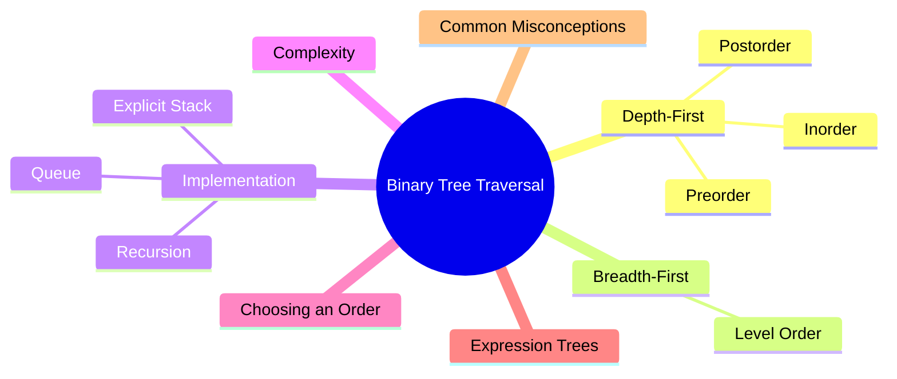

export const metadata = {
  title: 'Binary Tree Traversal',
  date: '2026-11-16',
  excerpt: 'The four standard ways to visit every node in a binary tree: preorder, inorder, postorder, and level order. Covers recursive and iterative versions, what each one costs in time and memory, and which order fits which job. Includes examples in TypeScript, Python, and Java.',
  tags: ['Data Structures'],
};

# Binary Tree Traversal

Traversing a tree means visiting every node exactly once. In an array the order is obvious: start at index 0 and keep going. A tree branches, so at every node you have to decide what comes next: the node itself, its left subtree, or its right subtree. Different choices give different orders, and each order is the natural fit for a different kind of problem.

The orders fall into two families. Depth-first traversal goes as deep as it can along one branch before backing up to try the next. Breadth-first traversal visits the tree level by level, from the top down. This article covers the four standard orders, how to implement each one, what they cost, and when to use which. It uses the `TreeNode` class from [Tree and Binary Tree Basics](./tree-and-binary-tree-basics).



- [Depth-First and Breadth-First](#depth-first-and-breadth-first)
- [Preorder, Inorder, and Postorder](#preorder-inorder-and-postorder)
- [Recursive Traversal](#recursive-traversal)
- [Iterative Traversal with a Stack](#iterative-traversal-with-a-stack)
- [Level-Order Traversal](#level-order-traversal)
- [Time and Space Complexity](#time-and-space-complexity)
- [Which Order to Use](#which-order-to-use)
- [Example: Expression Trees](#example-expression-trees)
- [Common Misconceptions](#common-misconceptions)
- [Conclusion](#conclusion)

---

## Depth-First and Breadth-First

Every example in this article uses this tree:

```text
        1
       / \
      2   3
     / \   \
    4   5   6
```

Starting at 1, depth-first traversal (DFS) goes to 2 and then to 4. Node 4 has no children, so it backs up to 2 and goes down to 5. Then it backs up to 1 and heads down the right side, to 3 and then 6.

Breadth-first traversal (BFS) visits the nodes level by level, left to right: first 1, then 2 and 3, then 4, 5, and 6.

The two need different helpers. Depth-first has to remember the nodes it will back up to, and it always goes back to the most recent one first. That's a stack, and recursion gives you one for free: the call stack. Breadth-first visits nodes in the order it discovers them, first in, first out, which makes it a job for a queue. Both structures are covered in [Stacks and Queues](./stack-and-queue).

---

## Preorder, Inorder, and Postorder

Depth-first traversal comes in three orders. They follow the same route through the tree and differ only in when they visit the node itself:

- Preorder: the node, then its left subtree, then its right subtree
- Inorder: the left subtree, then the node, then the right subtree
- Postorder: the left subtree, then the right subtree, then the node

The name tells you where the node goes relative to its subtrees: before them (pre), between them (in), or after them (post). In all three, the left subtree comes before the right.

| Order | Rule | Result for the Example Tree |
| :--- | :--- | :--- |
| Preorder | Node, left, right | 1 2 4 5 3 6 |
| Inorder | Left, node, right | 4 2 5 1 3 6 |
| Postorder | Left, right, node | 4 5 2 6 3 1 |
| Level order | Level by level, left to right | 1 2 3 4 5 6 |

To work one out by hand, apply the rule recursively. Take inorder. The left subtree of 1 is rooted at 2, and its inorder sequence is 4 2 5. Then comes 1 itself. Then the right subtree, rooted at 3: it has no left child, so its sequence is 3 6. Altogether: 4 2 5 1 3 6.

Another way to see it: the depth-first route passes each node three times, once on the way down, once between its two subtrees, and once on the way back up. Preorder visits a node the first time, inorder the second, and postorder the third.

Preorder, postorder, and level order work on any tree, however many children a node has. Inorder doesn't carry over as cleanly: "between the left and right subtrees" only means something in a binary tree.

---

## Recursive Traversal

The recursive versions are almost word-for-word translations of the rules. Here, visiting a node means appending its value to a list. In real code it could be anything: printing the value, adding it to a sum, copying the node.

```typescript
// TypeScript
function preorder(node: TreeNode | null, out: number[]): void {
  if (node === null) return;
  out.push(node.value); // node first
  preorder(node.left, out);
  preorder(node.right, out);
}

function inorder(node: TreeNode | null, out: number[]): void {
  if (node === null) return;
  inorder(node.left, out);
  out.push(node.value); // node between its subtrees
  inorder(node.right, out);
}

function postorder(node: TreeNode | null, out: number[]): void {
  if (node === null) return;
  postorder(node.left, out);
  postorder(node.right, out);
  out.push(node.value); // node last
}

const root = new TreeNode(
  1,
  new TreeNode(2, new TreeNode(4), new TreeNode(5)),
  new TreeNode(3, null, new TreeNode(6)),
);
const result: number[] = [];
inorder(root, result);
console.log(result); // [4, 2, 5, 1, 3, 6]
```

```python
# Python
from typing import Optional


def preorder(node: Optional[TreeNode], out: list[int]) -> None:
    if node is None:
        return
    out.append(node.value)  # node first
    preorder(node.left, out)
    preorder(node.right, out)


def inorder(node: Optional[TreeNode], out: list[int]) -> None:
    if node is None:
        return
    inorder(node.left, out)
    out.append(node.value)  # node between its subtrees
    inorder(node.right, out)


def postorder(node: Optional[TreeNode], out: list[int]) -> None:
    if node is None:
        return
    postorder(node.left, out)
    postorder(node.right, out)
    out.append(node.value)  # node last


root = TreeNode(
    1,
    TreeNode(2, TreeNode(4), TreeNode(5)),
    TreeNode(3, None, TreeNode(6)),
)
result: list[int] = []
inorder(root, result)
print(result)  # [4, 2, 5, 1, 3, 6]
```

```java
// Java
import java.util.ArrayList;
import java.util.List;

public class Traversal {
    static void preorder(TreeNode node, List<Integer> out) {
        if (node == null) return;
        out.add(node.value); // node first
        preorder(node.left, out);
        preorder(node.right, out);
    }

    static void inorder(TreeNode node, List<Integer> out) {
        if (node == null) return;
        inorder(node.left, out);
        out.add(node.value); // node between its subtrees
        inorder(node.right, out);
    }

    static void postorder(TreeNode node, List<Integer> out) {
        if (node == null) return;
        postorder(node.left, out);
        postorder(node.right, out);
        out.add(node.value); // node last
    }

    public static void main(String[] args) {
        TreeNode root = new TreeNode(1,
                new TreeNode(2, new TreeNode(4), new TreeNode(5)),
                new TreeNode(3, null, new TreeNode(6)));
        List<Integer> result = new ArrayList<>();
        inorder(root, result);
        System.out.println(result); // [4, 2, 5, 1, 3, 6]
    }
}
```

The three functions are the same except for where one line sits: the line that visits the node. Move that line and you get a different order.

Every node is visited once, so each traversal takes O(n) time. The memory cost is the call stack: one frame per level of recursion, so it grows with the height of the tree.

---

## Iterative Traversal with a Stack

Recursion has one practical limit: every nested call takes a frame on the call stack, and the call stack isn't big. In Node.js and on a default Java thread, a recursive traversal like the one above fails somewhere around ten thousand levels deep, with `RangeError: Maximum call stack size exceeded` or `StackOverflowError`. Python stops much sooner, at its default recursion limit of 1,000, with a `RecursionError`.

A balanced tree never gets close: a million nodes fit in 20 levels. A degenerate tree has one node per level, though, so ten thousand nodes means ten thousand levels. When a tree might be that deep, manage the stack yourself. An explicit stack lives on the heap, where the only limit is available memory.

Preorder is the easy one: pop a node, visit it, push its children. Push the right child first, so that the left child comes off the stack first.

Inorder takes more care, because a node can't be visited until its whole left subtree is done. The loop goes left as far as it can, pushing each node on the way down. When it can't go any further, the node on top of the stack is next in order: pop it, visit it, and repeat the whole process on its right subtree.

```typescript
// TypeScript
function preorderIterative(root: TreeNode | null): number[] {
  const out: number[] = [];
  const stack: TreeNode[] = root === null ? [] : [root];
  while (stack.length > 0) {
    const node = stack.pop()!;
    out.push(node.value);
    // push right before left, so that left is popped first
    if (node.right !== null) stack.push(node.right);
    if (node.left !== null) stack.push(node.left);
  }
  return out;
}

function inorderIterative(root: TreeNode | null): number[] {
  const out: number[] = [];
  const stack: TreeNode[] = [];
  let node = root;
  while (node !== null || stack.length > 0) {
    while (node !== null) { // go left as far as possible
      stack.push(node);
      node = node.left;
    }
    node = stack.pop()!; // its left subtree is done, so visit it
    out.push(node.value);
    node = node.right; // then handle its right subtree the same way
  }
  return out;
}
```

```python
# Python
from typing import Optional


def preorder_iterative(root: Optional[TreeNode]) -> list[int]:
    out: list[int] = []
    stack: list[TreeNode] = [root] if root is not None else []
    while stack:
        node = stack.pop()
        out.append(node.value)
        # push right before left, so that left is popped first
        if node.right is not None:
            stack.append(node.right)
        if node.left is not None:
            stack.append(node.left)
    return out


def inorder_iterative(root: Optional[TreeNode]) -> list[int]:
    out: list[int] = []
    stack: list[TreeNode] = []
    node = root
    while node is not None or stack:
        while node is not None:  # go left as far as possible
            stack.append(node)
            node = node.left
        node = stack.pop()  # its left subtree is done, so visit it
        out.append(node.value)
        node = node.right  # then handle its right subtree the same way
    return out
```

```java
// Java
import java.util.ArrayDeque;
import java.util.ArrayList;
import java.util.Deque;
import java.util.List;

public class IterativeTraversal {
    static List<Integer> preorderIterative(TreeNode root) {
        List<Integer> out = new ArrayList<>();
        Deque<TreeNode> stack = new ArrayDeque<>();
        if (root != null) stack.push(root);
        while (!stack.isEmpty()) {
            TreeNode node = stack.pop();
            out.add(node.value);
            // push right before left, so that left is popped first
            if (node.right != null) stack.push(node.right);
            if (node.left != null) stack.push(node.left);
        }
        return out;
    }

    static List<Integer> inorderIterative(TreeNode root) {
        List<Integer> out = new ArrayList<>();
        Deque<TreeNode> stack = new ArrayDeque<>();
        TreeNode node = root;
        while (node != null || !stack.isEmpty()) {
            while (node != null) { // go left as far as possible
                stack.push(node);
                node = node.left;
            }
            node = stack.pop(); // its left subtree is done, so visit it
            out.add(node.value);
            node = node.right; // then handle its right subtree the same way
        }
        return out;
    }
}
```

On the example tree, the iterative functions return the same sequences as the recursive ones: 1 2 4 5 3 6 for preorder and 4 2 5 1 3 6 for inorder. In both, the stack never holds more than h + 1 nodes, so the memory is O(h), the same as recursion. What changes is where that memory comes from: the heap has far more room than the call stack.

Postorder is the awkward one to do iteratively. A common shortcut is to run the preorder loop with the two children pushed in the opposite order, which produces node, right, left, and then reverse the result to get left, right, node. That gives the correct sequence, but only as a finished list: it can't hand you the nodes one at a time, in postorder, while the traversal is running. A true one-pass version has to remember whether it's coming back up from a node's left subtree or its right, which makes it longer and easier to get wrong.

---

## Level-Order Traversal

Level order uses a queue. Put the root in. Then, until the queue is empty, take the node at the front, visit it, and add its children at the back. A queue is first in, first out, so every node on one level comes out before any node on the next.

Often you want the levels themselves, not one flat list: to print a tree row by row, say, or to find the rightmost node on each level. The trick is to check the queue's size at the start of each round. At that moment the queue holds one complete level and nothing else, so removing that many nodes from the front handles one level and nothing more.

```typescript
// TypeScript
function levelOrder(root: TreeNode | null): number[][] {
  const levels: number[][] = [];
  let level: TreeNode[] = root === null ? [] : [root];
  while (level.length > 0) {
    levels.push(level.map((node) => node.value));
    const next: TreeNode[] = [];
    for (const node of level) {
      if (node.left !== null) next.push(node.left);
      if (node.right !== null) next.push(node.right);
    }
    level = next;
  }
  return levels;
}
```

```python
# Python
from collections import deque
from typing import Optional


def level_order(root: Optional[TreeNode]) -> list[list[int]]:
    levels: list[list[int]] = []
    queue: deque[TreeNode] = deque()
    if root is not None:
        queue.append(root)
    while queue:
        level: list[int] = []
        # at this point the queue holds one whole level
        for _ in range(len(queue)):
            node = queue.popleft()
            level.append(node.value)
            if node.left is not None:
                queue.append(node.left)
            if node.right is not None:
                queue.append(node.right)
        levels.append(level)
    return levels
```

```java
// Java
import java.util.ArrayDeque;
import java.util.ArrayList;
import java.util.List;
import java.util.Queue;

public class LevelOrder {
    static List<List<Integer>> levelOrder(TreeNode root) {
        List<List<Integer>> levels = new ArrayList<>();
        Queue<TreeNode> queue = new ArrayDeque<>();
        if (root != null) queue.offer(root);
        while (!queue.isEmpty()) {
            // at this point the queue holds one whole level
            int count = queue.size();
            List<Integer> level = new ArrayList<>();
            for (int i = 0; i < count; i++) {
                TreeNode node = queue.poll();
                level.add(node.value);
                if (node.left != null) queue.offer(node.left);
                if (node.right != null) queue.offer(node.right);
            }
            levels.add(level);
        }
        return levels;
    }
}
```

For the example tree, all three return `[[1], [2, 3], [4, 5, 6]]`.

JavaScript has no built-in queue, and `shift()` is O(n) because it moves every remaining element forward (see [Deques](./deque)). So the TypeScript version skips the queue: it keeps the current level in one array and collects the next level in another. Reading `level` front to back while appending to `next` is still first in, first out, just handled one level at a time.

---

## Time and Space Complexity

Every traversal visits each node once and does a constant amount of work per node, so all four take O(n) time. Where they differ is the extra memory they need, not counting the output:

| Traversal | Time | Extra Space | Balanced Tree | Degenerate Tree |
| :--- | :--- | :--- | :--- | :--- |
| Preorder, inorder, postorder | O(n) | O(h) | O(log n) | O(n) |
| Level order | O(n) | O(w) | O(n) | O(1) |

Here h is the height and w is the width: the largest number of nodes on any one level. The two tend to trade off against each other. In a balanced tree, depth-first needs only O(log n), but the bottom level of a perfect tree holds about half of all the nodes, so breadth-first needs O(n). In a degenerate tree it's the reverse: every level has one node, so the queue stays tiny while the depth-first stack grows to n.

There's also a technique called Morris traversal that does inorder in O(1) extra space, by temporarily pointing empty right references back up the tree. It's clever, but you'll rarely need it.

---

## Which Order to Use

Each order fits a different kind of job:

| Order | Use It When | Examples |
| :--- | :--- | :--- |
| Preorder | A node has to be handled before its children | Copying a tree, serializing it, printing a directory listing with indentation |
| Inorder | You want a binary search tree's values in sorted order | Listing a BST's values from smallest to largest, checking that a tree is a valid BST |
| Postorder | A node needs its children's results first | Computing sizes and heights, freeing a tree's memory, evaluating an expression |
| Level order | Distance from the root matters | Printing a tree level by level, finding the leaf closest to the root |

A few of these are worth a closer look.

Serialization works because preorder writes each parent before its children. Record every node in preorder, with a marker such as `#` for each empty child, and the result can be read back into the same tree. The example tree becomes `1 2 4 # # 5 # # 3 # 6 # #`.

The `height` function from [Tree and Binary Tree Basics](./tree-and-binary-tree-basics) is a postorder traversal: it can't compute a node's height until it knows the heights of both subtrees. Directory sizes work the same way, since a folder's size is the total of everything inside it. So does freeing a tree in a language without garbage collection: free a parent first and you lose the references to its children.

Level order is the right tool when distance from the root matters. To find the leaf closest to the root, a depth-first search may dig through long branches before reaching it. Breadth-first can stop at the first leaf it sees, because every node it hasn't visited yet is at least as far from the root.

---

## Example: Expression Trees

Arithmetic expressions show all three depth-first orders at work. Here is `(3 + 4) * 2` as a tree:

```text
      *
     / \
    +   2
   / \
  3   4
```

Operators are internal nodes and numbers are leaves. The parentheses aren't stored anywhere: the shape of the tree says `+` happens first, because it sits lower.

| Order | Output | Notation |
| :--- | :--- | :--- |
| Preorder | `* + 3 4 2` | Prefix, also called Polish notation |
| Inorder | `3 + 4 * 2` | Infix, minus the parentheses |
| Postorder | `3 4 + 2 *` | Postfix, also called Reverse Polish notation |

Inorder gives back the familiar infix form, but without the parentheses, and `3 + 4 * 2` means something else. Under the usual precedence rules it's 3 + 8 = 11, not 14. To print an expression tree correctly, wrap each operator and its two operands in parentheses: `((3 + 4) * 2)`.

Prefix and postfix need no parentheses at all, because the order of the tokens carries the structure. Postfix is especially easy to evaluate with a stack. Read the tokens left to right, push each number, and when you meet an operator, pop two numbers, apply it, and push the result. For `3 4 + 2 *`: push 3, push 4, `+` pops them and pushes 7, push 2, `*` pops 7 and 2 and pushes 14.

Evaluating the tree directly is a postorder traversal as well: evaluate the left subtree, evaluate the right subtree, then apply the operator.

---

## Common Misconceptions

| Common Misconception | What's Actually True |
| :--- | :--- |
| Inorder traversal returns the values in sorted order. | Only for a binary search tree. For the example tree in this article, inorder gives 4 2 5 1 3 6. |
| Recursive traversal doesn't use extra memory. | Every call takes a stack frame, so it uses O(h) memory, up to O(n) for a degenerate tree, and a deep enough tree overflows the call stack. |
| Iterative traversal is faster than recursive traversal. | Both are O(n). The main reason to go iterative is the call stack limit, not speed. |
| Breadth-first always uses less memory than depth-first. | It depends on the shape: O(w) against O(h). Wide trees favor depth-first, and tall, narrow trees favor breadth-first. |
| One traversal sequence is enough to rebuild a tree. | Different trees can share a sequence. A root 1 with one child 2 gives the preorder 1 2 whether 2 is on the left or the right. Preorder or postorder combined with inorder is enough when the values are distinct, and so is a preorder that marks empty children. |

---

## Conclusion

Traversal comes down to one question: when do you handle a node relative to its children? Preorder handles it before them, inorder between them, and postorder after them. Level order goes one level at a time instead. The first three are depth-first and run on a stack, either the call stack or one you manage yourself. Level order is breadth-first and runs on a queue. All four take O(n) time, and the memory depends on the shape of the tree: O(h) for depth-first, O(w) for breadth-first.

Recursion is the clearest way to write the depth-first orders, and it's fine for balanced trees. When a tree might be very deep, switch to an explicit stack.
