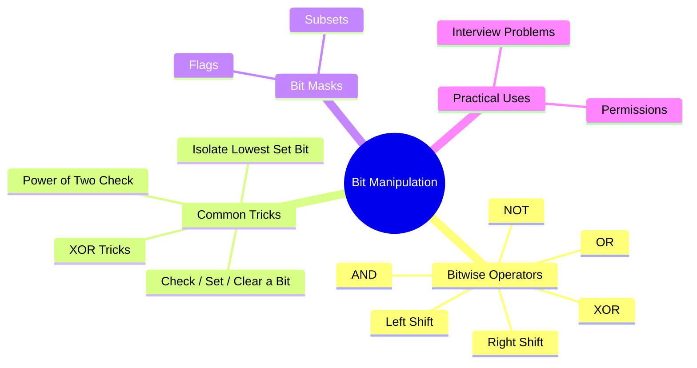

export const metadata = {
  title: 'Bit Manipulation',
  date: '2026-10-25',
  excerpt: 'A practical guide to bit manipulation: how integers are stored in binary, what each bitwise operator actually does, the tricks that show up constantly in interviews and systems code, and when reaching for bit operations is genuinely the right call.',
  tags: ['Programming', 'Algorithm'],
};

# Bit Manipulation

Every integer in your program is just a sequence of bits. Most of the time you don't need to think about that. But occasionally, working directly at the bit level is the cleanest, fastest, or only way to solve a problem. Bit manipulation is the set of techniques for doing exactly that.

The operations themselves are simple. What takes practice is recognizing when a problem has a bitwise structure and knowing which trick to reach for.



- [How Integers Are Stored](#how-integers-are-stored)
- [The Six Operators](#the-six-operators)
- [Essential Tricks](#essential-tricks)
- [XOR Properties](#xor-properties)
- [Bit Masks and Subsets](#bit-masks-and-subsets)
- [Practical Applications](#practical-applications)
- [JavaScript Specifics](#javascript-specifics)
- [Conclusion](#conclusion)

---

## How Integers Are Stored

An integer is stored as a fixed-width sequence of bits. A 32-bit integer has 32 slots, each holding a 0 or a 1. The rightmost bit is bit 0 (the least significant bit, or LSB), and the leftmost is bit 31 (the most significant bit, or MSB).

```text
Decimal 13 in 8-bit binary:

Bit position:  7  6  5  4  3  2  1  0
Bit value:     0  0  0  0  1  1  0  1
               ↑                    ↑
              MSB                  LSB

Value = 1×2³ + 1×2² + 0×2¹ + 1×2⁰ = 8 + 4 + 0 + 1 = 13
```

**Negative numbers** use two's complement. To negate a number: flip all the bits, then add 1. So −1 in 32 bits is all 1s (`0xFFFFFFFF`), and −13 is the bit-flip of 13 plus 1. The MSB acts as a sign bit: 0 means positive, 1 means negative.

```text
13  = 00000000 00000000 00000000 00001101
~13 = 11111111 11111111 11111111 11110010  (flip all bits)
-13 = 11111111 11111111 11111111 11110011  (add 1)
```

Two's complement is why `~n` equals `-(n + 1)` in every language that uses it (which is essentially all of them).

---

## The Six Operators

### AND (`&`)

Output bit is 1 only if **both** input bits are 1.

```text
  1010
& 1100
------
  1000
```

Use it to **check or clear** specific bits. Masking with a pattern of 1s keeps only those bit positions.

### OR (`|`)

Output bit is 1 if **either** input bit is 1.

```text
  1010
| 1100
------
  1110
```

Use it to **set** specific bits.

### XOR (`^`)

Output bit is 1 if the input bits are **different**.

```text
  1010
^ 1100
------
  0110
```

XOR is the most interesting operator. It flips bits where the mask is 1, and it has algebraic properties (covered in the next section) that make it useful for a surprising range of problems.

### NOT (`~`)

Flips every bit.

```text
~1010 = 0101
```

As noted above, `~n = -(n + 1)`.

### Left Shift (`<<`)

Shifts all bits to the left by `k` positions, filling the right with zeros. Equivalent to multiplying by 2^k (as long as no significant bits are shifted out).

```text
00001101 << 2 = 00110100   (13 << 2 = 52 = 13 × 4)
```

### Right Shift (`>>` and `>>>`)

Shifts all bits to the right by `k` positions. There are two variants:

- **Arithmetic right shift (`>>`)** — fills the left with the sign bit. Preserves the sign of negative numbers. Equivalent to integer division by 2^k
- **Logical right shift (`>>>`)** — fills the left with zeros, regardless of sign. In JavaScript, `>>>` always produces an unsigned 32-bit result

```text
11110000 >> 2  = 11111100   (arithmetic: sign bit fills in)
11110000 >>> 2 = 00111100   (logical: zeros fill in)
```

---

## Essential Tricks

These are the patterns that come up over and over. Each one is worth memorizing.

### Check if bit `k` is set

```javascript
const isSet = (n, k) => (n >> k & 1) === 1;

isSet(13, 2); // 13 = ...1101, bit 2 is 1 → true
isSet(13, 1); // 13 = ...1101, bit 1 is 0 → false
```

Shift `n` right by `k` to bring bit `k` down to position 0, then AND with 1 to isolate it.

### Set bit `k`

```javascript
const setBit = (n, k) => n | (1 << k);

setBit(13, 1); // 1101 | 0010 = 1111 = 15
```

### Clear bit `k`

```javascript
const clearBit = (n, k) => n & ~(1 << k);

clearBit(13, 2); // 1101 & ~0100 = 1101 & 1011 = 1001 = 9
```

### Toggle bit `k`

```javascript
const toggleBit = (n, k) => n ^ (1 << k);

toggleBit(13, 1); // 1101 ^ 0010 = 1111 = 15
toggleBit(15, 1); // 1111 ^ 0010 = 1101 = 13
```

### Check if `n` is a power of two

A power of two has exactly one bit set: 1, 2, 4, 8, 16, ... in binary are 1, 10, 100, 1000, 10000.

The trick: `n & (n - 1)` clears the lowest set bit. If `n` is a power of two, that's the only bit, so the result is 0.

```javascript
const isPowerOfTwo = (n) => n > 0 && (n & (n - 1)) === 0;

isPowerOfTwo(16); // 10000 & 01111 = 0 → true
isPowerOfTwo(12); // 01100 & 01011 = 01000 ≠ 0 → false
```

### Isolate the lowest set bit

```javascript
const lowestSetBit = (n) => n & (-n);

lowestSetBit(12); // 01100 & 10100 = 00100 = 4
```

`-n` in two's complement is `~n + 1`. The lowest set bit and all bits below it flip, but the lowest set bit itself stays 1 after the +1 carry. ANDing with `n` keeps only that bit.

### Count set bits (popcount)

Brian Kernighan's algorithm: repeatedly clear the lowest set bit until `n` is 0. The number of iterations equals the number of set bits.

```javascript
function countBits(n) {
  let count = 0;
  while (n !== 0) {
    n &= n - 1; // clear the lowest set bit
    count++;
  }
  return count;
}

countBits(13); // 1101 → 1100 → 1000 → 0000, 3 iterations → 3
```

This runs in O(k) where k is the number of set bits, which is faster than checking all 32 bits when the number is sparse.

---

## XOR Properties

XOR has three algebraic properties that make it uniquely useful:

1. `a ^ a = 0` — a number XORed with itself is 0.
2. `a ^ 0 = a` — a number XORed with 0 is unchanged.
3. XOR is commutative and associative: order doesn't matter.

These three facts together mean that if you XOR a collection of numbers, any number that appears an **even** number of times cancels out, and only numbers appearing an **odd** number of times survive.

**Classic problem: find the single number.** Given an array where every element appears twice except one, find the odd one out.

```javascript
function singleNumber(nums) {
  return nums.reduce((acc, n) => acc ^ n, 0);
}

singleNumber([4, 1, 2, 1, 2]); // 4 ^ 1 ^ 2 ^ 1 ^ 2 = 4 ^ (1^1) ^ (2^2) = 4 ^ 0 ^ 0 = 4
```

O(n) time, O(1) space. No hash map needed.

**Swap without a temporary variable:**

```javascript
let a = 5, b = 9;
a ^= b; // a = 5 ^ 9 = 12
b ^= a; // b = 9 ^ 12 = 5
a ^= b; // a = 12 ^ 5 = 9
// a = 9, b = 5
```

This works because of the cancellation property, but it's mostly a curiosity. A temporary variable is clearer and just as fast on modern hardware.

---

## Bit Masks and Subsets

A **bitmask** is an integer used as a compact set of boolean flags. If you have `n` items, you can represent any subset of them with an `n`-bit integer: bit `k` is 1 if item `k` is in the subset, 0 if not.

```javascript
// Represent a set of permissions: READ=bit 0, WRITE=bit 1, EXECUTE=bit 2
const READ    = 1 << 0; // 001
const WRITE   = 1 << 1; // 010
const EXECUTE = 1 << 2; // 100

let perms = READ | WRITE; // 011 = 3

// Check permission
const canRead    = (perms & READ) !== 0;    // true
const canExecute = (perms & EXECUTE) !== 0; // false

// Grant permission
perms |= EXECUTE; // 111 = 7

// Revoke permission
perms &= ~WRITE; // 101 = 5
```

### Enumerating all subsets

To iterate over all 2^n subsets of an n-element set:

```javascript
function allSubsets(items) {
  const n = items.length;
  const subsets = [];

  for (let mask = 0; mask < (1 << n); mask++) {
    const subset = [];
    for (let k = 0; k < n; k++) {
      if (mask & (1 << k)) subset.push(items[k]);
    }
    subsets.push(subset);
  }

  return subsets;
}

allSubsets(['a', 'b', 'c']);
// [], ['a'], ['b'], ['a','b'], ['c'], ['a','c'], ['b','c'], ['a','b','c']
```

This is O(2^n · n), which is unavoidable since there are 2^n subsets. The bitmask approach is clean and cache-friendly compared to recursive backtracking for the same task.

---

## Practical Applications

### Unix file permissions

The classic example. Each file has three groups (owner, group, others), each with three bits (read, write, execute). The permission `755` in octal is `111 101 101` in binary: owner has all three, group and others have read and execute.

### Bloom filters

A Bloom filter uses multiple hash functions to set bits in a large bit array. Checking membership means checking whether all the corresponding bits are set. False positives are possible; false negatives are not. The entire structure is just bitwise OR (to add) and AND (to check).

### Finding the missing number

Given an array of n−1 distinct integers from 1 to n, find the missing one.

```javascript
function missingNumber(nums) {
  let result = nums.length; // start with n
  for (let i = 0; i < nums.length; i++) {
    result ^= i ^ nums[i]; // XOR with both the index and the value
  }
  return result;
}

missingNumber([3, 0, 1]); // n=3, XOR: 3^0^3^1^0^2^1 = 2
```

Every number from 0 to n appears once in the index sequence and once in the array, except the missing one, which only appears in the index sequence. XOR cancels the pairs, leaving the missing number.

---

## JavaScript Specifics

JavaScript's bitwise operators work on **32-bit signed integers**. Before applying any bitwise operation, JavaScript converts the number to a 32-bit integer (truncating toward zero), performs the operation, and converts back to a 64-bit float.

This has a few consequences worth knowing:

```javascript
// Numbers larger than 2^31 - 1 get truncated
(2 ** 31) | 0;  // -2147483648 (the bit pattern wraps around)

// >>> converts to unsigned 32-bit, useful for treating the result as unsigned
-1 >>> 0;       // 4294967295 (0xFFFFFFFF)

// Bitwise OR with 0 is a fast way to truncate to a 32-bit integer
3.7 | 0;        // 3 (truncates toward zero, like Math.trunc)
-3.7 | 0;       // -3
```

For bit manipulation on numbers larger than 32 bits, use `BigInt`:

```javascript
const big = 1n << 40n; // BigInt supports arbitrary-width bit operations
```

---

## Conclusion

Bit manipulation is a specialized tool with a surprisingly long reach. The operators themselves are simple; the skill is in recognizing when a problem has bitwise structure.

The patterns worth internalizing:
- `n & (n-1)` clears the lowest set bit (and checks powers of two)
- `n & (-n)` isolates the lowest set bit
- XOR cancels pairs, which solves a whole class of "find the odd one out" problems
- Bitmasks turn a set of boolean flags into a single integer, enabling compact representation and fast subset enumeration

Reach for bit manipulation when you need compact state representation, when you're working close to hardware, or when a problem's structure fits naturally into binary. For everything else, clarity beats cleverness.
