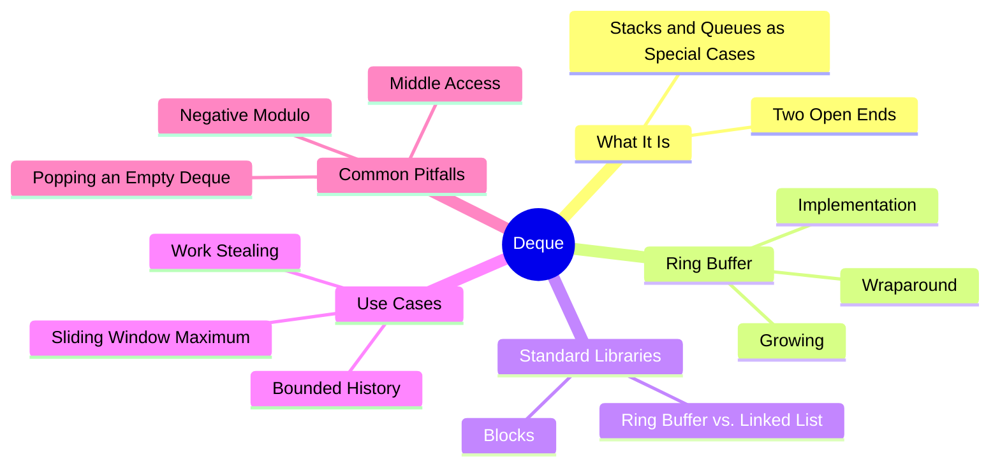
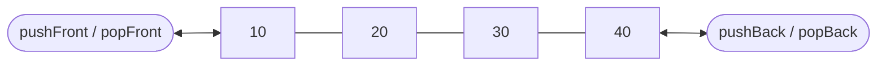
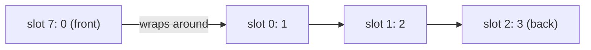

export const metadata = {
  title: 'Deques: Sequences Open at Both Ends',
  date: '2026-11-08',
  excerpt: 'An in-depth guide to deques: what a double-ended queue is, how a ring buffer makes both ends O(1), how Java, Python, and C++ build theirs, where deques earn their keep, and the pitfalls that catch people when they write one.',
  tags: ['Data Structures'],
};

# Deques: Sequences Open at Both Ends

A stack lets you work at one end. A queue lets you add at one end and remove from the other. A deque (short for double-ended queue, and pronounced "deck") drops both restrictions: you can add and remove at either end, and a well-built deque does all of it in O(1).

That makes it the most general of the three. Use only one end and it behaves like a stack; add at one end and remove at the other and it's a queue. Java's own documentation points you to `ArrayDeque` instead of the old `Stack` class when you need a stack. And because both ends are open, deques also turn up where neither a stack nor a queue fits: capped undo histories, sliding-window algorithms, and work-stealing thread pools.

The interface is the easy part. The real question is how to make the front as cheap as the back. An array is fast at its end and slow at its start, so a deque needs a different trick: a ring buffer, where the front is allowed to move.



- [What Is a Deque](#what-is-a-deque)
- [Building One on a Ring Buffer](#building-one-on-a-ring-buffer)
- [How Standard Libraries Build Them](#how-standard-libraries-build-them)
- [What Deques Are Good For](#what-deques-are-good-for)
- [Common Pitfalls](#common-pitfalls)
- [Conclusion](#conclusion)

---

## What Is a Deque

A deque is a sequence with both ends open. It has six core operations:

| Operation | What it does |
| - | - |
| `pushFront(x)` | Add `x` at the front |
| `pushBack(x)` | Add `x` at the back |
| `popFront()` | Remove and return the front element |
| `popBack()` | Remove and return the back element |
| `peekFront()` | Read the front element without removing it |
| `peekBack()` | Read the back element without removing it |



Every operation touches the front or the back, never the middle. That restriction is what lets a deque make all of them fast.

Stacks and queues are deques with a rule about which end you use:

- A stack only touches the back: `pushBack` and `popBack`
- A queue fills at the back and empties from the front: `pushBack` and `popFront`

If you've read [Understanding Stacks and Queues](/articles/stack-and-queue), you already know both halves. A deque is what you get when you stop choosing between them.

---

## Building One on a Ring Buffer

### Why a Plain Array Isn't Enough

A JavaScript array already has methods for both ends: `push` and `pop` at the back, `unshift` and `shift` at the front. The back is fine. The front isn't: `unshift` and `shift` move all the other elements one slot over, so each call is O(n). [Arrays: Sequences Laid Out in Contiguous Memory](/articles/array) explains why. On a large array, the cost is hard to miss: in Node.js 22, emptying a million-element array with `shift` took minutes.

The fix is to stop moving the elements and move the front instead.

### Moving the Front Instead of the Elements

Keep the elements in a fixed-size array and record where the front is with an index, `head`. Removing from the front moves `head` forward one slot. Adding at the front moves it back one slot and writes the new value there. Nothing else moves.

Sooner or later, `head` runs off one end of the array. A ring buffer handles that by treating the array as a circle: step past the last slot and you land on slot 0; step back from slot 0 and you land on the last slot. The wraparound is a remainder:

```text
next slot     = (i + 1) % capacity
previous slot = (i - 1 + capacity) % capacity
```

Here's an 8-slot ring after `pushBack(1)`, `pushBack(2)`, `pushBack(3)`, and then `pushFront(0)`:

| Slot | 0 | 1 | 2 | 3 | 4 | 5 | 6 | 7 |
| - | - | - | - | - | - | - | - | - |
| Value | 1 | 2 | 3 | | | | | 0 |

There's no slot before slot 0, so `pushFront(0)` wrapped `head` around to slot 7. To read the deque in order, start at `head` and follow the ring:



In general, the i-th element from the front lives in slot `(head + i) % capacity`. That's one addition and one remainder, so a ring buffer can still reach any position in O(1), just like a plain array.

### The Implementation

Here's the whole thing in JavaScript. The ring starts with 8 slots and doubles whenever it fills up.

```javascript
class Deque {
  constructor() {
    this.items = new Array(8); // the ring; its length is the capacity
    this.head = 0;             // slot of the front element
    this.size = 0;             // number of elements stored
  }

  // The slot that holds the i-th element from the front
  slot(i) {
    return (this.head + i) % this.items.length;
  }

  // Amortized O(1): write into the slot just past the back
  pushBack(value) {
    if (this.size === this.items.length) {
      this.grow();
    }
    this.items[this.slot(this.size)] = value;
    this.size++;
  }

  // Amortized O(1): step head back one slot, wrapping from 0 to the end
  pushFront(value) {
    if (this.size === this.items.length) {
      this.grow();
    }
    this.head = (this.head - 1 + this.items.length) % this.items.length;
    this.items[this.head] = value;
    this.size++;
  }

  // O(1): take the front element and move head forward
  popFront() {
    if (this.size === 0) return undefined;
    const value = this.items[this.head];
    this.items[this.head] = undefined; // drop the reference
    this.head = this.slot(1);
    this.size--;
    return value;
  }

  // O(1): take the back element; head stays where it is
  popBack() {
    if (this.size === 0) return undefined;
    const last = this.slot(this.size - 1);
    const value = this.items[last];
    this.items[last] = undefined;
    this.size--;
    return value;
  }

  // O(1)
  peekFront() {
    return this.size === 0 ? undefined : this.items[this.head];
  }

  // O(1)
  peekBack() {
    return this.size === 0 ? undefined : this.items[this.slot(this.size - 1)];
  }

  // O(n): copy into a ring twice as large, front element first
  grow() {
    const bigger = new Array(this.items.length * 2);
    for (let i = 0; i < this.size; i++) {
      bigger[i] = this.items[this.slot(i)];
    }
    this.items = bigger;
    this.head = 0;
  }
}
```

Three details hold the design together:

- `size` is tracked on its own. With only a head index and a tail index, an empty ring and a full one look the same, because `head === tail` in both. Counting the elements removes the ambiguity. (The other common fix is to always leave one slot empty.)
- `pushFront` adds the capacity before taking the remainder. In JavaScript, `-1 % 8` is `-1`, not `7`; [Common Pitfalls](#common-pitfalls) shows what goes wrong without it
- The pops clear the slot they read. Otherwise the ring would keep a reference to a value the deque no longer holds, and the garbage collector couldn't reclaim it

### Growing

When the ring is full, `grow` allocates one twice as large, copies the elements into it in order starting from the front, and resets `head` to 0. Copying the old array as it stands wouldn't work. With the front in slot 7 and the rest continuing from slot 0, as in the example above, a straight copy into 16 slots would leave eight empty slots between the front and everything after it.

Growing is O(n), but because the capacity doubles each time, it happens rarely enough that both pushes stay amortized O(1), for the same reason a dynamic array's `push` does. The pops never resize, so they're O(1) every time.

---

## How Standard Libraries Build Them

JavaScript doesn't come with a deque, but most languages do, and they don't all build it the same way:

| Type | Add / remove at the front | Add / remove at the back | Built on |
| - | - | - | - |
| Java `ArrayDeque` | `addFirst` / `pollFirst` | `addLast` / `pollLast` | A resizable ring buffer |
| Java `LinkedList` | `addFirst` / `pollFirst` | `addLast` / `pollLast` | A doubly linked list |
| Python `collections.deque` | `appendleft` / `popleft` | `append` / `pop` | A doubly linked list of fixed-size blocks |
| C++ `std::deque` | `push_front` / `pop_front` | `push_back` / `pop_back` | Separately allocated fixed-size blocks |

### Ring Buffer vs. Doubly Linked List

The first two rows are the two classic designs, and they sit at opposite ends of a trade-off:

| | Ring buffer | Doubly linked list |
| - | - | - |
| Add at either end | Amortized O(1) | O(1) |
| Remove at either end | O(1) | O(1) |
| Access by position | O(1) | O(n) |
| Extra memory | Spare capacity | Two pointers per element |
| Layout | Contiguous | Separate nodes on the heap |

A doubly linked list never copies anything, and its O(1) holds for every operation, not just on average. But each element costs its own allocation plus two pointers, and walking the list jumps around memory. A ring buffer is compact and cache-friendly, and pays for it with an occasional O(n) copy when it grows. For most workloads that's the better deal; Java's documentation says `ArrayDeque` is likely to be faster than `LinkedList` when used as a queue. The doubly linked list itself is covered in [Linked Lists: Sequences Built from Nodes and Pointers](/articles/linked-list).

### Blocks: The Middle Ground

Python and C++ split the difference with fixed-size blocks. CPython's `deque` links together blocks of 64 slots, so growing means adding a block: elements never move, and each block is contiguous. C++'s `std::deque` typically keeps its blocks in an array of pointers, which lets it reach any element in O(1) at the cost of one extra pointer lookup. When that array of pointers fills up, only the pointers get copied, never the elements. That's how `std::deque` can promise that adding at either end never invalidates references to the elements already in it. A ring buffer can't make that promise, since growing moves everything.

---

## What Deques Are Good For

A deque earns its place when both ends do real work.

### Sliding Window Maximum

Given an array and a window size `k`, find the largest value in every run of `k` consecutive elements. Rescanning each window costs O(n × k). A deque brings it down to O(n).

Keep a deque of indexes whose values decrease from front to back, so the front always holds the current window's maximum. Before adding a new index, pop every index from the back whose value is no larger than the new one. Those elements are older and no bigger, so as long as the new element is in the window, they can never be the maximum again. And when the front index slides out of the window, pop it from the front.

```javascript
// O(n): the maximum of every window of k consecutive elements
function windowMaxima(nums, k) {
  if (k < 1) return [];

  const deque = new Deque(); // indexes whose values decrease from front to back
  const maxima = [];

  for (let i = 0; i < nums.length; i++) {
    // The front index has slid out of the window
    if (deque.size > 0 && deque.peekFront() <= i - k) {
      deque.popFront();
    }

    // Older values no bigger than nums[i] can never be the maximum again
    while (deque.size > 0 && nums[deque.peekBack()] <= nums[i]) {
      deque.popBack();
    }

    deque.pushBack(i);

    // From the first full window on, the front holds the maximum
    if (i >= k - 1) {
      maxima.push(nums[deque.peekFront()]);
    }
  }

  return maxima;
}

windowMaxima([1, 3, -1, -3, 5, 3, 6, 7], 3); // [3, 3, 5, 5, 6, 7]
```

Each index is pushed once and popped at most once, so the whole pass is O(n) however large `k` is. Both ends are busy: the back throws out values that can no longer win, and the front retires indexes as they leave the window.

### Bounded History

An undo history usually has a cap: keep the last 100 actions and forget anything older. New actions go on the back, and undo takes from the back, so far that's a stack. But once the history is full, the oldest action has to come off the front, and that's queue behavior. A deque does both in O(1):

```javascript
const MAX_HISTORY = 100;
const history = new Deque();

function record(action) {
  history.pushBack(action);
  if (history.size > MAX_HISTORY) {
    history.popFront(); // forget the oldest action
  }
}

function undo() {
  return history.popBack(); // the most recent action, or undefined
}
```

Python has this built in: a `deque(maxlen=100)` discards from the opposite end on its own once it's full.

### Work Stealing

Deques are also at the heart of work stealing, a classic way to keep every thread in a pool busy. In Java's `ForkJoinPool`, each worker thread has its own deque of tasks. A worker pushes the subtasks it creates onto one end and pops its next task from that same end, so it works on the newest task first, whose data is likely still in cache. A worker that runs out of tasks steals from the other end of another worker's deque. That end holds the oldest task, which in divide-and-conquer work tends to be one of the largest pieces left, and because the owner and the thief work at opposite ends, they rarely collide.

---

## Common Pitfalls

### Popping an Empty Deque

What happens when you pop from an empty deque depends on the library:

| Library | Popping the front of an empty deque |
| - | - |
| Java `ArrayDeque` | `pollFirst` returns `null`; `removeFirst` throws `NoSuchElementException` |
| Python `collections.deque` | `popleft` raises `IndexError` |
| C++ `std::deque` | `pop_front` is undefined behavior |
| The ring buffer above | `popFront` returns `undefined` |

Java offers both styles on purpose, and it's also why `ArrayDeque` refuses `null` elements outright: if `null` were allowed, a `null` from `pollFirst` could mean either "the deque is empty" or "the front element is `null`." The ring buffer above has the same ambiguity with `undefined`. If a deque might hold `undefined`, check `size` before popping rather than trusting the return value.

### Negative Numbers and `%`

Moving `head` backward is where hand-written ring buffers most often break. In JavaScript, as in Java, C, and C++, the result of `%` takes the sign of the left operand:

```javascript
const capacity = 8;

(0 - 1) % capacity;            // -1, not 7
(0 - 1 + capacity) % capacity; // 7
```

Use the first version in `pushFront` and the first call on a fresh deque computes slot `-1`. In JavaScript, `items[-1] = value` doesn't throw; it quietly adds a property named `"-1"`, and the deque is broken from then on. Adding the capacity first keeps the left operand non-negative, so the result is always a valid slot. Python's `%` takes the sign of the right operand instead, so `(0 - 1) % 8` is `7` there. Code ported from Python can carry this bug over without anyone noticing.

### Expecting Fast Access in the Middle

A deque is fast at its ends, not everywhere. Inserting or removing in the middle is O(n) in every design above: elements have to shift over, or the structure has to be walked to the spot first. Reading by position varies: O(1) for a ring buffer and `std::deque`, O(n) for a linked list, and Python's `deque` is O(1) at the ends but slows to O(n) in the middle. If you need fast access by position and only ever add at the back, a plain array is still the better tool.

---

## Conclusion

A deque is a sequence open at both ends, and a good one makes adding and removing at either end O(1). Stacks and queues are the same structure with rules about which end you use.

- A plain JavaScript array is fast only at the back: `unshift` and `shift` are O(n)
- A ring buffer moves the front instead of the elements, wraps its indexes with `%`, and doubles when full, so pushes are amortized O(1) and pops are O(1)
- A doubly linked list gives worst-case O(1) at both ends but pays in memory and locality; block-based designs like Python's `deque` and C++'s `std::deque` sit in between
- A deque is worth reaching for when both ends matter: sliding windows, bounded histories, and work-stealing schedulers

When you only need one end, a stack or a queue states your intent more clearly. When you need both, use a deque. In JavaScript, that usually means writing a small ring buffer like the one above.
