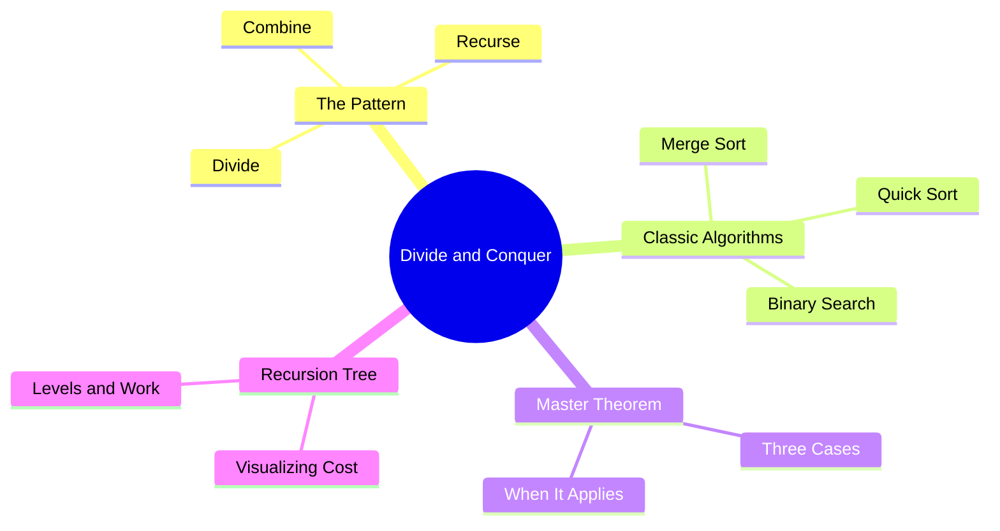

export const metadata = {
  title: 'Divide and Conquer (with Master Theorem)',
  date: '2026-10-24',
  excerpt: 'A thorough guide to divide and conquer: how splitting a problem into independent subproblems leads to elegant recursive solutions, how to analyze their cost with the Master Theorem, and where the technique shows up in merge sort, quick sort, and binary search.',
  tags: ['Programming', 'Algorithm'],
};

# Divide and Conquer (with Master Theorem)

Divide and conquer is one of the most powerful ideas in algorithm design. The strategy is simple: if a problem is too big to solve directly, split it into smaller independent subproblems, solve each one recursively, and combine the results. The recursion bottoms out when the subproblems are small enough to solve trivially.

What makes the technique worth studying isn't just that it works. It's that the same three-step pattern (divide, recurse, combine) keeps producing algorithms that are both elegant and fast, and the Master Theorem gives you a mechanical way to read off the time complexity without doing the full recurrence by hand.



- [The Core Pattern](#the-core-pattern)
- [Merge Sort](#merge-sort)
- [Quick Sort](#quick-sort)
- [Binary Search](#binary-search)
- [The Master Theorem](#the-master-theorem)
- [Recursion Tree Intuition](#recursion-tree-intuition)
- [When to Use Divide and Conquer](#when-to-use-divide-and-conquer)
- [Conclusion](#conclusion)

---

## The Core Pattern

Every divide-and-conquer algorithm follows the same skeleton:

1. **Divide** — split the problem into `a` subproblems, each of size `n/b`.
2. **Recurse** — solve each subproblem the same way.
3. **Combine** — merge the subproblem solutions into an answer for the original problem.

The recursion terminates at a base case, usually when the input is small enough (size 0 or 1) that the answer is immediate.

```javascript
function solve(problem) {
  if (isBaseCase(problem)) return solveDirectly(problem);

  const subproblems = divide(problem);
  const results = subproblems.map(solve);
  return combine(results);
}
```

The key requirement is that the subproblems are **independent**: solving one doesn't depend on the result of another. That's what separates divide and conquer from dynamic programming, where subproblems overlap and you cache results to avoid recomputing them.

---

## Merge Sort

Merge sort is the cleanest illustration of the pattern. To sort an array:

1. **Divide** — split the array in half.
2. **Recurse** — sort each half.
3. **Combine** — merge the two sorted halves into one sorted array.

The merge step is where the real work happens. Two sorted arrays can be merged in O(n) by walking a pointer through each and always picking the smaller front element.

```javascript
function mergeSort(arr) {
  if (arr.length <= 1) return arr;

  const mid = Math.floor(arr.length / 2);
  const left = mergeSort(arr.slice(0, mid));
  const right = mergeSort(arr.slice(mid));

  return merge(left, right);
}

function merge(left, right) {
  const result = [];
  let i = 0, j = 0;

  while (i < left.length && j < right.length) {
    if (left[i] <= right[j]) {
      result.push(left[i++]);
    } else {
      result.push(right[j++]);
    }
  }

  return result.concat(left.slice(i), right.slice(j));
}
```

**Complexity:** T(n) = 2T(n/2) + O(n). The Master Theorem (Case 2, covered below) gives O(n log n). This is guaranteed regardless of input, which is merge sort's main advantage over quick sort.

**Space:** O(n) for the temporary arrays used during merging. In-place merge sort exists but is significantly more complex.

---

## Quick Sort

Quick sort also splits the array, but differently. Instead of splitting by position, it splits by value around a chosen **pivot**:

1. **Divide** — pick a pivot, then partition the array so everything smaller than the pivot is on the left and everything larger is on the right. The pivot lands in its final sorted position.
2. **Recurse** — sort the left and right partitions.
3. **Combine** — nothing to do; the array is sorted in place.

```javascript
function quickSort(arr, lo = 0, hi = arr.length - 1) {
  if (lo >= hi) return;

  const pivotIndex = partition(arr, lo, hi);
  quickSort(arr, lo, pivotIndex - 1);
  quickSort(arr, pivotIndex + 1, hi);
}

function partition(arr, lo, hi) {
  const pivot = arr[hi];
  let i = lo - 1;

  for (let j = lo; j < hi; j++) {
    if (arr[j] <= pivot) {
      i++;
      [arr[i], arr[j]] = [arr[j], arr[i]];
    }
  }

  [arr[i + 1], arr[hi]] = [arr[hi], arr[i + 1]];
  return i + 1;
}
```

**Average complexity:** O(n log n). When the pivot consistently lands near the middle, the recurrence is T(n) = 2T(n/2) + O(n), same as merge sort.

**Worst case:** O(n²). This happens when the pivot is always the smallest or largest element, producing one partition of size n−1 and one of size 0. Picking the array's last element as the pivot on an already-sorted array is the classic trigger. Randomizing the pivot selection reduces this to a negligible probability.

**Space:** O(log n) average for the call stack (the recursion depth). No extra array is needed, which is why quick sort is often faster in practice despite the same asymptotic average as merge sort: it has better cache behavior and lower constant factors.

### Pivot Selection

The pivot choice matters more than it might seem:

| Strategy | Worst case trigger | Notes |
| - | - | - |
| Last element | Already-sorted input | Simple but fragile |
| Random element | Extremely unlikely | Good general choice |
| Median-of-three | Harder to construct | Used in many standard libraries |

---

## Binary Search

Binary search is divide and conquer applied to searching. Given a sorted array, find a target value:

1. **Divide** — check the middle element.
2. **Recurse** — if the target is smaller, search the left half; if larger, search the right half.
3. **Combine** — nothing to combine; the answer comes directly from the recursive call.

```javascript
function binarySearch(arr, target, lo = 0, hi = arr.length - 1) {
  if (lo > hi) return -1;

  const mid = Math.floor((lo + hi) / 2);

  if (arr[mid] === target) return mid;
  if (arr[mid] > target) return binarySearch(arr, target, lo, mid - 1);
  return binarySearch(arr, target, mid + 1, hi);
}
```

Each call halves the search space, so the recurrence is T(n) = T(n/2) + O(1), which gives O(log n). An iterative version avoids the call stack overhead and is usually preferred in production:

```javascript
function binarySearch(arr, target) {
  let lo = 0, hi = arr.length - 1;

  while (lo <= hi) {
    const mid = Math.floor((lo + hi) / 2);
    if (arr[mid] === target) return mid;
    if (arr[mid] < target) lo = mid + 1;
    else hi = mid - 1;
  }

  return -1;
}
```

Binary search is a good reminder that "combine" can be trivial. The power of divide and conquer sometimes comes entirely from the divide step.

---

## The Master Theorem

Most divide-and-conquer recurrences fit the form:

```text
T(n) = a · T(n/b) + f(n)
```

where:
- `a ≥ 1` — number of subproblems
- `b > 1` — factor by which the input shrinks
- `f(n)` — cost of the divide and combine steps

The Master Theorem compares `f(n)` against `n^(log_b a)` (written n^log_b(a)), which is the total work done at the leaves of the recursion tree.

### The Three Cases

**Case 1 — Leaves dominate:** If `f(n) = O(n^(log_b(a) − ε))` for some ε > 0, then:

```text
T(n) = Θ(n^log_b(a))
```

The work at the leaves overwhelms the work at each level, so the total is just the leaf work.

**Case 2 — Work is equal at every level:** If `f(n) = Θ(n^log_b(a) · log^k(n))` for some k ≥ 0, then:

```text
T(n) = Θ(n^log_b(a) · log^(k+1)(n))
```

The most common subcase is k = 0: if `f(n) = Θ(n^log_b(a))`, then T(n) = Θ(n^log_b(a) · log n).

**Case 3 — Root dominates:** If `f(n) = Ω(n^(log_b(a) + ε))` for some ε > 0, and `a · f(n/b) ≤ c · f(n)` for some c < 1 (the regularity condition), then:

```text
T(n) = Θ(f(n))
```

The work at the root level dominates everything below it.

### Worked Examples

| Algorithm | Recurrence | a | b | n^log_b(a) | f(n) | Case | Result |
| - | - | - | - | - | - | - | - |
| Merge sort | T(n) = 2T(n/2) + n | 2 | 2 | n¹ | n | 2 | Θ(n log n) |
| Binary search | T(n) = T(n/2) + 1 | 1 | 2 | n⁰ = 1 | 1 | 2 | Θ(log n) |
| Naive matrix multiply | T(n) = 8T(n/2) + n² | 8 | 2 | n³ | n² | 1 | Θ(n³) |
| Strassen's algorithm | T(n) = 7T(n/2) + n² | 7 | 2 | n^2.807 | n² | 1 | Θ(n^2.807) |

**Merge sort in detail:** a = 2, b = 2, so n^log_2(2) = n^1 = n. Since f(n) = n = Θ(n), this is Case 2 with k = 0, giving Θ(n log n).

**Binary search in detail:** a = 1, b = 2, so n^log_2(1) = n^0 = 1. Since f(n) = 1 = Θ(1), this is Case 2 with k = 0, giving Θ(log n).

### When the Master Theorem Doesn't Apply

The theorem requires `f(n)` to be polynomially larger or smaller than n^log_b(a). If the gap is only logarithmic, none of the three cases apply. For example, T(n) = 2T(n/2) + n log n falls into Case 2 with k = 1, giving Θ(n log² n), but T(n) = 2T(n/2) + n / log n doesn't fit any case cleanly and requires a different approach (like the Akra-Bazzi method).

---

## Recursion Tree Intuition

The Master Theorem is a formula, but the recursion tree is the picture behind it. Drawing it out makes the three cases obvious.

For T(n) = 2T(n/2) + n (merge sort):

```text
Level 0:  n                          → work: n
Level 1:  n/2    n/2                 → work: n/2 + n/2 = n
Level 2:  n/4  n/4  n/4  n/4         → work: 4 × n/4 = n
...
Level k:  2^k subproblems of size n/2^k → work: n
...
Level log n: n leaves of size 1      → work: n
```

Every level does exactly n work, and there are log n + 1 levels, so the total is Θ(n log n). This is Case 2: the work is evenly distributed across all levels.

For Case 1 (leaves dominate), the work per level grows as you go down, so the bottom level (the leaves) accounts for most of the total. For Case 3 (root dominates), the work per level shrinks as you go down, so the top level accounts for most of it.

---

## When to Use Divide and Conquer

The pattern fits naturally when:

- The problem can be split into **independent** subproblems of the same type
- The subproblems are roughly the same size (balanced splits give the best complexity)
- There's an efficient way to combine subproblem solutions

It's the wrong tool when subproblems overlap heavily (use dynamic programming instead) or when the combine step is as expensive as solving the problem from scratch.

Some less obvious applications:

- **Closest pair of points** — find the two closest points in a 2D plane in O(n log n) by dividing the point set by x-coordinate and merging with a careful strip check
- **Fast Fourier Transform (FFT)** — splits a polynomial evaluation into two half-size problems, achieving O(n log n) instead of O(n²)
- **Karatsuba multiplication** — multiplies two n-digit numbers in O(n^1.585) instead of O(n²) by splitting each number into two halves and making only 3 recursive multiplications instead of 4

---

## Conclusion

Divide and conquer works because splitting a problem in half and solving each piece recursively often turns an O(n²) brute-force into an O(n log n) algorithm. The three-step pattern (divide, recurse, combine) is the same in every case; what changes is how you split and how you merge.

The Master Theorem makes the complexity analysis mechanical: write down the recurrence T(n) = aT(n/b) + f(n), compare f(n) to n^log_b(a), and read off the answer from whichever case applies. When the theorem doesn't fit, the recursion tree gives you the same intuition in picture form.

The technique shows up everywhere: sorting, searching, computational geometry, signal processing, and fast arithmetic. Once you can recognize the pattern, the rest tends to follow.
