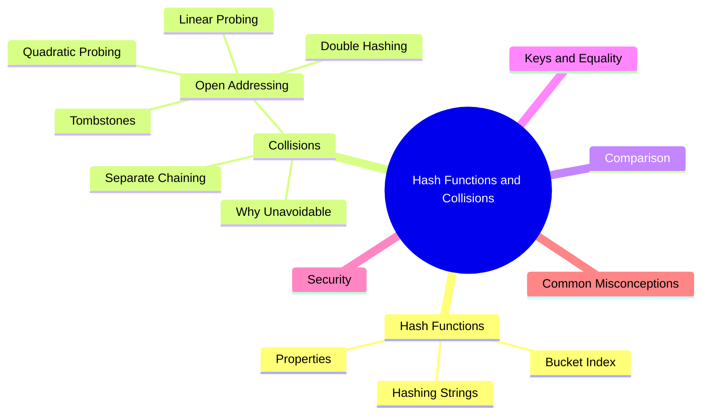
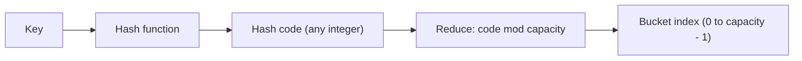

export const metadata = {
  title: 'Hash Functions and Collision Handling',
  date: '2026-11-14',
  excerpt: 'What makes a good hash function, how to hash strings without piling keys into a few buckets, and how hash tables cope when two keys land in the same spot: separate chaining, linear and quadratic probing, double hashing, and tombstones. Includes examples in TypeScript, Python, and Java.',
  tags: ['Data Structure'],
};

# Hash Functions and Collision Handling

A hash table is only as good as two things: the function that turns keys into indexes, and what the table does when two keys end up at the same index. Get the first one wrong and the keys pile into a handful of buckets. Get the second one wrong and lookups quietly miss entries that are sitting right there. Either way, the O(1) you were counting on is gone.

This article covers both halves. The first half is about hash functions: what they have to guarantee, why adding up characters is a bad idea, and how real tables turn a hash code into a bucket index. The second half is about collisions: separate chaining, the open addressing family (linear probing, quadratic probing, double hashing), and the surprisingly tricky problem of deleting entries. It assumes you've read [Hash Table](./hash-table) or know the basics.



- [What a Hash Function Does](#what-a-hash-function-does)
- [Properties of a Good Hash Function](#properties-of-a-good-hash-function)
- [Hashing Strings](#hashing-strings)
- [From Hash Code to Bucket Index](#from-hash-code-to-bucket-index)
- [Why Collisions Are Unavoidable](#why-collisions-are-unavoidable)
- [Separate Chaining](#separate-chaining)
- [Open Addressing](#open-addressing)
- [Implementing Linear Probing](#implementing-linear-probing)
- [Chaining vs. Open Addressing](#chaining-vs-open-addressing)
- [Keys, Equality, and Hash Codes](#keys-equality-and-hash-codes)
- [Hash Flooding and Security](#hash-flooding-and-security)
- [Common Misconceptions](#common-misconceptions)
- [Conclusion](#conclusion)

---

## What a Hash Function Does

A hash function takes a key and returns an integer, called the hash code (or hash value). A hash table uses it in two steps: first it computes the hash code, then it reduces that code to a valid bucket index.



The split matters. The hash function belongs to the key's type and never needs to know how big the table is. The table owns the second step and is free to change its capacity whenever it likes. That's why Java gives every object a `hashCode()`, while each `HashMap` decides on its own how many buckets to use.

---

## Properties of a Good Hash Function

- Deterministic: the same key always produces the same hash code (within one run of the program). Otherwise a stored entry can't be found again
- Consistent with equality: if two keys are equal, their hash codes must be equal. The reverse isn't required, since different keys are allowed to share a hash code
- Uniform: hash codes should spread evenly, so every bucket is about equally likely to be chosen. Uneven spread means long chains or long probe sequences
- Fast: the function runs on every insert, lookup, and delete, so its cost is paid every time. It should take time proportional to the key's size and no more

Not on the list: irreversibility and resistance to deliberate collisions. Those are cryptographic requirements. A table can do without them, and they cost speed. (Untrusted input is the exception; see the security section.)

---

## Hashing Strings

Integers are easy: the number itself is already a usable hash code. Strings take some work. The obvious first attempt is to add up the character codes:

```typescript
// TypeScript
function sumHash(s: string): number {
  let h = 0;
  for (let i = 0; i < s.length; i++) h += s.charCodeAt(i);
  return h;
}

function polyHash(s: string): number {
  let h = 0;
  for (let i = 0; i < s.length; i++) {
    h = (h * 31 + s.charCodeAt(i)) >>> 0; // wrap around at 32 bits
  }
  return h;
}

console.log(sumHash("cat"), sumHash("act"));   // 312 312
console.log(polyHash("cat"), polyHash("act")); // 98262 96402
```

```python
# Python
def sum_hash(s: str) -> int:
    return sum(ord(c) for c in s)


def poly_hash(s: str) -> int:
    h = 0
    for c in s:
        h = (h * 31 + ord(c)) & 0xFFFFFFFF  # Python ints never overflow, so wrap at 32 bits by hand
    return h


print(sum_hash("cat"), sum_hash("act"))    # 312 312
print(poly_hash("cat"), poly_hash("act"))  # 98262 96402
```

```java
// Java
public class StringHash {
    static int sumHash(String s) {
        int h = 0;
        for (int i = 0; i < s.length(); i++) h += s.charAt(i);
        return h;
    }

    static int polyHash(String s) {
        int h = 0;
        for (int i = 0; i < s.length(); i++) {
            h = 31 * h + s.charAt(i); // int overflow wraps around, by design
        }
        return h; // the same value as s.hashCode()
    }

    public static void main(String[] args) {
        System.out.println(sumHash("cat") + " " + sumHash("act"));   // 312 312
        System.out.println(polyHash("cat") + " " + polyHash("act")); // 98262 96402
    }
}
```

`sumHash` has two problems:

- It ignores order. `"cat"`, `"act"`, and `"tac"` all add up to 312, so every anagram of a word collides with it
- It spreads keys badly. The sums are small numbers packed into a narrow range. There are 11,881,376 five-letter lowercase strings, but their sums all fall between 485 and 610, which is only 126 distinct hash codes

`polyHash` fixes both by making each character's position matter. It treats the string as a number written in base 31:

```text
hash = s[0] × 31^(n-1) + s[1] × 31^(n-2) + … + s[n-1]
```

The loop computes it with one multiply and one add per character. For `"cat"` that's 99 × 31² + 97 × 31 + 116 = 98262, and for `"act"` it's 97 × 31² + 99 × 31 + 116 = 96402. The anagrams now land in different places. This is exactly what Java's `String.hashCode()` does.

Why 31? It's more convention than rule. It's a small odd prime, and `31 * h` can be computed cheaply as `(h << 5) - h`. Other small primes would work about as well. Overflow is intended: the value simply wraps around. Java's `int` is signed, so longer strings can produce negative hash codes. That's why the Java code in these articles uses `Math.floorMod` instead of a plain `%`.

Production hash functions (MurmurHash, xxHash, SipHash) mix more thoroughly, but the goal is the same: every character affects the result, and position matters.

---

## From Hash Code to Bucket Index

Next the table has to reduce the hash code to the range 0 to m − 1, where m is the number of buckets. There are three common ways:

| Method | Formula | Notes |
| :--- | :--- | :--- |
| Division | `hash code % m` | Simple. Works best when `m` is a prime that isn't close to a power of two |
| Bit mask | `hash code & (m - 1)` | Requires `m` to be a power of two. Faster than division, but only the low bits are used |
| Multiplication | `floor(m × frac(hash code × A))` | Works for any `m`, so the table size isn't critical. `frac` is the fractional part, and Knuth suggests A ≈ 0.618 |

The trouble with powers of two is that `hash code % m` keeps only the lowest bits and ignores the rest. Imagine keys that are multiples of 1024, such as page-aligned memory addresses. With 16 buckets, `key % 16` is 0 for every one of them, so they all pile into bucket 0. With 17 buckets, 17 consecutive multiples land in 17 different buckets.

So why do real tables use powers of two anyway? A mask is cheaper than a division, and doubling the capacity keeps it a power of two. They compensate by mixing the hash code first, so the low bits depend on the high bits too. Java's `HashMap` computes `h ^ (h >>> 16)` and then masks with `capacity - 1`. CPython's `dict` also uses power-of-two sizes, and it feeds the higher bits of the hash into its probe sequence.

---

## Why Collisions Are Unavoidable

There are far more possible keys than buckets. Even a 32-bit hash code has only about 4.3 billion values, while the number of possible ten-character strings is astronomically larger. By the pigeonhole principle, some keys must share a hash code. The table then maps those hash codes onto a much smaller number of buckets, so sharing a bucket is far more common still.

Collisions also arrive earlier than intuition suggests. This is the birthday problem: in a room of just 23 people, there's already a better-than-even chance that two share a birthday. The same math applies to buckets. If the hash function is perfectly uniform and there are m buckets, the chance of at least one collision reaches 50% after only about 1.18 × √m keys. A table with 1,000,000 buckets has even odds of a collision after roughly 1,200 insertions, about 0.1% of its capacity.

So a collision strategy isn't an optional extra. It has to be part of the design from the start.

---

## Separate Chaining

You saw separate chaining in [Hash Table](/articles/hash-table). Each bucket holds a collection of entries, and a lookup scans the bucket it hashes to. If the hash function is uniform, the average chain length equals the load factor α (entries divided by buckets), so a lookup costs about O(1 + α).

A few properties of chaining:

- The load factor can go above 1, and performance degrades gradually rather than falling off a cliff
- Deletion is trivial: remove the entry from its list
- A chain doesn't have to be a linked list. It can be a dynamic array, or even a balanced tree. Java's `HashMap` converts a chain into a red-black tree once it grows past 8 entries (in a table of at least 64 buckets), and converts it back when it shrinks to 6 or fewer. That keeps lookups at O(log n) even when many keys collide, as long as the keys are comparable
- The cost is memory and speed. Every entry carries a pointer, often a separate object, and walking a chain means jumping around memory, which is hard on the CPU cache

---

## Open Addressing

Open addressing drops the lists. Every entry lives in the array itself, one per slot. When the slot a key hashes to is taken, the table probes: it checks other slots in a fixed order until it finds a free one. A lookup follows the same order, starting at the hashed slot, and stops when it finds the key or reaches an empty slot, which means the key isn't there.

Because every entry needs its own slot, the table must always keep some empty. The load factor has to stay below 1, and in practice well below.

### Probe Sequences

The three standard methods differ only in how they pick the next slot to try. Here `h(k)` is the key's home slot and `i` is the number of the attempt (0, 1, 2, …):

| Method | Probe Sequence | Clustering | Notes |
| :--- | :--- | :--- | :--- |
| Linear probing | `(h(k) + i) % m` | Primary | Simplest, and neighbors in the array are neighbors in memory, so it's cache-friendly |
| Quadratic probing | `(h(k) + i²) % m` | Secondary | May not reach every slot. With a prime `m` and a load factor of at most 0.5, it's guaranteed to find a free one |
| Double hashing | `(h1(k) + i × h2(k)) % m` | Minimal | `h2(k)` must never be 0 and should be coprime with `m` (a prime `m` works) |

Clustering is the main thing that separates them. With linear probing, occupied slots form runs, and any key that hashes into a run has to walk to its end, which makes the run longer still. That's primary clustering. Quadratic probing avoids it by jumping farther each time, but two keys with the same home slot still follow the identical path (secondary clustering). Double hashing gives each key its own step size, so keys that start in the same place go different ways.

### A Worked Example

Take 8 slots, integer keys, and `h(k) = k % 8`. Insert 10, 18, 26, and 3 using linear probing:

| Insert | Home Slot | Slots Checked | Lands In |
| :--- | :--- | :--- | :--- |
| 10 | 2 | 2 | 2 |
| 18 | 2 | 2, 3 | 3 |
| 26 | 2 | 2, 3, 4 | 4 |
| 3 | 3 | 3, 4, 5 | 5 |

The array ends up as `[_, _, 10, 18, 26, 3, _, _]`. Notice that 3 never collided with 10 or 26 directly. Its home slot was simply occupied by 18, which had been pushed out of slot 2. One collision grew a run of occupied slots, and the run caught another key. That's primary clustering.

Quadratic probing handles the same keys differently. 26 checks slot 2, then 3 (offset 1), then 6 (offset 4). And 3 finds slot 4 free on its second try. The result is `[_, _, 10, 18, 3, _, 26, _]`, and 26 has jumped over the cluster.

Double hashing needs a second hash function. With 7 slots, `h1(k) = k % 7`, and `h2(k) = 1 + k % 6`, the keys 10, 17, and 24 all start at slot 3 but take different steps:

| Key | h1 | h2 | Slots Checked | Lands In |
| :--- | :--- | :--- | :--- | :--- |
| 10 | 3 | 5 | 3 | 3 |
| 17 | 3 | 6 | 3, 2 | 2 |
| 24 | 3 | 1 | 3, 4 | 4 |

### Deletion and Tombstones

Deletion is where open addressing gets tricky. Go back to the linear probing table `[_, _, 10, 18, 26, 3, _, _]` and delete 18 by simply emptying its slot: `[_, _, 10, _, 26, 3, _, _]`. Now look up 26. The search starts at slot 2 (that's 10, not a match), moves on to slot 3, finds it empty, and concludes that 26 isn't in the table. But 26 is sitting in slot 4. Emptying the slot broke the probe path that 26 depends on.

The fix is a tombstone: a marker that says "something was here". A lookup treats a tombstone as occupied and keeps probing, so paths stay intact. An insert is allowed to reuse a tombstone slot. The price is that tombstones pile up and make probe sequences longer even though few live entries remain, so tables count them toward the load factor and clear them out when they rebuild. (Linear probing can also delete without tombstones by shifting later entries back into the gap, but that's easy to get wrong.) Chained tables don't have this problem at all.

### Why Load Factor Matters Even More

Here's the expected number of probes for linear probing, from Knuth's classic analysis, assuming a uniformly random hash function:

| Load Factor | Successful Lookup | Unsuccessful Lookup |
| :--- | :--- | :--- |
| 0.5 | 1.5 | 2.5 |
| 0.75 | 2.5 | 8.5 |
| 0.9 | 5.5 | 50.5 |

Past 0.7 or so, the cost of a miss shoots up. That's why a table using linear probing resizes while it still has plenty of empty slots.

---

## Implementing Linear Probing

Here's a hash table that uses linear probing with tombstones. It tracks two counts: the number of live entries, and the number of occupied slots (live entries plus tombstones). It rebuilds when occupied slots would pass half the table. A rebuild drops the tombstones, and the table only grows if the live entries still need the room.

```typescript
// TypeScript
interface Slot<V> {
  key: string;
  value: V;
  deleted: boolean; // true = tombstone
}

class LinearProbingTable<V> {
  private slots: Array<Slot<V> | null>;
  private liveCount = 0; // live entries
  private used = 0;      // live entries + tombstones

  constructor(capacity = 8) {
    this.slots = new Array(capacity).fill(null);
  }

  get size(): number {
    return this.liveCount;
  }

  private hash(key: string): number {
    let h = 0;
    for (let i = 0; i < key.length; i++) {
      h = (h * 31 + key.charCodeAt(i)) >>> 0;
    }
    return h;
  }

  // The live slot holding `key`, or null if the key isn't in the table
  private find(key: string): Slot<V> | null {
    const capacity = this.slots.length;
    let i = this.hash(key) % capacity;
    for (let step = 0; step < capacity; step++) {
      const slot = this.slots[i];
      if (slot === null) return null; // an empty slot ends the search
      if (!slot.deleted && slot.key === key) return slot; // a tombstone is skipped over
      i = (i + 1) % capacity;
    }
    return null;
  }

  set(key: string, value: V): void {
    const existing = this.find(key);
    if (existing !== null) {
      existing.value = value;
      return;
    }
    if ((this.used + 1) / this.slots.length > 0.5) this.rebuild();
    this.place(key, value);
  }

  // Put a key we know is absent into the first empty or tombstone slot on its probe path
  private place(key: string, value: V): void {
    const capacity = this.slots.length;
    let i = this.hash(key) % capacity;
    let slot = this.slots[i];
    while (slot !== null && !slot.deleted) {
      i = (i + 1) % capacity;
      slot = this.slots[i];
    }
    if (slot === null) this.used++; // reusing a tombstone doesn't change `used`
    this.slots[i] = { key, value, deleted: false };
    this.liveCount++;
  }

  get(key: string): V | undefined {
    return this.find(key)?.value;
  }

  delete(key: string): boolean {
    const slot = this.find(key);
    if (slot === null) return false;
    slot.deleted = true; // leave a tombstone
    this.liveCount--;
    return true;
  }

  private rebuild(): void {
    const old = this.slots;
    let capacity = old.length;
    while ((this.liveCount + 1) * 3 > capacity) capacity *= 2; // aim for a table at most about a third full
    this.slots = new Array(capacity).fill(null);
    this.liveCount = 0;
    this.used = 0;
    for (const slot of old) {
      if (slot !== null && !slot.deleted) this.place(slot.key, slot.value);
    }
  }
}
```

```python
# Python
from dataclasses import dataclass
from typing import Generic, Optional, TypeVar

V = TypeVar("V")


@dataclass
class Slot(Generic[V]):
    key: str
    value: V
    deleted: bool = False  # True = tombstone


class LinearProbingTable(Generic[V]):
    def __init__(self, capacity: int = 8) -> None:
        self._slots: list[Optional[Slot[V]]] = [None] * capacity
        self._live = 0  # live entries
        self._used = 0  # live entries + tombstones

    def _start(self, key: str) -> int:
        return hash(key) % len(self._slots)

    def _find(self, key: str) -> Optional[Slot[V]]:
        """The live slot holding `key`, or None if the key isn't in the table."""
        capacity = len(self._slots)
        i = self._start(key)
        for _ in range(capacity):
            slot = self._slots[i]
            if slot is None:
                return None  # an empty slot ends the search
            if not slot.deleted and slot.key == key:
                return slot  # a tombstone is skipped over
            i = (i + 1) % capacity
        return None

    def set(self, key: str, value: V) -> None:
        existing = self._find(key)
        if existing is not None:
            existing.value = value
            return
        if (self._used + 1) / len(self._slots) > 0.5:
            self._rebuild()
        self._place(key, value)

    def _place(self, key: str, value: V) -> None:
        """Put a key we know is absent into the first empty or tombstone slot on its probe path."""
        capacity = len(self._slots)
        i = self._start(key)
        slot = self._slots[i]
        while slot is not None and not slot.deleted:
            i = (i + 1) % capacity
            slot = self._slots[i]
        if slot is None:
            self._used += 1  # reusing a tombstone doesn't change `_used`
        self._slots[i] = Slot(key, value)
        self._live += 1

    def get(self, key: str) -> Optional[V]:
        slot = self._find(key)
        return slot.value if slot is not None else None

    def delete(self, key: str) -> bool:
        slot = self._find(key)
        if slot is None:
            return False
        slot.deleted = True  # leave a tombstone
        self._live -= 1
        return True

    def __len__(self) -> int:
        return self._live

    def _rebuild(self) -> None:
        old = self._slots
        capacity = len(old)
        while (self._live + 1) * 3 > capacity:  # aim for a table at most about a third full
            capacity *= 2
        self._slots = [None] * capacity
        self._live = 0
        self._used = 0
        for slot in old:
            if slot is not None and not slot.deleted:
                self._place(slot.key, slot.value)
```

```java
// Java
public class LinearProbingTable<V> {
    private static class Slot<V> {
        final String key;
        V value;
        boolean deleted; // true = tombstone

        Slot(String key, V value) {
            this.key = key;
            this.value = value;
        }
    }

    private Slot<V>[] slots;
    private int liveCount = 0; // live entries
    private int used = 0;      // live entries + tombstones

    @SuppressWarnings("unchecked")
    public LinearProbingTable() {
        slots = (Slot<V>[]) new Slot[8];
    }

    private int startIndex(String key) {
        return Math.floorMod(key.hashCode(), slots.length);
    }

    // The live slot holding `key`, or null if the key isn't in the table
    private Slot<V> find(String key) {
        int i = startIndex(key);
        for (int step = 0; step < slots.length; step++) {
            Slot<V> slot = slots[i];
            if (slot == null) return null; // an empty slot ends the search
            if (!slot.deleted && slot.key.equals(key)) return slot; // a tombstone is skipped over
            i = (i + 1) % slots.length;
        }
        return null;
    }

    public void put(String key, V value) {
        Slot<V> existing = find(key);
        if (existing != null) {
            existing.value = value;
            return;
        }
        if ((double) (used + 1) / slots.length > 0.5) rebuild();
        place(key, value);
    }

    // Put a key we know is absent into the first empty or tombstone slot on its probe path
    private void place(String key, V value) {
        int i = startIndex(key);
        while (slots[i] != null && !slots[i].deleted) {
            i = (i + 1) % slots.length;
        }
        if (slots[i] == null) used++; // reusing a tombstone doesn't change `used`
        slots[i] = new Slot<>(key, value);
        liveCount++;
    }

    public V get(String key) {
        Slot<V> slot = find(key);
        return slot == null ? null : slot.value;
    }

    public boolean remove(String key) {
        Slot<V> slot = find(key);
        if (slot == null) return false;
        slot.deleted = true; // leave a tombstone
        liveCount--;
        return true;
    }

    public int size() {
        return liveCount;
    }

    @SuppressWarnings("unchecked")
    private void rebuild() {
        Slot<V>[] old = slots;
        int capacity = old.length;
        while ((liveCount + 1) * 3 > capacity) capacity *= 2; // aim for a table at most about a third full
        slots = (Slot<V>[]) new Slot[capacity];
        liveCount = 0;
        used = 0;
        for (Slot<V> slot : old) {
            if (slot != null && !slot.deleted) place(slot.key, slot.value);
        }
    }
}
```

A few notes on the code:

- `find` is the only place that knows how to probe. It stops at an empty slot, walks past tombstones, and gives up after one full lap, so it can't loop forever
- `set` always calls `find` first, so a key can never end up in the table twice
- `place` reuses the first tombstone it meets. That's safe because `find` has already shown the key is absent, and it keeps probe sequences short
- Rebuilding counts only live entries, so it doesn't grow the table just because of tombstones. A workload that keeps adding and deleting different keys doesn't make the table grow

---

## Chaining vs. Open Addressing

| | Separate Chaining | Open Addressing |
| :--- | :--- | :--- |
| Where entries live | In per-bucket lists or trees, outside the array | Directly in the array |
| Load factor | Can exceed 1, and degrades gradually | Must stay below 1, and degrades sharply near full |
| Deletion | Remove from the list | Needs tombstones (or shifting entries back) |
| Memory | An extra pointer, often an extra object, per entry | Compact, with no per-entry overhead |
| Cache behavior | Chases pointers | Mostly sequential slots, usually faster |
| Sensitivity to the hash function | Moderate | High, especially with linear probing |
| Used by | Java's `HashMap` | Python's `dict`, Rust's `HashMap` |

Neither one wins everywhere. Open addressing tends to be faster for small keys at moderate load, thanks to the cache. Chaining is simpler, deletes cleanly, and tolerates a high load factor better.

---

## Keys, Equality, and Hash Codes

One rule ties keys to hash tables: if two keys are equal, their hash codes must be equal. Break it, and the table can't find something it just stored, because the lookup hashes to a different bucket.

The failure looks different in each language:

```typescript
// TypeScript
const map = new Map<{ x: number; y: number }, string>();
map.set({ x: 1, y: 2 }, "A");
console.log(map.get({ x: 1, y: 2 })); // undefined: a different object, even though it looks identical

// Use a key with value semantics instead, such as a string
const grid = new Map<string, string>();
grid.set("1,2", "A");
console.log(grid.get("1,2")); // A
```

```python
# Python
from dataclasses import dataclass


@dataclass(frozen=True)  # generates __eq__ and __hash__ from the fields
class Point:
    x: int
    y: int


grid = {Point(1, 2): "A"}
print(grid[Point(1, 2)])  # A
```

```java
// Java
import java.util.HashMap;
import java.util.Map;

public class KeyDemo {
    static class BadPoint {
        final int x, y;

        BadPoint(int x, int y) {
            this.x = x;
            this.y = y;
        }

        @Override
        public boolean equals(Object o) {
            return o instanceof BadPoint p && p.x == x && p.y == y;
        }
        // hashCode() is not overridden, so every instance gets its own identity-based hash code
    }

    record Point(int x, int y) {} // equals() and hashCode() are generated from the fields

    public static void main(String[] args) {
        Map<BadPoint, String> bad = new HashMap<>();
        bad.put(new BadPoint(1, 2), "A");
        System.out.println(bad.get(new BadPoint(1, 2))); // null: equal keys, different hash codes

        Map<Point, String> good = new HashMap<>();
        good.put(new Point(1, 2), "A");
        System.out.println(good.get(new Point(1, 2)));   // A
    }
}
```

JavaScript compares objects by reference, so two identical-looking object literals are different keys. Java is the dangerous one: overriding `equals` without `hashCode` compiles fine and fails quietly at runtime. Python protects you here. A plain `@dataclass` (mutable, with `__eq__` generated) is unhashable, and trying to use it as a key raises a `TypeError`. `frozen=True` makes it hashable.

Mutable keys are a related trap. If you change a key's fields after inserting it, its hash code changes, but the entry stays in the bucket chosen for the old one. The key is still in the table, but lookups can no longer find it. Use immutable keys, or at least never modify a key while it's inside a table.

---

## Hash Flooding and Security

The O(1) average assumes that keys spread out. If an attacker controls the keys (query parameters, JSON fields, HTTP headers) and knows your hash function, they can craft thousands of keys that all collide. Each insert then costs O(n), and a request that should take milliseconds can tie up a CPU core for minutes. This is hash flooding, and it was demonstrated against web frameworks in 2011, hitting PHP, Java, Python, Ruby, and ASP.NET, among others.

The defenses are:

- Randomize the hash. Pick a random seed when the process starts and use a keyed hash function such as SipHash, so an attacker can't predict which keys collide. Python does this for strings and bytes, which is why `hash("cat")` prints a different number every time you start the interpreter. It also means you should never store `hash()` results or depend on them across runs
- Cap the damage per bucket. Java 8 and later turn long chains into balanced trees, which limits the worst case to O(log n) for comparable keys
- Limit what attackers can send, such as the number of fields in a request

The two kinds of hash functions serve different purposes. Cryptographic ones like SHA-256 are one-way and extremely hard to collide on purpose, but they're far too slow for a table that hashes on every operation. Table hash functions (MurmurHash, xxHash, FNV-1a) trade those guarantees for speed. The reverse also holds: never use `hashCode()` or a table hash for passwords or integrity checks.

---

## Common Misconceptions

| Common Misconception | What's Actually True |
| :--- | :--- |
| A good hash function never produces collisions. | Collisions are unavoidable. Even a perfectly uniform hash function starts colliding after about √m insertions into m buckets. |
| Equal hash codes mean equal keys. | They don't. Different keys can share a hash code, which is why a table always compares the keys themselves after hashing. |
| A stronger hash function, like SHA-256, makes a better table. | Cryptographic hashes are much slower, and a table doesn't need what they offer. It needs speed and an even spread. |
| Linear probing is bad and should be avoided. | It's simple and cache-friendly, and it's fast in practice when the load factor stays moderate and the hash function is good. |
| In open addressing, deleting means emptying the slot. | That breaks the probe paths of other keys. The slot needs a tombstone, or the following entries have to be shifted back. |
| A hash code is the same everywhere, every time. | Not guaranteed. Python randomizes string hashes per process, and Java's default `Object.hashCode()` can differ from one run to the next. Don't persist hash codes. |

---

## Conclusion

The hash function decides where keys go, and collision handling decides what happens when they collide. A good hash function is deterministic, fast, uniform, and consistent with equality. Collisions can't be avoided, so every table commits to one of two strategies: chaining, which keeps colliding entries together in a bucket, or open addressing, which moves them to another slot in the array.

A few rules of thumb come out of all this:

- Use the hash function that ships with the key type. If you write your own for a custom class, base it on exactly the fields that `equals` compares
- Keep the load factor in check. It matters most for open addressing, where performance falls off sharply as the table fills up
- Use immutable keys, and don't depend on hash codes or iteration order staying the same between runs
- If keys come from untrusted input, stick with the language's built-in tables instead of rolling your own

Add resizing, and that's the whole picture of how a hash table works.
