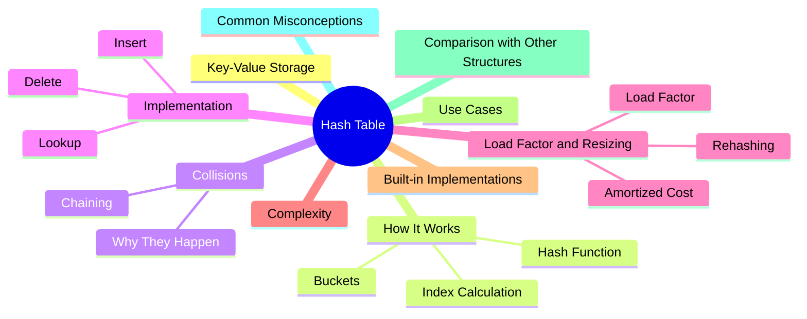
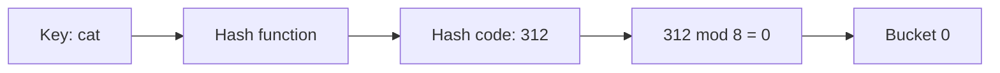
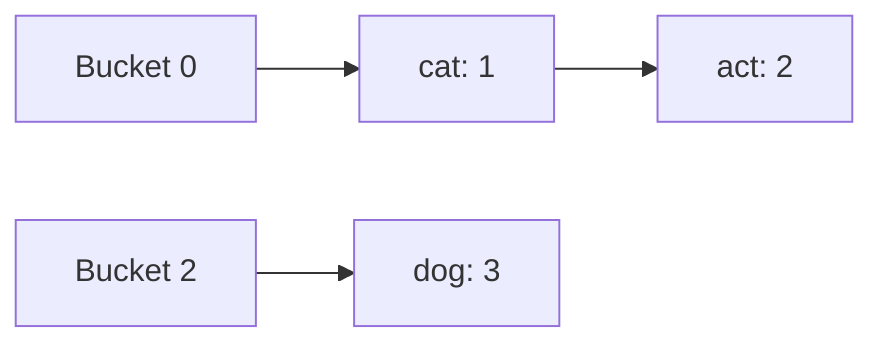

export const metadata = {
  title: 'Hash Table',
  date: '2026-11-09',
  excerpt: 'How a key turns into an array index, what collisions are, why load factor and resizing keep lookups fast, and what O(1) on average really promises. Includes examples in TypeScript, Python, and Java.',
  tags: ['Data Structure'],
};

# Hash Table

A hash table stores key-value pairs and finds the value for a key in constant time, on average. It's the structure behind Python's `dict`, JavaScript's `Map`, and Java's `HashMap`, and one of the structures you'll use most in everyday code.

The idea is a small trick. An array gives you any element in O(1), as long as you know its index. A hash table works out that index from the key: a hash function turns the key into a number, and the number decides where the value lives. Everything else in the design (collisions, load factor, resizing) exists to keep the trick working when keys are messy and the data keeps growing.



- [What Is a Hash Table](#what-is-a-hash-table)
- [How It Works](#how-it-works)
- [Collisions](#collisions)
- [Implementing a Hash Table](#implementing-a-hash-table)
- [Load Factor and Resizing](#load-factor-and-resizing)
- [Time and Space Complexity](#time-and-space-complexity)
- [Hash Tables in Practice](#hash-tables-in-practice)
- [Common Use Cases](#common-use-cases)
- [Hash Table vs. Other Data Structures](#hash-table-vs-other-data-structures)
- [Common Misconceptions](#common-misconceptions)
- [Conclusion](#conclusion)

---

## What Is a Hash Table

A hash table (also called a hash map or a dictionary) stores key-value pairs. Every key is unique, and you use the key to get its value back:

```text
"alice" → 30
"bob"   → 25
"carol" → 41
```

If your keys were small integers, a plain array would already do the job: the key is the index. An array is, in effect, a hash table whose hash function does nothing. The trouble starts with keys that can't be used as indexes directly: strings, user IDs in the millions, coordinates. Nobody wants a ten-million-slot array for a thousand users, and a string isn't a number to begin with.

A hash function solves that. It maps any key to a number, and the table reduces that number to a range that fits the array. The array stays small, and the lookup stays direct.

---

## How It Works

Under the hood, a hash table is an array. Each position in the array is called a bucket. To store or find a key, the table does three things:

1. Run the key through the hash function to get an integer, the hash code.
2. Reduce the hash code to a valid bucket index, usually with `hash code % capacity`.
3. Read from or write to that bucket.



To keep the arithmetic easy, take a deliberately naive hash function: add up the character codes of the string. (It's a poor hash function, and the next article explains why. Here it's only a way to get small numbers.) With 8 buckets:

| Key | Character codes | Hash code | Index (hash code % 8) |
| :--- | :--- | :--- | :--- |
| `"cat"` | 99 + 97 + 116 | 312 | 0 |
| `"dog"` | 100 + 111 + 103 | 314 | 2 |
| `"act"` | 97 + 99 + 116 | 312 | 0 |

`"cat"` and `"dog"` end up in different buckets. `"cat"` and `"act"` both land in bucket 0, which is a collision. We'll deal with that in a moment.

Three things to note:

- The hash function must be deterministic. The same key has to produce the same hash code every time, or a value you stored could never be found again
- The table stores the key together with the value. Bucket 0 doesn't say whether it holds `"cat"` or `"act"`, so on lookup the table compares the stored key with the one you asked for
- The index depends on the capacity. 312 % 8 is 0, but 312 % 16 is 8. A table that changes size has to work out where everything goes all over again, which matters in the resizing section below

---

## Collisions

When two different keys map to the same bucket, that's a collision. It isn't a bug. The number of possible keys (every string, every integer) is far larger than the number of buckets, so some keys have to share. No hash function can prevent it, and as the next article shows, collisions show up much sooner than most people expect.

So every hash table needs a strategy for them. The simplest one is separate chaining: each bucket holds a small list, and every entry that hashes to that bucket goes into it. A lookup hashes the key, goes to the bucket, and scans the list for a matching key.



The other family is open addressing, where entries live in the array itself and a colliding key goes into some other free slot. This article sticks with chaining because it's easy to implement and easy to reason about. Open addressing is covered in [Hash Functions and Collision Handling](/articles/hash-functions-and-collision-handling).

---

## Implementing a Hash Table

Here is a minimal hash table with separate chaining, in three languages. It supports set, get, and delete for string keys, and it grows on its own when it gets crowded (the next section explains when and why). JavaScript has no built-in hash function for strings, so the TypeScript version includes a small one. The Python and Java versions use the built-in `hash()` and `hashCode()`.

```typescript
// TypeScript
class HashTable<V> {
  private buckets: Array<Array<[string, V]>>;
  private count = 0;

  constructor(private capacity = 8) {
    this.buckets = Array.from({ length: capacity }, () => []);
  }

  get size(): number {
    return this.count;
  }

  // JavaScript has no built-in string hash, so we write a simple one
  private hash(key: string): number {
    let h = 0;
    for (let i = 0; i < key.length; i++) {
      h = (h * 31 + key.charCodeAt(i)) >>> 0; // wrap around at 32 bits
    }
    return h;
  }

  private indexFor(key: string): number {
    return this.hash(key) % this.capacity;
  }

  set(key: string, value: V): void {
    const bucket = this.buckets[this.indexFor(key)];
    for (const entry of bucket) {
      if (entry[0] === key) {
        entry[1] = value; // key already exists: overwrite
        return;
      }
    }
    bucket.push([key, value]);
    this.count++;
    if (this.count / this.capacity > 0.75) this.resize();
  }

  get(key: string): V | undefined {
    for (const [k, v] of this.buckets[this.indexFor(key)]) {
      if (k === key) return v;
    }
    return undefined;
  }

  delete(key: string): boolean {
    const bucket = this.buckets[this.indexFor(key)];
    const i = bucket.findIndex(([k]) => k === key);
    if (i === -1) return false;
    bucket.splice(i, 1);
    this.count--;
    return true;
  }

  private resize(): void {
    const oldBuckets = this.buckets;
    this.capacity *= 2;
    this.buckets = Array.from({ length: this.capacity }, () => []);
    for (const bucket of oldBuckets) {
      for (const [key, value] of bucket) {
        this.buckets[this.indexFor(key)].push([key, value]); // the index changed, so re-insert
      }
    }
  }
}
```

```python
# Python
from typing import Generic, Optional, TypeVar

V = TypeVar("V")


class HashTable(Generic[V]):
    def __init__(self, capacity: int = 8) -> None:
        self._buckets: list[list[tuple[str, V]]] = [[] for _ in range(capacity)]
        self._size = 0

    def _index_for(self, key: str) -> int:
        # hash() can be negative, but % with a positive capacity is always 0..capacity-1
        return hash(key) % len(self._buckets)

    def set(self, key: str, value: V) -> None:
        bucket = self._buckets[self._index_for(key)]
        for i, (k, _) in enumerate(bucket):
            if k == key:
                bucket[i] = (key, value)  # key already exists: overwrite
                return
        bucket.append((key, value))
        self._size += 1
        if self._size / len(self._buckets) > 0.75:
            self._resize()

    def get(self, key: str) -> Optional[V]:
        for k, v in self._buckets[self._index_for(key)]:
            if k == key:
                return v
        return None

    def delete(self, key: str) -> bool:
        bucket = self._buckets[self._index_for(key)]
        for i, (k, _) in enumerate(bucket):
            if k == key:
                del bucket[i]
                self._size -= 1
                return True
        return False

    def __len__(self) -> int:
        return self._size

    def _resize(self) -> None:
        old_buckets = self._buckets
        self._buckets = [[] for _ in range(len(old_buckets) * 2)]
        for bucket in old_buckets:
            for key, value in bucket:
                self._buckets[self._index_for(key)].append((key, value))  # the index changed, so re-insert
```

```java
// Java
public class HashTable<V> {
    private static class Node<V> {
        final String key;
        V value;
        Node<V> next;

        Node(String key, V value, Node<V> next) {
            this.key = key;
            this.value = value;
            this.next = next;
        }
    }

    private Node<V>[] buckets;
    private int size = 0;

    @SuppressWarnings("unchecked")
    public HashTable() {
        buckets = (Node<V>[]) new Node[8];
    }

    private static int indexFor(String key, int capacity) {
        // hashCode() can be negative; floorMod always returns 0..capacity-1
        return Math.floorMod(key.hashCode(), capacity);
    }

    public void put(String key, V value) {
        int i = indexFor(key, buckets.length);
        for (Node<V> node = buckets[i]; node != null; node = node.next) {
            if (node.key.equals(key)) {
                node.value = value; // key already exists: overwrite
                return;
            }
        }
        buckets[i] = new Node<>(key, value, buckets[i]); // add at the head of the chain
        size++;
        if ((double) size / buckets.length > 0.75) resize();
    }

    public V get(String key) {
        for (Node<V> node = buckets[indexFor(key, buckets.length)]; node != null; node = node.next) {
            if (node.key.equals(key)) return node.value;
        }
        return null;
    }

    public boolean remove(String key) {
        int i = indexFor(key, buckets.length);
        Node<V> prev = null;
        for (Node<V> node = buckets[i]; node != null; prev = node, node = node.next) {
            if (node.key.equals(key)) {
                if (prev == null) buckets[i] = node.next;
                else prev.next = node.next;
                size--;
                return true;
            }
        }
        return false;
    }

    public int size() {
        return size;
    }

    @SuppressWarnings("unchecked")
    private void resize() {
        Node<V>[] bigger = (Node<V>[]) new Node[buckets.length * 2];
        for (Node<V> head : buckets) {
            Node<V> node = head;
            while (node != null) {
                Node<V> next = node.next; // save it, because we're about to relink this node
                int i = indexFor(node.key, bigger.length); // the index changed, so re-insert
                node.next = bigger[i];
                bigger[i] = node;
                node = next;
            }
        }
        buckets = bigger;
    }
}
```

The three operations share the same shape:

- Set: hash the key to find its bucket, then scan the bucket for the key. If it's there, replace the value. If not, add a new entry
- Get: take the same path and return the value if the key is found
- Delete: find the entry in its bucket and remove it

Every operation starts by hashing and picking a bucket, and ends with a scan of that one bucket. As long as buckets stay short, the scan costs almost nothing. That's where the O(1) comes from.

One loose end: `get` returns `undefined`, `None`, or `null` when the key is missing, so you can't tell a missing key from a stored `undefined`, `None`, or `null`. Built-in tables avoid this by offering a separate membership check (`has`, `in`, `containsKey`).

---

## Load Factor and Resizing

The load factor is the number of entries divided by the number of buckets. With chaining, it's also the average length of a chain: 12 entries in 8 buckets means 1.5 entries per bucket. Keep it low and lookups stay fast. Let it climb, and the chains get long enough that the table behaves more like a linked list than an array.

To prevent that, a table resizes itself. When the load factor passes a threshold, it allocates a bigger array (usually twice the size) and moves every entry over. The code above uses 0.75, so with 8 buckets the 7th entry triggers a resize. Java's `HashMap` uses the same default, starting at 16 buckets. Python's `dict` resizes when it's about two-thirds full, and other implementations pick other thresholds.

Resizing isn't just a copy. The index is `hash code % capacity`, so changing the capacity changes where entries belong. Every entry has to be rehashed and re-inserted. (Remember that 312 goes to bucket 0 in a table of 8, but to bucket 8 in a table of 16.)

That makes a single resize O(n). Overall it's still cheap, because the capacity doubles each time and resizes get rarer as the table grows. Each resize happens at roughly twice the size of the previous one, so the total number of entries moved is a geometric sum, bounded by about 2n. Spread across n inserts, that's a constant amount of extra work per insert. Insertion is amortized O(1).

The cost isn't evenly spread, though. The insert that triggers a resize is noticeably slower than the ones around it, which matters in latency-sensitive systems. If you know roughly how many entries are coming, some languages let you pre-size the table (Java's `HashMap` constructor takes an initial capacity) and skip the early resizes.

---

## Time and Space Complexity

| Operation | Average | Worst Case |
| :--- | :--- | :--- |
| Insert | O(1) | O(n) |
| Lookup | O(1) | O(n) |
| Delete | O(1) | O(n) |

The average case rests on two assumptions: the hash function spreads keys evenly, and the load factor stays bounded (which resizing takes care of). Under those conditions each bucket holds a constant number of entries on average, so scanning one takes constant time.

The worst case is every key landing in the same bucket. The table turns into one long list, and every operation scans all n entries. With a decent hash function and ordinary input that doesn't happen, but it can be forced on purpose; the next article covers how. An insert that triggers a resize is also O(n) by itself, though as shown above it's O(1) amortized.

Space is O(n): the entries, plus a bucket array whose size stays proportional to n thanks to resizing.

---

## Hash Tables in Practice

You'll rarely write your own. Every mainstream language ships a well-tuned one:

| Language | Key-Value | Set | Notes |
| :--- | :--- | :--- | :--- |
| TypeScript / JavaScript | `Map` | `Set` | Keeps insertion order. Keys that are objects are compared by reference |
| Python | `dict` | `set` | Keys must be hashable. `dict` keeps insertion order (3.7+) |
| Java | `HashMap` | `HashSet` | No ordering guarantee. `LinkedHashMap` keeps insertion order, `TreeMap` keeps sorted order |

The basic operations look like this:

```typescript
// TypeScript
const ages = new Map<string, number>();
ages.set("alice", 30);
ages.set("bob", 25);
console.log(ages.get("alice"));   // 30
console.log(ages.has("carol"));   // false
console.log(ages.delete("bob"));  // true
console.log(ages.size);           // 1
```

```python
# Python
ages: dict[str, int] = {}
ages["alice"] = 30
ages["bob"] = 25
print(ages["alice"])    # 30
print("carol" in ages)  # False
del ages["bob"]
print(len(ages))        # 1
```

```java
// Java
import java.util.HashMap;
import java.util.Map;

public class BuiltInDemo {
    public static void main(String[] args) {
        Map<String, Integer> ages = new HashMap<>();
        ages.put("alice", 30);
        ages.put("bob", 25);
        System.out.println(ages.get("alice"));          // 30
        System.out.println(ages.containsKey("carol"));  // false
        ages.remove("bob");
        System.out.println(ages.size());                // 1
    }
}
```

A few notes on each:

- In JavaScript, prefer `Map` over a plain object when you need a dictionary. Object keys are converted to strings (`obj[1]` and `obj["1"]` are the same property), and objects inherit properties from their prototype, so `"constructor" in {}` is `true`. A `Map` accepts any type as a key and has a real `size`
- In Python, keys must be hashable. Numbers, strings, and tuples of those qualify. Lists, dicts, and sets don't: `{[1, 2]: "x"}` raises `TypeError: unhashable type: 'list'`
- In Java, `HashMap` relies on the key's `hashCode()` and `equals()`. `String` and `Integer` implement them correctly. For your own classes, you have to (see [Hash Functions and Collision Handling](/articles/hash-functions-and-collision-handling))
- Don't count on a hash table to sort anything. `Map` and `dict` iterate in insertion order, which isn't sorted order, and `HashMap` gives no ordering guarantee

---

## Common Use Cases

| Scenario | What the Table Stores | Example |
| :--- | :--- | :--- |
| Counting | item → count | Word frequency, votes, error codes |
| Membership and deduplication | A set of items seen so far | Removing duplicates, tracking visited nodes in a graph |
| Caching and memoization | input → computed result | Memoized Fibonacci (see [Recursion](/articles/recursion)), cached API responses |
| Lookup by ID | id → record | Users by user ID, settings by name |
| Grouping | key → list of items | Orders by customer, words by first letter |
| Complement lookup | value → index | Two Sum |

Two Sum is a good example of what a hash table buys you. Given an array of numbers and a target, find the indexes of two numbers that add up to the target. The brute-force answer checks every pair with two nested loops, which is O(n²). With a hash table, you walk the array once and ask a single question for each number: have I already seen `target - number`? If so, you're done. If not, remember this number and move on. That's O(n) time, paid for with O(n) extra space.

```typescript
// TypeScript
function twoSum(nums: number[], target: number): [number, number] | null {
  const seen = new Map<number, number>(); // value -> index
  for (let i = 0; i < nums.length; i++) {
    const j = seen.get(target - nums[i]);
    if (j !== undefined) return [j, i];
    seen.set(nums[i], i);
  }
  return null;
}
```

```python
# Python
from typing import Optional


def two_sum(nums: list[int], target: int) -> Optional[tuple[int, int]]:
    seen: dict[int, int] = {}  # value -> index
    for i, num in enumerate(nums):
        complement = target - num
        if complement in seen:
            return seen[complement], i
        seen[num] = i
    return None
```

```java
// Java
import java.util.HashMap;
import java.util.Map;

public class TwoSum {
    public static int[] twoSum(int[] nums, int target) {
        Map<Integer, Integer> seen = new HashMap<>(); // value -> index
        for (int i = 0; i < nums.length; i++) {
            Integer j = seen.get(target - nums[i]);
            if (j != null) return new int[] { j, i };
            seen.put(nums[i], i);
        }
        return null;
    }
}
```

The check happens before the number is stored, so an element is never paired with itself.

---

## Hash Table vs. Other Data Structures

| Structure | Lookup by Key | Insert | Delete | Sorted by Key |
| :--- | :--- | :--- | :--- | :--- |
| Unsorted array | O(n) | O(1) | O(n) | No |
| Sorted array | O(log n) | O(n) | O(n) | Yes |
| Balanced binary search tree (`TreeMap`, `std::map`) | O(log n) | O(log n) | O(log n) | Yes |
| Hash table | O(1) average | O(1) average | O(1) average | No |

Reach for a hash table when you need fast lookups by exact key and the order doesn't matter. Reach for a tree-based structure when you need keys in sorted order, range queries ("everything between 10 and 20"), or the smallest and largest key. A hash table has no idea which keys are close to each other: neighboring buckets hold unrelated keys, so there's nothing to walk.

---

## Common Misconceptions

| Common Misconception | What's Actually True |
| :--- | :--- |
| Hash table lookups are always O(1). | O(1) is the average case. It depends on a good hash function and a bounded load factor, and the worst case is O(n). |
| Collisions mean something is broken. | Collisions are normal and expected. The table is built to handle them. What matters is how many there are. |
| A hash table keeps its keys sorted. | It doesn't. Some implementations keep insertion order (`Map`, `dict`), but that isn't sorted order, and Java's `HashMap` guarantees no order at all. |
| Resizing makes inserts slow. | A single resize costs O(n), but resizes get rarer as the table grows, so insertion is O(1) amortized. |
| Any object can be a key. | Keys have to hash and compare consistently. Python rejects lists, JavaScript's `Map` compares objects by reference, and Java needs `equals` and `hashCode` to agree. |
| A JavaScript object is just a `Map`. | Objects turn keys into strings and inherit properties from their prototype. Use `Map` when you want a real dictionary. |

---

## Conclusion

A hash table trades a bit of memory and some bookkeeping for lookups that don't slow down as the data grows. The pieces fit together simply: a hash function picks a bucket, collisions get sorted out inside the bucket, and resizing keeps the buckets short. The O(1) you get is an average, and it holds for as long as all three keep doing their jobs.

In practice, use the language's built-in table. Reach for it whenever you need to find things by key, count them, deduplicate them, or cache results, and switch to a tree-based structure when order matters. The next article takes a closer look at the two parts this one only sketched: how hash functions are designed, and what the other collision strategies look like. See [Hash Functions and Collision Handling](/articles/hash-functions-and-collision-handling).
