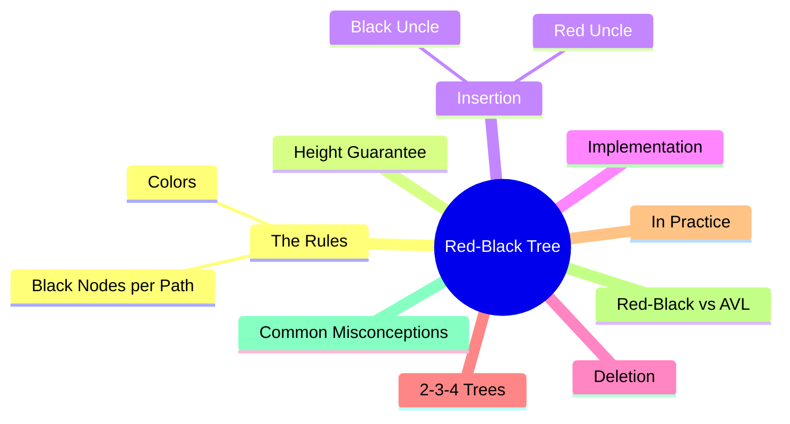

export const metadata = {
  title: 'Red-Black Tree',
  date: '2026-11-19',
  excerpt: 'How a red-black tree uses one color bit per node to keep a binary search tree balanced: the five rules, why they bound the height, how insertion repairs the tree by recoloring and rotating, what deletion has to handle, how red-black trees mirror 2-3-4 trees, and how they compare with AVL trees. Includes examples in TypeScript, Python, and Java.',
  tags: ['Data Structures'],
};

# Red-Black Tree

An AVL tree keeps a tight grip on its shape: at every node, the two subtrees can differ in height by at most one. A red-black tree settles for less. It gives every node a color, red or black, and enforces a few rules about how the colors can be arranged. Those rules let the tree grow somewhat taller than an AVL tree, but they still guarantee a height of O(log n), and they make the tree cheaper to repair after a change: an insert needs at most two rotations, and a delete at most three.

That trade-off has made red-black trees the default balanced tree in practice. Java's `TreeMap` and `TreeSet` are red-black trees, as are `std::map` and `std::set` in the major C++ standard libraries, and the Linux kernel uses them all over the place.

This article covers the rules, why they keep the tree short, how insertion repairs the tree (with a complete implementation), what deletion has to deal with, how red-black trees relate to 2-3-4 trees, and how they compare with AVL trees. It builds on [Binary Search Tree](./binary-search-tree) and [AVL Tree](./avl-tree).



- [The Rules](#the-rules)
- [Why the Height Stays Logarithmic](#why-the-height-stays-logarithmic)
- [Inserting](#inserting)
- [Implementing Insertion](#implementing-insertion)
- [Deleting](#deleting)
- [Red-Black Trees and 2-3-4 Trees](#red-black-trees-and-2-3-4-trees)
- [Red-Black Trees in Practice](#red-black-trees-in-practice)
- [Red-Black vs. AVL Trees](#red-black-vs-avl-trees)
- [Common Misconceptions](#common-misconceptions)
- [Conclusion](#conclusion)

---

## The Rules

A red-black tree is a binary search tree in which every node is either red or black, and the colors follow five rules:

1. Every node is red or black
2. The root is black
3. Every null child counts as a black leaf
4. A red node can't have a red child
5. Every path from a node down to a null child passes through the same number of black nodes

Rules 1 to 3 are mostly bookkeeping. A red root can always be recolored black without breaking anything, and treating null children as black leaves (often called NIL leaves) just makes rule 5 easier to state. Rules 4 and 5 are the ones that shape the tree.

Here's a valid red-black tree, with the red nodes shown in parentheses:

```text
          4
        /   \
      2       6
     / \     /
   (1) (3) (5)
```

Rule 5 holds at the root: every path from 4 down to a null child passes through exactly two black nodes, 4 and either 2 or 6. Passing through the red nodes 1, 3, or 5 doesn't change the count. It holds at every other node too. From 2 or 6, for example, every path down passes through one black node. Rule 4 holds because the only red nodes are leaves, whose children are null, and null counts as black.

---

## Why the Height Stays Logarithmic

Call the number of black nodes on a path from the root down to a null child b. By rule 5, b is the same for every such path. Two facts follow:

- No path from the root has more than 2b nodes. By rule 4, every red node's children are black, and the root is black, so at most half the nodes on any path can be red
- The top b levels of the tree are completely full. If a node were missing anywhere in them, there would be a null child fewer than b levels down, and the path to it would pass through fewer than b black nodes, breaking rule 5. Full levels hold $2^b - 1$ nodes, so n is at least $2^b - 1$, which means b is at most log₂(n + 1)

Put together, the longest path from the root has at most 2b nodes, so the height is at most 2 log₂(n + 1). The shortest path, meanwhile, has at least b nodes. The tree can be lopsided, but the longest path from the root is never more than twice as long as the shortest.

That bound is looser than an AVL tree's, and sometimes it shows. Here are both trees with 1,000 values:

| Insertion Order | AVL Tree Height | Red-Black Tree Height |
| :--- | :--- | :--- |
| Sorted (1, 2, 3, …, 1,000) | 9 | 16 |
| Random (average over 200 runs) | About 11 | About 11 |

On random input the two end up practically the same height. Sorted input leaves the red-black tree noticeably taller, though still nowhere near the 999 of a plain BST.

---

## Inserting

A new value goes in exactly as in a plain BST, as a new leaf, and the new node is colored red. A red node doesn't change the number of black nodes on any path, so rule 5 still holds. Only two rules can break. If the new node is the root, it breaks rule 2, and it's simply colored black. Otherwise, the only risk is rule 4: if the new node's parent is also red, there are two reds in a row.

If the parent is black, there's nothing to fix. If the parent is red, it can't be the root, so there's a grandparent, and the grandparent is black, since it has a red child. What happens next depends on the uncle, the parent's sibling. Below, g is the grandparent, p the parent, u the uncle, and x the new node.

### Red Uncle: Recolor

If the uncle is red too, no rotation is needed. Color the parent and the uncle black, and the grandparent red:

```text
      g              (g)
     / \             / \
   (p) (u)    →     p   u
   /               /
 (x)             (x)
```

Every path through g still passes through exactly one black node among g, p, and u, so rule 5 holds. But g is now red, and its own parent might be red as well. If it is, the same problem has moved two levels up, and the fix-up repeats with g in place of x. If g is the root, it's simply colored black again, which adds one black node to every path at once.

This case works the same no matter which side p and x are on.

### Black Uncle: Rotate

If the uncle is black (a null child counts as black), recoloring alone won't work, but a rotation will. Which rotation depends on the shape of the path from g to p to x.

If the path is a straight line, with x and p on the same side, rotate at g in the opposite direction, then swap the colors of p and g. When x and p are both left children, that's a right rotation at g:

```text
       g             p
      / \           / \
    (p)  u   →    (x) (g)
    /                   \
  (x)                    u
```

Now p is in g's place, colored black, with two red children. There are no longer two reds in a row, and every path passes through as many black nodes as before. If p had a right subtree, it moves across to become g's left subtree, as in any right rotation. Nothing above p has changed, so the fix-up is done.

If the path zigzags instead, with x and p on opposite sides, first rotate at p to straighten it out. When p is a left child and x is a right child, that's a left rotation at p:

```text
      g             g
     / \           / \
   (p)  u    →   (x)  u
     \           /
     (x)       (p)
```

Now x and p have traded places and form a straight line, so the previous case finishes the job, with p in the role of the new node.

Either way, an insert makes at most two rotations. Recoloring can travel up the tree, but each step only changes a few colors, and it stops as soon as it reaches a black parent or the root.

### An Example

Insert 1, 2, 3, and 4 into an empty tree:

| Insert | What Happens |
| :--- | :--- |
| 1 | It's the root, so it's colored black |
| 2 | Its parent, 1, is black. Nothing to fix |
| 3 | Its parent, 2, is red, and its uncle (1's empty left side) is black. 1, 2, and 3 form a straight line, so a left rotation at 1 makes 2 the root, and swapping colors leaves 2 black, with red children 1 and 3 |
| 4 | Its parent, 3, is red, and so is its uncle, 1. Recolor 1 and 3 black and 2 red. 2 is the root, so it goes back to black |

Here's the tree after inserting 3 (a) and after inserting 4 (b):

```text
(a)          (b)
    2            2
   / \          / \
 (1) (3)       1   3
                    \
                    (4)
```

Inserting 4 added a black node to every path: the paths from the root down used to pass through one black node each, and now they pass through two.

---

## Implementing Insertion

Here's a red-black tree of integers with search and insert. Unlike the BST and AVL code in the previous articles, each node also keeps a pointer to its parent, because the fix-up walks up the tree from the new node. Null children count as black, and the `isRed` helper takes care of that.

```typescript
// TypeScript
class RBNode {
  red = true; // new nodes start red
  left: RBNode | null = null;
  right: RBNode | null = null;
  parent: RBNode | null = null;

  constructor(public value: number) {}
}

function isRed(node: RBNode | null): boolean {
  return node !== null && node.red; // null children count as black
}

function heightOf(node: RBNode | null): number {
  if (node === null) return -1;
  return 1 + Math.max(heightOf(node.left), heightOf(node.right));
}

class RedBlackTree {
  private root: RBNode | null = null;

  get height(): number {
    return heightOf(this.root);
  }

  contains(value: number): boolean {
    let node = this.root;
    while (node !== null) {
      if (value < node.value) node = node.left;
      else if (value > node.value) node = node.right;
      else return true;
    }
    return false;
  }

  insert(value: number): void {
    // an ordinary BST insert, keeping track of the parent
    let parent: RBNode | null = null;
    let node = this.root;
    while (node !== null) {
      if (value === node.value) return; // no duplicates
      parent = node;
      node = value < node.value ? node.left : node.right;
    }
    const added = new RBNode(value);
    added.parent = parent;
    if (parent === null) this.root = added;
    else if (value < parent.value) parent.left = added;
    else parent.right = added;
    this.fixAfterInsert(added);
  }

  private fixAfterInsert(x: RBNode): void {
    // fix any two reds in a row, then make sure the root is black
    while (isRed(x.parent)) {
      const p = x.parent!;
      const g = p.parent!; // p is red, so it isn't the root
      const u = p === g.left ? g.right : g.left;
      if (isRed(u)) {
        // red uncle: recolor, then continue from the grandparent
        p.red = false;
        u!.red = false;
        g.red = true;
        x = g;
      } else if (p === g.left) {
        if (x === p.right) {
          // zigzag: rotate at p to make a straight line
          this.rotateLeft(p);
          x = p;
        }
        x.parent!.red = false;
        g.red = true;
        this.rotateRight(g);
      } else {
        if (x === p.left) {
          this.rotateRight(p);
          x = p;
        }
        x.parent!.red = false;
        g.red = true;
        this.rotateLeft(g);
      }
    }
    this.root!.red = false;
  }

  private rotateLeft(x: RBNode): void {
    const y = x.right!;
    x.right = y.left;
    if (y.left !== null) y.left.parent = x;
    this.replace(x, y);
    y.left = x;
    x.parent = y;
  }

  private rotateRight(y: RBNode): void {
    const x = y.left!;
    y.left = x.right;
    if (x.right !== null) x.right.parent = y;
    this.replace(y, x);
    x.right = y;
    y.parent = x;
  }

  // puts child where node was, under node's parent
  private replace(node: RBNode, child: RBNode): void {
    child.parent = node.parent;
    if (node.parent === null) this.root = child;
    else if (node === node.parent.left) node.parent.left = child;
    else node.parent.right = child;
  }
}

const tree = new RedBlackTree();
for (let v = 1; v <= 1000; v++) tree.insert(v);
console.log(tree.height);         // 16
console.log(tree.contains(500));  // true
console.log(tree.contains(1001)); // false
```

```python
# Python
from typing import Optional


class RBNode:
    def __init__(self, value: int) -> None:
        self.value = value
        self.red = True  # new nodes start red
        self.left: Optional[RBNode] = None
        self.right: Optional[RBNode] = None
        self.parent: Optional[RBNode] = None


def is_red(node: Optional[RBNode]) -> bool:
    return node is not None and node.red  # null children count as black


def height_of(node: Optional[RBNode]) -> int:
    if node is None:
        return -1
    return 1 + max(height_of(node.left), height_of(node.right))


class RedBlackTree:
    def __init__(self) -> None:
        self._root: Optional[RBNode] = None

    @property
    def height(self) -> int:
        return height_of(self._root)

    def __contains__(self, value: int) -> bool:
        node = self._root
        while node is not None:
            if value < node.value:
                node = node.left
            elif value > node.value:
                node = node.right
            else:
                return True
        return False

    def insert(self, value: int) -> None:
        # an ordinary BST insert, keeping track of the parent
        parent: Optional[RBNode] = None
        node = self._root
        while node is not None:
            if value == node.value:
                return  # no duplicates
            parent = node
            node = node.left if value < node.value else node.right
        added = RBNode(value)
        added.parent = parent
        if parent is None:
            self._root = added
        elif value < parent.value:
            parent.left = added
        else:
            parent.right = added
        self._fix_after_insert(added)

    def _fix_after_insert(self, x: RBNode) -> None:
        # fix any two reds in a row, then make sure the root is black
        while is_red(x.parent):
            p = x.parent
            g = p.parent  # p is red, so it isn't the root
            u = g.right if p is g.left else g.left
            if is_red(u):
                # red uncle: recolor, then continue from the grandparent
                p.red = False
                u.red = False
                g.red = True
                x = g
            elif p is g.left:
                if x is p.right:
                    # zigzag: rotate at p to make a straight line
                    self._rotate_left(p)
                    x = p
                x.parent.red = False
                g.red = True
                self._rotate_right(g)
            else:
                if x is p.left:
                    self._rotate_right(p)
                    x = p
                x.parent.red = False
                g.red = True
                self._rotate_left(g)
        self._root.red = False

    def _rotate_left(self, x: RBNode) -> None:
        y = x.right
        x.right = y.left
        if y.left is not None:
            y.left.parent = x
        self._replace(x, y)
        y.left = x
        x.parent = y

    def _rotate_right(self, y: RBNode) -> None:
        x = y.left
        y.left = x.right
        if x.right is not None:
            x.right.parent = y
        self._replace(y, x)
        x.right = y
        y.parent = x

    # puts child where node was, under node's parent
    def _replace(self, node: RBNode, child: RBNode) -> None:
        child.parent = node.parent
        if node.parent is None:
            self._root = child
        elif node is node.parent.left:
            node.parent.left = child
        else:
            node.parent.right = child


tree = RedBlackTree()
for v in range(1, 1001):
    tree.insert(v)
print(tree.height)   # 16
print(500 in tree)   # True
print(1001 in tree)  # False
```

```java
// Java
public class RedBlackTree {
    private static class Node {
        int value;
        boolean red = true; // new nodes start red
        Node left, right, parent;

        Node(int value) {
            this.value = value;
        }
    }

    private Node root;

    private static boolean isRed(Node node) {
        return node != null && node.red; // null children count as black
    }

    private static int heightOf(Node node) {
        if (node == null) return -1;
        return 1 + Math.max(heightOf(node.left), heightOf(node.right));
    }

    public int height() {
        return heightOf(root);
    }

    public boolean contains(int value) {
        Node node = root;
        while (node != null) {
            if (value < node.value) node = node.left;
            else if (value > node.value) node = node.right;
            else return true;
        }
        return false;
    }

    public void insert(int value) {
        // an ordinary BST insert, keeping track of the parent
        Node parent = null;
        Node node = root;
        while (node != null) {
            if (value == node.value) return; // no duplicates
            parent = node;
            node = value < node.value ? node.left : node.right;
        }
        Node added = new Node(value);
        added.parent = parent;
        if (parent == null) root = added;
        else if (value < parent.value) parent.left = added;
        else parent.right = added;
        fixAfterInsert(added);
    }

    private void fixAfterInsert(Node x) {
        // fix any two reds in a row, then make sure the root is black
        while (isRed(x.parent)) {
            Node p = x.parent;
            Node g = p.parent; // p is red, so it isn't the root
            Node u = p == g.left ? g.right : g.left;
            if (isRed(u)) {
                // red uncle: recolor, then continue from the grandparent
                p.red = false;
                u.red = false;
                g.red = true;
                x = g;
            } else if (p == g.left) {
                if (x == p.right) {
                    // zigzag: rotate at p to make a straight line
                    rotateLeft(p);
                    x = p;
                }
                x.parent.red = false;
                g.red = true;
                rotateRight(g);
            } else {
                if (x == p.left) {
                    rotateRight(p);
                    x = p;
                }
                x.parent.red = false;
                g.red = true;
                rotateLeft(g);
            }
        }
        root.red = false;
    }

    private void rotateLeft(Node x) {
        Node y = x.right;
        x.right = y.left;
        if (y.left != null) y.left.parent = x;
        replace(x, y);
        y.left = x;
        x.parent = y;
    }

    private void rotateRight(Node y) {
        Node x = y.left;
        y.left = x.right;
        if (x.right != null) x.right.parent = y;
        replace(y, x);
        x.right = y;
        y.parent = x;
    }

    // puts child where node was, under node's parent
    private void replace(Node node, Node child) {
        child.parent = node.parent;
        if (node.parent == null) root = child;
        else if (node == node.parent.left) node.parent.left = child;
        else node.parent.right = child;
    }

    public static void main(String[] args) {
        RedBlackTree tree = new RedBlackTree();
        for (int v = 1; v <= 1000; v++) tree.insert(v);
        System.out.println(tree.height());       // 16
        System.out.println(tree.contains(500));  // true
        System.out.println(tree.contains(1001)); // false
    }
}
```

How it fits together:

- `insert` is the plain BST insert, plus setting the new node's parent pointer, followed by the fix-up
- The fix-up loops while x's parent is red. A red uncle means recoloring and moving x up to the grandparent. A black uncle means one or two rotations, after which x's parent is black and the loop ends. Finally, the root is colored black, in case the new node is the root or recoloring turned it red
- The rotations work as in [AVL Tree](./avl-tree), except that they also update parent pointers, and `replace` attaches the rotated subtree to the node above it
- The demo inserts 1 to 1,000 in sorted order, and the tree ends up with a height of 16, compared with 9 for an AVL tree and 999 for a plain BST

---

## Deleting

Deletion starts as an ordinary BST delete. If the node has two children, it takes its in-order successor's value, and the successor is removed instead. Either way, the node that actually leaves the tree has at most one child.

If that node is red, nothing breaks. Removing a red node doesn't change any path's black count, and it can't put two reds next to each other. If it's black but its only child is red, color that child black to replace the missing black node.

The hard case is removing a black node with no red child to take over its color. Every path that went through it now has one black node too few. The usual way to think about it is that the spot it left behind carries an extra black, a "double black", which has to be either absorbed or pushed up the tree. What to do depends on that spot's sibling, s:

- s is red: rotate at the parent so that s moves up, and swap the colors of s and the parent. The spot now has a black sibling, so one of the cases below applies
- s is black and both of its children are black: color s red. Now both sides of the parent are one black node short, so the extra black moves up to the parent. If the parent is red, color it black and stop. Otherwise, repeat from the parent
- s is black, its child nearer the spot is red, and its other child is black: rotate at s to bring the red child up, and swap their colors. The spot's new sibling is black, with a red far child, which is the last case
- s is black and its far child is red: rotate at the parent so that s moves up, give s the parent's old color, and color the parent and s's far child black. That puts the missing black node back on the short side, and the fix-up is done

Only the second case can repeat, and it never rotates. The first case leads to one of the others, and the last two end the fix-up. So a delete makes at most three rotations, while the recoloring climbs at most O(log n) levels. With every mirror image spelled out, the code is about twice as long as insertion's. Library authors have done that work already, and chapter 13 of *Introduction to Algorithms* (CLRS) walks through the full version if you want to see it.

---

## Red-Black Trees and 2-3-4 Trees

A 2-3-4 tree is a search tree whose nodes hold one, two, or three keys, with two, three, or four children, and whose leaves are all at the same depth. It stays perfectly balanced by growing at the top: when a node fills up, it splits, and its middle key moves up into the parent. It's a B-tree whose nodes have at most four children, the same structure that [Binary Search Tree](./binary-search-tree) describes as the standard database index.

A red-black tree is a 2-3-4 tree drawn with binary nodes. Take each black node together with its red children, and treat them as one 2-3-4 node:

- A black node with no red children is a 2-node, holding one key
- A black node with one red child is a 3-node, holding two keys
- A black node with two red children is a 4-node, holding three keys

The example tree from [The Rules](#the-rules) becomes:

```text
         [4]
        /   \
  [1 2 3]   [5 6]
```

Seen this way, the rules make sense. Each black node stands for one 2-3-4 node, and all the leaves of a 2-3-4 tree are at the same depth, so every path passes through the same number of black nodes: that's rule 5. A red node is part of its black parent's node, and a red node with a red child would make a node with more than three keys: that's rule 4. Even insertion lines up. In the red-uncle case, a black node with two red children turns red and gives its color to its children, which is a 4-node splitting and passing its middle key up to its parent.

That's no coincidence. Rudolf Bayer invented the structure in 1972 as the "symmetric binary B-tree", and Leonidas Guibas and Robert Sedgewick recast it with red and black colors in 1978.

---

## Red-Black Trees in Practice

You'll rarely write a red-black tree yourself, but you've almost certainly used one:

- Java: `TreeMap` and `TreeSet` are red-black trees, and `HashMap` turns a bucket into one when it holds too many entries, as described in [Hash Functions and Collision Handling](./hash-functions-and-collision-handling)
- C++: `std::map`, `std::set`, `std::multimap`, and `std::multiset` are red-black trees in all three major standard libraries: libstdc++, libc++, and Microsoft's STL
- Linux: the kernel has its own red-black tree implementation, used by the CPU scheduler, high-resolution timers, epoll, and more

Python and JavaScript have nothing like it built in. As covered in [Binary Search Tree](./binary-search-tree), you'd reach for a library there.

---

## Red-Black vs. AVL Trees

| Property | AVL Tree | Red-Black Tree |
| :--- | :--- | :--- |
| Balance rule | At every node, subtree heights differ by at most 1 | No red node has a red child, and every path has the same number of black nodes |
| Maximum height | About 1.44 log₂ n | 2 log₂(n + 1) |
| Rotations per insert | At most 2 | At most 2 |
| Rotations per delete | Up to one per level, O(log n) | At most 3 |
| Extra data per node | A height, or a 2-bit balance factor | One bit for the color |
| Best fit | Lookups far outnumber changes | A general-purpose default |

Neither one wins across the board. Both guarantee O(log n) search, insert, and delete. An AVL tree's stricter balance pays off when lookups dominate, while a red-black tree's cheaper deletes and lighter bookkeeping are why library authors usually choose it.

---

## Common Misconceptions

| Common Misconception | What's Actually True |
| :--- | :--- |
| Red nodes are the unbalanced ones. | A node's color says nothing about its own balance. Red marks a node that belongs with its black parent (in 2-3-4 terms, part of the same node), and the rules about colors along whole paths are what bound the height. |
| A red-black tree is as short as an AVL tree. | It can be taller: up to 2 log₂(n + 1), versus about 1.44 log₂ n. On random data the two end up about the same height, but sorted input can leave a red-black tree noticeably taller. |
| Every path from the root to a leaf has the same length. | Every such path has the same number of black nodes. The red nodes in between can make one path up to twice as long as another. |
| An insert can trigger rotations all the way up the tree. | It makes at most two rotations. What can travel up the tree is recoloring, which only changes a few colors at each step. |
| NIL leaves are real nodes that take up memory. | They're a way of stating the rules. Implementations use null children, as the code here does, or one shared sentinel node. |
| New nodes are colored black. | They start out red, because a red node doesn't change any path's black count. The worst it can cause is two reds in a row, or a red root, and the fix-up repairs both. |

---

## Conclusion

A red-black tree is a binary search tree with a color on every node and two rules that matter: no red node has a red child, and every path down from a node passes through the same number of black nodes. Together they keep the longest path from the root at most twice as long as the shortest, and the height at most 2 log₂(n + 1).

An insert adds a red leaf and fixes any red-red conflict by recoloring up the tree, with at most two rotations at the end. A delete is more involved but needs at most three rotations. Logarithmic height with cheap, bounded repairs is why red-black trees sit behind Java's `TreeMap`, C++'s `std::map`, and the Linux kernel.
