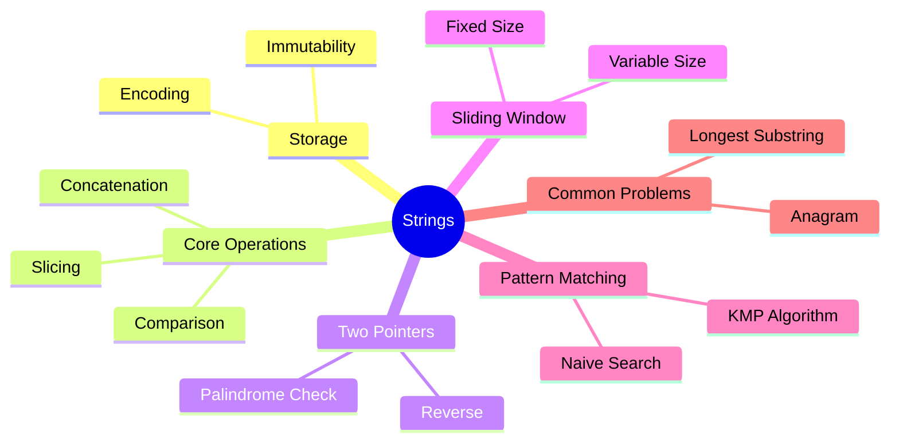

export const metadata = {
  title: 'String Algorithms',
  date: '2026-11-05',
  excerpt: 'A thorough guide to strings: how they are stored in memory, the operations and their true costs, the two-pointer and sliding window techniques that solve most interview problems, and the KMP algorithm for efficient pattern matching.',
  tags: ['Data Structures'],
};

# String Algorithms

A string is a sequence of characters. Simple enough — but that's exactly the right starting point: everything about string algorithms follows from the fact that a string is an ordered sequence, and that characters can be compared, counted, and rearranged.

Strings are everywhere in software, and so are string problems. Most of them come down to a handful of techniques: two pointers, sliding window, and pattern matching. Understanding those techniques, and the true cost of the operations underneath them, is what actually lets you solve these problems rather than just recognize them.



- [How Strings Are Stored](#how-strings-are-stored)
- [Core Operations and Their Costs](#core-operations-and-their-costs)
- [Two Pointers](#two-pointers)
- [Sliding Window](#sliding-window)
- [Pattern Matching and KMP](#pattern-matching-and-kmp)
- [Common Problem Patterns](#common-problem-patterns)
- [Conclusion](#conclusion)

---

## How Strings Are Stored

Under the hood, a string is an array of characters. In C, it's literally a `char[]` terminated by a null byte (`\0`). In Java and JavaScript, strings are objects wrapping an immutable array of characters.

**Immutability** is the most important property to internalize. In Java, Python, and JavaScript, strings cannot be modified in place. Every operation that appears to change a string actually creates a new one.

```javascript
let s = 'hello';
s[0] = 'H'; // silently does nothing in JavaScript
console.log(s); // 'hello'

s = s.toUpperCase(); // creates a new string 'HELLO', assigns it to s
```

This has a direct consequence for concatenation in a loop:

```javascript
// O(n²) — each += creates a new string and copies everything
let result = '';
for (const word of words) {
  result += word;
}

// O(n) — collect parts, join once at the end
const result = words.join('');
```

Each `+=` copies the entire accumulated string into a new allocation. After `k` iterations, you've copied 1 + 2 + 3 + ... + k characters, which is O(k²) total. Collecting into an array and joining once is O(n).

**Encoding** matters when you move beyond ASCII. JavaScript strings are UTF-16: most common characters take one 16-bit code unit, but characters outside the Basic Multilingual Plane (emoji, some CJK characters) take two code units (a surrogate pair). `string.length` counts code units, not characters.

```javascript
const emoji = '😀';
emoji.length;        // 2 (two UTF-16 code units)
[...emoji].length;   // 1 (one Unicode code point, spread operator handles surrogates)
```

For most algorithm problems, you can assume ASCII and treat each character as one unit. Just be aware the assumption breaks in production code handling arbitrary user input.

---

## Core Operations and Their Costs

| Operation | Cost | Notes |
| - | - | - |
| Access by index | O(1) | Same as array |
| Length | O(1) | Stored as a field |
| Comparison (`===`) | O(n) | Must compare character by character |
| Concatenation (`+`) | O(n) | Copies both strings into a new one |
| Slice / substring | O(k) | k = length of the slice |
| Search (`indexOf`) | O(n·m) | Naive; KMP is O(n+m) |
| Split | O(n) | |
| Replace | O(n) | |

The comparison cost surprises people. `s1 === s2` is O(n) in the worst case because the engine has to compare every character. Short-circuit evaluation helps: if the lengths differ, the answer is immediately false. But two strings of the same length that differ only in the last character require a full scan.

---

## Two Pointers

The two-pointer technique places one pointer at each end of the string and moves them toward each other. It's the natural tool for problems that ask about pairs of characters at symmetric positions.

### Palindrome check

A palindrome reads the same forward and backward. Check it by comparing characters from both ends, moving inward until the pointers meet.

```javascript
function isPalindrome(s) {
  let lo = 0, hi = s.length - 1;

  while (lo < hi) {
    if (s[lo] !== s[hi]) return false;
    lo++;
    hi--;
  }

  return true;
}

isPalindrome('racecar'); // true
isPalindrome('hello');   // false
```

O(n) time, O(1) space. No need to reverse the string and compare.

### Valid palindrome with non-alphanumeric characters

A common variant: ignore non-alphanumeric characters and treat uppercase and lowercase as equal.

```javascript
function isPalindrome(s) {
  const clean = s.toLowerCase().replace(/[^a-z0-9]/g, '');
  let lo = 0, hi = clean.length - 1;

  while (lo < hi) {
    if (clean[lo] !== clean[hi]) return false;
    lo++;
    hi--;
  }

  return true;
}
```

### Reverse a string

```javascript
function reverse(s) {
  const arr = s.split('');
  let lo = 0, hi = arr.length - 1;

  while (lo < hi) {
    [arr[lo], arr[hi]] = [arr[hi], arr[lo]];
    lo++;
    hi--;
  }

  return arr.join('');
}
```

Since strings are immutable, you convert to an array, swap in place, and join back. O(n) time, O(n) space for the array.

---

## Sliding Window

The sliding window technique maintains a contiguous subarray (or substring) that satisfies some condition, expanding or contracting it as you scan from left to right. It turns what would be an O(n²) nested loop into a single O(n) pass.

### Fixed-size window

Find the maximum sum of any subarray of length `k`:

```javascript
function maxSumSubarray(arr, k) {
  let windowSum = 0;
  for (let i = 0; i < k; i++) windowSum += arr[i];

  let maxSum = windowSum;
  for (let i = k; i < arr.length; i++) {
    windowSum += arr[i] - arr[i - k]; // slide: add new, remove old
    maxSum = Math.max(maxSum, windowSum);
  }

  return maxSum;
}
```

Each step adds one element and removes one, so the window sum updates in O(1).

### Variable-size window

The more interesting case: find the length of the longest substring without repeating characters.

```javascript
function lengthOfLongestSubstring(s) {
  const seen = new Map(); // character → last seen index
  let maxLen = 0;
  let lo = 0;

  for (let hi = 0; hi < s.length; hi++) {
    const c = s[hi];

    // If we've seen this character and it's inside the current window, shrink from the left
    if (seen.has(c) && seen.get(c) >= lo) {
      lo = seen.get(c) + 1;
    }

    seen.set(c, hi);
    maxLen = Math.max(maxLen, hi - lo + 1);
  }

  return maxLen;
}

lengthOfLongestSubstring('abcabcbb'); // 3 ('abc')
lengthOfLongestSubstring('pwwkew');   // 3 ('wke')
```

`hi` always moves forward. `lo` only moves forward (never backward). Each character is added to the window at most once and removed at most once, so the total work is O(n).

### Minimum window substring

Find the smallest window in `s` that contains all characters of `t`:

```javascript
function minWindow(s, t) {
  const need = new Map();
  for (const c of t) need.set(c, (need.get(c) ?? 0) + 1);

  let have = 0, required = need.size;
  let lo = 0, minLen = Infinity, minStart = 0;
  const window = new Map();

  for (let hi = 0; hi < s.length; hi++) {
    const c = s[hi];
    window.set(c, (window.get(c) ?? 0) + 1);

    if (need.has(c) && window.get(c) === need.get(c)) have++;

    while (have === required) {
      if (hi - lo + 1 < minLen) {
        minLen = hi - lo + 1;
        minStart = lo;
      }
      const left = s[lo];
      window.set(left, window.get(left) - 1);
      if (need.has(left) && window.get(left) < need.get(left)) have--;
      lo++;
    }
  }

  return minLen === Infinity ? '' : s.slice(minStart, minStart + minLen);
}

minWindow('ADOBECODEBANC', 'ABC'); // 'BANC'
```

The outer loop expands the window; the inner `while` shrinks it from the left whenever all required characters are present. Each character is processed at most twice (once when added, once when removed), so the total is O(n + m) where n = `s.length` and m = `t.length`.

---

## Pattern Matching and KMP

Given a text `t` and a pattern `p`, find all positions where `p` occurs in `t`.

### Naive approach

Check every possible starting position:

```javascript
function naiveSearch(text, pattern) {
  const positions = [];
  for (let i = 0; i <= text.length - pattern.length; i++) {
    let match = true;
    for (let j = 0; j < pattern.length; j++) {
      if (text[i + j] !== pattern[j]) { match = false; break; }
    }
    if (match) positions.push(i);
  }
  return positions;
}
```

O(n·m) in the worst case. For a pattern like `'aaab'` in a text like `'aaaa...aaab'`, almost every position requires a full scan of the pattern before finding a mismatch.

### KMP (Knuth-Morris-Pratt)

KMP avoids redundant comparisons by precomputing a **failure function** (also called the prefix function or partial match table) for the pattern. The failure function tells you: if a mismatch occurs at position `j` in the pattern, how far back can you shift the pattern without missing a match?

The key insight: if the pattern has a prefix that is also a suffix of the part matched so far, you don't need to restart from the beginning of the pattern. You can jump to the end of that prefix.

**Step 1: Build the failure function**

`fail[j]` = the length of the longest proper prefix of `pattern[0..j]` that is also a suffix.

```javascript
function buildFailure(pattern) {
  const fail = new Array(pattern.length).fill(0);
  let k = 0; // length of the previous longest prefix-suffix

  for (let j = 1; j < pattern.length; j++) {
    while (k > 0 && pattern[k] !== pattern[j]) {
      k = fail[k - 1]; // fall back
    }
    if (pattern[k] === pattern[j]) k++;
    fail[j] = k;
  }

  return fail;
}

buildFailure('ababc'); // [0, 0, 1, 2, 0]
// 'a'     → no proper prefix-suffix → 0
// 'ab'    → no match → 0
// 'aba'   → 'a' is both prefix and suffix → 1
// 'abab'  → 'ab' is both prefix and suffix → 2
// 'ababc' → no match → 0
```

**Step 2: Search using the failure function**

```javascript
function kmpSearch(text, pattern) {
  if (pattern.length === 0) return [0];
  const fail = buildFailure(pattern);
  const positions = [];
  let k = 0; // number of characters matched so far

  for (let i = 0; i < text.length; i++) {
    while (k > 0 && text[i] !== pattern[k]) {
      k = fail[k - 1]; // mismatch: fall back using the failure function
    }
    if (text[i] === pattern[k]) k++;
    if (k === pattern.length) {
      positions.push(i - pattern.length + 1); // found a match
      k = fail[k - 1]; // look for the next match
    }
  }

  return positions;
}

kmpSearch('ababcababc', 'ababc'); // [0, 5]
```

**Complexity:** O(n + m). Building the failure function is O(m); the search is O(n). The `while` loop inside the search looks like it could make things O(n·m), but `k` can only increase by 1 per outer iteration and can only decrease in total as many times as it increased, so the total number of `k` decrements across the entire search is bounded by n.

**Why it matters:** For most practical inputs, the naive approach is fast enough. KMP becomes important when the pattern has long repeated prefixes (like DNA sequences or binary strings), or when you're searching the same pattern in many texts and want to pay the O(m) preprocessing cost only once.

---

## Common Problem Patterns

### Anagram check

Two strings are anagrams if they contain the same characters with the same frequencies. Sort both and compare, or use a frequency map.

```javascript
function isAnagram(s, t) {
  if (s.length !== t.length) return false;

  const count = new Array(26).fill(0);
  for (let i = 0; i < s.length; i++) {
    count[s.charCodeAt(i) - 97]++;
    count[t.charCodeAt(i) - 97]--;
  }

  return count.every((c) => c === 0);
}

isAnagram('anagram', 'nagaram'); // true
isAnagram('rat', 'car');         // false
```

O(n) time, O(1) space (the array is always size 26 for lowercase ASCII).

### Group anagrams

Given a list of strings, group the anagrams together. The key insight: anagrams have the same sorted form.

```javascript
function groupAnagrams(strs) {
  const map = new Map();

  for (const s of strs) {
    const key = s.split('').sort().join('');
    if (!map.has(key)) map.set(key, []);
    map.get(key).push(s);
  }

  return [...map.values()];
}

groupAnagrams(['eat', 'tea', 'tan', 'ate', 'nat', 'bat']);
// [['eat','tea','ate'], ['tan','nat'], ['bat']]
```

O(n · k log k) where n is the number of strings and k is the maximum string length.

### Longest palindromic substring

Expand around each possible center. A palindrome has either one center character (odd length) or two center characters (even length).

```javascript
function longestPalindrome(s) {
  let start = 0, maxLen = 1;

  function expand(lo, hi) {
    while (lo >= 0 && hi < s.length && s[lo] === s[hi]) {
      if (hi - lo + 1 > maxLen) {
        maxLen = hi - lo + 1;
        start = lo;
      }
      lo--;
      hi++;
    }
  }

  for (let i = 0; i < s.length; i++) {
    expand(i, i);     // odd-length palindromes
    expand(i, i + 1); // even-length palindromes
  }

  return s.slice(start, start + maxLen);
}

longestPalindrome('babad'); // 'bab' or 'aba'
longestPalindrome('cbbd');  // 'bb'
```

O(n²) time, O(1) space. The Manacher's algorithm can do this in O(n), but the expand-around-center approach is much easier to implement and remember.

---

## Conclusion

String problems look varied on the surface, but most of them reduce to a small set of techniques:

- **Two pointers** for problems involving pairs of characters at symmetric positions (palindromes, reversals)
- **Sliding window** for problems asking about the longest or shortest substring satisfying some condition
- **Frequency maps** for problems about character counts (anagrams, permutations)
- **KMP** when you need efficient pattern matching, especially with repeated prefixes

The underlying cost model is what ties everything together: strings are immutable sequences, so concatenation in a loop is O(n²), and any algorithm that avoids rebuilding the string from scratch at each step is worth understanding.
