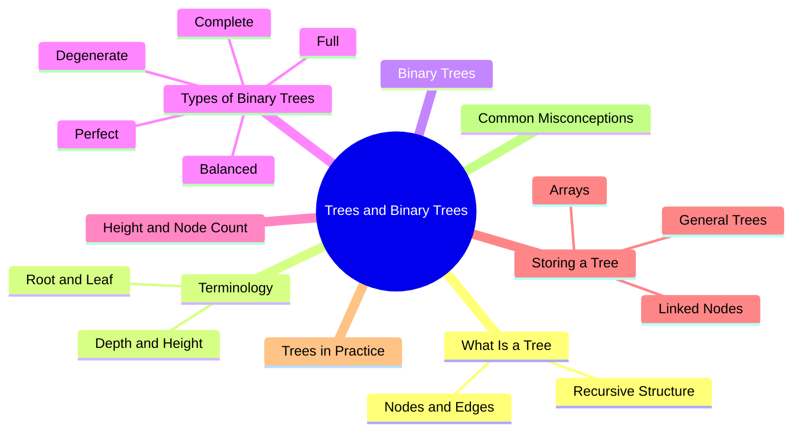
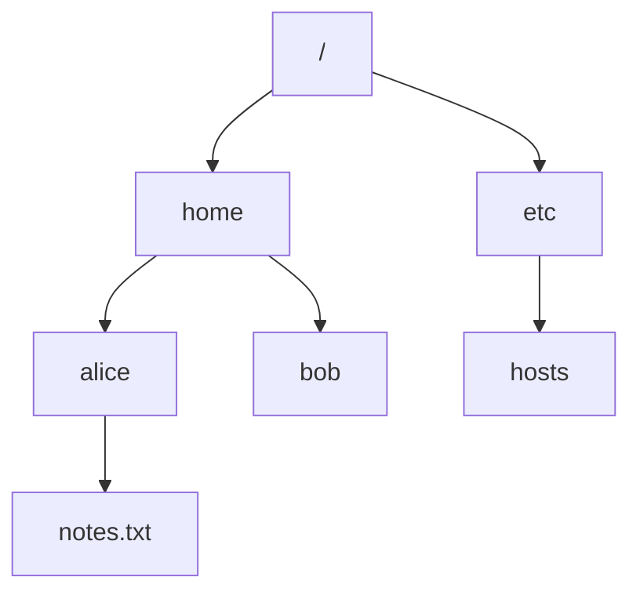
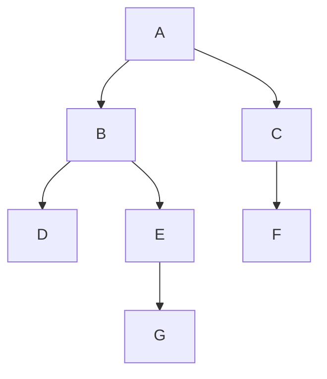

export const metadata = {
  title: 'Tree and Binary Tree Basics',
  date: '2026-11-15',
  excerpt: 'What a tree is, the vocabulary that comes with it (root, leaf, depth, height), what makes a tree binary, the common shapes a binary tree can take, why height decides how fast a tree is, and how trees are stored in memory. Includes examples in TypeScript, Python, and Java.',
  tags: ['Data Structures'],
};

# Tree and Binary Tree Basics

Arrays, linked lists, stacks, and queues are all linear: every element has at most one element before it and one after it. A lot of data isn't shaped like that. A folder holds files and other folders, an HTML element holds other elements, and an org chart branches out at every manager. The natural structure for data like this is a tree.

Trees are also the foundation for some of the most useful structures in programming: binary search trees, heaps, and the B-trees behind database indexes. They all build on the ideas in this article: the vocabulary, what makes a tree binary, the shapes a binary tree can take, why height matters so much, and how trees are stored in memory.



- [What Is a Tree](#what-is-a-tree)
- [Tree Terminology](#tree-terminology)
- [Binary Trees](#binary-trees)
- [Types of Binary Trees](#types-of-binary-trees)
- [Height and Node Count](#height-and-node-count)
- [Storing a Tree in Memory](#storing-a-tree-in-memory)
- [Trees in Practice](#trees-in-practice)
- [Common Misconceptions](#common-misconceptions)
- [Conclusion](#conclusion)

---

## What Is a Tree

A tree is a set of nodes connected by edges. One node sits at the top and is called the root, and every node can have any number of children below it. Here's part of a file system drawn as a tree:



Two rules make a structure a tree:

- Every node except the root has exactly one parent
- There are no cycles. Follow the parent links up from any node and you always end at the root

Those rules have two useful consequences. There's only one path from the root to any given node, so every node has a well-defined position. And a tree with n nodes has n − 1 edges: one for each node other than the root, linking it to its parent.

Trees are also recursive. Take any node together with everything below it, and you get another tree, called a subtree. So a tree can be defined in terms of itself: a root node, plus zero or more subtrees, one for each child. That's why code that works on trees is usually recursive (see [Recursion](./recursion)): handle the current node and let the same function handle each subtree.

---

## Tree Terminology

Trees come with a lot of vocabulary. The table below uses this tree for every example:



| Term | Meaning | In the Example |
| :--- | :--- | :--- |
| Root | The node at the top, the only one without a parent | A |
| Parent, child | A node's parent is the node directly above it; its children are the nodes directly below it | B is the parent of D and E |
| Siblings | Nodes with the same parent | D and E |
| Leaf | A node with no children | D, F, and G |
| Internal node | A node with at least one child | A, B, C, and E |
| Ancestor, descendant | A node's ancestors are its parent, its parent's parent, and so on up to the root; its descendants are its children, their children, and so on | G's ancestors are E, B, and A; B's descendants are D, E, and G |
| Subtree | A node together with all of its descendants | The subtree rooted at B is B, D, E, and G |
| Degree | The number of children a node has | B has degree 2, C has degree 1 |
| Depth | The number of edges from the root down to the node | A is at depth 0, G at depth 3 |
| Level | All the nodes at the same depth | Level 2 is D, E, and F |
| Height of a node | The number of edges on the longest path from the node down to a leaf | B has height 2, F has height 0 |
| Height of a tree | The height of its root | 3 |

Depth and height are easy to mix up. Depth is measured from the top: how far a node is from the root. Height is measured from the bottom: how far a node is from the deepest leaf below it. The root always has depth 0, every leaf has height 0, and the height of the tree equals the depth of its deepest node.

This series counts edges, so the root is at depth 0 (and on level 0), and a tree with a single node has height 0. Some textbooks and many coding problems count nodes instead, which makes every depth, level, and height one larger. Neither is wrong, but check which one a problem uses. Counting edges also means an empty tree has height −1. That looks odd, but it's what makes the recursive height function in the next section come out right.

---

## Binary Trees

A binary tree is a tree in which every node has at most two children, called the left child and the right child.

Left and right aren't interchangeable. In (a), node 1 has only a left child; in (b), only a right child. As general trees they'd be the same, but as binary trees they're different:

```text
(a)      (b)
  1        1
 /          \
2            2
```

The difference matters later. In a binary search tree, which side a value is on tells you whether it's smaller or larger than its parent.

Binary trees also have a tidy recursive definition: a binary tree is either empty, or a node with a left subtree and a right subtree, each of which is a binary tree. In code, "empty" is `null` (or `None`), and that's where every recursive function on a tree stops.

Here's a node in each language, along with two of the most common recursive functions: `size`, which counts the nodes, and `height`. The example builds this tree:

```text
      1
     / \
    2   3
   / \
  4   5
```

```typescript
// TypeScript
class TreeNode {
  constructor(
    public value: number,
    public left: TreeNode | null = null,
    public right: TreeNode | null = null,
  ) {}
}

function size(node: TreeNode | null): number {
  if (node === null) return 0;
  return 1 + size(node.left) + size(node.right);
}

function height(node: TreeNode | null): number {
  if (node === null) return -1; // so that a single node has height 0
  return 1 + Math.max(height(node.left), height(node.right));
}

const root = new TreeNode(
  1,
  new TreeNode(2, new TreeNode(4), new TreeNode(5)),
  new TreeNode(3),
);
console.log(size(root));   // 5
console.log(height(root)); // 2
```

```python
# Python
from typing import Optional


class TreeNode:
    def __init__(
        self,
        value: int,
        left: Optional["TreeNode"] = None,
        right: Optional["TreeNode"] = None,
    ) -> None:
        self.value = value
        self.left = left
        self.right = right


def size(node: Optional[TreeNode]) -> int:
    if node is None:
        return 0
    return 1 + size(node.left) + size(node.right)


def height(node: Optional[TreeNode]) -> int:
    if node is None:
        return -1  # so that a single node has height 0
    return 1 + max(height(node.left), height(node.right))


root = TreeNode(1, TreeNode(2, TreeNode(4), TreeNode(5)), TreeNode(3))
print(size(root))    # 5
print(height(root))  # 2
```

```java
// Java
public class TreeNode {
    int value;
    TreeNode left;
    TreeNode right;

    TreeNode(int value) {
        this.value = value;
    }

    TreeNode(int value, TreeNode left, TreeNode right) {
        this.value = value;
        this.left = left;
        this.right = right;
    }

    static int size(TreeNode node) {
        if (node == null) return 0;
        return 1 + size(node.left) + size(node.right);
    }

    static int height(TreeNode node) {
        if (node == null) return -1; // so that a single node has height 0
        return 1 + Math.max(height(node.left), height(node.right));
    }

    public static void main(String[] args) {
        TreeNode root = new TreeNode(1,
                new TreeNode(2, new TreeNode(4), new TreeNode(5)),
                new TreeNode(3));
        System.out.println(size(root));   // 5
        System.out.println(height(root)); // 2
    }
}
```

Both functions follow the recursive definition. The size of a tree is one (the node itself) plus the sizes of its two subtrees. The height is one more than the height of the taller subtree. For an empty tree, `size` returns 0 and `height` returns −1, and that −1 is what puts a leaf at height 0: 1 + max(−1, −1) = 0.

Each function visits every node once, so both run in O(n) time. The recursion goes as deep as the tree is tall, which matters for very tall trees.

---

## Types of Binary Trees

A few names describe how a binary tree is filled in:

- Full: every node has either zero or two children. No node has only one
- Complete: every level is completely filled except possibly the last, and the nodes on the last level are as far left as possible
- Perfect: every internal node has two children and all the leaves are at the same depth, so every level is completely filled

```text
(a)             (b)
      1               1
     / \             / \
    2   3           2   3
       / \         /
      4   5       4

(c)
      1
    /   \
   2     3
  / \   / \
 4   5 6   7
```

(a) is full but not complete: node 2 has no children while node 3 does, so the last level isn't filled from the left. (b) is complete but not full: node 2 has only one child. (c) is perfect, which makes it both full and complete. Being full and being complete are independent of each other, as (a) and (b) show.

These names aren't fully standardized. Some authors call a perfect tree "complete", and some call it "full". The definitions above are the most common ones today, and the ones this series uses.

Two more terms are about height rather than how the levels fill up:

- Balanced: the height stays O(log n), close to the minimum for its number of nodes. A common precise version: at every node, the heights of the left and right subtrees differ by at most 1
- Degenerate: every internal node has only one child. The tree is a linked list in all but name, and its height is n − 1

```text
(a)                (b)
      2            1
     / \            \
    1   3            2
         \            \
          4            3
                        \
                         4
```

Both trees hold the same four values. (a) is balanced, with height 2. (b) is degenerate, with height 3. With four nodes the gap is one level, but it grows quickly, as the next section shows.

---

## Height and Node Count

Many tree operations, such as a search in a binary search tree or an insert into a heap, follow a single path between the root and a leaf. Their cost is proportional to the height of the tree, not to the number of nodes. So how short can a tree with n nodes be, and how tall?

Every node has at most two children, so each level can hold at most twice as many nodes as the level above it. Level d holds at most $2^d$ nodes, and a tree of height h holds at most $1 + 2 + 4 + \cdots + 2^h = 2^{h+1} - 1$ nodes. Only a perfect tree reaches that maximum.

Turn that around, and a tree with n nodes needs a height of at least about log₂ n. More precisely, the smallest possible height is $\lfloor \log_2 n \rfloor$, and complete trees achieve it. At the other end, a degenerate tree puts one node on each level, for a height of n − 1.

| Nodes (n) | Smallest Possible Height | Largest Possible Height |
| :--- | :--- | :--- |
| 7 | 2 | 6 |
| 1,000 | 9 | 999 |
| 1,000,000 | 19 | 999,999 |

A walk from the root to the deepest leaf visits at most 20 nodes in the best-shaped tree with a million nodes, and up to a million in the worst-shaped one. Same data, same number of nodes. That's the difference between O(log n) and O(n), and it's why keeping trees balanced gets so much attention.

---

## Storing a Tree in Memory

### Linked Nodes

The `TreeNode` class above is the usual way to store a tree: each node is a separate object holding a value and references to its children. It handles any shape, and adding or removing a node only means updating a reference or two. The price is two extra references per node, and nodes that end up scattered across memory instead of sitting next to each other.

### Arrays

A complete binary tree can be stored without any references at all. Lay the nodes out in an array, level by level, left to right. For the node at index i (counting from 0):

- Its left child is at index $2i + 1$
- Its right child is at index $2i + 2$
- Its parent is at index $\lfloor (i - 1) / 2 \rfloor$

The five-node tree from the code above becomes `[1, 2, 3, 4, 5]`. Node 2 is at index 1, so its children are at indexes 3 and 4 (values 4 and 5), and its parent is at index $\lfloor (1 - 1) / 2 \rfloor = 0$, the root.

A complete tree has no gaps, so every slot in the array is used. Moving between parent and child is plain arithmetic, and the nodes sit next to each other in memory, which the CPU cache likes (see [Arrays](./array)). This is how binary heaps are stored.

The layout falls apart for sparse trees, because a missing node still takes up its slot. A degenerate tree shows how bad it gets: a chain of 20 nodes running down the right side needs an array of $2^{20} - 1$ = 1,048,575 slots to hold 20 values. Use the array layout for complete trees and linked nodes for everything else.

### General Trees

When a node can have any number of children, fixed `left` and `right` fields aren't enough. The simplest fix is to give each node a list of its children; recursive functions then loop over that list instead of making two calls.

Another classic layout is left-child, right-sibling: each node stores a reference to its first child and one to its next sibling. That's two references per node, so any tree can be stored in the shape of a binary tree. The DOM offers both views of an element's children: `children` gives you the list, and `firstElementChild` and `nextElementSibling` let you walk the same elements one link at a time.

---

## Trees in Practice

You work with trees all the time, often without calling them that:

| Where | What the Tree Represents |
| :--- | :--- |
| The DOM | An HTML document. Each element is a node, and the elements directly inside it are its children (see [DOM](./web-dom)) |
| File systems | Directories, and the files and directories inside them |
| Compilers and tooling | Source code parsed into an abstract syntax tree (AST). TypeScript, Babel, ESLint, and Prettier all work on ASTs |
| UI frameworks | Components that render other components, such as React's component tree |
| JSON | Objects and arrays nested inside each other |
| Data structures | Binary search trees for ordered data, heaps for priority queues, B-trees for database indexes, tries for prefix search |

An AST shows how much a tree's shape can carry. Here is `1 + 2 * 3`:

```text
    +
   / \
  1   *
     / \
    2   3
```

The tree doesn't need precedence rules or parentheses: `*` sits below `+`, so `2 * 3` has to be computed before the addition can use its result.

---

## Common Misconceptions

| Common Misconception | What's Actually True |
| :--- | :--- |
| Every node in a binary tree has two children. | At most two. A node can have zero, one, or two children. A tree in which every node has zero or two is called full. |
| A binary tree is just a tree whose nodes have at most two children. | A binary tree also tells left from right. A node with only a left child and a node with only a right child form two different binary trees. |
| A binary tree with n nodes has a height of about log n. | Only if it's balanced. The height can be anything from $\lfloor \log_2 n \rfloor$ to n − 1, and a degenerate tree is no faster than a linked list. |
| Depth and height mean the same thing. | Depth counts down from the root to a node. Height counts down from a node to its deepest leaf. They meet in one place: the height of the tree equals the depth of its deepest node. |
| Complete and perfect binary trees are the same. | A perfect tree has every level full. A complete tree may have a partly filled last level, as long as the nodes on it are packed to the left. |
| Every binary tree is a binary search tree. | A binary search tree is a binary tree with an ordering rule. Expression trees and heaps are binary trees that don't follow it. |

---

## Conclusion

A tree is a set of nodes with one root, one parent for every other node, and no cycles. That simple structure makes it recursive all the way down: every node is the root of its own subtree, which is why tree code so often calls itself. A binary tree adds two things: at most two children per node, and a fixed left and right.

The most important number for a tree is its height. Many operations follow a single path between the root and a leaf, so they cost one step per level, and for n nodes the height can be anything from about log₂ n to n − 1. Keeping trees short is what keeps them fast.
