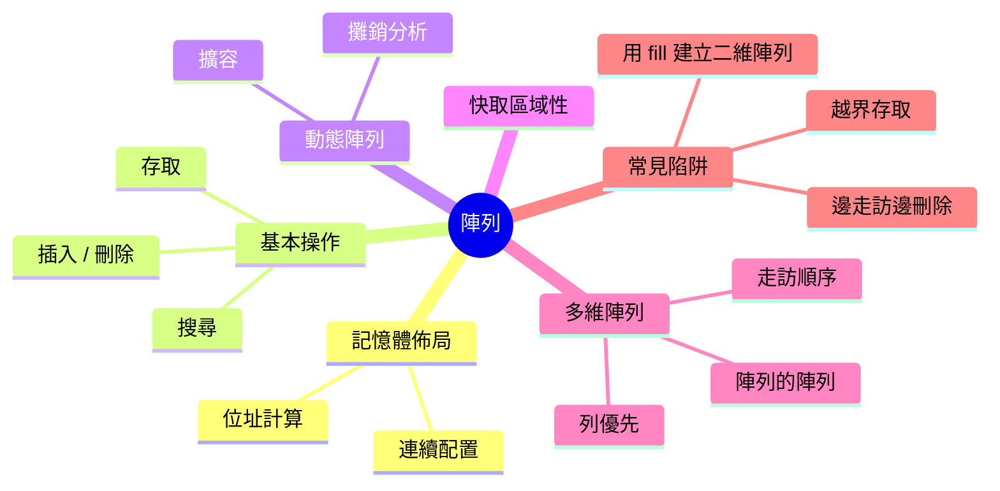
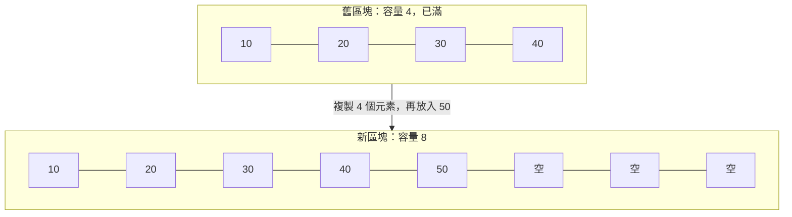
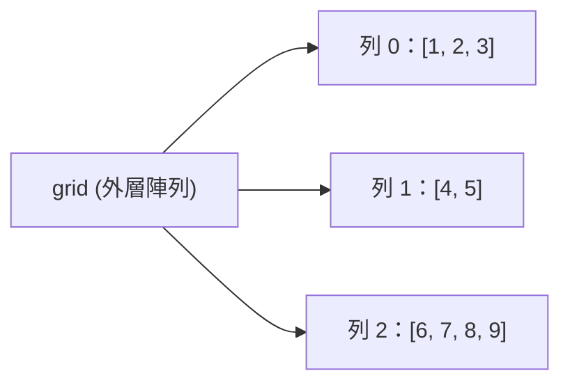

export const metadata = {
  title: '陣列：排列在連續記憶體上的序列',
  date: '2026-09-13',
  excerpt: '深入解析陣列：連續記憶體為什麼讓索引存取只要 O(1)、插入與刪除為什麼昂貴、動態陣列如何靠擴容做到攤銷 O(1)、陣列在實務上為什麼快、多維陣列如何排列，以及最常讓人出錯的幾個陷阱。',
  tags: ['程式設計', '資料結構', '演算法'],
};

# 陣列：排列在連續記憶體上的序列

陣列 (array) 大概是你寫程式時最早碰到、也最常用的資料結構：一排元素，從 0 開始編號，想拿第幾個就拿第幾個。它簡單到幾乎讓人忘了它也是一種「結構」。

但許多資料結構說穿了，底層就是一個陣列：堆疊、佇列、堆積、雜湊表，通常都是。

陣列的一切優缺點，都來自同一個性質：所有元素緊挨著存放在同一塊記憶體裡。這個性質讓它取值飛快、走訪飛快，也讓它在「從中間插入」和「長大」這兩件事上付出代價。把這一點想通，陣列的其他特性幾乎都能自己推導出來。



- [什麼是陣列](#什麼是陣列)
- [基本操作](#基本操作)
- [靜態陣列與動態陣列](#靜態陣列與動態陣列)
- [快取區域性](#快取區域性)
- [多維陣列](#多維陣列)
- [常見陷阱](#常見陷阱)
- [總結](#總結)

---

## 什麼是陣列

陣列是一組依序存放在一塊連續記憶體裡的元素，每個元素都用一個整數索引 (index) 來存取。建立陣列時，程式會向系統要一整塊夠大的空間，再把元素一個接一個排進去，中間不留空隙。

假設有一個存放 5 個整數的陣列，每個整數佔 4 個位元組，這塊記憶體從位址 1000 開始：

| 索引 | 0 | 1 | 2 | 3 | 4 |
| - | - | - | - | - | - |
| 值 | 10 | 20 | 30 | 40 | 50 |
| 位址 | 1000 | 1004 | 1008 | 1012 | 1016 |

因為每一格大小相同、彼此相連，任何一個元素的位址都能直接算出來：

```text
元素 i 的位址 = 起始位址 + i × 每個元素的大小
```

要讀 `arr[3]`，電腦不必從頭數過去，只要算出 1000 + 3 × 4 = 1012，然後直接到那個位址取值。陣列有 5 個元素還是 500 萬個元素，這個計算都一樣快。陣列的隨機存取 (random access) 之所以是 O(1)，就是因為存取靠的是算術，不是搜尋。

這個公式也順便解釋了兩件常讓初學者困惑的事：

- 索引為什麼從 0 開始。索引其實是「距離起點有幾格」的位移量 (offset)。第一個元素就在起點上，位移是 0。
- 為什麼傳統的陣列要求元素型別一致。公式成立的前提是每一格大小相同；如果有的元素佔 4 個位元組、有的佔 8 個，就沒辦法用一次乘法算出位置。

你可能會想：JavaScript 和 Python 的陣列明明可以混放數字、字串和物件。它們並沒有打破這條規則，而是換了個方式遵守：陣列的每一格只放一個固定大小的值。字串和物件不放在格子裡，格子裡存的是指向它們的參照 (reference)。字串和物件本身大小不一，但參照的大小都一樣，所以公式依然成立。

---

## 基本操作

### 存取與修改

依索引讀取或寫入都是 O(1)：算出位址就能讀寫。

```javascript
const scores = [90, 85, 77, 92];

scores[2];      // 77，O(1)
scores[2] = 80; // O(1)
```

### 搜尋

如果要找的是「某個值在哪裡」，索引就幫不上忙了。在沒有排序的陣列裡，只能從頭一個一個比對，最壞情況要看完全部元素，是 O(n)。

如果陣列已經排序，就能用二分搜尋 (binary search) 每次丟掉一半的範圍，降到 O(log n)。二分搜尋之所以快，正是因為陣列能在 O(1) 內跳到正中間那一格；換成鏈結串列，光是走到中間就要 O(n)。二分搜尋的實作可參考 [Big O 表示法](/articles/big-o-notation)。

### 插入與刪除

這是陣列吃虧的地方。元素必須緊密相連、中間不能有空位，所以要在索引 `i` 插入新元素時，原本從 `i` 開始的每個元素都得往右挪一格，把位置騰出來：

| | [0] | [1] | [2] | [3] | [4] |
| - | - | - | - | - | - |
| 插入前 | 10 | 20 | 30 | 40 | |
| 在索引 1 插入 99 | 10 | 99 | 20 | 30 | 40 |

20、30、40 各往右移了一格。把這個過程寫出來，成本就一目了然：

```javascript
// O(n)：在 index 插入 value
function insertAt(arr, index, value) {
  if (index < 0 || index > arr.length) return;

  // 從最後一個元素開始往右挪，才不會蓋掉還沒搬的元素
  for (let i = arr.length; i > index; i--) {
    arr[i] = arr[i - 1];
  }
  arr[index] = value;
}
```

刪除剛好相反：拿掉索引 `i` 的元素之後，後面的元素都要往左挪一格，把空位補起來。不論插入或刪除，成本都取決於該位置之後有多少個元素：在開頭操作，後面的元素全都得搬，是 O(n)；在結尾操作，後面沒有元素，什麼都不用搬，是 O(1)。JavaScript 的 `unshift`、`shift`、`splice`，規格上就是這樣一格一格搬的，所以在大陣列上並不便宜。

如果不在乎元素的順序，刪除可以做到 O(1)：拿最後一個元素來填補要刪掉的位置，再移除最後一格。遊戲引擎管理場景中的大量物件時常用這一招，任何「順序不重要」的集合也都適用。

```javascript
// O(1)：不保留順序的刪除
function removeUnordered(arr, index) {
  if (index < 0 || index >= arr.length) return;

  arr[index] = arr[arr.length - 1]; // 最後一個元素補進來
  arr.pop();
}
```

### 複雜度總覽

| 操作 | 時間複雜度 |
| - | - |
| 依索引存取 / 修改 | O(1) |
| 搜尋 (未排序) | O(n) |
| 搜尋 (已排序，二分搜尋) | O(log n) |
| 在結尾插入 / 刪除 | O(1)* |
| 在開頭或中間插入 / 刪除 | O(n) |
| 不保留順序的刪除 | O(1) |

\* 在動態陣列上，結尾插入是攤銷 O(1)，下一節說明。

---

## 靜態陣列與動態陣列

傳統的陣列有一個硬性限制：大小在建立時就固定了。在 C 裡宣告 `int scores[5];`，或在 Java 寫 `new int[5]`，拿到的就是剛好放得下 5 個整數的空間，之後不能再長大。

原因出在記憶體本身。陣列必須連續，而緊接在這塊空間後面的記憶體，很可能已經被其他資料佔用，沒辦法往後延伸。

但真實世界的資料量常常事先無法得知。動態陣列 (dynamic array) 就是為此而生的。Java 的 `ArrayList`、C++ 的 `std::vector`、Python 的 `list`，以及 JavaScript 的 `Array`，都是動態陣列，做法如下：

1. 先配置一塊比目前需要更大的空間。已經使用的格數叫長度 (length)，總格數叫容量 (capacity)。
2. 新元素放進後面的空格，O(1)。
3. 空格用完時，配置一塊更大的新空間 (常見的是原本的 1.5 倍或 2 倍)，把所有元素複製過去，再釋放舊的空間。



下面用 JavaScript 實作一個簡化版的動態陣列。為了貼近真實情況，底層用的是 `Int32Array`：一塊長度固定、只能放 32 位元整數的連續記憶體，它不會自己長大，所以擴容得親手處理。

```javascript
class DynamicArray {
  constructor() {
    this.capacity = 4;                         // 總共有幾格
    this.length = 0;                           // 實際用了幾格
    this.data = new Int32Array(this.capacity); // 一塊固定大小的連續記憶體
  }

  // 攤銷 O(1)：放到結尾，滿了就先擴容
  push(value) {
    if (this.length === this.capacity) {
      this.grow();
    }
    this.data[this.length] = value;
    this.length++;
  }

  // O(1)：容量裡多出來的空格不算數，只有 length 以內的索引合法
  get(index) {
    if (index < 0 || index >= this.length) {
      throw new RangeError(`Index ${index} is out of bounds`);
    }
    return this.data[index];
  }

  // O(n)：配置兩倍大的新區塊，把舊元素全部複製過去
  grow() {
    this.capacity *= 2;
    const bigger = new Int32Array(this.capacity);
    bigger.set(this.data);
    this.data = bigger; // 舊區塊沒人參照了，交給垃圾回收
  }
}
```

### 攤銷分析：為什麼 `push` 仍然是 O(1)

擴容要複製全部元素，是 O(n)。這樣看來 `push` 似乎是 O(n)？關鍵在於擴容很少發生，而且越來越少。

從容量 4 開始連續 `push`，只有下面這幾次會觸發擴容：

| 第幾次 push | 容量變化 | 複製的元素數 |
| - | - | - |
| 第 5 次 | 4 → 8 | 4 |
| 第 9 次 | 8 → 16 | 8 |
| 第 17 次 | 16 → 32 | 16 |
| 第 33 次 | 32 → 64 | 32 |

`push` 33 次，總共只複製了 4 + 8 + 16 + 32 = 60 個元素，平均每次 `push` 不到 2 次複製。這不是巧合：容量每次翻倍，每一次擴容的複製量都比之前所有擴容加起來還多，所以全部的複製量加總，永遠小於最後一次的兩倍，也就一定小於 2n。

n 次 `push` 的總成本是 O(n)，平均下來每次 O(1)。這種「把偶爾一次的高成本，分攤到大量低成本操作上」的分析方式稱為攤銷分析 (amortized analysis)，得到的結果就是攤銷 O(1)。

不過，攤銷 O(1) 不代表每一次都快，觸發擴容的那一次 `push` 仍然是 O(n)。多數程式不會察覺，但在對延遲敏感的場合，例如必須在一個畫格內跑完的動畫邏輯，偶爾一次大型擴容就可能變成畫面上的卡頓。

### 為什麼要按比例成長

如果每次只多配置固定的格數，例如每次加 10 格，結果會完全不同。容量依序是 10、20、30……，每多 10 個元素就要把全部複製一次，複製總量大約是 n² / 20，平均每次 `push` 變成 O(n)。

成長倍率各家不同：Java 的 `ArrayList` 每次長成 1.5 倍，CPython 的 `list` 只多配置約 1/8。只要是按比例成長，攤銷成本就是 O(1)。倍率大，擴容次數少；倍率小，閒置的空間少。

如果事先知道大概要放多少元素，很多語言允許你一開始就把容量配置好 (Java 的 `new ArrayList<>(10000)`、C++ 的 `vector.reserve(10000)`)，完全省掉中途的擴容。

---

## 快取區域性

Big O 只數操作次數，不管每次存取記憶體要花多久；陣列在實務上的優勢，正好藏在這個盲點裡。

相對於 CPU，主記憶體很慢，所以 CPU 不會一次只拿一個值，而是一口氣把一整條快取行 (cache line，通常是 64 位元組) 搬進快取。一條快取行裝得下 16 個 4 位元組的整數，讀到其中一個，其餘 15 個也跟著進了快取。CPU 還會偵測循序存取的模式，在你開口之前，先把後面幾條快取行預取 (prefetch) 進來。

陣列的連續排列能把這兩項好處吃滿：從頭走到尾時，大部分讀取都命中快取，CPU 幾乎不必等待主記憶體。這正是鏈結串列放棄掉的優勢，代價有多大，可以參考 [鏈結串列：由節點與指標構成的序列](/articles/linked-list)。

有一點要注意：在 Java、Python、JavaScript 這類語言裡，裝物件的陣列存的是參照，物件本身則可能散落在 heap 各處。走訪參照本身很快，但每次透過參照去讀物件的欄位，都可能跳到記憶體的另一個角落。所以需要榨出效能的程式 (圖形、音訊、大量數值運算) 常改用只裝原始數值的陣列，例如 JavaScript 的 Typed Array (前面用到的 `Int32Array` 就是一種)，讓資料本身真正連續。

---

## 多維陣列

記憶體只有一個維度，就是一長串位址。所以二維陣列 (矩陣、棋盤、圖片) 必須以某種方式攤平成一維。最常見的方式是列優先 (row-major)：放完一整列，再接著放下一列。

```text
邏輯上 (3 列 × 4 欄)          記憶體中 (列優先)

[ 0  1  2  3 ]
[ 4  5  6  7 ]      →       0 1 2 3 4 5 6 7 8 9 10 11
[ 8  9 10 11 ]
```

格子裡的數字，就是它在一維記憶體中的索引。第 `r` 列、第 `c` 欄的元素位置是：

```text
索引 = r × 欄數 + c
```

例如 `[1][2]` 就是 1 × 4 + 2 = 6。這仍然只是一次乘法加一次加法，所以多維陣列的存取依然是 O(1)。C 與 C++ 的多維陣列、NumPy 的陣列 (預設) 都採用列優先；Fortran、MATLAB、Julia 則是欄優先 (column-major)，一欄一欄地放。

### 陣列的陣列

JavaScript 與 Python 的 `[[...], [...]]`、Java 的 `int[][]` 並不是這樣。它們的二維陣列其實是「陣列的陣列」：外層陣列的每一格存的是一個參照，指向另一個各自配置的陣列。每一列本身是連續的，但列與列之間不一定相鄰，長度也可以各不相同，所以又稱為鋸齒陣列 (jagged array)。



在講求效能的場合，常見的做法是自己攤平：配置一個長度為「列數 × 欄數」的一維陣列，再用上面的公式算索引。瀏覽器的 Canvas 就是這麼做的：`getImageData()` 回傳的像素資料是一個一維的 `Uint8ClampedArray`，以列優先排列，每個像素依序佔 4 個位元組 (R、G、B、A)。

```javascript
const { data, width } = ctx.getImageData(0, 0, canvas.width, canvas.height);

// 讀取座標 (x, y) 的像素
function getPixel(x, y) {
  const i = (y * width + x) * 4; // 先算出是第幾個像素，再乘上每個像素的 4 個位元組
  return { r: data[i], g: data[i + 1], b: data[i + 2], a: data[i + 3] };
}
```

### 走訪順序會影響速度

既然記憶體是列優先，走訪時讓內層迴圈沿著同一列前進，存取就是連續的。把兩層迴圈對調，內層每走一步都要跳過一整列，在大型矩陣上幾乎每次讀取都落在不同的快取行。

```javascript
// 快：內層迴圈沿著記憶體順序前進
for (let r = 0; r < rows; r++) {
  for (let c = 0; c < cols; c++) {
    sum += grid[r * cols + c];
  }
}

// 慢：內層迴圈每走一步就跳過 cols 格
for (let c = 0; c < cols; c++) {
  for (let r = 0; r < rows; r++) {
    sum += grid[r * cols + c];
  }
}
```

兩段的時間複雜度都是 O(rows × cols)，讀到的元素也完全相同，速度卻差很多。以 Node.js 22 對一個 2048 × 2048 的 `Float64Array` 實測，逐列走訪大約比逐欄走訪快 6 倍 (確切數字依硬體而異)。Big O 相同，不代表跑起來一樣快。

---

## 常見陷阱

### 越界存取

陣列的合法索引是 `0` 到 `length - 1`。差一錯誤 (off-by-one) 是最常見的陣列 bug 之一，而越界之後會發生什麼，各語言差異很大：

| 語言 | 讀取 `arr[10]` (長度為 3) |
| - | - |
| C / C++ | 未定義行為：讀到陣列以外的記憶體，可能是垃圾值，也可能讓程式崩潰 |
| Java | 拋出 `ArrayIndexOutOfBoundsException` |
| Python | 拋出 `IndexError` |
| JavaScript | 不報錯，回傳 `undefined` |

C 的越界寫入更危險，它會悄悄覆蓋相鄰的資料，這正是緩衝區溢位 (buffer overflow) 漏洞的來源。JavaScript 則是另一個極端：越界讀取靜默地回傳 `undefined`；像 `arr[10] = 'x'` 這樣的越界寫入，則會若無其事地把陣列撐到長度 11，中間全是空位。不論哪一種，錯誤往往都要到很後面才浮現。

### 邊走訪邊刪除

```javascript
const nums = [1, 2, 2, 3];

for (let i = 0; i < nums.length; i++) {
  if (nums[i] === 2) nums.splice(i, 1);
}

console.log(nums); // [1, 2, 3]，有一個 2 沒被刪掉
```

刪掉索引 1 的 `2` 之後，後面的元素全部往左挪一格，第二個 `2` 移到了索引 1；但迴圈接著把 `i` 加到 2，剛好跳過它。這就是前面講的搬移，只是這次造成的不是變慢，而是 bug。

解法是倒著走 (刪除只會影響已經走過的位置)，或者乾脆不要原地修改，用 `filter` 產生新陣列：

```javascript
const result = nums.filter((n) => n !== 2); // [1, 3]
```

`filter` 一趟就完成，O(n)；在迴圈裡反覆 `splice`，最壞情況則是 O(n²)。

### 用 `fill` 建立二維陣列

這看起來是建立三個空列的合理寫法：

```javascript
const grid = new Array(3).fill([]);
grid[0].push(1);
console.log(grid); // [[1], [1], [1]]
```

`fill` 會把同一個值放進每一格，而這個值是一個陣列的參照，所以三列其實是同一個陣列。正確做法是讓每一列各自建立：

```javascript
const grid = Array.from({ length: 3 }, () => []);
grid[0].push(1);
console.log(grid); // [[1], [], []]
```

---

## 總結

陣列只做了一個決定：把元素緊挨著放在一塊連續的記憶體裡。其餘的一切都由此而來：

- 元素的位置可以直接算出來，所以依索引存取是 O(1)。
- 元素之間不能有空隙，所以在開頭或中間插入、刪除，都得搬動後面所有的元素，是 O(n)。
- 後面的記憶體不一定空著，所以陣列沒辦法直接原地長大；動態陣列靠按比例擴容，換來攤銷 O(1) 的 `push`。
- 連續排列對快取友善，所以陣列在實務上往往比 Big O 暗示的還要快。

猶豫該用哪種資料結構時，先用陣列。只有當它的弱點 (頻繁地在開頭或中間插入、刪除，或需要依鍵查找) 真正成為瓶頸時，才值得換成別的結構。
