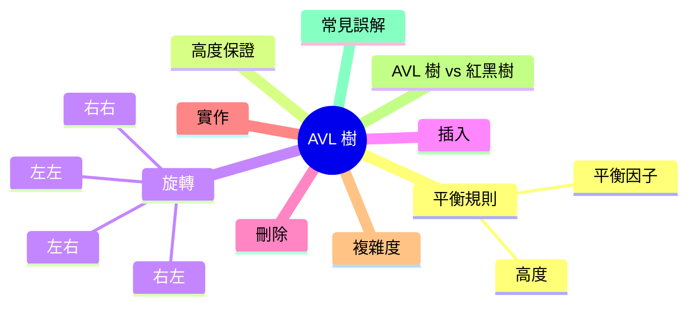

export const metadata = {
  title: 'AVL 樹',
  date: '2026-11-18',
  excerpt: 'AVL 樹如何不讓二元搜尋樹長得太高：平衡規則、它為什麼能保證對數高度、節點失衡的四種情況與各自的旋轉修正、插入與刪除的完整過程，以及 AVL 樹與紅黑樹的比較。內含 TypeScript、Python 與 Java 範例。',
  tags: ['資料結構'],
};

# AVL 樹

二元搜尋樹有多快，取決於它有多矮。每個操作都是從根節點沿著一條路徑往下走，而值抵達的順序，決定了這條路徑有多長。插入已排序的資料，樹就會變成一條鏈結串列，每個操作都變成 O(n)。

AVL 樹是不讓這種事發生的二元搜尋樹。每次插入或刪除之後，它會檢查剛剛改動過的那條路徑上的每個節點，只要某個節點的一棵子樹比另一棵高出兩層，就用一到兩次旋轉修正形狀。不論資料以什麼順序抵達，高度都維持在 O(log n)。

它是第一種自平衡二元搜尋樹，由 Georgy Adelson-Velsky 與 Evgenii Landis 在 1962 年發表，名稱就取自兩人姓氏的縮寫。本文涵蓋平衡規則、它為什麼能讓樹保持矮、節點失衡的四種情況與各自的旋轉修正、包含插入與刪除的完整實作，以及 AVL 樹與紅黑樹的比較。內容建立在 [二元搜尋樹 BST](./binary-search-tree) 之上，特別是其中關於旋轉的段落。



- [平衡規則](#平衡規則)
- [為什麼高度能維持在對數等級](#為什麼高度能維持在對數等級)
- [旋轉：四種情況](#旋轉四種情況)
- [插入](#插入)
- [刪除](#刪除)
- [實作 AVL 樹](#實作-avl-樹)
- [時間與空間複雜度](#時間與空間複雜度)
- [AVL 樹 vs. 紅黑樹](#avl-樹-vs-紅黑樹)
- [常見誤解](#常見誤解)
- [總結](#總結)

---

## 平衡規則

AVL 規則講的是高度。節點的高度，是從它往下走到葉節點的最長路徑上有幾條邊；和 [樹與二元樹基礎](./tree-and-binary-tree-basics) 一樣，葉節點的高度是 0，空的子樹高度是 −1。

節點的平衡因子 (balance factor)，是左子樹的高度減去右子樹的高度。AVL 規則要求每個節點的平衡因子都必須是 −1、0 或 +1。換句話說，在每個節點上，兩棵子樹的高度最多只能相差 1。(有些資料是反過來相減。正負號怎麼定都可以，只要前後一致就好。)

下面是一棵合法的 AVL 樹：

```text
        5
       / \
      3   8
     / \   \
    2   4   9
   /
  1
```

| 節點 | 左子樹高度 | 右子樹高度 | 平衡因子 |
| :--- | :--- | :--- | :--- |
| 5 | 2 | 1 | +1 |
| 3 | 1 | 0 | +1 |
| 2 | 0 | −1 | +1 |
| 8 | −1 | 0 | −1 |
| 1、4、9 | −1 | −1 | 0 |

這條規則並不要求完美的樹。節點 2 有左子節點、沒有右子節點，樹的左半邊也比右半邊多深一層。規則禁止的，是在樹的任何地方相差 2 以上。

「任何地方」才是重點。只檢查根節點是不夠的：

```text
        4
       / \
      3   5
     /     \
    2       6
   /         \
  1           7
```

根節點的兩棵子樹高度都是 2，所以它的平衡因子是 0。但節點 3 的左子樹高度是 1，又沒有右子樹，平衡因子是 +2；節點 5 則是它的鏡像，平衡因子是 −2。這不是一棵 AVL 樹，而且只要兩條鏈再長一點，它就跟兩條鏈結串列沒什麼兩樣。

---

## 為什麼高度能維持在對數等級

這條規則只比較節點的兩棵子樹，卻能限制整棵樹的高度。要知道它限制得多緊，可以反過來問：高度為 h 的 AVL 樹，最少需要幾個節點？

把這個數字記為 N(h)。高度為 h 的樹，一定有一棵子樹的高度是 h − 1。另一棵子樹可以矮一點，但最多只能矮一層，所以最省節點的選擇是高度 h − 2。讓兩棵子樹也都盡量省節點，就得到 N(h) = N(h − 1) + N(h − 2) + 1，起始值是 N(0) = 1 (單一節點) 與 N(1) = 2 (一個節點加上一個子節點)：

| 高度 h | 0 | 1 | 2 | 3 | 4 | 5 | 6 | 7 | 8 |
| :--- | :--- | :--- | :--- | :--- | :--- | :--- | :--- | :--- | :--- |
| 最少節點數 N(h) | 1 | 2 | 4 | 7 | 12 | 20 | 33 | 54 | 88 |

這就是費氏數列 (Fibonacci sequence) 的遞迴式再多加 1，事實上每個 N(h) 都剛好比某個費氏數少 1。費氏數每往後一項，大約就變成前一項的 1.618 倍 (黃金比例)，所以高度為 h 的樹最少需要的節點數，會隨 h 呈指數成長。反過來說，高度只會隨節點數以對數速度成長：n 個節點的 AVL 樹，高度永遠不會超過大約 1.44 log₂ n。上一節的範例樹，正是這種最省節點的樹之一：7 個節點，高度 3。

以 1,000 個值為例，和 [二元搜尋樹 BST](./binary-search-tree) 中的普通 BST 對照：

| 插入順序 | 普通 BST 的高度 | AVL 樹的高度 |
| :--- | :--- | :--- |
| 已排序 (1, 2, 3, …, 1,000) | 999 | 9 |
| 隨機 (200 次的平均) | 約 21 | 約 11 |
| 最壞的插入順序 | 999 | 13 |

1,000 個節點的二元樹，高度最低就是 9。已排序的輸入是普通 BST 的最壞情況，卻讓 AVL 樹剛好達到這個最低值；隨機輸入只比它多一兩層；而且不論以什麼順序插入，高度都不可能超過 13。

---

## 旋轉：四種情況

插入或刪除只會改變一條路徑上的高度，所以只有這條路徑上的節點可能失衡，而且只會比規則允許的多偏一層，也就是平衡因子變成 +2 或 −2。修正方式取決於多出來的高度在哪裡。看失衡的節點，以及它較高的那個子節點：

| 情況 | 失衡節點 | 較高的子節點 | 修正方式 |
| :--- | :--- | :--- | :--- |
| 左左 (Left-Left) | 左邊較高 (+2) | 左邊較高或平衡 | 在該節點右旋 |
| 右右 (Right-Right) | 右邊較高 (−2) | 右邊較高或平衡 | 在該節點左旋 |
| 左右 (Left-Right) | 左邊較高 (+2) | 右邊較高 | 先在子節點左旋，再在該節點右旋 |
| 右左 (Right-Left) | 右邊較高 (−2) | 左邊較高 | 先在子節點右旋，再在該節點左旋 |

較高的子節點只有在刪除之後才可能是平衡的。插入之後，它一定會偏向某一邊。

右旋會把節點的左子節點提上來，取代它的位置，詳見 [二元搜尋樹 BST](./binary-search-tree)；左旋則是它的鏡像。每次旋轉只改動少數幾個連結，所以即使是雙旋轉，也只要 O(1) 時間。

### 單旋轉

最小的左左情況，來自依序插入 3、2、1。節點 3 的左子樹高度是 1、沒有右子樹，平衡因子是 +2，而它的左子節點 2 也偏左。在 3 做一次右旋，2 就成為根節點：

```text
    3
   /          2
  2     →    / \
 /          1   3
1
```

右右是它的鏡像：依序插入 1、2、3，在 1 做一次左旋就能修正。

### 雙旋轉

這次改成依序插入 3、1、2。節點 3 依然是左邊較高，但它的左子節點偏右，所以從 3 往下到新節點的路徑呈鋸齒狀。這時在 3 右旋沒有用，只會把鋸齒變成它的鏡像：1 在最上面，3 是它的右子節點，2 是 3 的左子節點，一樣失衡。

這需要兩次旋轉。先在 1 左旋，把鋸齒拉直成左左的一直線，再在 3 右旋就完成了：

```text
  3         3
 /         /        2
1    →    2    →   / \
 \       /        1   3
  2     1
```

右左也是鏡像：先在子節點右旋，再在該節點左旋。

---

## 插入

插入一開始就是普通的 BST 插入：搜尋這個值，在搜尋走到盡頭的地方接上新的葉節點。接著沿著路徑往回走向根節點。在每個節點上，用子節點的高度重新計算它的高度，並檢查平衡因子。如果是 +2 或 −2，就套用上一節對應的修正。

一次插入最多只需要修正一次。新的葉節點最多只會讓路徑上的每棵子樹高一層，而在最低的失衡節點旋轉之後，那棵子樹會回到插入之前的高度，它上面的節點完全感受不到變化。所以一次插入最多只需要一次單旋轉或一次雙旋轉。

試試已排序的輸入，也就是曾經讓普通 BST 變成鏈結串列的那種輸入：依序插入 1 到 7。插入 1、2、4 時，每個節點都保持平衡，其餘每次插入都會觸發一次旋轉：

| 插入 | 失衡節點 | 情況 | 修正方式 |
| :--- | :--- | :--- | :--- |
| 3 | 1 | 右右 | 在 1 左旋 |
| 5 | 3 | 右右 | 在 3 左旋 |
| 6 | 2 | 右右 | 在 2 左旋 |
| 7 | 5 | 右右 | 在 5 左旋 |

插入 6 時，失衡的節點是 2，也就是當時的根節點，所以旋轉之後 4 成為新的根節點。最後得到的樹，剛好是一棵 perfect 二元樹：

```text
      4
    /   \
   2     6
  / \   / \
 1   3 5   7
```

這裡每次旋轉都是右右，因為每個新值都跑到最右邊。隨機順序的輸入，則會遇到全部四種情況。

---

## 刪除

刪除一開始也是普通的 BST 刪除，同樣分成三種情況：葉節點直接拿掉；只有一個子節點的節點，由那個子節點取代；有兩個子節點的節點，複製中序後繼的值，再改成刪除後繼。接著和插入一樣，從樹真正改變的地方往回走，一路更新高度，並修正失衡的節點。

以左邊這棵樹為例，刪除 6：

```text
      4
     / \            2
    2   6    →     / \
   / \            1   4
  1   3              /
                    3
```

少了 6 之後，節點 4 的左子樹高度是 1，右子樹是空的，平衡因子是 +2。它較高的子節點 2 完全平衡，這在插入之後不可能發生。這仍然算是左左，在 4 做一次右旋就能修正：2 成為根節點，3 則移過去成為 4 的左子節點。

刪除和插入的差別，在於接下來的事。在這個例子裡，旋轉後子樹的高度是 2，和刪除前一樣，所以上面的節點都不受影響。但刪除之後的旋轉，也可能讓子樹比原本矮一層，而矮了一層的子樹，又可能讓更上面的節點失衡。所以必須一路檢查到根節點，最壞情況下，一次刪除會在每一層都旋轉。即使如此，也只是 O(log n) 次旋轉，每次 O(1)。

---

## 實作 AVL 樹

下面是一棵存放整數的 AVL 樹，支援搜尋、插入與刪除。每個節點存放的是高度而不是平衡因子，因為平衡因子很容易從子節點的高度算出來。插入與刪除都用遞迴實作，每次呼叫都會回傳它所處理的那棵子樹的新根節點。如果旋轉換掉了某棵子樹的根，父節點的 `node.left = ...` 或 `node.right = ...` 賦值就會接上新的根。和普通 BST 不同，這裡用遞迴是安全的，因為遞迴深度只和樹高一樣，而一百萬個值的 AVL 樹，高度最多也只有 27。

```typescript
// TypeScript
class AVLNode {
  left: AVLNode | null = null;
  right: AVLNode | null = null;
  height = 0; // 新節點一定是葉節點

  constructor(public value: number) {}
}

function heightOf(node: AVLNode | null): number {
  return node === null ? -1 : node.height;
}

function updateHeight(node: AVLNode): void {
  node.height = 1 + Math.max(heightOf(node.left), heightOf(node.right));
}

function balanceFactor(node: AVLNode): number {
  return heightOf(node.left) - heightOf(node.right);
}

function rotateRight(y: AVLNode): AVLNode {
  const x = y.left!;
  y.left = x.right;
  x.right = y;
  updateHeight(y); // y 現在位於 x 下方，所以先更新它
  updateHeight(x);
  return x;
}

function rotateLeft(x: AVLNode): AVLNode {
  const y = x.right!;
  x.right = y.left;
  y.left = x;
  updateHeight(x);
  updateHeight(y);
  return y;
}

// 修正一個節點的高度與平衡，回傳子樹新的根節點
function rebalance(node: AVLNode): AVLNode {
  updateHeight(node);
  const balance = balanceFactor(node);
  if (balance > 1) {
    // 左右：先旋轉子節點，把它變成左左
    if (balanceFactor(node.left!) < 0) node.left = rotateLeft(node.left!);
    return rotateRight(node);
  }
  if (balance < -1) {
    // 右左：先旋轉子節點，把它變成右右
    if (balanceFactor(node.right!) > 0) node.right = rotateRight(node.right!);
    return rotateLeft(node);
  }
  return node;
}

// 兩者都回傳所處理子樹的新根節點
function insertAt(node: AVLNode | null, value: number): AVLNode {
  if (node === null) return new AVLNode(value);
  if (value < node.value) node.left = insertAt(node.left, value);
  else if (value > node.value) node.right = insertAt(node.right, value);
  else return node; // 不允許重複
  return rebalance(node);
}

function deleteAt(node: AVLNode | null, value: number): AVLNode | null {
  if (node === null) return null; // 找不到
  if (value < node.value) node.left = deleteAt(node.left, value);
  else if (value > node.value) node.right = deleteAt(node.right, value);
  else if (node.left === null) return node.right;
  else if (node.right === null) return node.left;
  else {
    // 兩個子節點：把後繼的值複製到這個節點，
    // 再從右子樹刪除後繼
    let successor = node.right;
    while (successor.left !== null) successor = successor.left;
    node.value = successor.value;
    node.right = deleteAt(node.right, successor.value);
  }
  return rebalance(node);
}

class AVLTree {
  private root: AVLNode | null = null;

  get height(): number {
    return heightOf(this.root);
  }

  contains(value: number): boolean {
    let node = this.root;
    while (node !== null) {
      if (value < node.value) node = node.left;
      else if (value > node.value) node = node.right;
      else return true;
    }
    return false;
  }

  insert(value: number): void {
    this.root = insertAt(this.root, value);
  }

  delete(value: number): void {
    this.root = deleteAt(this.root, value);
  }
}

const tree = new AVLTree();
for (let v = 1; v <= 1000; v++) tree.insert(v);
console.log(tree.height);        // 9
console.log(tree.contains(500)); // true
tree.delete(500);
console.log(tree.contains(500)); // false
```

```python
# Python
from typing import Optional


class AVLNode:
    def __init__(self, value: int) -> None:
        self.value = value
        self.left: Optional[AVLNode] = None
        self.right: Optional[AVLNode] = None
        self.height = 0  # 新節點一定是葉節點


def height_of(node: Optional[AVLNode]) -> int:
    return -1 if node is None else node.height


def update_height(node: AVLNode) -> None:
    node.height = 1 + max(height_of(node.left), height_of(node.right))


def balance_factor(node: AVLNode) -> int:
    return height_of(node.left) - height_of(node.right)


def rotate_right(y: AVLNode) -> AVLNode:
    x = y.left
    y.left = x.right
    x.right = y
    update_height(y)  # y 現在位於 x 下方，所以先更新它
    update_height(x)
    return x


def rotate_left(x: AVLNode) -> AVLNode:
    y = x.right
    x.right = y.left
    y.left = x
    update_height(x)
    update_height(y)
    return y


# 修正一個節點的高度與平衡，回傳子樹新的根節點
def rebalance(node: AVLNode) -> AVLNode:
    update_height(node)
    balance = balance_factor(node)
    if balance > 1:
        # 左右：先旋轉子節點，把它變成左左
        if balance_factor(node.left) < 0:
            node.left = rotate_left(node.left)
        return rotate_right(node)
    if balance < -1:
        # 右左：先旋轉子節點，把它變成右右
        if balance_factor(node.right) > 0:
            node.right = rotate_right(node.right)
        return rotate_left(node)
    return node


# 兩者都回傳所處理子樹的新根節點
def insert_at(node: Optional[AVLNode], value: int) -> AVLNode:
    if node is None:
        return AVLNode(value)
    if value < node.value:
        node.left = insert_at(node.left, value)
    elif value > node.value:
        node.right = insert_at(node.right, value)
    else:
        return node  # 不允許重複
    return rebalance(node)


def delete_at(node: Optional[AVLNode], value: int) -> Optional[AVLNode]:
    if node is None:
        return None  # 找不到
    if value < node.value:
        node.left = delete_at(node.left, value)
    elif value > node.value:
        node.right = delete_at(node.right, value)
    elif node.left is None:
        return node.right
    elif node.right is None:
        return node.left
    else:
        # 兩個子節點：把後繼的值複製到這個節點，
        # 再從右子樹刪除後繼
        successor = node.right
        while successor.left is not None:
            successor = successor.left
        node.value = successor.value
        node.right = delete_at(node.right, successor.value)
    return rebalance(node)


class AVLTree:
    def __init__(self) -> None:
        self._root: Optional[AVLNode] = None

    @property
    def height(self) -> int:
        return height_of(self._root)

    def __contains__(self, value: int) -> bool:
        node = self._root
        while node is not None:
            if value < node.value:
                node = node.left
            elif value > node.value:
                node = node.right
            else:
                return True
        return False

    def insert(self, value: int) -> None:
        self._root = insert_at(self._root, value)

    def delete(self, value: int) -> None:
        self._root = delete_at(self._root, value)


tree = AVLTree()
for v in range(1, 1001):
    tree.insert(v)
print(tree.height)  # 9
print(500 in tree)  # True
tree.delete(500)
print(500 in tree)  # False
```

```java
// Java
public class AVLTree {
    private static class Node {
        int value;
        int height = 0; // 新節點一定是葉節點
        Node left, right;

        Node(int value) {
            this.value = value;
        }
    }

    private Node root;

    public int height() {
        return heightOf(root);
    }

    public boolean contains(int value) {
        Node node = root;
        while (node != null) {
            if (value < node.value) node = node.left;
            else if (value > node.value) node = node.right;
            else return true;
        }
        return false;
    }

    public void insert(int value) {
        root = insertAt(root, value);
    }

    public void delete(int value) {
        root = deleteAt(root, value);
    }

    private static int heightOf(Node node) {
        return node == null ? -1 : node.height;
    }

    private static void updateHeight(Node node) {
        int left = heightOf(node.left);
        int right = heightOf(node.right);
        node.height = 1 + Math.max(left, right);
    }

    private static int balanceFactor(Node node) {
        return heightOf(node.left) - heightOf(node.right);
    }

    private static Node rotateRight(Node y) {
        Node x = y.left;
        y.left = x.right;
        x.right = y;
        updateHeight(y); // y 現在位於 x 下方，所以先更新它
        updateHeight(x);
        return x;
    }

    private static Node rotateLeft(Node x) {
        Node y = x.right;
        x.right = y.left;
        y.left = x;
        updateHeight(x);
        updateHeight(y);
        return y;
    }

    // 修正一個節點的高度與平衡，回傳子樹新的根節點
    private static Node rebalance(Node node) {
        updateHeight(node);
        int balance = balanceFactor(node);
        if (balance > 1) {
            // 左右：先旋轉子節點，把它變成左左
            if (balanceFactor(node.left) < 0) {
                node.left = rotateLeft(node.left);
            }
            return rotateRight(node);
        }
        if (balance < -1) {
            // 右左：先旋轉子節點，把它變成右右
            if (balanceFactor(node.right) > 0) {
                node.right = rotateRight(node.right);
            }
            return rotateLeft(node);
        }
        return node;
    }

    // 兩者都回傳所處理子樹的新根節點
    private static Node insertAt(Node node, int value) {
        if (node == null) return new Node(value);
        if (value < node.value) node.left = insertAt(node.left, value);
        else if (value > node.value) node.right = insertAt(node.right, value);
        else return node; // 不允許重複
        return rebalance(node);
    }

    private static Node deleteAt(Node node, int value) {
        if (node == null) return null; // 找不到
        if (value < node.value) node.left = deleteAt(node.left, value);
        else if (value > node.value) node.right = deleteAt(node.right, value);
        else if (node.left == null) return node.right;
        else if (node.right == null) return node.left;
        else {
            // 兩個子節點：把後繼的值複製到這個節點，
            // 再從右子樹刪除後繼
            Node successor = node.right;
            while (successor.left != null) successor = successor.left;
            node.value = successor.value;
            node.right = deleteAt(node.right, successor.value);
        }
        return rebalance(node);
    }

    public static void main(String[] args) {
        AVLTree tree = new AVLTree();
        for (int v = 1; v <= 1000; v++) tree.insert(v);
        System.out.println(tree.height());      // 9
        System.out.println(tree.contains(500)); // true
        tree.delete(500);
        System.out.println(tree.contains(500)); // false
    }
}
```

各部分的分工如下：

- `rebalance` 負責所有平衡工作。往回走的路徑上，每個節點都會經過它：先更新節點的高度，再套用四種情況中符合的那一種
- 旋轉會更新被移動的兩個節點的高度，先更新下面那個，因為上面那個的高度取決於它
- 插入與刪除就是普通 BST 的版本，只是往回走時，會對路上的每個節點呼叫 `rebalance`。一次插入中，這些呼叫最多只有一次真的會旋轉，其餘的只是更新高度
- 範例依序插入 1 到 1,000，這是普通 BST 的最壞情況，而樹的高度最後只有 9

---

## 時間與空間複雜度

| 操作 | 時間 | 備註 |
| :--- | :--- | :--- |
| 搜尋 | O(log n) | 高度維持在大約 1.44 log₂ n 以下 |
| 插入 | O(log n) | 最多一次單旋轉或一次雙旋轉 |
| 刪除 | O(log n) | 往回走時，可能每一層都要旋轉 |
| 最小值 / 最大值 | O(log n) | 最左邊與最右邊的節點 |
| 依序走訪 | O(n) | 中序走訪，和所有 BST 一樣 |

空間是 O(n)。和普通 BST 相比，唯一多出來的是每個節點存放的高度，一個很小的整數。有些實作改存平衡因子，只需要 2 個位元。

---

## AVL 樹 vs. 紅黑樹

紅黑樹是另一種知名的自平衡 BST，它做了不同的取捨。它的規則比較寬鬆，所以樹可以長得比較高：最多 2 log₂(n + 1)，而不是大約 1.44 log₂ n。換來的是比較少的結構調整：一次刪除最多只需要三次旋轉，而 AVL 樹的一次刪除，可能每一層都要旋轉。

AVL 樹適合查詢遠多於修改的資料，紅黑樹則是更常見的通用選擇。Java 的 `TreeMap` 是紅黑樹，主要 C++ 標準函式庫中的 `std::map` 也是。下一篇會說明紅黑樹如何運作，並把兩者放在一起比較。

---

## 常見誤解

| 常見誤解 | 正確觀念 |
| :--- | :--- |
| AVL 樹是完美平衡的。 | 每個節點的子樹高度都可以相差 1，而這些差距會累積。AVL 樹的高度，可以達到完美平衡樹的大約 1.44 倍。 |
| 只要檢查根節點的平衡因子就夠了。 | 規則適用於每個節點。左右各掛一條長鏈的根節點，平衡因子是 0，但它底下的節點早已嚴重失衡。 |
| 平衡因子比較的是兩棵子樹的節點數。 | 比較的是高度。一棵子樹的節點可以比另一棵多很多，高度卻一樣。 |
| 一次插入可能一路旋轉到根節點。 | 一次插入最多只需要修正一次，也就是一次單旋轉或雙旋轉，因為修正會讓子樹回到原本的高度。只有刪除才可能在好幾層都旋轉。 |
| 每次變動之後，都要重新計算每個節點的高度。 | 只有改動路徑上的節點需要更新，而且每個節點只要用子節點存好的高度，O(1) 就能算出來。 |
| AVL 樹一定比紅黑樹快。 | AVL 樹比較矮，所以查詢可能少走幾步，但刪除時可能要做更多結構調整。哪個比較快，取決於讀寫的比例。 |

---

## 總結

AVL 樹是多了一條規則的二元搜尋樹：在每個節點上，兩棵子樹的高度最多相差 1。光是這條規則，就能讓高度維持在大約 1.44 log₂ n 以下，因為一定高度的樹最少需要的節點數，會像費氏數列一樣成長。

插入與刪除的做法和普通 BST 一樣，之後再沿著路徑往回走，修正失衡的節點。失衡只有四種情況，每種都用一到兩次旋轉修正。一次插入最多只需要修正一次，一次刪除則可能每一層都要修正。不論如何，搜尋、插入與刪除在最壞情況下都是 O(log n)，與資料抵達的順序無關。
