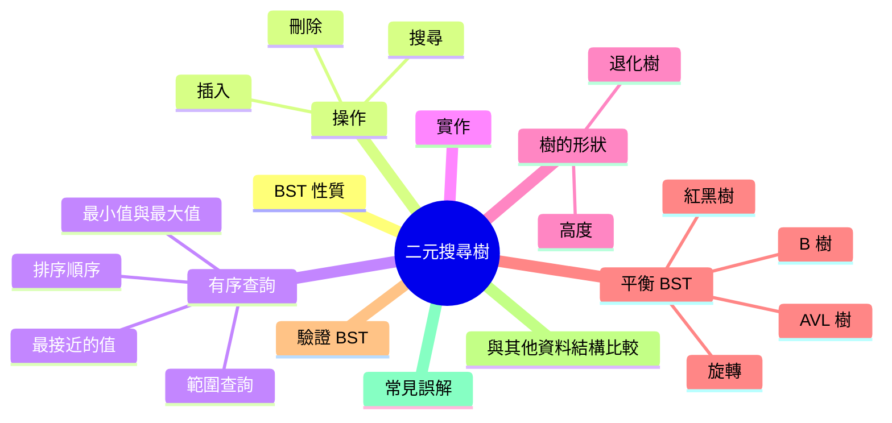

export const metadata = {
  title: '二元搜尋樹 BST',
  date: '2026-11-17',
  excerpt: '二元搜尋樹如何讓值保持有序；搜尋、插入與刪除如何運作 (包括有兩個子節點的情況)；為什麼插入順序可能讓它退化成鏈結串列、平衡樹如何避免這件事，以及如何確認一棵樹真的是 BST。內含 TypeScript、Python 與 Java 範例。',
  tags: ['資料結構'],
};

# 二元搜尋樹 BST

二元搜尋樹 (binary search tree，BST) 是讓值保持有序的二元樹。每個節點都遵守同一條規則：比它小的值放左邊，比它大的值放右邊。靠著這條規則，搜尋、插入或刪除一個值，都只需要從根節點沿著一條路徑往下走，而且排序好的值等於是免費附送的。

雜湊表找 key 更快，平均 O(1)，但它完全不知道哪些 key 彼此接近。BST 知道。問它最小的值、42 之後的第一個值，或是 10 到 20 之間的所有值，它都能沿著樹往下走來回答，不必掃過全部資料。Java 的 `TreeMap` 與 `TreeSet` 這類有序的 map 與 set，就是建立在這個基礎上。

本文涵蓋 BST 的規則、三個核心操作、一份完整的實作、BST 為什麼可能退化成鏈結串列、平衡樹如何避免這件事，以及如何確認一棵樹真的是 BST。內容建立在 [樹與二元樹基礎](./tree-and-binary-tree-basics) 與 [二元樹遍歷](./binary-tree-traversal) 之上。



- [BST 的性質](#bst-的性質)
- [搜尋](#搜尋)
- [插入](#插入)
- [刪除](#刪除)
- [排序順序與範圍查詢](#排序順序與範圍查詢)
- [實作 BST](#實作-bst)
- [為什麼形狀很重要](#為什麼形狀很重要)
- [平衡二元搜尋樹](#平衡二元搜尋樹)
- [驗證 BST](#驗證-bst)
- [BST vs. 其他資料結構](#bst-vs-其他資料結構)
- [常見誤解](#常見誤解)
- [總結](#總結)

---

## BST 的性質

二元搜尋樹中的每個節點都遵守這條規則：

- 左子樹中的每個值，都比節點的值小
- 右子樹中的每個值，都比節點的值大

下面這棵 BST，是依序插入 50、30、70、20、40、60、80、45 建出來的。本文接下來都用它當範例：

```text
            50
          /    \
        30      70
       /  \    /  \
     20   40  60   80
            \
             45
```

這條規則適用於整棵子樹，而不只是節點自己的子節點。45 是 40 的右子節點，而 45 > 40。但 45 也在 30 的右子樹裡，所以它必須比 30 大；它也在 50 的左子樹裡，所以必須比 50 小。這三個條件全都成立。

照這條規則的寫法，重複的值沒有容身之處，而這也是最常見的做法：當成 set 使用的 BST 會忽略已經存在的值，當成 map 使用的則會更新既有項目的值。如果真的需要重複值，可以在每個節點裡記錄一個計數，或是固定把相等的值放到同一側。

因為左邊全都比較小、右邊全都比較大，中序走訪 (左子樹、節點、右子樹) 會依遞增順序拜訪所有值。以範例樹來說：20 30 40 45 50 60 70 80。

---

## 搜尋

要找一個值，從根節點開始比較：

- 等於節點的值，就找到了
- 比較小，就往左走
- 比較大，就往右走
- 如果那個方向沒有子節點，這個值就不在樹裡

搜尋 45：45 < 50，往左走到 30。45 > 30，往右走到 40。45 > 40，往右走到 45。找到了，總共比較四次。

搜尋 65：65 > 50，往右走到 70。65 < 70，往左走到 60。65 > 60，要往右走，但 60 沒有右子節點。65 不在樹裡。

每次比較都會往下走一層，並排除一整棵子樹，這和在已排序陣列上做二分搜尋是同樣的道理。一次搜尋最多比較 h + 1 次，h 是樹的高度。

---

## 插入

插入就是一次找不到目標的搜尋。沿著同樣的路徑走，在路徑斷掉的地方接上新節點。要插入 65，搜尋會停在 60 空著的右側，所以 65 成為 60 的右子節點：

```text
            50
          /    \
        30      70
       /  \    /  \
     20   40  60   80
            \   \
             45  65
```

新的值永遠會成為葉節點，既有的節點也從來不會移動。所以 BST 的形狀取決於值被插入的順序，而這件事的影響比想像中大得多 (見 [為什麼形狀很重要](#為什麼形狀很重要))。

---

## 刪除

刪除是唯一需要分情況處理的操作，因為移除一個節點時，不能破壞它底下那些節點的規則。做法取決於這個節點有幾個子節點。

### 沒有子節點

葉節點拿掉即可。從範例樹刪除 20，就是把它從 30 的左側拿掉，其他都不變。

### 一個子節點

用它唯一的子節點取代它，那個子節點的整棵子樹也就跟著往上移一層。刪除 40 時，它唯一的子節點是 45，所以 45 移到 40 原本的位置。這麼做是安全的：45 原本就在 30 的右子樹與 50 的左子樹裡，現在依然如此。

### 兩個子節點

這是最棘手的情況。把節點拿掉，會留下兩棵子樹，卻只有一個位置能接上。所以改成找出這個節點的中序後繼 (in-order successor)，也就是右子樹中最小的值：先往右走一步，再一路往左走到底。把後繼的值複製到這個節點，再從右子樹中刪除後繼。

從範例樹刪除 30：它的右子樹是 40，40 有一個右子節點 45。40 沒有左子節點，所以 40 就是後繼。把 40 複製到原本存放 30 的節點，再刪除原本的 40。它只有一個子節點，所以 45 會移上來補它的位置：

```text
            50
          /    \
        40      70
       /  \    /  \
     20   45  60   80
```

這個做法成立，靠的是兩個事實。第一，後繼比左子樹中的所有值都大，也比右子樹中其他所有值都小，所以它可以取代被刪除的值，而不會破壞規則。第二，後繼一定沒有左子節點 (如果有，那個左子節點會更小，後繼就應該是它才對)，所以刪除後繼一定屬於前面兩種簡單的情況。改用中序前驅 (in-order predecessor)，也就是左子樹中最大的值，效果也完全一樣。

---

## 排序順序與範圍查詢

這種有序性帶來的好處不只有搜尋：

- 排序順序：中序走訪會依遞增順序拜訪所有值，O(n)
- 最小值與最大值：最小值是最左邊的節點 (從根節點一路往左走)，最大值是最右邊的節點。兩者都是 O(h)
- 最接近的值：要找大於等於 x 的最小值，就照搜尋 x 的方式往下走，並記住最後一次往左轉的節點。如果 x 不在樹裡，那個節點就是答案。小於等於 x 的最大值做法相同，只是方向相反。兩者都是 O(h)
- 範圍查詢：依序取出 `low` 到 `high` 之間的所有值，O(h + k)，k 是回傳的值的個數

範圍查詢可以走訪整棵樹再過濾，但 BST 讓它能跳過樹的大部分。如果一個節點的值小於 `low`，它左子樹裡的值只會更小，根本不需要進去。而中序走訪一旦遇到大於 `high` 的值，剩下的值都更大，就可以停下來。剩下的工作，就是一條往下走到範圍起點的路徑，再加上逐一走過範圍內的值。

---

## 實作 BST

以下是一個整數 BST，支援搜尋、插入、刪除與範圍查詢。它沿用 [樹與二元樹基礎](./tree-and-binary-tree-basics) 中的 `TreeNode` 類別。和 set 一樣，它會忽略重複值：插入已經存在的值會回傳 `false`。所有方法都用迴圈而不是遞迴，所以就算樹的形狀很差，也不會讓呼叫堆疊溢位。

```typescript
// TypeScript
class BST {
  private root: TreeNode | null = null;
  private count = 0;

  get size(): number {
    return this.count;
  }

  contains(value: number): boolean {
    let node = this.root;
    while (node !== null) {
      if (value < node.value) node = node.left;
      else if (value > node.value) node = node.right;
      else return true;
    }
    return false;
  }

  insert(value: number): boolean {
    let parent: TreeNode | null = null;
    let node = this.root;
    while (node !== null) {
      if (value === node.value) return false; // 不允許重複
      parent = node;
      node = value < node.value ? node.left : node.right;
    }
    const leaf = new TreeNode(value);
    if (parent === null) this.root = leaf;
    else if (value < parent.value) parent.left = leaf;
    else parent.right = leaf;
    this.count++;
    return true;
  }

  delete(value: number): boolean {
    let parent: TreeNode | null = null;
    let node = this.root;
    while (node !== null && node.value !== value) {
      parent = node;
      node = value < node.value ? node.left : node.right;
    }
    if (node === null) return false; // 找不到

    if (node.left !== null && node.right !== null) {
      // 兩個子節點：把後繼的值複製到這個節點，
      // 再改成刪除後繼
      let successorParent = node;
      let successor = node.right;
      while (successor.left !== null) {
        successorParent = successor;
        successor = successor.left;
      }
      node.value = successor.value;
      parent = successorParent;
      node = successor;
    }

    // 現在 node 最多只有一個子節點：用那個子節點取代 node
    const child = node.left !== null ? node.left : node.right;
    if (parent === null) this.root = child;
    else if (parent.left === node) parent.left = child;
    else parent.right = child;
    this.count--;
    return true;
  }

  // 依遞增順序回傳所有滿足 low <= v <= high 的值 v
  valuesBetween(low: number, high: number): number[] {
    const out: number[] = [];
    const stack: TreeNode[] = [];
    let node = this.root;
    while (node !== null || stack.length > 0) {
      if (node !== null) {
        if (node.value < low) {
          // node 與它的左子樹都小於 low：跳過
          node = node.right;
        } else {
          // 處理完它的左子樹後再回來
          stack.push(node);
          node = node.left;
        }
      } else {
        node = stack.pop()!;
        if (node.value > high) break; // 剩下的值都更大
        out.push(node.value);
        node = node.right;
      }
    }
    return out;
  }
}

const tree = new BST();
for (const v of [50, 30, 70, 20, 40, 60, 80, 45]) tree.insert(v);
console.log(tree.contains(45));          // true
console.log(tree.contains(65));          // false
tree.delete(30);
console.log(tree.valuesBetween(40, 70)); // [40, 45, 50, 60, 70]
console.log(tree.size);                  // 7
```

```python
# Python
from typing import Optional


class BST:
    def __init__(self) -> None:
        self._root: Optional[TreeNode] = None
        self._size = 0

    def __len__(self) -> int:
        return self._size

    def __contains__(self, value: int) -> bool:
        node = self._root
        while node is not None:
            if value < node.value:
                node = node.left
            elif value > node.value:
                node = node.right
            else:
                return True
        return False

    def insert(self, value: int) -> bool:
        parent: Optional[TreeNode] = None
        node = self._root
        while node is not None:
            if value == node.value:
                return False  # 不允許重複
            parent = node
            node = node.left if value < node.value else node.right
        leaf = TreeNode(value)
        if parent is None:
            self._root = leaf
        elif value < parent.value:
            parent.left = leaf
        else:
            parent.right = leaf
        self._size += 1
        return True

    def delete(self, value: int) -> bool:
        parent: Optional[TreeNode] = None
        node = self._root
        while node is not None and node.value != value:
            parent = node
            node = node.left if value < node.value else node.right
        if node is None:
            return False  # 找不到

        if node.left is not None and node.right is not None:
            # 兩個子節點：把後繼的值複製到這個節點，
            # 再改成刪除後繼
            successor_parent = node
            successor = node.right
            while successor.left is not None:
                successor_parent = successor
                successor = successor.left
            node.value = successor.value
            parent = successor_parent
            node = successor

        # 現在 node 最多只有一個子節點：用那個子節點取代 node
        child = node.left if node.left is not None else node.right
        if parent is None:
            self._root = child
        elif parent.left is node:
            parent.left = child
        else:
            parent.right = child
        self._size -= 1
        return True

    # 依遞增順序回傳所有滿足 low <= v <= high 的值 v
    def values_between(self, low: int, high: int) -> list[int]:
        out: list[int] = []
        stack: list[TreeNode] = []
        node = self._root
        while node is not None or stack:
            if node is not None:
                if node.value < low:
                    # node 與它的左子樹都小於 low：跳過
                    node = node.right
                else:
                    # 處理完它的左子樹後再回來
                    stack.append(node)
                    node = node.left
            else:
                node = stack.pop()
                if node.value > high:
                    break  # 剩下的值都更大
                out.append(node.value)
                node = node.right
        return out


tree = BST()
for v in [50, 30, 70, 20, 40, 60, 80, 45]:
    tree.insert(v)
print(45 in tree)                   # True
print(65 in tree)                   # False
tree.delete(30)
print(tree.values_between(40, 70))  # [40, 45, 50, 60, 70]
print(len(tree))                    # 7
```

```java
// Java
import java.util.ArrayDeque;
import java.util.ArrayList;
import java.util.Deque;
import java.util.List;

public class BST {
    private TreeNode root;
    private int size = 0;

    public int size() {
        return size;
    }

    public boolean contains(int value) {
        TreeNode node = root;
        while (node != null) {
            if (value < node.value) node = node.left;
            else if (value > node.value) node = node.right;
            else return true;
        }
        return false;
    }

    public boolean insert(int value) {
        TreeNode parent = null;
        TreeNode node = root;
        while (node != null) {
            if (value == node.value) return false; // 不允許重複
            parent = node;
            node = value < node.value ? node.left : node.right;
        }
        TreeNode leaf = new TreeNode(value);
        if (parent == null) root = leaf;
        else if (value < parent.value) parent.left = leaf;
        else parent.right = leaf;
        size++;
        return true;
    }

    public boolean remove(int value) {
        TreeNode parent = null;
        TreeNode node = root;
        while (node != null && node.value != value) {
            parent = node;
            node = value < node.value ? node.left : node.right;
        }
        if (node == null) return false; // 找不到

        if (node.left != null && node.right != null) {
            // 兩個子節點：把後繼的值複製到這個節點，
            // 再改成刪除後繼
            TreeNode successorParent = node;
            TreeNode successor = node.right;
            while (successor.left != null) {
                successorParent = successor;
                successor = successor.left;
            }
            node.value = successor.value;
            parent = successorParent;
            node = successor;
        }

        // 現在 node 最多只有一個子節點：用那個子節點取代 node
        TreeNode child = node.left != null ? node.left : node.right;
        if (parent == null) root = child;
        else if (parent.left == node) parent.left = child;
        else parent.right = child;
        size--;
        return true;
    }

    // 依遞增順序回傳所有滿足 low <= v <= high 的值 v
    public List<Integer> valuesBetween(int low, int high) {
        List<Integer> out = new ArrayList<>();
        Deque<TreeNode> stack = new ArrayDeque<>();
        TreeNode node = root;
        while (node != null || !stack.isEmpty()) {
            if (node != null) {
                if (node.value < low) {
                    // node 與它的左子樹都小於 low：跳過
                    node = node.right;
                } else {
                    // 處理完它的左子樹後再回來
                    stack.push(node);
                    node = node.left;
                }
            } else {
                node = stack.pop();
                if (node.value > high) break; // 剩下的值都更大
                out.add(node.value);
                node = node.right;
            }
        }
        return out;
    }

    public static void main(String[] args) {
        BST tree = new BST();
        for (int v : List.of(50, 30, 70, 20, 40, 60, 80, 45)) tree.insert(v);
        System.out.println(tree.contains(45));          // true
        System.out.println(tree.contains(65));          // false
        tree.remove(30);
        System.out.println(tree.valuesBetween(40, 70)); // [40, 45, 50, 60, 70]
        System.out.println(tree.size());                // 7
    }
}
```

每個方法都對應到前面的章節：

- 搜尋：比較的迴圈，每一步往下走一層
- 插入：同樣的迴圈，並記住父節點。搜尋走出樹外時，就把新的葉節點接到那個父節點上
- 刪除：找到節點和它的父節點。如果節點有兩個子節點，就把後繼的值複製進來，改成刪除後繼。不論哪種情況，最後剩下的都是一個最多只有一個子節點的節點，用那個子節點取代它即可 (如果是葉節點，就什麼都不放)
- 範圍查詢：迭代版的中序走訪，和 [二元樹遍歷](./binary-tree-traversal) 中的類似，再加上前一節的兩個捷徑。它會跳過小於 `low` 的節點以及它們的左子樹，並在遇到第一個大於 `high` 的值時停下，因此是 O(h + k)

---

## 為什麼形狀很重要

搜尋、插入與刪除都是從根節點沿著一條路徑走，所以都是 O(h) 時間。BST 有多快取決於它的高度，而高度取決於值抵達的順序。

依序插入 1、2、3、4、5。每個新值都比樹裡現有的值大，所以每次都往右走：

```text
1
 \
  2
   \
    3
     \
      4
       \
        5
```

這根本就是一條鏈結串列，每個操作都變成 O(n)。而且這不是罕見的極端情況：排序過的資料到處都是。時間戳記、自動遞增的 ID、從已排序檔案讀進來的資料列，全都是依序抵達的。

下表是把 1,000 個值放進 BST 後的結果，依插入順序而有所不同：

| 插入順序 | 高度 | 節點的平均深度 |
| :--- | :--- | :--- |
| 已排序 (1, 2, 3, …, 1,000) | 999 | 499.5 |
| 隨機 (200 次的平均) | 約 21 | 約 11 |
| 最佳情況 (complete 二元樹) | 9 | 約 8 |

平均深度大致就是一次典型的成功搜尋要往下走的步數。隨機順序很接近最佳情況：高度大約是最小值的兩倍，一般的搜尋也只多走幾步。已排序的順序則是一場災難。但你很少能決定資料抵達的順序，而這正是平衡樹要解決的問題。

---

## 平衡二元搜尋樹

自平衡 BST (self-balancing BST) 會自己修復形狀。每次插入或刪除之後，它會檢查樹的某一部分是否變得太歪，如果是，就重新調整結構。不論值以什麼順序抵達，高度都維持在 O(log n)，所以每個操作在最壞情況下都是 O(log n)，而不是只在運氣好的輸入下才成立。

最基本的修復手法是旋轉 (rotation)。右旋會把節點的左子節點提上來，取代它的位置：

```text
        y                  x
       / \                / \
      x   C     →        A   y
     / \                    / \
    A   B                  B   C
```

這裡的 A、B、C 都是整棵子樹。節點 x 往上移，節點 y 往下移成為 x 的右子節點，而原本是 x 右子樹的 B，則變成 y 的左子樹。旋轉前後的中序序列都是 A x B y C，所以 BST 的規則依然成立。但 A 上升了一層、C 下降了一層，旋轉就是這樣把重量從一側移到另一側。只有三個參考會改變，所以旋轉是 O(1) 時間。左旋則是它的鏡像。

最知名的兩種自平衡樹，差別在於要求有多嚴格：

- AVL 樹：讓每個節點的兩棵子樹高度相差不超過 1。它的高度維持在大約 1.44 log₂ n 以下，所以查詢很快，但維持這麼嚴格的平衡，會讓刪除的代價比較高，因為一次刪除可能每一層都需要旋轉
- 紅黑樹：把每個節點標成紅色或黑色，並透過一組規則，確保從根節點到葉節點的最長路徑，不會超過最短路徑的兩倍。它的高度最多是 2 log₂(n + 1)，比 AVL 樹稍高，但一次插入最多只需要兩次旋轉，一次刪除最多三次

你很少需要自己實作這兩種樹。主流語言提供的是：

| 語言 | 有序 Set / Map | 備註 |
| :--- | :--- | :--- |
| Java | `TreeSet`、`TreeMap` | 紅黑樹。`TreeMap` 保證 `containsKey`、`get`、`put` 與 `remove` 為 O(log n) |
| C++ | `std::set`、`std::map` | 搜尋、插入與刪除為對數時間，通常以紅黑樹實作 |
| Python | 標準函式庫中沒有 | `bisect` 模組可以讓一般的 list 保持排序，但每次插入都是 O(n)。第三方套件 `sortedcontainers` 是常見的選擇 |
| TypeScript / JavaScript | 沒有內建 | `Map` 與 `Set` 保留的是插入順序，不是排序順序。可以使用函式庫，資料量小時也可以用排序過的陣列 |

Java 的 `TreeSet` 展示了有序結構能回答、雜湊集合卻答不出來的問題：

```java
// Java
import java.util.List;
import java.util.TreeSet;

public class TreeSetDemo {
    public static void main(String[] args) {
        var set = new TreeSet<>(List.of(50, 30, 70, 20, 40, 60, 80, 45));
        System.out.println(set.first());                    // 20
        System.out.println(set.last());                     // 80
        System.out.println(set.ceiling(65));                // 70
        System.out.println(set.floor(65));                  // 60
        System.out.println(set.subSet(40, true, 70, true)); // [40, 45, 50, 60, 70]
    }
}
```

`ceiling(65)` 回傳大於等於 65 的最小值，`floor(65)` 則回傳小於等於 65 的最大值。

`TreeMap` 對 key 也提供同樣的操作：`firstKey`、`ceilingKey`、`floorKey`、`subMap` 等等。

資料庫把這個想法推得更遠。B 樹 (B-tree) 不是二元的：每個節點存放許多 key、擁有許多子節點，節點的大小與一個磁碟分頁相當，所以即使是很大的資料表也只有幾層深，一次查詢只需要幾次磁碟讀取。以 PostgreSQL 為例，B 樹就是預設的索引類型，它也是關聯式資料庫中最常見的索引結構。

---

## 驗證 BST

檢查一棵二元樹是不是合法的 BST 時，一個經典的錯誤是只拿每個節點和它自己的子節點比較。下面這棵樹能通過這種檢查：

```text
        50
       /  \
     30    70
       \
        60
```

30 < 50、70 > 50、60 > 30，每一對父子節點看起來都沒問題。但 60 在 50 的左子樹裡，那裡的每個值都必須比 50 小。這棵樹不是 BST，而且後果很明顯：搜尋 60 時，會在 50 往右走，永遠找不到它。

正確的做法是把每個節點必須落在的範圍往下傳。根節點可以是任何值。往左走時，目前的值成為新的上界；往右走時，它成為新的下界。在上面這棵樹中，60 必須大於 30 且小於 50，但它不是。

```typescript
// TypeScript
function isValidBST(root: TreeNode | null): boolean {
  // 這棵子樹中的每個值都必須嚴格介於 low 與 high 之間
  const check = (node: TreeNode | null, low: number, high: number): boolean => {
    if (node === null) return true;
    if (node.value <= low || node.value >= high) return false;
    return (
      check(node.left, low, node.value) &&
      check(node.right, node.value, high)
    );
  };
  return check(root, -Infinity, Infinity);
}
```

```python
# Python
import math
from typing import Optional


def is_valid_bst(root: Optional[TreeNode]) -> bool:
    # 這棵子樹中的每個值都必須嚴格介於 low 與 high 之間
    def check(node: Optional[TreeNode], low: float, high: float) -> bool:
        if node is None:
            return True
        if not low < node.value < high:
            return False
        return (
            check(node.left, low, node.value)
            and check(node.right, node.value, high)
        )

    return check(root, -math.inf, math.inf)
```

```java
// Java
public class Validator {
    public static boolean isValidBST(TreeNode root) {
        // 用 long 當邊界，Integer.MIN_VALUE 與 MAX_VALUE 才能通過檢查
        return check(root, Long.MIN_VALUE, Long.MAX_VALUE);
    }

    // 這棵子樹中的每個值都必須嚴格介於 low 與 high 之間
    private static boolean check(TreeNode node, long low, long high) {
        if (node == null) return true;
        if (node.value <= low || node.value >= high) return false;
        return check(node.left, low, node.value)
                && check(node.right, node.value, high);
    }
}
```

它只拜訪每個節點一次，所以是 O(n) 時間，再加上遞迴的 O(h) 空間。另一個同樣好的做法是：做一次中序走訪，檢查每個值是否都比前一個大，因為一棵二元樹是 BST，若且唯若它的中序序列嚴格遞增。

---

## BST vs. 其他資料結構

| 資料結構 | 搜尋 | 插入 / 刪除 | 依序走訪 | 最小 / 最大值 | 範圍查詢 |
| :--- | :--- | :--- | :--- | :--- | :--- |
| 已排序陣列 | O(log n) | O(n) | O(n) | O(1) | O(log n + k) |
| 雜湊表 | 平均 O(1) | 平均 O(1) | O(n log n)，需要先排序 | O(n) | O(n) |
| BST (未平衡) | O(h)，最壞 O(n) | O(h)，最壞 O(n) | O(n) | O(h) | O(h + k) |
| 平衡 BST | O(log n) | O(log n) | O(n) | O(log n) | O(log n + k) |

其中 k 是範圍內的值的個數。該選哪一個，取決於你要對資料提出什麼問題：

- 只用精確的 key 查詢時，用雜湊表。在這件事上它是四者中最快的，而大多數查詢也只需要這樣
- 在乎順序、資料又不斷變動時，用平衡 BST：依序走訪、找最接近的值、範圍查詢、取最小值與最大值，同時又有頻繁的插入與刪除
- 資料很少變動時，用已排序陣列。二分搜尋和平衡樹一樣快，而陣列更精簡，對 CPU 快取也友善得多

---

## 常見誤解

| 常見誤解 | 正確觀念 |
| :--- | :--- |
| BST 的操作都是 O(log n)。 | 只有在樹平衡時才是。普通 BST 是 O(h)，而插入已排序的資料會讓 h = n − 1。 |
| 拿每個節點跟它的子節點比較，就足以驗證 BST。 | 規則涵蓋的是整棵子樹。一個節點可能在父節點的正確一側，卻在某個祖先的錯誤一側。 |
| 堆積是一種 BST。 | 堆積只規定父節點與子節點之間的大小關係 (在最小堆積中，每個父節點都不大於它的子節點)，完全不管左右。它能在 O(1) 找到最小值，但搜尋任意一個值需要 O(n)。 |
| 平衡 BST 一定是完美平衡的。 | 平衡樹允許一些彈性。AVL 樹允許子樹高度相差 1，紅黑樹允許一條路徑長到另一條的兩倍。它們保證的是 O(log n) 的高度。 |
| 刪除有兩個子節點的節點，就得重建它的子樹。 | 把中序後繼的值複製過來，再刪除後繼即可，而後繼最多只有一個子節點。所有工作都在往下的一條路徑上完成。 |
| 有了雜湊表，就不需要 BST。 | 雜湊表在精確 key 查詢上勝出，但除非掃過每一筆資料，否則它無法回答與順序有關的問題 (最小的 key、下一個 key、某個範圍內的所有值)。這正是 BST 的用途。 |

---

## 總結

二元搜尋樹是加上一條規則的二元樹：小的值在左、大的值在右，而且適用於整棵子樹。搜尋、插入與刪除都只沿著從根節點出發的一條路徑走，中序走訪則能依排序順序取出每個值。既能快速查詢、又懂得順序，這是雜湊表給不了的。

一切都取決於高度。每個操作都是 O(h)，而普通 BST 的高度取決於資料抵達的順序：隨機輸入時是 O(log n)，已排序的輸入則是 n − 1。AVL 樹與紅黑樹這類自平衡樹消除了這種依賴，保證 O(log n)，這也是標準函式庫中的有序 set 與 map 都建立在它們之上的原因。自己寫一次普通 BST 來理解它的運作，實際的程式碼則使用函式庫提供的平衡版本。
