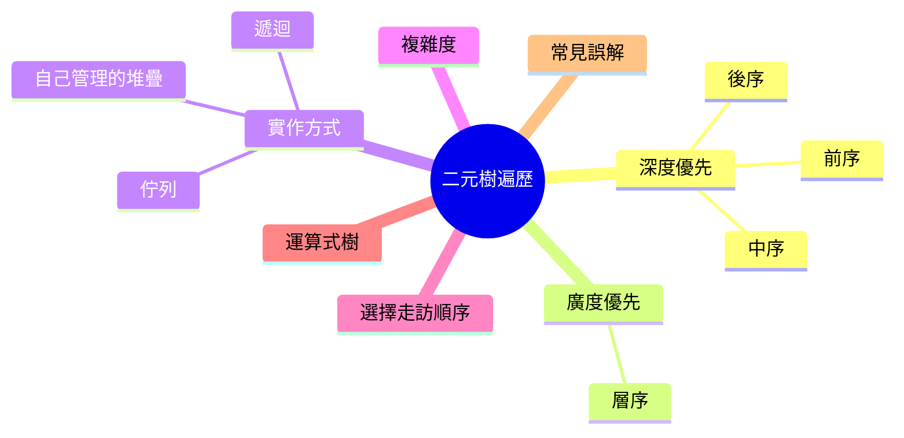

export const metadata = {
  title: '二元樹遍歷',
  date: '2026-11-16',
  excerpt: '走訪二元樹每個節點的四種標準方式：前序、中序、後序與層序。涵蓋遞迴與迭代寫法、各自在時間與記憶體上的成本，以及哪種順序適合哪種工作。內含 TypeScript、Python 與 Java 範例。',
  tags: ['資料結構'],
};

# 二元樹遍歷

遍歷 (traversal) 又稱走訪，指的是把樹的每個節點都拜訪一次，而且只拜訪一次。在陣列中，順序很明顯：從索引 0 開始一路往後。但樹會分岔，所以在每個節點上都得決定下一步要處理什麼：節點本身、它的左子樹，還是右子樹。不同的選擇會產生不同的順序，而每種順序各自適合不同的問題。

這些順序分成兩大類。深度優先 (depth-first) 走訪會沿著一條分支盡量往深處走，走到底再退回來，換下一條分支。廣度優先 (breadth-first) 走訪則由上往下，一層一層地拜訪。本文介紹四種標準的走訪順序、各自的實作方式與成本，以及什麼時候該用哪一種。文中使用的 `TreeNode` 類別來自 [樹與二元樹基礎](./tree-and-binary-tree-basics)。



- [深度優先與廣度優先](#深度優先與廣度優先)
- [前序、中序與後序](#前序中序與後序)
- [遞迴走訪](#遞迴走訪)
- [用堆疊實作迭代走訪](#用堆疊實作迭代走訪)
- [層序走訪](#層序走訪)
- [時間與空間複雜度](#時間與空間複雜度)
- [該用哪一種順序](#該用哪一種順序)
- [範例：運算式樹](#範例運算式樹)
- [常見誤解](#常見誤解)
- [總結](#總結)

---

## 深度優先與廣度優先

本文的所有範例都使用這棵樹：

```text
        1
       / \
      2   3
     / \   \
    4   5   6
```

深度優先走訪 (DFS) 從 1 開始，先走到 2，再走到 4。節點 4 沒有子節點，所以退回 2，再往下走到 5。接著退回 1，轉往右側，走到 3，再走到 6。

廣度優先走訪 (BFS) 則是一層一層、由左到右拜訪節點：先是 1，然後是 2 和 3，最後是 4、5、6。

兩者需要的輔助結構不同。深度優先得記住之後要退回去的節點，而且永遠先回到最近的那一個。這就是堆疊 (stack)，而遞迴免費提供了一個：呼叫堆疊 (call stack)。廣度優先則依照發現節點的順序拜訪它們，先進先出，所以要用佇列 (queue)。這兩種結構在 [Stack 與 Queue](/./stack-and-queue) 中都有介紹。

---

## 前序、中序與後序

深度優先走訪有三種順序。它們在樹中走的路線完全相同，差別只在什麼時候拜訪節點本身：

- 前序 (preorder)：先節點，再左子樹，最後右子樹
- 中序 (inorder)：先左子樹，再節點，最後右子樹
- 後序 (postorder)：先左子樹，再右子樹，最後節點

名稱說明了節點相對於子樹的位置：在子樹之前 (前)、之間 (中) 或之後 (後)。三者都是左子樹先於右子樹。

| 順序 | 規則 | 範例樹的結果 |
| :--- | :--- | :--- |
| 前序 | 節點、左、右 | 1 2 4 5 3 6 |
| 中序 | 左、節點、右 | 4 2 5 1 3 6 |
| 後序 | 左、右、節點 | 4 5 2 6 3 1 |
| 層序 | 一層一層，由左到右 | 1 2 3 4 5 6 |

想手算的話，就遞迴地套用規則。以中序為例：1 的左子樹以 2 為根，它的中序是 4 2 5。接著是 1 本身。然後是以 3 為根的右子樹：3 沒有左子節點，所以是 3 6。合起來就是 4 2 5 1 3 6。

另一種理解方式：深度優先的路線會經過每個節點三次，往下時一次、在兩棵子樹之間一次、往回走時再一次。前序在第一次經過時拜訪節點，中序在第二次，後序在第三次。

前序、後序與層序可以用在任何樹上，不管一個節點有幾個子節點。中序就沒那麼容易推廣：「在左右子樹之間」只在二元樹中才有意義。

---

## 遞迴走訪

遞迴版本幾乎就是把規則逐字翻成程式。這裡的「拜訪」節點，是把它的值加進一個串列；在實際的程式中，可以是任何事：印出值、累加到總和、複製節點。

```typescript
// TypeScript
function preorder(node: TreeNode | null, out: number[]): void {
  if (node === null) return;
  out.push(node.value); // 先處理節點
  preorder(node.left, out);
  preorder(node.right, out);
}

function inorder(node: TreeNode | null, out: number[]): void {
  if (node === null) return;
  inorder(node.left, out);
  out.push(node.value); // 在兩棵子樹之間處理節點
  inorder(node.right, out);
}

function postorder(node: TreeNode | null, out: number[]): void {
  if (node === null) return;
  postorder(node.left, out);
  postorder(node.right, out);
  out.push(node.value); // 最後處理節點
}

const root = new TreeNode(
  1,
  new TreeNode(2, new TreeNode(4), new TreeNode(5)),
  new TreeNode(3, null, new TreeNode(6)),
);
const result: number[] = [];
inorder(root, result);
console.log(result); // [4, 2, 5, 1, 3, 6]
```

```python
# Python
from typing import Optional


def preorder(node: Optional[TreeNode], out: list[int]) -> None:
    if node is None:
        return
    out.append(node.value)  # 先處理節點
    preorder(node.left, out)
    preorder(node.right, out)


def inorder(node: Optional[TreeNode], out: list[int]) -> None:
    if node is None:
        return
    inorder(node.left, out)
    out.append(node.value)  # 在兩棵子樹之間處理節點
    inorder(node.right, out)


def postorder(node: Optional[TreeNode], out: list[int]) -> None:
    if node is None:
        return
    postorder(node.left, out)
    postorder(node.right, out)
    out.append(node.value)  # 最後處理節點


root = TreeNode(
    1,
    TreeNode(2, TreeNode(4), TreeNode(5)),
    TreeNode(3, None, TreeNode(6)),
)
result: list[int] = []
inorder(root, result)
print(result)  # [4, 2, 5, 1, 3, 6]
```

```java
// Java
import java.util.ArrayList;
import java.util.List;

public class Traversal {
    static void preorder(TreeNode node, List<Integer> out) {
        if (node == null) return;
        out.add(node.value); // 先處理節點
        preorder(node.left, out);
        preorder(node.right, out);
    }

    static void inorder(TreeNode node, List<Integer> out) {
        if (node == null) return;
        inorder(node.left, out);
        out.add(node.value); // 在兩棵子樹之間處理節點
        inorder(node.right, out);
    }

    static void postorder(TreeNode node, List<Integer> out) {
        if (node == null) return;
        postorder(node.left, out);
        postorder(node.right, out);
        out.add(node.value); // 最後處理節點
    }

    public static void main(String[] args) {
        TreeNode root = new TreeNode(1,
                new TreeNode(2, new TreeNode(4), new TreeNode(5)),
                new TreeNode(3, null, new TreeNode(6)));
        List<Integer> result = new ArrayList<>();
        inorder(root, result);
        System.out.println(result); // [4, 2, 5, 1, 3, 6]
    }
}
```

三個函式只差在一行的位置，也就是拜訪節點的那一行。把它換個位置，就得到另一種順序。

每個節點都只拜訪一次，所以每種走訪都是 O(n) 時間。記憶體則花在呼叫堆疊上：每一層遞迴佔一個堆疊框架 (stack frame)，所以用量會隨著樹的高度增加。

---

## 用堆疊實作迭代走訪

遞迴有一個實際的限制：每一層巢狀呼叫都會在呼叫堆疊上佔一個框架，而呼叫堆疊並不大。在 Node.js 與預設的 Java 執行緒上，像上面這樣的遞迴走訪，大約在一萬層左右就會失敗，丟出 `RangeError: Maximum call stack size exceeded` 或 `StackOverflowError`。Python 更早就會停下來：它預設的遞迴上限是 1,000，超過時會丟出 `RecursionError`。

平衡的樹永遠碰不到這個限制，一百萬個節點也只有 20 層。但退化的樹每一層只有一個節點，一萬個節點就是一萬層。當樹可能這麼深時，就自己管理堆疊。自己建立的堆疊存放在 heap 記憶體中，唯一的限制是可用的記憶體量。

前序最簡單：彈出一個節點、拜訪它，再把它的子節點推入堆疊。先推右子節點，左子節點才會先被彈出。

中序就要多花點心思，因為一個節點必須等到整棵左子樹都處理完，才能被拜訪。迴圈會盡可能往左走，沿路把每個節點推入堆疊。走不下去時，堆疊頂端的節點就是下一個：彈出它、拜訪它，再對它的右子樹重複整個過程。

```typescript
// TypeScript
function preorderIterative(root: TreeNode | null): number[] {
  const out: number[] = [];
  const stack: TreeNode[] = root === null ? [] : [root];
  while (stack.length > 0) {
    const node = stack.pop()!;
    out.push(node.value);
    // 先推右、再推左，左邊才會先被彈出
    if (node.right !== null) stack.push(node.right);
    if (node.left !== null) stack.push(node.left);
  }
  return out;
}

function inorderIterative(root: TreeNode | null): number[] {
  const out: number[] = [];
  const stack: TreeNode[] = [];
  let node = root;
  while (node !== null || stack.length > 0) {
    while (node !== null) { // 盡可能往左走
      stack.push(node);
      node = node.left;
    }
    node = stack.pop()!; // 它的左子樹已經處理完，拜訪它
    out.push(node.value);
    node = node.right; // 再用同樣的方式處理它的右子樹
  }
  return out;
}
```

```python
# Python
from typing import Optional


def preorder_iterative(root: Optional[TreeNode]) -> list[int]:
    out: list[int] = []
    stack: list[TreeNode] = [root] if root is not None else []
    while stack:
        node = stack.pop()
        out.append(node.value)
        # 先推右、再推左，左邊才會先被彈出
        if node.right is not None:
            stack.append(node.right)
        if node.left is not None:
            stack.append(node.left)
    return out


def inorder_iterative(root: Optional[TreeNode]) -> list[int]:
    out: list[int] = []
    stack: list[TreeNode] = []
    node = root
    while node is not None or stack:
        while node is not None:  # 盡可能往左走
            stack.append(node)
            node = node.left
        node = stack.pop()  # 它的左子樹已經處理完，拜訪它
        out.append(node.value)
        node = node.right  # 再用同樣的方式處理它的右子樹
    return out
```

```java
// Java
import java.util.ArrayDeque;
import java.util.ArrayList;
import java.util.Deque;
import java.util.List;

public class IterativeTraversal {
    static List<Integer> preorderIterative(TreeNode root) {
        List<Integer> out = new ArrayList<>();
        Deque<TreeNode> stack = new ArrayDeque<>();
        if (root != null) stack.push(root);
        while (!stack.isEmpty()) {
            TreeNode node = stack.pop();
            out.add(node.value);
            // 先推右、再推左，左邊才會先被彈出
            if (node.right != null) stack.push(node.right);
            if (node.left != null) stack.push(node.left);
        }
        return out;
    }

    static List<Integer> inorderIterative(TreeNode root) {
        List<Integer> out = new ArrayList<>();
        Deque<TreeNode> stack = new ArrayDeque<>();
        TreeNode node = root;
        while (node != null || !stack.isEmpty()) {
            while (node != null) { // 盡可能往左走
                stack.push(node);
                node = node.left;
            }
            node = stack.pop(); // 它的左子樹已經處理完，拜訪它
            out.add(node.value);
            node = node.right; // 再用同樣的方式處理它的右子樹
        }
        return out;
    }
}
```

在範例樹上，迭代版本回傳的序列與遞迴版本相同：前序是 1 2 4 5 3 6，中序是 4 2 5 1 3 6。兩者的堆疊最多只會有 h + 1 個節點，所以空間是 O(h)，與遞迴相同。改變的是記憶體從哪裡來：heap 的空間比呼叫堆疊大得多。

後序是迭代寫法中最麻煩的一種。常見的捷徑是：把前序迴圈中推入兩個子節點的順序對調，得到「節點、右、左」，再把結果反轉，就變成「左、右、節點」。這樣得到的序列是正確的，但只能拿到完整的結果串列：它無法在走訪進行的過程中，依後序一個一個地交出節點。真正一趟完成的版本，必須記住自己是從節點的左子樹還是右子樹回來的，程式會更長，也更容易寫錯。

---

## 層序走訪

層序走訪使用佇列。先把根節點放進去，然後只要佇列不是空的，就取出最前面的節點、拜訪它，再把它的子節點加到佇列尾端。佇列是先進先出，所以同一層的節點，一定會在下一層的任何節點之前出列。

很多時候，你要的是一層一層分開的結果，而不是一整串：例如逐行印出一棵樹，或找出每一層最右邊的節點。訣竅是在每一輪開始時，先記下佇列的長度。在那個時間點，佇列裡裝的是完整的一層，而且只有這一層，所以從前端取出那麼多個節點，就是處理完這一層。

```typescript
// TypeScript
function levelOrder(root: TreeNode | null): number[][] {
  const levels: number[][] = [];
  let level: TreeNode[] = root === null ? [] : [root];
  while (level.length > 0) {
    levels.push(level.map((node) => node.value));
    const next: TreeNode[] = [];
    for (const node of level) {
      if (node.left !== null) next.push(node.left);
      if (node.right !== null) next.push(node.right);
    }
    level = next;
  }
  return levels;
}
```

```python
# Python
from collections import deque
from typing import Optional


def level_order(root: Optional[TreeNode]) -> list[list[int]]:
    levels: list[list[int]] = []
    queue: deque[TreeNode] = deque()
    if root is not None:
        queue.append(root)
    while queue:
        level: list[int] = []
        # 此時佇列裡就是完整的一層
        for _ in range(len(queue)):
            node = queue.popleft()
            level.append(node.value)
            if node.left is not None:
                queue.append(node.left)
            if node.right is not None:
                queue.append(node.right)
        levels.append(level)
    return levels
```

```java
// Java
import java.util.ArrayDeque;
import java.util.ArrayList;
import java.util.List;
import java.util.Queue;

public class LevelOrder {
    static List<List<Integer>> levelOrder(TreeNode root) {
        List<List<Integer>> levels = new ArrayList<>();
        Queue<TreeNode> queue = new ArrayDeque<>();
        if (root != null) queue.offer(root);
        while (!queue.isEmpty()) {
            // 此時佇列裡就是完整的一層
            int count = queue.size();
            List<Integer> level = new ArrayList<>();
            for (int i = 0; i < count; i++) {
                TreeNode node = queue.poll();
                level.add(node.value);
                if (node.left != null) queue.offer(node.left);
                if (node.right != null) queue.offer(node.right);
            }
            levels.add(level);
        }
        return levels;
    }
}
```

在範例樹上，三者都回傳 `[[1], [2, 3], [4, 5, 6]]`。

JavaScript 沒有內建的佇列，而 `shift()` 是 O(n)，因為它要把剩下的每個元素往前移 (見 [雙端佇列](./deque))。所以 TypeScript 版本不用佇列：它用一個陣列存放目前這一層，再用另一個陣列收集下一層。從頭到尾讀取 `level`，同時把子節點加到 `next` 的尾端，仍然是先進先出，只是一次處理一層。

---

## 時間與空間複雜度

每種走訪都只拜訪每個節點一次，每個節點的工作量是常數，所以四種都是 O(n) 時間。它們的差別在於額外需要的記憶體 (不含輸出結果)：

| 走訪方式 | 時間 | 額外空間 | 平衡樹 | 退化樹 |
| :--- | :--- | :--- | :--- | :--- |
| 前序、中序、後序 | O(n) | O(h) | O(log n) | O(n) |
| 層序 | O(n) | O(w) | O(n) | O(1) |

其中 h 是高度，w 是寬度，也就是單一層中最多的節點數。這兩者通常此消彼長。在平衡樹中，深度優先只需要 O(log n)，但 perfect 二元樹的最底層就佔了將近一半的節點，所以廣度優先需要 O(n)。退化樹的情況則倒過來：每一層只有一個節點，佇列始終很小，深度優先的堆疊卻會長到 n。

還有一種叫做 Morris 走訪 (Morris traversal) 的技巧，能用 O(1) 的額外空間完成中序走訪，做法是暫時把空著的右側參考指回樹的上方。這個技巧很巧妙，但實務上很少需要。

---

## 該用哪一種順序

每種順序各自適合不同的工作：

| 順序 | 適用時機 | 範例 |
| :--- | :--- | :--- |
| 前序 | 節點必須在子節點之前處理 | 複製一棵樹、序列化、印出有縮排的目錄清單 |
| 中序 | 想依排序順序取得二元搜尋樹的值 | 由小到大列出 BST 的值、檢查一棵樹是不是合法的 BST |
| 後序 | 節點需要先拿到子節點的結果 | 計算大小與高度、釋放一棵樹的記憶體、計算運算式的值 |
| 層序 | 與根節點的距離很重要 | 逐層印出一棵樹、找出離根節點最近的葉節點 |

其中幾項值得多看一眼。

序列化之所以可行，是因為前序會先寫出父節點，再寫出子節點。依前序記錄每個節點，每遇到一個空的子節點就寫一個標記 (例如 `#`)，得到的結果就能讀回成同一棵樹。範例樹會變成 `1 2 4 # # 5 # # 3 # 6 # #`。

[樹與二元樹基礎](./tree-and-binary-tree-basics) 中的 `height` 函式就是一種後序走訪：在知道兩棵子樹的高度之前，它沒辦法算出節點的高度。計算目錄大小也一樣，因為資料夾的大小就是裡面所有東西的總和。在沒有垃圾回收的語言中釋放一棵樹也是如此：先釋放父節點，就會失去指向子節點的參考。

需要考慮與根節點的距離時，層序就是正確的工具。要找出離根節點最近的葉節點，深度優先搜尋可能得先鑽過很長的分支才找得到；廣度優先則可以在遇到第一個葉節點時就停下來，因為還沒拜訪的節點，離根節點都不會比它更近。

---

## 範例：運算式樹

算術運算式能同時展示三種深度優先順序。下面是 `(3 + 4) * 2` 的樹：

```text
      *
     / \
    +   2
   / \
  3   4
```

運算子是內部節點，數字是葉節點。樹裡並沒有存放括號：樹的形狀本身就說明 `+` 要先算，因為它的位置比較低。

| 順序 | 輸出 | 表示法 |
| :--- | :--- | :--- |
| 前序 | `* + 3 4 2` | 前置表示法 (prefix)，又稱波蘭表示法 |
| 中序 | `3 + 4 * 2` | 中置表示法 (infix)，但少了括號 |
| 後序 | `3 4 + 2 *` | 後置表示法 (postfix)，又稱逆波蘭表示法 |

中序還原出我們熟悉的中置形式，但少了括號，`3 + 4 * 2` 的意思就變了：依照一般的運算優先順序，它是 3 + 8 = 11，而不是 14。要正確印出運算式樹，就得把每個運算子和它的兩個運算元一起用括號包起來：`((3 + 4) * 2)`。

前置與後置表示法完全不需要括號，因為符號的順序本身就帶有結構。後置表示法用堆疊來計算特別容易：由左到右讀取，遇到數字就推入堆疊；遇到運算子，就彈出兩個數字、計算，再把結果推回去。以 `3 4 + 2 *` 為例：推入 3、推入 4，`+` 彈出它們並推入 7，推入 2，`*` 彈出 7 和 2 並推入 14。

直接計算這棵樹的值，同樣是一種後序走訪：先算左子樹，再算右子樹，最後套用運算子。

---

## 常見誤解

| 常見誤解 | 正確觀念 |
| :--- | :--- |
| 中序走訪會依排序順序回傳值。 | 只有二元搜尋樹才會。以本文的範例樹來說，中序得到的是 4 2 5 1 3 6。 |
| 遞迴走訪不需要額外的記憶體。 | 每次呼叫都會佔用一個堆疊框架，所以它需要 O(h) 的記憶體，退化樹時達到 O(n)，而且樹夠深就會讓呼叫堆疊溢位。 |
| 迭代走訪比遞迴走訪快。 | 兩者都是 O(n)。改用迭代的主要理由是呼叫堆疊的限制，而不是速度。 |
| 廣度優先一定比深度優先省記憶體。 | 要看樹的形狀：O(w) 對上 O(h)。寬的樹對深度優先有利，又高又窄的樹則對廣度優先有利。 |
| 一種走訪序列就足以重建一棵樹。 | 不同的樹可能產生相同的序列。根節點 1 只有一個子節點 2 時，不論 2 在左邊還是右邊，前序都是 1 2。值都不重複時，前序或後序搭配中序就足以重建；有標記空子節點的前序也可以。 |

---

## 總結

走訪歸結成一個問題：節點相對於它的子節點，要在什麼時候處理？前序在子節點之前處理它，中序在兩個子節點之間，後序在子節點之後，層序則改成一次處理一層。前三種是深度優先，靠堆疊運作，可能是呼叫堆疊，也可能是自己管理的堆疊。層序是廣度優先，靠佇列運作。四種都是 O(n) 時間，記憶體則取決於樹的形狀：深度優先是 O(h)，廣度優先是 O(w)。

遞迴是寫深度優先走訪最清楚的方式，用在平衡的樹上也完全沒問題。當樹可能非常深時，就改用自己管理的堆疊。
