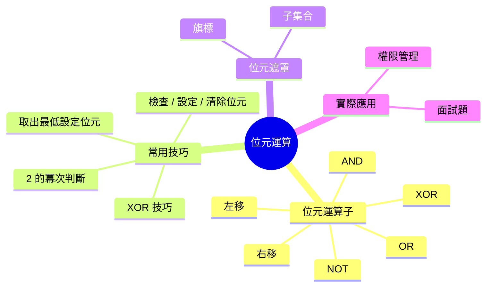

export const metadata = {
  title: '位元運算 Bit Manipulation',
  date: '2026-10-25',
  excerpt: '位元運算實用指南：整數如何以二進位儲存、每個位元運算子實際做了什麼、面試和系統程式中反覆出現的技巧，以及什麼時候用位元運算才是真正正確的選擇。',
  tags: ['程式設計', '演算法'],
};

# 位元運算 Bit Manipulation

程式裡的每一個整數，說穿了就是一串位元。大多數時候你不需要去想這件事。但偶爾，直接在位元層面操作，才是解決問題最乾淨、最快，甚至是唯一的方式。位元運算就是這套技巧的集合。

運算子本身很簡單。需要練習的是：認出一個問題具有位元結構，以及知道該用哪個技巧。



- [整數如何儲存](#整數如何儲存)
- [六個運算子](#六個運算子)
- [必備技巧](#必備技巧)
- [XOR 的性質](#xor-的性質)
- [位元遮罩與子集合](#位元遮罩與子集合)
- [實際應用](#實際應用)
- [JavaScript 的特殊之處](#javascript-的特殊之處)
- [總結](#總結)

---

## 整數如何儲存

整數以固定寬度的位元序列儲存。一個 32 位元整數有 32 個槽，每個槽放 0 或 1。最右邊是第 0 位 (最低有效位，LSB)，最左邊是第 31 位 (最高有效位，MSB)。

```text
十進位 13 的 8 位元二進位表示：

位元位置：  7  6  5  4  3  2  1  0
位元值：    0  0  0  0  1  1  0  1
            ↑                    ↑
           MSB                  LSB

值 = 1×2³ + 1×2² + 0×2¹ + 1×2⁰ = 8 + 4 + 0 + 1 = 13
```

**負數**使用二補數 (two's complement)。要對一個數取負：把所有位元翻轉，再加 1。所以 32 位元的 −1 是全 1 (`0xFFFFFFFF`)，−13 是 13 的位元翻轉加 1。MSB 作為符號位：0 代表正數，1 代表負數。

```text
13  = 00000000 00000000 00000000 00001101
~13 = 11111111 11111111 11111111 11110010  (翻轉所有位元)
-13 = 11111111 11111111 11111111 11110011  (加 1)
```

二補數就是為什麼在所有使用它的語言 (幾乎所有語言都是) 中，`~n` 等於 `-(n + 1)`。

---

## 六個運算子

### AND (`&`)

只有**兩個**輸入位元都是 1 時，輸出才是 1。

```text
  1010
& 1100
------
  1000
```

用來**檢查或清除**特定位元。用一個 1 的遮罩做 AND，就能只保留那些位元位置。

### OR (`|`)

**任一**輸入位元是 1，輸出就是 1。

```text
  1010
| 1100
------
  1110
```

用來**設定**特定位元。

### XOR (`^`)

兩個輸入位元**不同**時，輸出才是 1。

```text
  1010
^ 1100
------
  0110
```

XOR 是最有趣的運算子。它在遮罩為 1 的地方翻轉位元，而且有代數性質 (下一節介紹)，讓它能解決出乎意料多種問題。

### NOT (`~`)

翻轉每一個位元。

```text
~1010 = 0101
```

如前所述，`~n = -(n + 1)`。

### 左移 (`<<`)

把所有位元往左移 `k` 個位置，右邊補 0。等同於乘以 2^k (只要沒有有效位元被移出去)。

```text
00001101 << 2 = 00110100   (13 << 2 = 52 = 13 × 4)
```

### 右移 (`>>` 與 `>>>`)

把所有位元往右移 `k` 個位置。有兩種：

- **算術右移 (`>>`)** — 左邊補符號位。保留負數的符號。等同於除以 2^k 取整
- **邏輯右移 (`>>>`)** — 左邊一律補 0，不管符號。在 JavaScript 中，`>>>` 永遠產生無符號的 32 位元結果

```text
11110000 >> 2  = 11111100   (算術：補符號位)
11110000 >>> 2 = 00111100   (邏輯：補 0)
```

---

## 必備技巧

這些是反覆出現的模式，每一個都值得記起來。

### 檢查第 `k` 位元是否為 1

```javascript
const isSet = (n, k) => (n >> k & 1) === 1;

isSet(13, 2); // 13 = ...1101，第 2 位是 1 → true
isSet(13, 1); // 13 = ...1101，第 1 位是 0 → false
```

把 `n` 右移 `k` 位，讓第 `k` 位落到第 0 位，再 AND 1 把它取出來。

### 設定第 `k` 位元

```javascript
const setBit = (n, k) => n | (1 << k);

setBit(13, 1); // 1101 | 0010 = 1111 = 15
```

### 清除第 `k` 位元

```javascript
const clearBit = (n, k) => n & ~(1 << k);

clearBit(13, 2); // 1101 & ~0100 = 1101 & 1011 = 1001 = 9
```

### 翻轉第 `k` 位元

```javascript
const toggleBit = (n, k) => n ^ (1 << k);

toggleBit(13, 1); // 1101 ^ 0010 = 1111 = 15
toggleBit(15, 1); // 1111 ^ 0010 = 1101 = 13
```

### 判斷 `n` 是否為 2 的冪次

2 的冪次只有一個位元是 1：1、2、4、8、16 的二進位分別是 1、10、100、1000、10000。

技巧：`n & (n - 1)` 會清除最低的設定位元。如果 `n` 是 2 的冪次，那就是唯一的位元，結果會是 0。

```javascript
const isPowerOfTwo = (n) => n > 0 && (n & (n - 1)) === 0;

isPowerOfTwo(16); // 10000 & 01111 = 0 → true
isPowerOfTwo(12); // 01100 & 01011 = 01000 ≠ 0 → false
```

### 取出最低的設定位元

```javascript
const lowestSetBit = (n) => n & (-n);

lowestSetBit(12); // 01100 & 10100 = 00100 = 4
```

在二補數中，`-n` 等於 `~n + 1`。最低設定位元以下的所有位元都翻轉了，但最低設定位元本身在加 1 的進位後仍然是 1。AND 上 `n` 就只保留那一個位元。

### 計算設定位元的數量 (popcount)

Brian Kernighan 演算法：反覆清除最低的設定位元，直到 `n` 變成 0。迭代次數就等於設定位元的數量。

```javascript
function countBits(n) {
  let count = 0;
  while (n !== 0) {
    n &= n - 1; // 清除最低的設定位元
    count++;
  }
  return count;
}

countBits(13); // 1101 → 1100 → 1000 → 0000，3 次迭代 → 3
```

這個方法的時間複雜度是 O(k)，k 是設定位元的數量，當數字稀疏時比逐一檢查全部 32 位元更快。

---

## XOR 的性質

XOR 有三個代數性質，讓它獨樹一幟：

1. `a ^ a = 0` — 一個數和自己 XOR 得 0。
2. `a ^ 0 = a` — 一個數和 0 XOR 不變。
3. XOR 滿足交換律與結合律：順序不影響結果。

這三點合在一起意味著：對一組數字做 XOR，出現**偶數**次的數字會互相抵消，只有出現**奇數**次的數字會留下來。

**經典問題：找出唯一的數字。** 給定一個陣列，其中每個元素都出現兩次，只有一個出現一次，找出那個數字。

```javascript
function singleNumber(nums) {
  return nums.reduce((acc, n) => acc ^ n, 0);
}

singleNumber([4, 1, 2, 1, 2]); // 4 ^ 1 ^ 2 ^ 1 ^ 2 = 4 ^ (1^1) ^ (2^2) = 4 ^ 0 ^ 0 = 4
```

O(n) 時間，O(1) 空間。不需要雜湊表。

**不用暫存變數交換兩個數：**

```javascript
let a = 5, b = 9;
a ^= b; // a = 5 ^ 9 = 12
b ^= a; // b = 9 ^ 12 = 5
a ^= b; // a = 12 ^ 5 = 9
// a = 9, b = 5
```

這利用了抵消性質，但主要是個趣味技巧。用暫存變數更清楚，在現代硬體上速度也一樣快。

---

## 位元遮罩與子集合

**位元遮罩 (bitmask)** 是一個用來表示一組布林旗標的整數。如果有 `n` 個項目，可以用一個 `n` 位元的整數表示它們的任意子集合：第 `k` 位是 1 代表項目 `k` 在子集合裡，0 代表不在。

```javascript
// 用位元表示權限：READ=第0位，WRITE=第1位，EXECUTE=第2位
const READ    = 1 << 0; // 001
const WRITE   = 1 << 1; // 010
const EXECUTE = 1 << 2; // 100

let perms = READ | WRITE; // 011 = 3

// 檢查權限
const canRead    = (perms & READ) !== 0;    // true
const canExecute = (perms & EXECUTE) !== 0; // false

// 授予權限
perms |= EXECUTE; // 111 = 7

// 撤銷權限
perms &= ~WRITE; // 101 = 5
```

### 枚舉所有子集合

要走訪一個 n 元素集合的所有 2^n 個子集合：

```javascript
function allSubsets(items) {
  const n = items.length;
  const subsets = [];

  for (let mask = 0; mask < (1 << n); mask++) {
    const subset = [];
    for (let k = 0; k < n; k++) {
      if (mask & (1 << k)) subset.push(items[k]);
    }
    subsets.push(subset);
  }

  return subsets;
}

allSubsets(['a', 'b', 'c']);
// [], ['a'], ['b'], ['a','b'], ['c'], ['a','c'], ['b','c'], ['a','b','c']
```

這是 O(2^n · n)，因為有 2^n 個子集合，這個成本無法避免。相比遞迴回溯，位元遮罩的寫法更簡潔，也更對快取友善。

---

## 實際應用

### Unix 檔案權限

最經典的例子。每個檔案有三個群組 (擁有者、群組、其他人)，每個群組有三個位元 (讀、寫、執行)。八進位的 `755` 是二進位的 `111 101 101`：擁有者有全部三個權限，群組和其他人有讀和執行。

### Bloom Filter

Bloom filter 用多個雜湊函式在一個大型位元陣列上設定位元。檢查成員資格就是檢查對應的位元是否都被設定。可能有偽陽性，但不會有偽陰性。整個結構就是位元 OR (新增) 和 AND (查詢)。

### 找出缺少的數字

給定一個包含 n−1 個不重複整數的陣列，數字範圍是 1 到 n，找出缺少的那個。

```javascript
function missingNumber(nums) {
  let result = nums.length; // 從 n 開始
  for (let i = 0; i < nums.length; i++) {
    result ^= i ^ nums[i]; // 同時 XOR 索引和值
  }
  return result;
}

missingNumber([3, 0, 1]); // n=3，XOR：3^0^3^1^0^2^1 = 2
```

從 0 到 n 的每個數字，在索引序列中出現一次、在陣列中出現一次，只有缺少的那個只在索引序列中出現。XOR 消掉成對的數字，留下缺少的那個。

---

## JavaScript 的特殊之處

JavaScript 的位元運算子作用在 **32 位元有符號整數**上。在執行任何位元運算之前，JavaScript 會把數字轉換成 32 位元整數 (向零截斷)，執行運算，再轉回 64 位元浮點數。

幾個值得知道的結果：

```javascript
// 大於 2^31 - 1 的數字會被截斷
(2 ** 31) | 0;  // -2147483648 (位元模式繞回去了)

// >>> 轉換成無符號 32 位元，適合把結果當作無符號數處理
-1 >>> 0;       // 4294967295 (0xFFFFFFFF)

// 對 0 做 OR 是快速截斷成 32 位元整數的方式
3.7 | 0;        // 3 (向零截斷，等同 Math.trunc)
-3.7 | 0;       // -3
```

如果需要對超過 32 位元的數字做位元運算，使用 `BigInt`：

```javascript
const big = 1n << 40n; // BigInt 支援任意寬度的位元運算
```

---

## 總結

位元運算是個小而精的工具。運算子本身很簡單；技巧在於認出一個問題具有位元結構。

值得內化的模式：
- `n & (n-1)` 清除最低的設定位元 (也用來判斷 2 的冪次)
- `n & (-n)` 取出最低的設定位元
- XOR 消掉成對的數字，解決一整類「找出奇數次出現的元素」問題
- 位元遮罩把一組布林旗標壓縮成一個整數，讓表示更緊湊、子集合枚舉更快速

當你需要緊湊的狀態表示、在接近硬體的層面工作，或問題的結構能乾淨地對應到二進位時，就是用位元運算的時機。其他情況下，清晰比聰明更重要。
