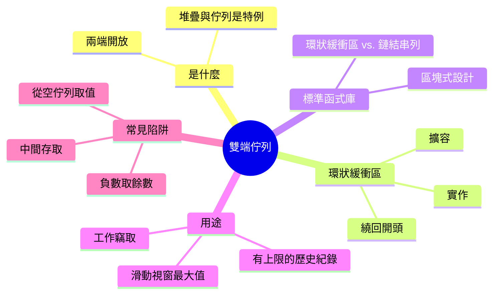
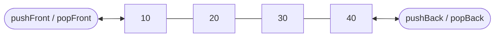
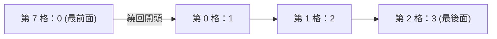

export const metadata = {
  title: '雙端佇列：兩端都能進出的序列',
  date: '2026-11-08',
  excerpt: '深入解析雙端佇列：它是什麼、環狀緩衝區如何讓兩端都做到 O(1)、Java、Python、C++ 各自怎麼實作、它真正派上用場的地方，以及自己動手寫時最容易踩的陷阱。',
  tags: ['資料結構'],
};

# 雙端佇列：兩端都能進出的序列

堆疊只能在一端操作；佇列從一端加入、從另一端取出。雙端佇列 (deque，double-ended queue 的縮寫，念作 "deck") 把這兩條限制都拿掉了：兩端都能加入、也都能取出，而一個寫得好的雙端佇列，這些操作全都是 O(1)。

所以它是三者之中最通用的。只用一端，它就是堆疊；一端進、另一端出，它就是佇列。Java 自己的文件也建議，需要堆疊時用 `ArrayDeque`，而不是老舊的 `Stack` 類別。也因為兩端都開放，雙端佇列會出現在堆疊和佇列都不夠用的地方：有上限的復原紀錄、滑動視窗演算法，以及工作竊取 (work stealing) 執行緒池。

介面是簡單的部分，真正的問題在於：怎麼讓前面跟後面一樣便宜？陣列在尾端很快、在開頭很慢，所以雙端佇列得換個做法：環狀緩衝區 (ring buffer)，讓「前面」本身可以移動。



- [什麼是雙端佇列](#什麼是雙端佇列)
- [用環狀緩衝區實作](#用環狀緩衝區實作)
- [標準函式庫的做法](#標準函式庫的做法)
- [雙端佇列的用途](#雙端佇列的用途)
- [常見陷阱](#常見陷阱)
- [總結](#總結)

---

## 什麼是雙端佇列

雙端佇列是一個兩端都開放的序列，核心操作有六個：

| 操作 | 作用 |
| - | - |
| `pushFront(x)` | 在前面加入 `x` |
| `pushBack(x)` | 在後面加入 `x` |
| `popFront()` | 取出並回傳最前面的元素 |
| `popBack()` | 取出並回傳最後面的元素 |
| `peekFront()` | 讀取最前面的元素，但不取出 |
| `peekBack()` | 讀取最後面的元素，但不取出 |



每個操作都只碰最前面或最後面，從不碰中間。正是這個限制，讓雙端佇列能把它們全都做快。

堆疊和佇列，其實就是規定了只能用哪一端的雙端佇列：

- 堆疊只碰後面：`pushBack` 和 `popBack`
- 佇列從後面放入、從前面取出：`pushBack` 和 `popFront`

如果你讀過 [Stack 與 Queue](/articles/stack-and-queue)，這兩半你早就認識了。雙端佇列，就是不再二選一的結果。

---

## 用環狀緩衝區實作

### 為什麼不能直接用陣列

JavaScript 的陣列本來就有操作兩端的方法：後面有 `push` 和 `pop`，前面有 `unshift` 和 `shift`。後面沒問題，問題在前面：`unshift` 和 `shift` 得把其他每個元素都挪一格，所以每次呼叫都是 O(n)，原因在 [陣列：排列在連續記憶體上的序列](/articles/array) 說明過。陣列一大，差距就藏不住：在 Node.js 22 上，用 `shift` 清空一個 100 萬個元素的陣列，要花上好幾分鐘。

解法是：別再搬元素，改成移動「前面」的位置。

### 移動 head，而不是搬元素

把元素放在一個固定大小的陣列裡，再用一個索引 `head` 記住最前面的元素在哪一格。從前面取出時，`head` 往後移一格；在前面加入時，`head` 往前退一格，再把新值寫進去。其他元素一動也不動。

`head` 遲早會跑出陣列的邊界。環狀緩衝區的做法，是把陣列當成一個圓圈：走過最後一格，就回到第 0 格；從第 0 格往前退，就回到最後一格。繞回去靠的是取餘數：

```text
下一格 = (i + 1) % 容量
上一格 = (i - 1 + 容量) % 容量
```

下面是一個 8 格的環，依序執行 `pushBack(1)`、`pushBack(2)`、`pushBack(3)`，再執行 `pushFront(0)` 之後的樣子：

| 格 | 0 | 1 | 2 | 3 | 4 | 5 | 6 | 7 |
| - | - | - | - | - | - | - | - | - |
| 值 | 1 | 2 | 3 | | | | | 0 |

第 0 格前面已經沒有格子，所以 `pushFront(0)` 讓 `head` 繞回了第 7 格。要依序讀出雙端佇列，就從 `head` 出發、沿著環走：



一般來說，從前面數來第 i 個元素，放在第 `(head + i) % 容量` 格。這只是一次加法加一次取餘數，所以環狀緩衝區跟一般陣列一樣，能在 O(1) 內拿到任何位置的元素。

### 實作

下面是完整的 JavaScript 實作。環一開始有 8 格，每次滿了就翻倍。

```javascript
class Deque {
  constructor() {
    this.items = new Array(8); // 環本身；它的長度就是容量
    this.head = 0;             // 最前面的元素所在的格子
    this.size = 0;             // 目前存了幾個元素
  }

  // 從前面數來第 i 個元素所在的格子
  slot(i) {
    return (this.head + i) % this.items.length;
  }

  // 攤銷 O(1)：寫進最後面元素的下一格
  pushBack(value) {
    if (this.size === this.items.length) {
      this.grow();
    }
    this.items[this.slot(this.size)] = value;
    this.size++;
  }

  // 攤銷 O(1)：head 往前退一格，從 0 繞回最後一格
  pushFront(value) {
    if (this.size === this.items.length) {
      this.grow();
    }
    this.head = (this.head - 1 + this.items.length) % this.items.length;
    this.items[this.head] = value;
    this.size++;
  }

  // O(1)：取出最前面的元素，head 往後移
  popFront() {
    if (this.size === 0) return undefined;
    const value = this.items[this.head];
    this.items[this.head] = undefined; // 放掉參照
    this.head = this.slot(1);
    this.size--;
    return value;
  }

  // O(1)：取出最後面的元素，head 不動
  popBack() {
    if (this.size === 0) return undefined;
    const last = this.slot(this.size - 1);
    const value = this.items[last];
    this.items[last] = undefined;
    this.size--;
    return value;
  }

  // O(1)
  peekFront() {
    return this.size === 0 ? undefined : this.items[this.head];
  }

  // O(1)
  peekBack() {
    return this.size === 0 ? undefined : this.items[this.slot(this.size - 1)];
  }

  // O(n)：從最前面開始，依序複製到兩倍大的環
  grow() {
    const bigger = new Array(this.items.length * 2);
    for (let i = 0; i < this.size; i++) {
      bigger[i] = this.items[this.slot(i)];
    }
    this.items = bigger;
    this.head = 0;
  }
}
```

整個設計靠三個細節撐住：

- `size` 要另外記。如果只有 head 和 tail 兩個索引，空的環和滿的環看起來一模一樣，兩者都是 `head === tail`。另外記下元素個數，就不會分不清。(另一種常見做法是永遠留一格不用。)
- `pushFront` 先加上容量再取餘數。在 JavaScript 裡，`-1 % 8` 是 `-1`，不是 `7`；少了這一步會壞成什麼樣子，[常見陷阱](#常見陷阱) 會說明
- 取出時會清掉那一格。不然環裡會一直留著一個雙端佇列早就不持有的參照，垃圾回收也就沒辦法回收它

### 擴容

環滿的時候，`grow` 會配置一個兩倍大的環，從最前面開始依序把元素複製過去，再把 `head` 歸零。不能照原樣複製舊陣列：像上面的例子那樣，最前面在第 7 格、其餘從第 0 格接下去，原樣複製到 16 格裡，最前面和後面的元素之間會多出 8 個空格。

擴容是 O(n)，但容量每次翻倍，發生的次數少到讓兩種 push 都還是攤銷 O(1)，道理和動態陣列的 `push` 一樣。取出永遠不會觸發擴容，所以每一次都是 O(1)。

---

## 標準函式庫的做法

JavaScript 沒有內建雙端佇列，但大部分語言都有，而且做法不盡相同：

| 型別 | 前面：加入 / 取出 | 後面：加入 / 取出 | 底層結構 |
| - | - | - | - |
| Java `ArrayDeque` | `addFirst` / `pollFirst` | `addLast` / `pollLast` | 可擴容的環狀緩衝區 |
| Java `LinkedList` | `addFirst` / `pollFirst` | `addLast` / `pollLast` | 雙向鏈結串列 |
| Python `collections.deque` | `appendleft` / `popleft` | `append` / `pop` | 由固定大小區塊組成的雙向鏈結串列 |
| C++ `std::deque` | `push_front` / `pop_front` | `push_back` / `pop_back` | 各自配置的固定大小區塊 |

### 環狀緩衝區 vs. 雙向鏈結串列

前兩列是兩種經典設計，剛好站在同一個取捨的兩端：

| | 環狀緩衝區 | 雙向鏈結串列 |
| - | - | - |
| 在任一端加入 | 攤銷 O(1) | O(1) |
| 在任一端取出 | O(1) | O(1) |
| 依位置存取 | O(1) | O(n) |
| 額外記憶體 | 預留的空間 | 每個元素兩個指標 |
| 記憶體佈局 | 連續 | 各自配置的節點 |

雙向鏈結串列從不複製任何東西，而且它的 O(1) 每一次都成立，不是平均起來才成立。但每個元素都得各自配置一次記憶體、多帶兩個指標，走訪時也得在記憶體裡跳來跳去。環狀緩衝區精簡、對快取友善，代價是擴容時偶爾一次 O(n) 的複製。對大多數情況來說，這筆交易比較划算；Java 的文件也說，`ArrayDeque` 拿來當佇列時，很可能比 `LinkedList` 快。雙向鏈結串列本身，可以參考 [鏈結串列：由節點與指標構成的序列](/articles/linked-list)。

### 區塊：折衷的做法

Python 和 C++ 則用固定大小的區塊來折衷。CPython 的 `deque` 把一個個 64 格的區塊串成鏈，所以長大只是多掛一個區塊：元素從不搬家，每個區塊內部又是連續的。C++ 的 `std::deque` 通常把區塊放在一個指標陣列裡，所以仍然能在 O(1) 內拿到任何元素，代價是多一次指標查找；指標陣列滿了，要複製的也只是指標，元素本身不動。`std::deque` 也因此能保證：在任一端加入元素，都不會讓指向既有元素的參照失效。環狀緩衝區給不了這個保證，因為一擴容，所有元素都會搬家。

---

## 雙端佇列的用途

當兩端都在做事，雙端佇列才真正派上用場。

### 滑動視窗最大值

給一個陣列和視窗大小 `k`，找出每 `k` 個連續元素中的最大值。每個視窗都重新掃一遍，要 O(n × k)；用雙端佇列可以降到 O(n)。

做法是維護一個存放索引的雙端佇列，讓這些索引對應的值從前到後遞減，這樣最前面永遠是當前視窗的最大值。加入新索引之前，先從後面取出所有值不大於新元素的索引：那些元素比較舊、也沒有比較大，只要新元素還在視窗裡，它們就不可能再成為最大值。而最前面的索引一旦滑出視窗，就從前面取出。

```javascript
// O(n)：每個長度為 k 的連續視窗中的最大值
function windowMaxima(nums, k) {
  if (k < 1) return [];

  const deque = new Deque(); // 存放索引，對應的值從前到後遞減
  const maxima = [];

  for (let i = 0; i < nums.length; i++) {
    // 最前面的索引已經滑出視窗
    if (deque.size > 0 && deque.peekFront() <= i - k) {
      deque.popFront();
    }

    // 比 nums[i] 舊、又不比它大的值，不可能再成為最大值
    while (deque.size > 0 && nums[deque.peekBack()] <= nums[i]) {
      deque.popBack();
    }

    deque.pushBack(i);

    // 從第一個完整的視窗開始，最前面就是最大值
    if (i >= k - 1) {
      maxima.push(nums[deque.peekFront()]);
    }
  }

  return maxima;
}

windowMaxima([1, 3, -1, -3, 5, 3, 6, 7], 3); // [3, 3, 5, 5, 6, 7]
```

每個索引只會被加入一次、最多被取出一次，所以不管 `k` 多大，整趟都是 O(n)。兩端都在忙：後面負責淘汰不可能再贏的值，前面負責讓離開視窗的索引退場。

### 有上限的歷史紀錄

復原 (undo) 的歷史紀錄通常有上限：只保留最近 100 個動作，更早的就忘掉。新動作放在後面，復原也從後面拿，到這裡為止是個堆疊。但紀錄滿了以後，最舊的動作得從前面丟掉，這又是佇列的行為。雙端佇列兩件事都能以 O(1) 做到：

```javascript
const MAX_HISTORY = 100;
const history = new Deque();

function record(action) {
  history.pushBack(action);
  if (history.size > MAX_HISTORY) {
    history.popFront(); // 忘掉最舊的動作
  }
}

function undo() {
  return history.popBack(); // 最近的一個動作，沒有則回傳 undefined
}
```

Python 直接內建了這個功能：`deque(maxlen=100)` 滿了之後，會自己從另一端丟掉元素。

### 工作竊取

雙端佇列也是工作竊取的核心，這是讓執行緒池裡每個執行緒都有事做的經典手法。在 Java 的 `ForkJoinPool` 裡，每個工作執行緒都有自己的任務雙端佇列。它把自己產生的子任務推進其中一端，下一個任務也從同一端拿，所以總是先處理最新的任務，而那份資料很可能還在快取裡。手上沒事的執行緒，則從別人雙端佇列的另一端「偷」任務。那一端放的是最舊的任務，在分治 (divide and conquer) 的工作裡，這往往是剩下最大的幾塊之一；而且擁有者和竊取者在不同端操作，很少撞在一起。

---

## 常見陷阱

### 從空的雙端佇列取值

從空的雙端佇列取值會發生什麼，完全看你用哪個函式庫：

| 函式庫 | 從空佇列的前面取出 |
| - | - |
| Java `ArrayDeque` | `pollFirst` 回傳 `null`；`removeFirst` 拋出 `NoSuchElementException` |
| Python `collections.deque` | `popleft` 拋出 `IndexError` |
| C++ `std::deque` | `pop_front` 是未定義行為 |
| 上面的環狀緩衝區 | `popFront` 回傳 `undefined` |

Java 刻意同時提供兩種風格，這也是 `ArrayDeque` 乾脆不允許存 `null` 的原因：如果 `null` 是合法元素，`pollFirst` 回傳的 `null` 就可能代表「佇列空了」，也可能代表「最前面那個元素就是 `null`」。上面的環狀緩衝區對 `undefined` 也有同樣的歧義。如果雙端佇列裡可能存 `undefined`，取出前先檢查 `size`，別依賴回傳值。

### 負數與 `%`

往回移動 `head`，是手寫環狀緩衝區最常出錯的地方。JavaScript 跟 Java、C、C++ 一樣，`%` 的結果和左邊運算元同號：

```javascript
const capacity = 8;

(0 - 1) % capacity;            // -1，不是 7
(0 - 1 + capacity) % capacity; // 7
```

如果 `pushFront` 用的是第一種寫法，全新的雙端佇列第一次呼叫它，就會算出第 `-1` 格。在 JavaScript 裡，`items[-1] = value` 不會拋錯，而是悄悄多出一個名為 `"-1"` 的屬性，從此整個雙端佇列就壞了。先加上容量，左邊運算元就不會是負數，結果永遠是合法的格子。Python 的 `%` 則和右邊運算元同號，所以在 Python 裡 `(0 - 1) % 8` 是 `7`。從 Python 移植過來的程式碼，很容易在沒人察覺的情況下，把這個 bug 一起帶過來。

### 以為中間也很快

雙端佇列快的是兩端，不是每個地方。在中間插入或刪除，上面每一種設計都是 O(n)：不是得搬動元素，就是得先走到那個位置。依位置讀取則各有不同：環狀緩衝區和 `std::deque` 是 O(1)，鏈結串列是 O(n)，Python 的 `deque` 在兩端是 O(1)，越靠近中間越慢，最慢到 O(n)。如果你需要快速的依位置存取，而且只會在後面加入元素，一般的陣列仍然是比較好的工具。

---

## 總結

雙端佇列是兩端都開放的序列，好的實作能讓兩端的加入與取出都是 O(1)。堆疊和佇列，則是同一個結構加上「只能用哪一端」的規則。

- JavaScript 的陣列只有後面快：`unshift` 和 `shift` 都是 O(n)
- 環狀緩衝區移動的是最前面的位置而不是元素，用 `%` 讓索引繞回開頭，滿了就翻倍，所以加入是攤銷 O(1)，取出是 O(1)
- 雙向鏈結串列在兩端都是最壞情況 O(1)，但要付出記憶體和區域性的代價；Python 的 `deque` 和 C++ 的 `std::deque` 這類區塊式設計，介於兩者之間
- 當兩端都重要時，雙端佇列就值得一用：滑動視窗、有上限的歷史紀錄、工作竊取排程

只需要一端時，用堆疊或佇列更能表達你的意圖。兩端都需要時，就用雙端佇列；在 JavaScript 裡，這通常代表自己寫一個像上面那樣的小型環狀緩衝區。
