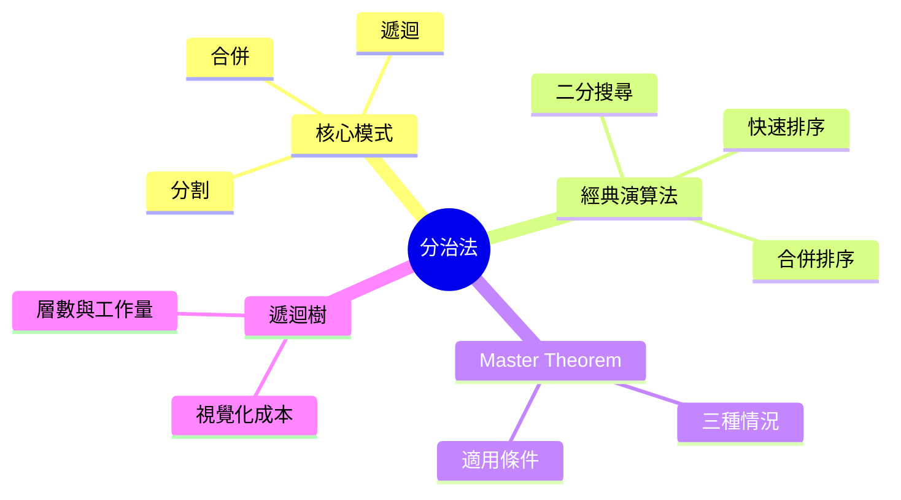

export const metadata = {
  title: '分治法 (含 Master Theorem)',
  date: '2026-10-24',
  excerpt: '深入解析分治法：把問題拆成獨立子問題如何帶來優雅的遞迴解法、如何用 Master Theorem 分析時間複雜度，以及這個技巧在合併排序、快速排序、二分搜尋中的具體應用。',
  tags: ['程式設計', '演算法'],
};

# 分治法 (含 Master Theorem)

分治法 (Divide and Conquer) 是演算法設計中最強大的思路之一。策略很簡單：如果一個問題太大、無法直接解決，就把它拆成幾個較小的獨立子問題，遞迴地各自解決，再把結果合併起來。當子問題小到可以直接解決時，遞迴就到底了。

這個技巧值得深入理解，不只是因為它有效，而是因為同樣的三步驟模式 (分割、遞迴、合併) 一再產出既優雅又快速的演算法，而 Master Theorem 讓你不必手動展開遞迴，就能直接讀出時間複雜度。



- [核心模式](#核心模式)
- [合併排序](#合併排序)
- [快速排序](#快速排序)
- [二分搜尋](#二分搜尋)
- [Master Theorem](#master-theorem)
- [遞迴樹的直覺](#遞迴樹的直覺)
- [什麼時候用分治法](#什麼時候用分治法)
- [總結](#總結)

---

## 核心模式

每一個分治演算法都遵循同樣的骨架：

1. **分割 (Divide)** — 把問題拆成 `a` 個子問題，每個大小為 `n/b`。
2. **遞迴 (Recurse)** — 用同樣的方式解決每個子問題。
3. **合併 (Combine)** — 把子問題的解合併成原問題的答案。

遞迴在基本情況 (base case) 時終止，通常是輸入小到可以直接回答 (大小為 0 或 1)。

```javascript
function solve(problem) {
  if (isBaseCase(problem)) return solveDirectly(problem);

  const subproblems = divide(problem);
  const results = subproblems.map(solve);
  return combine(results);
}
```

關鍵要求是子問題必須**相互獨立**：解決其中一個不需要依賴另一個的結果。這正是分治法與動態規劃的分界線，動態規劃處理的是子問題重疊的情況，需要快取結果來避免重複計算。

---

## 合併排序

合併排序是這個模式最清晰的示範。要排序一個陣列：

1. **分割** — 從中間切成兩半。
2. **遞迴** — 分別排序兩半。
3. **合併** — 把兩個已排序的半段合併成一個排序好的陣列。

合併步驟才是真正的工作所在。兩個已排序的陣列可以用 O(n) 合併：各自維持一個指標，每次取兩個前端元素中較小的那個。

```javascript
function mergeSort(arr) {
  if (arr.length <= 1) return arr;

  const mid = Math.floor(arr.length / 2);
  const left = mergeSort(arr.slice(0, mid));
  const right = mergeSort(arr.slice(mid));

  return merge(left, right);
}

function merge(left, right) {
  const result = [];
  let i = 0, j = 0;

  while (i < left.length && j < right.length) {
    if (left[i] <= right[j]) {
      result.push(left[i++]);
    } else {
      result.push(right[j++]);
    }
  }

  return result.concat(left.slice(i), right.slice(j));
}
```

**複雜度：** T(n) = 2T(n/2) + O(n)。Master Theorem (情況二，見下文) 給出 O(n log n)。這在最壞情況下也成立，這是合併排序相對於快速排序的主要優勢。

**空間：** 合併時需要暫存陣列，O(n)。原地合併排序存在，但複雜度高出許多。

---

## 快速排序

快速排序也把陣列分割，但方式不同。它不是按位置切，而是按值圍繞一個選定的**基準 (pivot)** 來分割：

1. **分割** — 選一個基準，把陣列重排，讓所有比基準小的元素在左邊、比基準大的在右邊。基準本身就落在它最終排序後的位置。
2. **遞迴** — 分別排序左右兩個分區。
3. **合併** — 不需要做任何事；陣列已經原地排好了。

```javascript
function quickSort(arr, lo = 0, hi = arr.length - 1) {
  if (lo >= hi) return;

  const pivotIndex = partition(arr, lo, hi);
  quickSort(arr, lo, pivotIndex - 1);
  quickSort(arr, pivotIndex + 1, hi);
}

function partition(arr, lo, hi) {
  const pivot = arr[hi];
  let i = lo - 1;

  for (let j = lo; j < hi; j++) {
    if (arr[j] <= pivot) {
      i++;
      [arr[i], arr[j]] = [arr[j], arr[i]];
    }
  }

  [arr[i + 1], arr[hi]] = [arr[hi], arr[i + 1]];
  return i + 1;
}
```

**平均複雜度：** O(n log n)。當基準每次都落在接近中間的位置，遞迴式是 T(n) = 2T(n/2) + O(n)，與合併排序相同。

**最壞情況：** O(n²)。當基準每次都是最小或最大的元素，就會產生一個大小為 n−1 的分區和一個大小為 0 的分區。對一個已排序的陣列選最後一個元素當基準，就是最典型的觸發條件。隨機選取基準可以把這種情況的機率降到可以忽略。

**空間：** 呼叫堆疊平均 O(log n) (遞迴深度)。不需要額外的陣列，這也是快速排序在實務上往往比合併排序更快的原因：更好的快取行為，更低的常數係數。

### 基準的選擇

基準的選法比看起來更重要：

| 策略 | 最壞情況觸發條件 | 備註 |
| - | - | - |
| 最後一個元素 | 已排序的輸入 | 簡單但脆弱 |
| 隨機元素 | 機率極低 | 通用的好選擇 |
| 三數取中 | 較難構造 | 許多標準函式庫採用 |

---

## 二分搜尋

二分搜尋是分治法應用在搜尋上的例子。給定一個已排序的陣列，找到目標值：

1. **分割** — 檢查中間的元素。
2. **遞迴** — 如果目標比中間值小，搜尋左半段；如果比較大，搜尋右半段。
3. **合併** — 不需要合併；答案直接從遞迴呼叫中回傳。

```javascript
function binarySearch(arr, target, lo = 0, hi = arr.length - 1) {
  if (lo > hi) return -1;

  const mid = Math.floor((lo + hi) / 2);

  if (arr[mid] === target) return mid;
  if (arr[mid] > target) return binarySearch(arr, target, lo, mid - 1);
  return binarySearch(arr, target, mid + 1, hi);
}
```

每次呼叫都把搜尋範圍減半，遞迴式是 T(n) = T(n/2) + O(1)，得到 O(log n)。迭代版本可以避免呼叫堆疊的開銷，在實務上通常更受青睞：

```javascript
function binarySearch(arr, target) {
  let lo = 0, hi = arr.length - 1;

  while (lo <= hi) {
    const mid = Math.floor((lo + hi) / 2);
    if (arr[mid] === target) return mid;
    if (arr[mid] < target) lo = mid + 1;
    else hi = mid - 1;
  }

  return -1;
}
```

二分搜尋提醒了我們：「合併」步驟可以是微不足道的。分治法的威力有時完全來自「分割」這一步。

---

## Master Theorem

大多數分治法的遞迴式都符合這個形式：

```text
T(n) = a · T(n/b) + f(n)
```

其中：
- `a ≥ 1` — 子問題的數量
- `b > 1` — 輸入縮小的倍數
- `f(n)` — 分割與合併步驟的成本

Master Theorem 把 `f(n)` 與 `n^log_b(a)` 做比較 (即 n 的 log_b(a) 次方)，後者代表遞迴樹葉節點的總工作量。

### 三種情況

**情況一 — 葉節點主導：** 若 `f(n) = O(n^(log_b(a) − ε))`，對某個 ε > 0 成立，則：

```text
T(n) = Θ(n^log_b(a))
```

葉節點的工作量壓過每一層的工作量，總成本就是葉節點的工作量。

**情況二 — 每層工作量相等：** 若 `f(n) = Θ(n^log_b(a) · log^k(n))`，對某個 k ≥ 0 成立，則：

```text
T(n) = Θ(n^log_b(a) · log^(k+1)(n))
```

最常見的子情況是 k = 0：若 `f(n) = Θ(n^log_b(a))`，則 T(n) = Θ(n^log_b(a) · log n)。

**情況三 — 根節點主導：** 若 `f(n) = Ω(n^(log_b(a) + ε))`，對某個 ε > 0 成立，且 `a · f(n/b) ≤ c · f(n)` 對某個 c < 1 成立 (正則條件)，則：

```text
T(n) = Θ(f(n))
```

根節點這一層的工作量主導了以下所有層。

### 實例演算

| 演算法 | 遞迴式 | a | b | n^log_b(a) | f(n) | 情況 | 結果 |
| - | - | - | - | - | - | - | - |
| 合併排序 | T(n) = 2T(n/2) + n | 2 | 2 | n¹ | n | 2 | Θ(n log n) |
| 二分搜尋 | T(n) = T(n/2) + 1 | 1 | 2 | n⁰ = 1 | 1 | 2 | Θ(log n) |
| 矩陣乘法 (暴力) | T(n) = 8T(n/2) + n² | 8 | 2 | n³ | n² | 1 | Θ(n³) |
| Strassen 演算法 | T(n) = 7T(n/2) + n² | 7 | 2 | n^2.807 | n² | 1 | Θ(n^2.807) |

**合併排序詳解：** a = 2，b = 2，所以 n^log_2(2) = n^1 = n。由於 f(n) = n = Θ(n)，符合情況二 (k = 0)，得到 Θ(n log n)。

**二分搜尋詳解：** a = 1，b = 2，所以 n^log_2(1) = n^0 = 1。由於 f(n) = 1 = Θ(1)，符合情況二 (k = 0)，得到 Θ(log n)。

### Master Theorem 不適用的情況

定理要求 `f(n)` 與 n^log_b(a) 之間有多項式級別的差距。如果差距只有對數級別，三種情況都不適用。例如 T(n) = 2T(n/2) + n log n 屬於情況二 (k = 1)，得到 Θ(n log² n)；但 T(n) = 2T(n/2) + n / log n 不符合任何情況，需要用其他方法 (例如 Akra-Bazzi 方法) 處理。

---

## 遞迴樹的直覺

Master Theorem 是一個公式，但遞迴樹是它背後的圖像。把它畫出來，三種情況就一目了然。

以 T(n) = 2T(n/2) + n (合併排序) 為例：

```text
第 0 層：  n                              → 工作量：n
第 1 層：  n/2    n/2                     → 工作量：n/2 + n/2 = n
第 2 層：  n/4  n/4  n/4  n/4             → 工作量：4 × n/4 = n
...
第 k 層：  2^k 個大小為 n/2^k 的子問題    → 工作量：n
...
第 log n 層：n 個大小為 1 的葉節點        → 工作量：n
```

每一層都做 n 的工作，共有 log n + 1 層，所以總量是 Θ(n log n)。這是情況二：工作量均勻分布在每一層。

情況一 (葉節點主導)：每往下一層，工作量就增加，所以最底層 (葉節點) 佔了總量的大部分。情況三 (根節點主導)：每往下一層，工作量就減少，所以最頂層佔了總量的大部分。

---

## 什麼時候用分治法

這個模式在以下情況天然適用：

- 問題可以拆成**相互獨立**、類型相同的子問題
- 子問題的大小大致相等 (平衡的分割能帶來最好的複雜度)
- 有高效的方式合併子問題的解

當子問題大量重疊時，分治法是錯誤的工具 (應該用動態規劃)；當合併步驟的成本和從頭解決問題一樣高時，也不適合。

幾個不那麼顯眼的應用：

- **最近點對問題** — 在二維平面上找最近的兩個點，用分治法可以做到 O(n log n)：按 x 座標把點集分成兩半，再用一個仔細的帶狀檢查來合併
- **快速傅立葉變換 (FFT)** — 把多項式求值拆成兩個半大小的問題，從 O(n²) 降到 O(n log n)
- **Karatsuba 乘法** — 把兩個 n 位數各自拆成兩半，只做 3 次遞迴乘法而非 4 次，把複雜度從 O(n²) 降到 O(n^1.585)

---

## 總結

分治法之所以有效，是因為把問題對半切、遞迴解決每一半，往往能把 O(n²) 的暴力解變成 O(n log n) 的演算法。三步驟模式 (分割、遞迴、合併) 在每個例子裡都一樣，變的只是怎麼切、怎麼合。

Master Theorem 讓複雜度分析變成機械式的操作：寫下遞迴式 T(n) = aT(n/b) + f(n)，把 f(n) 與 n^log_b(a) 比較，再從適用的情況讀出答案。當定理不適用時，遞迴樹能用圖像的方式給你同樣的直覺。

這個技巧無處不在：排序、搜尋、計算幾何、訊號處理、快速算術。能認出這個模式，後面的事情往往就順了。
