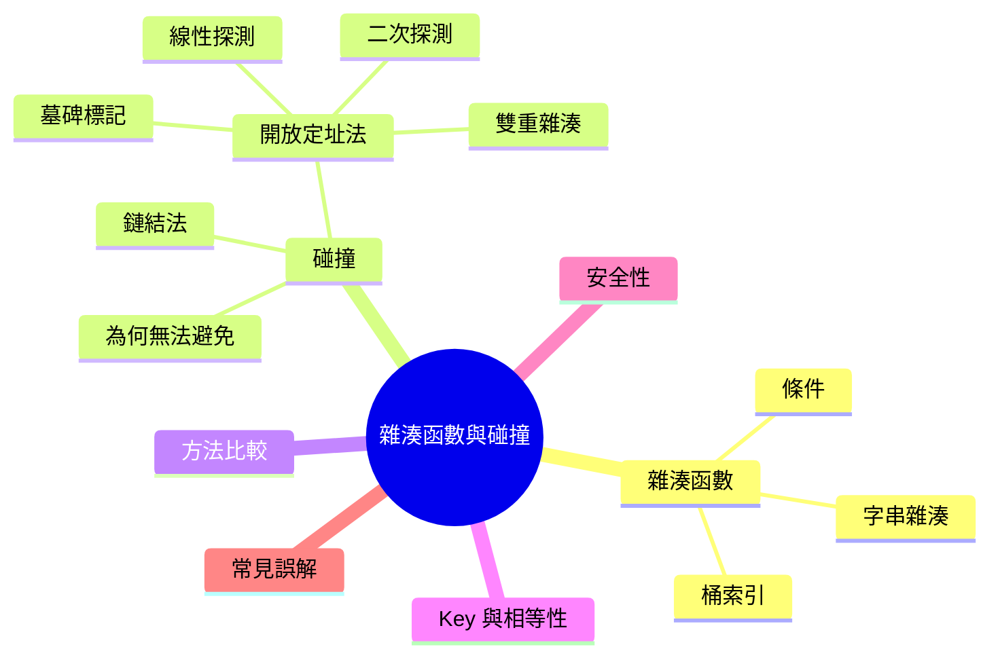
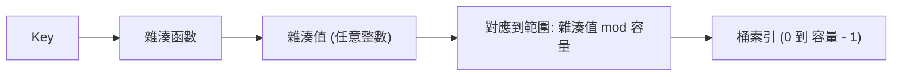

export const metadata = {
  title: '雜湊函數與碰撞處理',
  date: '2026-11-14',
  excerpt: '好的雜湊函數該具備什麼條件、如何對字串做雜湊才不會讓 key 擠進少數幾個桶，以及兩個 key 撞在同一個位置時雜湊表怎麼處理：鏈結法、線性與二次探測、雙重雜湊，還有墓碑標記。內含 TypeScript、Python 與 Java 範例。',
  tags: ['資料結構'],
};

# 雜湊函數與碰撞處理

雜湊表的表現取決於兩件事：把 key 轉成索引的函數，以及兩個 key 撞在同一個索引時雜湊表怎麼處理。前者沒做好，key 會全部擠進少數幾個桶；後者沒做好，查詢會悄悄漏掉明明就在表裡的資料。無論哪一種，你原本指望的 O(1) 都會不見。

本文把這兩部分都說明一遍。前半談雜湊函數：它必須保證什麼、為什麼把字元相加是個壞主意，以及實際的雜湊表怎麼把雜湊值轉成桶索引。後半談碰撞：鏈結法 (separate chaining)、開放定址法 (open addressing) 這一系 (線性探測、二次探測、雙重雜湊)，以及刪除資料這個出乎意料棘手的問題。建議先讀過 [雜湊表 Hash Table](./hash-table)，或已經了解基本概念。



- [雜湊函數在做什麼](#雜湊函數在做什麼)
- [好的雜湊函數該具備什麼](#好的雜湊函數該具備什麼)
- [字串的雜湊](#字串的雜湊)
- [從雜湊值到桶索引](#從雜湊值到桶索引)
- [為什麼碰撞無法避免](#為什麼碰撞無法避免)
- [鏈結法 (Separate Chaining)](#鏈結法-separate-chaining)
- [開放定址法 (Open Addressing)](#開放定址法-open-addressing)
- [實作線性探測](#實作線性探測)
- [鏈結法 vs. 開放定址法](#鏈結法-vs-開放定址法)
- [Key 的相等性與雜湊值](#key-的相等性與雜湊值)
- [雜湊碰撞攻擊與安全性](#雜湊碰撞攻擊與安全性)
- [常見誤解](#常見誤解)
- [總結](#總結)

---

## 雜湊函數在做什麼

雜湊函數接收一個 key，回傳一個整數，稱為雜湊值 (hash code 或 hash value)。雜湊表分兩步使用它：先算出雜湊值，再把雜湊值對應到有效的桶索引。



這個拆分很重要。雜湊函數屬於 key 的型別，完全不需要知道雜湊表有多大；第二步則由雜湊表負責，容量想怎麼改都可以。這也是為什麼 Java 讓每個物件都有 `hashCode()`，而每個 `HashMap` 自己決定要用多少個桶。

---

## 好的雜湊函數該具備什麼

- 確定性 (deterministic)：同一個 key 永遠產生相同的雜湊值 (在程式的同一次執行中)。否則存進去的資料就找不回來
- 與相等性一致：兩個 key 相等，它們的雜湊值就必須相等。反過來則不要求，不同的 key 可以有相同的雜湊值
- 均勻 (uniform)：雜湊值要平均散開，讓每個桶被選中的機率大致相同。分布不均就會造成過長的鏈結串列或過長的探測序列
- 快：雜湊函數在每次新增、查詢、刪除時都會執行，成本每次都要付。它花的時間應該與 key 的大小成正比，不要更多

清單裡沒有「不可逆」和「難以刻意製造碰撞」，那是密碼學雜湊函數的要求。雜湊表用不到，而且它們會拖慢速度。(來源不受信任時是例外，見安全性一節。)

---

## 字串的雜湊

整數很簡單：數字本身就可以當雜湊值。字串則需要多費點功夫。最直覺的做法，是把字元編碼加起來：

```typescript
// TypeScript
function sumHash(s: string): number {
  let h = 0;
  for (let i = 0; i < s.length; i++) h += s.charCodeAt(i);
  return h;
}

function polyHash(s: string): number {
  let h = 0;
  for (let i = 0; i < s.length; i++) {
    h = (h * 31 + s.charCodeAt(i)) >>> 0; // 在 32 位元處繞回
  }
  return h;
}

console.log(sumHash("cat"), sumHash("act"));   // 312 312
console.log(polyHash("cat"), polyHash("act")); // 98262 96402
```

```python
# Python
def sum_hash(s: str) -> int:
    return sum(ord(c) for c in s)


def poly_hash(s: str) -> int:
    h = 0
    for c in s:
        h = (h * 31 + ord(c)) & 0xFFFFFFFF  # Python 的整數不會溢位，所以要自己在 32 位元處繞回
    return h


print(sum_hash("cat"), sum_hash("act"))    # 312 312
print(poly_hash("cat"), poly_hash("act"))  # 98262 96402
```

```java
// Java
public class StringHash {
    static int sumHash(String s) {
        int h = 0;
        for (int i = 0; i < s.length(); i++) h += s.charAt(i);
        return h;
    }

    static int polyHash(String s) {
        int h = 0;
        for (int i = 0; i < s.length(); i++) {
            h = 31 * h + s.charAt(i); // int 溢位時會繞回去，這是刻意的設計
        }
        return h; // 與 s.hashCode() 的值相同
    }

    public static void main(String[] args) {
        System.out.println(sumHash("cat") + " " + sumHash("act"));   // 312 312
        System.out.println(polyHash("cat") + " " + polyHash("act")); // 98262 96402
    }
}
```

`sumHash` 有兩個問題：

- 它忽略順序。`"cat"`、`"act"`、`"tac"` 的總和都是 312，所以一個單字的所有字母異位詞 (anagram) 都會與它碰撞
- 它分散得很差。總和是一堆擠在狹窄範圍內的小數字。五個小寫字母的字串有 11,881,376 種，但它們的總和全都落在 485 到 610 之間，也就是只有 126 種不同的雜湊值

`polyHash` 讓每個字元的位置都有意義，兩個問題就一併解決。它把字串當成一個 31 進位的數字：

```text
hash = s[0] × 31^(n-1) + s[1] × 31^(n-2) + … + s[n-1]
```

迴圈裡每個字元只需要一次乘法和一次加法。以 `"cat"` 來說就是 99 × 31² + 97 × 31 + 116 = 98262，`"act"` 則是 97 × 31² + 99 × 31 + 116 = 96402。字母異位詞現在落在不同的地方。Java 的 `String.hashCode()` 做的就是這件事。

為什麼是 31？與其說是定律，不如說是傳統。它是個小的奇數質數，而且 `31 * h` 可以便宜地算成 `(h << 5) - h`；其他小質數效果也差不多。溢位是刻意的：數值直接繞回去。Java 的 `int` 是有號的，所以較長的字串可能產生負的雜湊值。這也是本文的 Java 程式碼用 `Math.floorMod`，而不是直接用 `%` 的原因。

實際使用的雜湊函數 (MurmurHash、xxHash、SipHash) 混合得更徹底，但目標相同：每個字元都會影響結果，而且位置很重要。

---

## 從雜湊值到桶索引

接下來，雜湊表要把雜湊值對應到 0 到 m − 1 的範圍，m 是桶的數量。常見的做法有三種：

| 方法 | 公式 | 備註 |
| :--- | :--- | :--- |
| 除法 | `雜湊值 % m` | 簡單。當 `m` 是不接近 2 的次方的質數時效果最好 |
| 位元遮罩 | `雜湊值 & (m - 1)` | 要求 `m` 是 2 的次方。比除法快，但只用到低位元 |
| 乘法 | `floor(m × frac(雜湊值 × A))` | 對任何 `m` 都適用，所以桶的數量不是關鍵。`frac` 是小數部分，Knuth 建議 A ≈ 0.618 |

2 的次方的麻煩在於，`雜湊值 % m` 只保留最低的幾個位元，其餘的全部忽略。想像 key 都是 1024 的倍數，例如對齊分頁的記憶體位址。桶有 16 個時，每一個的 `key % 16` 都是 0，全部擠進桶 0；桶有 17 個時，連續 17 個倍數會落在 17 個不同的桶。

那為什麼實際的雜湊表還是用 2 的次方？因為遮罩比除法便宜，而且容量加倍後依然是 2 的次方。它們的補救方法是先把雜湊值混合過，讓低位元也取決於高位元。例如 Java 的 `HashMap` 會先算 `h ^ (h >>> 16)`，再用 `capacity - 1` 做遮罩；CPython 的 `dict` 同樣使用 2 的次方大小，並且把雜湊值的高位元混進探測序列裡。

---

## 為什麼碰撞無法避免

可能的 key 遠多於桶的數量。即使是 32 位元的雜湊值，也只有大約 43 億種，而 10 個字元的字串的可能組合是個天文數字。根據鴿籠原理 (pigeonhole principle)，一定有 key 共用同一個雜湊值；雜湊表再把這些雜湊值對應到更少的桶，共用同一個桶的情況只會更常見。

碰撞出現的時間也比直覺早。這就是生日悖論 (birthday problem)：一個房間裡只要有 23 個人，就有超過一半的機率有兩個人同一天生日。同樣的算式也適用於桶。假設雜湊函數完全均勻、共有 m 個桶，只要大約插入 1.18 × √m 個 key，發生至少一次碰撞的機率就達到 50%。一個有 1,000,000 個桶的雜湊表，插入大約 1,200 筆資料時，就有一半的機率已經發生碰撞，約為容量的 0.1%。

所以碰撞處理策略不是可有可無的附加功能，從一開始就得納入設計。

---

## 鏈結法 (Separate Chaining)

你已經在 [Hash Table：雜湊表](/articles/hash-table) 看過鏈結法了。每個桶裡存放一組資料，查詢時掃描 key 雜湊到的那個桶。如果雜湊函數夠均勻，鏈結串列的平均長度就等於負載因子 α (資料筆數除以桶數)，所以一次查詢的成本大約是 O(1 + α)。

鏈結法有幾個特性：

- 負載因子可以超過 1，而且效能是逐漸下滑，不是突然崩潰
- 刪除很簡單：把資料從串列中移除就好
- 桶裡的容器不一定要是鏈結串列，也可以是動態陣列，甚至是平衡樹。Java 的 `HashMap` 在一個桶的資料超過 8 筆 (且桶數至少 64) 時，會把它轉成紅黑樹，縮減到 6 筆以下時再轉回來。只要 key 之間可以比較大小，即使很多 key 碰撞，查詢也能維持在 O(log n)
- 代價是記憶體與速度。每筆資料都帶著指標，常常還是獨立的物件，走訪鏈就是在記憶體裡跳來跳去，對 CPU 快取很不友善

---

## 開放定址法 (Open Addressing)

開放定址法不用串列。每筆資料都直接放在陣列裡，一格一筆。當 key 雜湊到的格子已被佔用，雜湊表就進行探測 (probe)：依固定的順序檢查其他格子，直到找到空位。查詢時照同樣的順序走：從雜湊到的格子開始，找到 key 或遇到空格就停，遇到空格代表 key 不在表中。

因為每筆資料都需要自己的一格，雜湊表必須隨時保留一些空格。負載因子一定要低於 1，實務上還得低很多。

### 探測序列

三種標準做法的差別只在於如何挑選下一個要試的格子。其中 `h(k)` 是 key 的起始格 (home slot)，`i` 是第幾次嘗試 (0、1、2、…)：

| 方法 | 探測序列 | 群聚 | 備註 |
| :--- | :--- | :--- | :--- |
| 線性探測 (Linear Probing) | `(h(k) + i) % m` | 主要群聚 | 最簡單，而且陣列中相鄰的格子在記憶體中也相鄰，對快取友善 |
| 二次探測 (Quadratic Probing) | `(h(k) + i²) % m` | 次要群聚 | 不一定走得到每個格子。`m` 是質數且負載因子不超過 0.5 時，保證找得到空格 |
| 雙重雜湊 (Double Hashing) | `(h1(k) + i × h2(k)) % m` | 極少 | `h2(k)` 不能是 0，而且最好與 `m` 互質 (`m` 為質數即可) |

群聚 (clustering) 是它們之間最主要的差別。線性探測中，被佔用的格子會連成一段，任何雜湊到這一段的 key 都得走到盡頭，然後讓這一段更長，這叫主要群聚 (primary clustering)。二次探測每次跳得更遠，避開了這個問題，但起始格相同的兩個 key 還是會走同樣的路徑 (次要群聚，secondary clustering)。雙重雜湊則讓每個 key 有自己的步長，起始位置相同的 key 也會走上不同的路。

### 範例演練

假設有 8 個格子、整數 key，且 `h(k) = k % 8`。用線性探測依序插入 10、18、26 和 3：

| 插入 | 起始格 | 檢查的格子 | 最後落在 |
| :--- | :--- | :--- | :--- |
| 10 | 2 | 2 | 2 |
| 18 | 2 | 2, 3 | 3 |
| 26 | 2 | 2, 3, 4 | 4 |
| 3 | 3 | 3, 4, 5 | 5 |

陣列最後是 `[_, _, 10, 18, 26, 3, _, _]`。注意 3 從沒有和 10 或 26 直接碰撞，它的起始格剛好被 18 佔著，而 18 是從格子 2 被擠出來的。一次碰撞讓一段被佔用的格子變長，這一段又抓住了另一個 key，這就是主要群聚。

二次探測處理同樣的 key 就不一樣：26 先檢查格子 2，再檢查 3 (位移 1)，然後是 6 (位移 4)；3 則在第二次嘗試就在格子 4 找到空位。結果是 `[_, _, 10, 18, 3, _, 26, _]`，26 跳過了那一段群聚。

雙重雜湊需要第二個雜湊函數。有 7 個格子，`h1(k) = k % 7`、`h2(k) = 1 + k % 6` 時，10、17、24 的起始格都是 3，但步長各不相同：

| Key | h1 | h2 | 檢查的格子 | 最後落在 |
| :--- | :--- | :--- | :--- | :--- |
| 10 | 3 | 5 | 3 | 3 |
| 17 | 3 | 6 | 3, 2 | 2 |
| 24 | 3 | 1 | 3, 4 | 4 |

### 刪除與墓碑標記 (Tombstone)

刪除是開放定址法開始麻煩的地方。回到線性探測的表 `[_, _, 10, 18, 26, 3, _, _]`，如果直接把 18 的格子清空來刪除，會變成 `[_, _, 10, _, 26, 3, _, _]`。現在查詢 26：從格子 2 開始 (是 10，不符合)，接著格子 3，是空的，於是判斷 26 不在表中。但 26 明明就在格子 4。清空格子，把 26 依賴的探測路徑弄斷了。

解法是墓碑標記 (tombstone)：一個表示「這裡曾經有東西」的記號。查詢時把墓碑當成已佔用的格子，繼續往下探測，路徑就保持完整；新增時則可以重複利用墓碑的格子。代價是墓碑會越積越多，即使存活的資料很少，探測序列也會變長，所以雜湊表會把墓碑也算進負載因子，並在重建時一併清掉。(線性探測也可以不用墓碑，改成把後面的資料往前搬來補洞，但這種做法很容易寫錯。) 鏈結法則完全沒有這個問題。

### 為什麼負載因子在這裡更重要

以下是線性探測的預期探測次數，出自 Knuth 的經典分析，前提是雜湊函數完全均勻隨機：

| 負載因子 | 查詢成功 | 查詢失敗 |
| :--- | :--- | :--- |
| 0.5 | 1.5 | 2.5 |
| 0.75 | 2.5 | 8.5 |
| 0.9 | 5.5 | 50.5 |

超過 0.7 左右，查詢落空的成本就急遽上升。這就是為什麼使用線性探測的雜湊表，會在還有大量空格的時候就擴容。

---

## 實作線性探測

以下是使用線性探測與墓碑標記的雜湊表。它記錄兩個數量：存活的資料筆數，以及被佔用的格子數 (存活資料加上墓碑)。當被佔用的格子將超過表的一半時，就會重建。重建會清掉墓碑，只有存活的資料仍然需要空間時，表才會變大。

```typescript
// TypeScript
interface Slot<V> {
  key: string;
  value: V;
  deleted: boolean; // true = 墓碑
}

class LinearProbingTable<V> {
  private slots: Array<Slot<V> | null>;
  private liveCount = 0; // 存活的資料
  private used = 0;      // 存活的資料 + 墓碑

  constructor(capacity = 8) {
    this.slots = new Array(capacity).fill(null);
  }

  get size(): number {
    return this.liveCount;
  }

  private hash(key: string): number {
    let h = 0;
    for (let i = 0; i < key.length; i++) {
      h = (h * 31 + key.charCodeAt(i)) >>> 0;
    }
    return h;
  }

  // 持有 key 的存活格子；key 不在表中則回傳 null
  private find(key: string): Slot<V> | null {
    const capacity = this.slots.length;
    let i = this.hash(key) % capacity;
    for (let step = 0; step < capacity; step++) {
      const slot = this.slots[i];
      if (slot === null) return null; // 遇到空格就結束搜尋
      if (!slot.deleted && slot.key === key) return slot; // 遇到墓碑就跳過
      i = (i + 1) % capacity;
    }
    return null;
  }

  set(key: string, value: V): void {
    const existing = this.find(key);
    if (existing !== null) {
      existing.value = value;
      return;
    }
    if ((this.used + 1) / this.slots.length > 0.5) this.rebuild();
    this.place(key, value);
  }

  // 把已知不存在的 key 放進探測路徑上第一個空格或墓碑
  private place(key: string, value: V): void {
    const capacity = this.slots.length;
    let i = this.hash(key) % capacity;
    let slot = this.slots[i];
    while (slot !== null && !slot.deleted) {
      i = (i + 1) % capacity;
      slot = this.slots[i];
    }
    if (slot === null) this.used++; // 重複利用墓碑，不會改變 `used`
    this.slots[i] = { key, value, deleted: false };
    this.liveCount++;
  }

  get(key: string): V | undefined {
    return this.find(key)?.value;
  }

  delete(key: string): boolean {
    const slot = this.find(key);
    if (slot === null) return false;
    slot.deleted = true; // 留下墓碑
    this.liveCount--;
    return true;
  }

  private rebuild(): void {
    const old = this.slots;
    let capacity = old.length;
    while ((this.liveCount + 1) * 3 > capacity) capacity *= 2; // 目標是讓表最多約三分之一滿
    this.slots = new Array(capacity).fill(null);
    this.liveCount = 0;
    this.used = 0;
    for (const slot of old) {
      if (slot !== null && !slot.deleted) this.place(slot.key, slot.value);
    }
  }
}
```

```python
# Python
from dataclasses import dataclass
from typing import Generic, Optional, TypeVar

V = TypeVar("V")


@dataclass
class Slot(Generic[V]):
    key: str
    value: V
    deleted: bool = False  # True = 墓碑


class LinearProbingTable(Generic[V]):
    def __init__(self, capacity: int = 8) -> None:
        self._slots: list[Optional[Slot[V]]] = [None] * capacity
        self._live = 0  # 存活的資料
        self._used = 0  # 存活的資料 + 墓碑

    def _start(self, key: str) -> int:
        return hash(key) % len(self._slots)

    def _find(self, key: str) -> Optional[Slot[V]]:
        """持有 key 的存活格子；key 不在表中則回傳 None。"""
        capacity = len(self._slots)
        i = self._start(key)
        for _ in range(capacity):
            slot = self._slots[i]
            if slot is None:
                return None  # 遇到空格就結束搜尋
            if not slot.deleted and slot.key == key:
                return slot  # 遇到墓碑就跳過
            i = (i + 1) % capacity
        return None

    def set(self, key: str, value: V) -> None:
        existing = self._find(key)
        if existing is not None:
            existing.value = value
            return
        if (self._used + 1) / len(self._slots) > 0.5:
            self._rebuild()
        self._place(key, value)

    def _place(self, key: str, value: V) -> None:
        """把已知不存在的 key 放進探測路徑上第一個空格或墓碑。"""
        capacity = len(self._slots)
        i = self._start(key)
        slot = self._slots[i]
        while slot is not None and not slot.deleted:
            i = (i + 1) % capacity
            slot = self._slots[i]
        if slot is None:
            self._used += 1  # 重複利用墓碑，不會改變 `_used`
        self._slots[i] = Slot(key, value)
        self._live += 1

    def get(self, key: str) -> Optional[V]:
        slot = self._find(key)
        return slot.value if slot is not None else None

    def delete(self, key: str) -> bool:
        slot = self._find(key)
        if slot is None:
            return False
        slot.deleted = True  # 留下墓碑
        self._live -= 1
        return True

    def __len__(self) -> int:
        return self._live

    def _rebuild(self) -> None:
        old = self._slots
        capacity = len(old)
        while (self._live + 1) * 3 > capacity:  # 目標是讓表最多約三分之一滿
            capacity *= 2
        self._slots = [None] * capacity
        self._live = 0
        self._used = 0
        for slot in old:
            if slot is not None and not slot.deleted:
                self._place(slot.key, slot.value)
```

```java
// Java
public class LinearProbingTable<V> {
    private static class Slot<V> {
        final String key;
        V value;
        boolean deleted; // true = 墓碑

        Slot(String key, V value) {
            this.key = key;
            this.value = value;
        }
    }

    private Slot<V>[] slots;
    private int liveCount = 0; // 存活的資料
    private int used = 0;      // 存活的資料 + 墓碑

    @SuppressWarnings("unchecked")
    public LinearProbingTable() {
        slots = (Slot<V>[]) new Slot[8];
    }

    private int startIndex(String key) {
        return Math.floorMod(key.hashCode(), slots.length);
    }

    // 持有 key 的存活格子；key 不在表中則回傳 null
    private Slot<V> find(String key) {
        int i = startIndex(key);
        for (int step = 0; step < slots.length; step++) {
            Slot<V> slot = slots[i];
            if (slot == null) return null; // 遇到空格就結束搜尋
            if (!slot.deleted && slot.key.equals(key)) return slot; // 遇到墓碑就跳過
            i = (i + 1) % slots.length;
        }
        return null;
    }

    public void put(String key, V value) {
        Slot<V> existing = find(key);
        if (existing != null) {
            existing.value = value;
            return;
        }
        if ((double) (used + 1) / slots.length > 0.5) rebuild();
        place(key, value);
    }

    // 把已知不存在的 key 放進探測路徑上第一個空格或墓碑
    private void place(String key, V value) {
        int i = startIndex(key);
        while (slots[i] != null && !slots[i].deleted) {
            i = (i + 1) % slots.length;
        }
        if (slots[i] == null) used++; // 重複利用墓碑，不會改變 `used`
        slots[i] = new Slot<>(key, value);
        liveCount++;
    }

    public V get(String key) {
        Slot<V> slot = find(key);
        return slot == null ? null : slot.value;
    }

    public boolean remove(String key) {
        Slot<V> slot = find(key);
        if (slot == null) return false;
        slot.deleted = true; // 留下墓碑
        liveCount--;
        return true;
    }

    public int size() {
        return liveCount;
    }

    @SuppressWarnings("unchecked")
    private void rebuild() {
        Slot<V>[] old = slots;
        int capacity = old.length;
        while ((liveCount + 1) * 3 > capacity) capacity *= 2; // 目標是讓表最多約三分之一滿
        slots = (Slot<V>[]) new Slot[capacity];
        liveCount = 0;
        used = 0;
        for (Slot<V> slot : old) {
            if (slot != null && !slot.deleted) place(slot.key, slot.value);
        }
    }
}
```

程式碼的幾個重點：

- `find` 是唯一知道怎麼探測的地方。它遇到空格就停，經過墓碑就繼續走，走完一整圈就放棄，所以不會無限迴圈
- `set` 一定先呼叫 `find`，所以同一個 key 不可能在表裡出現兩次
- `place` 會重複利用它遇到的第一個墓碑。這是安全的，因為 `find` 已經確認這個 key 不存在，而且這樣可以讓探測序列保持較短
- 重建時只計算存活的資料，所以不會只因為有墓碑就讓表變大。一個不斷新增、刪除不同 key 的工作負載，也不會讓表越長越大

---

## 鏈結法 vs. 開放定址法

| | 鏈結法 | 開放定址法 |
| :--- | :--- | :--- |
| 資料存放位置 | 放在每個桶的串列或樹中，在陣列之外 | 直接放在陣列裡 |
| 負載因子 | 可以超過 1，效能逐漸下滑 | 必須低於 1，接近滿的時候效能急遽下滑 |
| 刪除 | 從串列中移除 | 需要墓碑標記 (或把資料往前搬) |
| 記憶體 | 每筆資料多一個指標，常常還多一個物件 | 緊湊，每筆資料沒有額外開銷 |
| 快取表現 | 要追著指標跳 | 大多是連續的格子，通常比較快 |
| 對雜湊函數品質的敏感度 | 中等 | 高，尤其是線性探測 |
| 使用者 | Java 的 `HashMap` | Python 的 `dict`、Rust 的 `HashMap` |

沒有哪一個全面勝出。開放定址法在 key 小、負載適中時，靠著快取通常比較快；鏈結法比較單純，刪除乾淨，對高負載的容忍度也比較好。

---

## Key 的相等性與雜湊值

key 與雜湊表之間有一條規則：兩個 key 相等，它們的雜湊值就必須相等。違反這條規則，雜湊表就會找不到剛存進去的東西，因為查詢時雜湊到了不同的桶。

這種失敗在每個語言裡的樣子不同：

```typescript
// TypeScript
const map = new Map<{ x: number; y: number }, string>();
map.set({ x: 1, y: 2 }, "A");
console.log(map.get({ x: 1, y: 2 })); // undefined：雖然長得一樣，但是不同的物件

// 改用具有「值語意」的 key，例如字串
const grid = new Map<string, string>();
grid.set("1,2", "A");
console.log(grid.get("1,2")); // A
```

```python
# Python
from dataclasses import dataclass


@dataclass(frozen=True)  # 依欄位自動產生 __eq__ 與 __hash__
class Point:
    x: int
    y: int


grid = {Point(1, 2): "A"}
print(grid[Point(1, 2)])  # A
```

```java
// Java
import java.util.HashMap;
import java.util.Map;

public class KeyDemo {
    static class BadPoint {
        final int x, y;

        BadPoint(int x, int y) {
            this.x = x;
            this.y = y;
        }

        @Override
        public boolean equals(Object o) {
            return o instanceof BadPoint p && p.x == x && p.y == y;
        }
        // 沒有覆寫 hashCode()，所以每個實例都有自己基於身分 (identity) 的雜湊值
    }

    record Point(int x, int y) {} // 依欄位自動產生 equals() 與 hashCode()

    public static void main(String[] args) {
        Map<BadPoint, String> bad = new HashMap<>();
        bad.put(new BadPoint(1, 2), "A");
        System.out.println(bad.get(new BadPoint(1, 2))); // null：key 相等，但雜湊值不同

        Map<Point, String> good = new HashMap<>();
        good.put(new Point(1, 2), "A");
        System.out.println(good.get(new Point(1, 2)));   // A
    }
}
```

JavaScript 以參考 (reference) 比較物件，所以兩個長得一模一樣的物件字面值是不同的 key。Java 是最危險的：只覆寫 `equals` 卻沒有覆寫 `hashCode`，編譯完全沒問題，執行時卻悄悄出錯。Python 在這點上保護了你：一般的 `@dataclass` (可變，且會產生 `__eq__`) 是不可雜湊的，拿來當 key 會丟出 `TypeError`；加上 `frozen=True` 才會變成可雜湊。

可變的 key 是相關的另一個陷阱。如果在 key 放進表之後修改它的欄位，雜湊值就變了，但資料還留在舊雜湊值所選的桶裡。這個 key 仍在表中，但查詢再也找不到它了。請使用不可變的 key，至少不要在 key 還在表裡的時候去修改它。

---

## 雜湊碰撞攻擊與安全性

平均 O(1) 的前提是 key 會散開。如果攻擊者能控制 key (查詢參數、JSON 欄位、HTTP 標頭)，又知道你用的雜湊函數，就能精心製造出幾千個互相碰撞的 key。這樣每次新增的成本是 O(n)，一個原本只需要幾毫秒的請求，可能會佔住一個 CPU 核心好幾分鐘。這就是雜湊碰撞攻擊 (hash flooding)，2011 年曾有人針對網頁框架示範過，受影響的包括 PHP、Java、Python、Ruby 和 ASP.NET 等等。

防禦方式有：

- 隨機化雜湊。在行程啟動時選一個隨機種子，並使用帶金鑰的雜湊函數，例如 SipHash，讓攻擊者無法預測哪些 key 會碰撞。Python 對字串與 bytes 就是這麼做的，所以每次啟動直譯器，`hash("cat")` 印出來的數字都不一樣。這也代表你不該把 `hash()` 的結果存起來，或是在不同次執行之間依賴它
- 限制單一個桶的損害。Java 8 之後會把過長的鏈轉成平衡樹，讓可比較大小的 key 的最壞情況限制在 O(log n)
- 限制攻擊者能送進來的東西，例如請求中欄位的數量

也要分清楚兩種雜湊函數。SHA-256 這類密碼學雜湊函數是單向的，而且極難被刻意製造碰撞，但對一個每次操作都要雜湊的雜湊表來說慢太多了。雜湊表用的雜湊函數 (MurmurHash、xxHash、FNV-1a) 則是放棄這些保證，換取速度。反過來也一樣：不要把 `hashCode()` 或雜湊表用的雜湊函數拿去處理密碼或做完整性檢查。

---

## 常見誤解

| 常見誤解 | 正確觀念 |
| :--- | :--- |
| 好的雜湊函數不會產生碰撞。 | 碰撞無法避免。即使是完全均勻的雜湊函數，在 m 個桶中插入大約 √m 筆資料後就會開始碰撞。 |
| 雜湊值相同代表 key 相同。 | 不一定。不同的 key 可以有相同的雜湊值，所以雜湊表在雜湊之後，永遠還要比較 key 本身。 |
| 用更強的雜湊函數 (例如 SHA-256) 雜湊表會更好。 | 密碼學雜湊函數慢很多，而雜湊表並不需要它們提供的特性。雜湊表要的是速度和均勻的分布。 |
| 線性探測很差，應該避免。 | 它簡單又對快取友善，只要負載因子維持適中、雜湊函數夠好，實務上很快。 |
| 開放定址法中，刪除就是把格子清空。 | 這樣會弄斷其他 key 的探測路徑。這個格子需要墓碑標記，或是要把後面的資料往前搬。 |
| 雜湊值在任何地方、任何時候都相同。 | 不保證。Python 每個行程會隨機化字串的雜湊值，Java 預設的 `Object.hashCode()` 在不同次執行間也可能不同。別把雜湊值存起來。 |

---

## 總結

雜湊函數決定 key 放在哪裡，碰撞處理則決定它們撞在一起時怎麼辦。好的雜湊函數要有確定性、快、均勻，並且與相等性一致。碰撞無法避免，所以每個雜湊表都得選定一種策略：鏈結法，把碰撞的資料放在同一個桶裡；或開放定址法，把它們移到陣列中的另一格。

從這些內容可以歸納出幾條經驗法則：

- 使用 key 型別內建的雜湊函數。如果要為自訂類別寫自己的，就只用 `equals` 會比較的那些欄位來算
- 控制好負載因子。對開放定址法尤其重要，因為表一接近滿，效能就會急遽下滑
- 使用不可變的 key，也不要依賴雜湊值或走訪順序在不同次執行之間保持不變
- 如果 key 來自不受信任的輸入，請用語言內建的雜湊表，不要自己實作

再加上擴容，就是雜湊表運作的完整樣貌。
