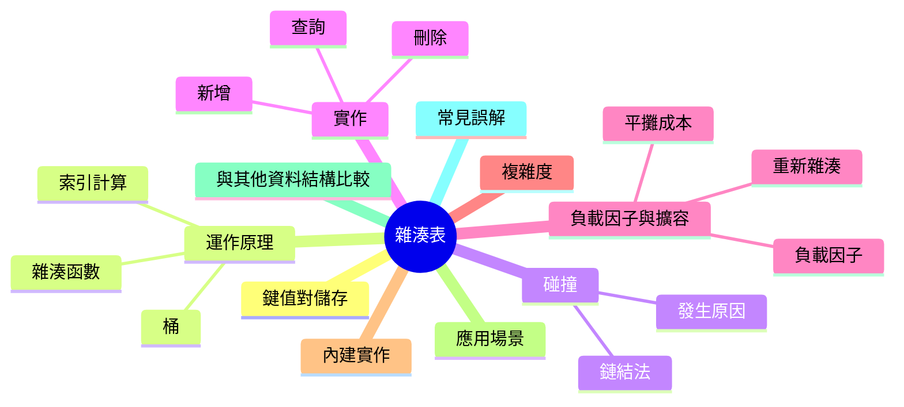
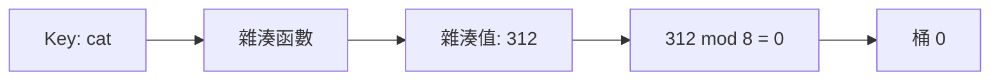
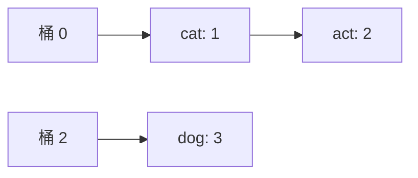

export const metadata = {
  title: '雜湊表 Hash Table',
  date: '2026-11-09',
  excerpt: '深入解析雜湊表：key 如何變成陣列索引、什麼是碰撞、負載因子與擴容為什麼能讓查詢維持快速，以及「平均 O(1)」究竟保證了什麼。內含 TypeScript、Python 與 Java 範例。',
  tags: ['資料結構'],
};

# 雜湊表 Hash Table

雜湊表 (Hash Table) 儲存的是鍵值對 (key-value pair)，並且能在平均 O(1) 的時間內，用 key 找到對應的 value。Python 的 `dict`、JavaScript 的 `Map`、Java 的 `HashMap` 背後都是它，也是日常開發中最常用到的資料結構之一。

它的核心是一個小技巧。陣列只要知道索引，就能在 O(1) 取得任何元素；雜湊表則是從 key 算出這個索引：雜湊函數 (hash function) 把 key 轉成一個數字，這個數字決定 value 存放的位置。設計中其他的部分 (碰撞、負載因子、擴容)，都是為了在 key 五花八門、資料不斷增長的情況下，讓這個技巧持續有效。




- [什麼是雜湊表](#什麼是雜湊表)
- [運作原理](#運作原理)
- [碰撞](#碰撞)
- [實作雜湊表](#實作雜湊表)
- [負載因子與擴容](#負載因子與擴容)
- [時間與空間複雜度](#時間與空間複雜度)
- [內建的雜湊表](#內建的雜湊表)
- [常見應用場景](#常見應用場景)
- [雜湊表 vs. 其他資料結構](#雜湊表-vs-其他資料結構)
- [常見誤解](#常見誤解)
- [總結](#總結)

---

## 什麼是雜湊表

雜湊表 (也稱為 hash map 或字典 dictionary) 儲存鍵值對。每個 key 都是唯一的，你用 key 取回對應的 value：

```text
"alice" → 30
"bob"   → 25
"carol" → 41
```

如果 key 是小整數，一個普通的陣列就夠了：key 本身就是索引。陣列其實就是一個雜湊函數什麼都不做的雜湊表。麻煩出在無法直接當索引用的 key：字串、上百萬的使用者 ID、座標。沒有人會為了一千個使用者配置一個一千萬格的陣列，何況字串根本不是數字。

雜湊函數就是用來解決這件事的。它把任何 key 對應成一個數字，再由雜湊表把這個數字對應到陣列放得下的範圍。陣列可以維持很小，查詢又能一步到位。

---

## 運作原理

雜湊表的底層就是一個陣列，陣列中的每個位置稱為桶 (bucket)。要儲存或查找一個 key，雜湊表會做三件事：

1. 把 key 丟進雜湊函數，得到一個整數，也就是雜湊值 (hash code)
2. 把雜湊值對應到有效的桶索引，通常用 `雜湊值 % 容量`
3. 讀取或寫入那個桶



為了讓計算簡單，我們用一個刻意做得很簡陋的雜湊函數：把字串每個字元的編碼加起來。(這是個很差的雜湊函數，下一篇會解釋原因，這裡只是為了得到比較小的數字。) 假設有 8 個桶：

| Key | 字元編碼 | 雜湊值 | 索引 (雜湊值 % 8) |
| :--- | :--- | :--- | :--- |
| `"cat"` | 99 + 97 + 116 | 312 | 0 |
| `"dog"` | 100 + 111 + 103 | 314 | 2 |
| `"act"` | 97 + 99 + 116 | 312 | 0 |

`"cat"` 與 `"dog"` 落在不同的桶。`"cat"` 和 `"act"` 都落在桶 0，這就是碰撞，稍後會處理。

要留意三件事：

- 雜湊函數必須是確定性的 (deterministic)。同一個 key 每次都要產生相同的雜湊值，否則存進去的值就再也找不回來
- 雜湊表會把 key 和 value 一起存起來。桶 0 本身並沒有說它存的是 `"cat"` 還是 `"act"`，所以查詢時，雜湊表要拿存著的 key 跟你要找的 key 比對
- 索引取決於容量。312 % 8 是 0，但 312 % 16 是 8。雜湊表一旦改變大小，每筆資料的位置都得重新計算，這在下面的擴容一節會用到

---

## 碰撞

當兩個不同的 key 對應到同一個桶，就是碰撞 (collision)。這不是 bug。可能出現的 key (所有字串、所有整數) 遠多於桶的數量，所以一定有 key 得共用桶。沒有任何雜湊函數能避免這件事，而且如同下一篇會看到的，碰撞出現的時間比多數人以為的早得多。

所以每個雜湊表都需要一套處理策略。最簡單的是鏈結法 (separate chaining)：每個桶裡放一個小串列，所有雜湊到這個桶的資料都放進去。查詢時先雜湊 key、找到桶，再掃描串列找符合的 key。



另一類做法是開放定址法 (open addressing)：資料直接放在陣列裡，發生碰撞的 key 改放到別的空位。本文以鏈結法為主，因為它容易實作，也容易推理；開放定址法會在 [Hash Functions and Collision Handling：雜湊函數與碰撞處理](/articles/hash-functions-and-collision-handling) 中說明。

---

## 實作雜湊表

以下是使用鏈結法的最小雜湊表，分別以三種語言實作。它支援字串 key 的 set、get 與 delete，並且在變擠的時候自動擴容 (下一節會說明何時、為什麼)。JavaScript 沒有內建的字串雜湊函數，所以 TypeScript 版本自己寫了一個簡單的；Python 與 Java 版本則使用內建的 `hash()` 與 `hashCode()`。

```typescript
// TypeScript
class HashTable<V> {
  private buckets: Array<Array<[string, V]>>;
  private count = 0;

  constructor(private capacity = 8) {
    this.buckets = Array.from({ length: capacity }, () => []);
  }

  get size(): number {
    return this.count;
  }

  // JavaScript 沒有內建的字串雜湊函數，所以自己寫一個簡單的
  private hash(key: string): number {
    let h = 0;
    for (let i = 0; i < key.length; i++) {
      h = (h * 31 + key.charCodeAt(i)) >>> 0; // 在 32 位元處繞回
    }
    return h;
  }

  private indexFor(key: string): number {
    return this.hash(key) % this.capacity;
  }

  set(key: string, value: V): void {
    const bucket = this.buckets[this.indexFor(key)];
    for (const entry of bucket) {
      if (entry[0] === key) {
        entry[1] = value; // key 已存在：覆寫
        return;
      }
    }
    bucket.push([key, value]);
    this.count++;
    if (this.count / this.capacity > 0.75) this.resize();
  }

  get(key: string): V | undefined {
    for (const [k, v] of this.buckets[this.indexFor(key)]) {
      if (k === key) return v;
    }
    return undefined;
  }

  delete(key: string): boolean {
    const bucket = this.buckets[this.indexFor(key)];
    const i = bucket.findIndex(([k]) => k === key);
    if (i === -1) return false;
    bucket.splice(i, 1);
    this.count--;
    return true;
  }

  private resize(): void {
    const oldBuckets = this.buckets;
    this.capacity *= 2;
    this.buckets = Array.from({ length: this.capacity }, () => []);
    for (const bucket of oldBuckets) {
      for (const [key, value] of bucket) {
        this.buckets[this.indexFor(key)].push([key, value]); // 索引變了，所以要重新放入
      }
    }
  }
}
```

```python
# Python
from typing import Generic, Optional, TypeVar

V = TypeVar("V")


class HashTable(Generic[V]):
    def __init__(self, capacity: int = 8) -> None:
        self._buckets: list[list[tuple[str, V]]] = [[] for _ in range(capacity)]
        self._size = 0

    def _index_for(self, key: str) -> int:
        # hash() 可能是負數，但對正數容量取 % 的結果一定落在 0..capacity-1
        return hash(key) % len(self._buckets)

    def set(self, key: str, value: V) -> None:
        bucket = self._buckets[self._index_for(key)]
        for i, (k, _) in enumerate(bucket):
            if k == key:
                bucket[i] = (key, value)  # key 已存在：覆寫
                return
        bucket.append((key, value))
        self._size += 1
        if self._size / len(self._buckets) > 0.75:
            self._resize()

    def get(self, key: str) -> Optional[V]:
        for k, v in self._buckets[self._index_for(key)]:
            if k == key:
                return v
        return None

    def delete(self, key: str) -> bool:
        bucket = self._buckets[self._index_for(key)]
        for i, (k, _) in enumerate(bucket):
            if k == key:
                del bucket[i]
                self._size -= 1
                return True
        return False

    def __len__(self) -> int:
        return self._size

    def _resize(self) -> None:
        old_buckets = self._buckets
        self._buckets = [[] for _ in range(len(old_buckets) * 2)]
        for bucket in old_buckets:
            for key, value in bucket:
                self._buckets[self._index_for(key)].append((key, value))  # 索引變了，所以要重新放入
```

```java
// Java
public class HashTable<V> {
    private static class Node<V> {
        final String key;
        V value;
        Node<V> next;

        Node(String key, V value, Node<V> next) {
            this.key = key;
            this.value = value;
            this.next = next;
        }
    }

    private Node<V>[] buckets;
    private int size = 0;

    @SuppressWarnings("unchecked")
    public HashTable() {
        buckets = (Node<V>[]) new Node[8];
    }

    private static int indexFor(String key, int capacity) {
        // hashCode() 可能是負數；floorMod 一定回傳 0..capacity-1
        return Math.floorMod(key.hashCode(), capacity);
    }

    public void put(String key, V value) {
        int i = indexFor(key, buckets.length);
        for (Node<V> node = buckets[i]; node != null; node = node.next) {
            if (node.key.equals(key)) {
                node.value = value; // key 已存在：覆寫
                return;
            }
        }
        buckets[i] = new Node<>(key, value, buckets[i]); // 加在鏈結串列的開頭
        size++;
        if ((double) size / buckets.length > 0.75) resize();
    }

    public V get(String key) {
        for (Node<V> node = buckets[indexFor(key, buckets.length)]; node != null; node = node.next) {
            if (node.key.equals(key)) return node.value;
        }
        return null;
    }

    public boolean remove(String key) {
        int i = indexFor(key, buckets.length);
        Node<V> prev = null;
        for (Node<V> node = buckets[i]; node != null; prev = node, node = node.next) {
            if (node.key.equals(key)) {
                if (prev == null) buckets[i] = node.next;
                else prev.next = node.next;
                size--;
                return true;
            }
        }
        return false;
    }

    public int size() {
        return size;
    }

    @SuppressWarnings("unchecked")
    private void resize() {
        Node<V>[] bigger = (Node<V>[]) new Node[buckets.length * 2];
        for (Node<V> head : buckets) {
            Node<V> node = head;
            while (node != null) {
                Node<V> next = node.next; // 先存起來，因為等一下要改這個節點的 next
                int i = indexFor(node.key, bigger.length); // 索引變了，所以要重新放入
                node.next = bigger[i];
                bigger[i] = node;
                node = next;
            }
        }
        buckets = bigger;
    }
}
```

三個操作的流程很相似：

- Set：雜湊 key 找到它的桶，再掃描該桶尋找這個 key。找到就替換 value，找不到就新增一筆
- Get：走同樣的路徑，找到 key 就回傳 value
- Delete：在桶裡找到該筆資料並移除

每個操作都是先雜湊、選桶，最後掃描那一個桶。只要桶夠短，掃描的成本幾乎可以忽略，O(1) 就是這樣來的。

還有一個小細節：key 不存在時，`get` 會回傳 `undefined`、`None` 或 `null`，所以你分不出「key 不存在」和「存的值剛好就是 `undefined`、`None` 或 `null`」。內建的雜湊表會另外提供判斷 key 是否存在的方法 (`has`、`in`、`containsKey`) 來解決這個問題。

---

## 負載因子與擴容

負載因子 (load factor) 是資料筆數除以桶的數量。在鏈結法中，它同時也是鏈結串列的平均長度：8 個桶裡有 12 筆資料，平均每個桶 1.5 筆。負載因子低，查詢就快；任它升高，串列變長，雜湊表就會越來越像一個鏈結串列，而不是陣列。

為了避免這種情況，雜湊表會自己擴容 (resize)。當負載因子超過門檻，就配置一個更大的陣列 (通常是兩倍)，再把所有資料搬過去。上面的程式碼使用 0.75，所以 8 個桶時，第 7 筆資料就會觸發擴容。Java 的 `HashMap` 預設也是 0.75，起始有 16 個桶；Python 的 `dict` 則是在大約三分之二滿時擴容。不同的實作會選不同的門檻。

擴容不是單純的複製。索引是 `雜湊值 % 容量`，容量一變，每筆資料該放的位置也跟著變，所以每一筆都得重新雜湊、重新放入。(還記得嗎？312 在 8 個桶中落在桶 0，在 16 個桶中卻落在桶 8。)

因此單次擴容是 O(n)。但整體來看成本其實很低，因為容量每次都加倍，隨著雜湊表變大，擴容會越來越少發生。每次擴容大約發生在上一次的兩倍大小時，搬移的資料總數是一個等比級數的和，上限大約是 2n。把它平均分攤到 n 次新增上，每次新增只多了常數的工作量，所以新增是平攤 O(1) (amortized O(1))。

不過成本並不是均勻分布的。觸發擴容的那一次新增，會明顯比其他幾次慢，這在對延遲敏感的系統裡值得留意。如果你大概知道會放多少資料，有些語言允許事先指定大小 (Java 的 `HashMap` 建構子可以指定初始容量)，省掉前面幾次擴容。

---

## 時間與空間複雜度

| 操作 | 平均情況 | 最壞情況 |
| :--- | :--- | :--- |
| 新增 | O(1) | O(n) |
| 查詢 | O(1) | O(n) |
| 刪除 | O(1) | O(n) |

平均情況建立在兩個假設上：雜湊函數能把 key 均勻分散，而且負載因子維持在一定範圍內 (擴容會確保這件事)。在這兩個條件下，每個桶平均只有常數筆資料，掃描一個桶也就只要常數時間。

最壞情況是所有 key 都落在同一個桶。雜湊表退化成一條長長的串列，每個操作都得掃過全部 n 筆資料。雜湊函數合理、輸入正常時不會發生，但有人可以刻意製造這種情況，下一篇會談到。觸發擴容的那次新增本身也是 O(n)，不過如前所述，它的平攤成本是 O(1)。

空間複雜度是 O(n)：資料本身，加上一個因為擴容而大小始終與 n 成正比的桶陣列。

---

## 內建的雜湊表

你很少需要自己寫雜湊表，主流語言都內建了調校得很好的實作：

| 語言 | 鍵值對 | 集合 | 備註 |
| :--- | :--- | :--- | :--- |
| TypeScript / JavaScript | `Map` | `Set` | 保留插入順序。物件型別的 key 以參考 (reference) 比較 |
| Python | `dict` | `set` | key 必須是可雜湊的 (hashable)。`dict` 保留插入順序 (3.7 起) |
| Java | `HashMap` | `HashSet` | 不保證順序。`LinkedHashMap` 保留插入順序，`TreeMap` 依 key 排序 |

基本操作如下：

```typescript
// TypeScript
const ages = new Map<string, number>();
ages.set("alice", 30);
ages.set("bob", 25);
console.log(ages.get("alice"));   // 30
console.log(ages.has("carol"));   // false
console.log(ages.delete("bob"));  // true
console.log(ages.size);           // 1
```

```python
# Python
ages: dict[str, int] = {}
ages["alice"] = 30
ages["bob"] = 25
print(ages["alice"])    # 30
print("carol" in ages)  # False
del ages["bob"]
print(len(ages))        # 1
```

```java
// Java
import java.util.HashMap;
import java.util.Map;

public class BuiltInDemo {
    public static void main(String[] args) {
        Map<String, Integer> ages = new HashMap<>();
        ages.put("alice", 30);
        ages.put("bob", 25);
        System.out.println(ages.get("alice"));          // 30
        System.out.println(ages.containsKey("carol"));  // false
        ages.remove("bob");
        System.out.println(ages.size());                // 1
    }
}
```

各自要注意的地方：

- 在 JavaScript 中，需要字典的時候優先用 `Map`，而不是普通物件。物件的 key 會被轉成字串 (`obj[1]` 與 `obj["1"]` 是同一個屬性)，而且物件會繼承原型 (prototype) 上的屬性，所以 `"constructor" in {}` 是 `true`。`Map` 可以用任何型別當 key，也有真正的 `size`
- 在 Python 中，key 必須是可雜湊的。數字、字串，以及由它們組成的 tuple 都可以；list、dict、set 不行：`{[1, 2]: "x"}` 會丟出 `TypeError: unhashable type: 'list'`
- 在 Java 中，`HashMap` 依賴 key 的 `hashCode()` 與 `equals()`。`String` 和 `Integer` 都已正確實作；自己寫的類別則要自己實作 (見 [Hash Functions and Collision Handling：雜湊函數與碰撞處理](/articles/hash-functions-and-collision-handling))
- 別指望雜湊表幫你排序。`Map` 與 `dict` 依插入順序走訪，那不是排序後的順序，而 `HashMap` 完全不保證順序

---

## 常見應用場景

| 情境 | 雜湊表裡存什麼 | 範例 |
| :--- | :--- | :--- |
| 計數 | 項目 → 次數 | 單字頻率、得票數、錯誤碼 |
| 判斷是否存在與去重 | 目前看過的項目集合 | 移除重複值、記錄圖形走訪中已拜訪的節點 |
| 快取與記憶化 | 輸入 → 計算結果 | 記憶化的費氏數列 (見 [Recursion：遞迴](/articles/recursion))、快取 API 回應 |
| 以 ID 查詢 | id → 紀錄 | 以使用者 ID 找使用者、以名稱找設定 |
| 分組 | key → 項目串列 | 依客戶分組訂單、依首字母分組單字 |
| 補數查找 | 數值 → 索引 | Two Sum |

Two Sum 很適合用來說明雜湊表帶來的好處。給定一個數字陣列和一個目標值，找出兩個數字的索引，使它們的和等於目標值。暴力解法用兩層巢狀迴圈檢查每一對，是 O(n²)。用雜湊表的話，只要走過陣列一次，對每個數字只問一個問題：`target - number` 之前出現過嗎？出現過就找到了，沒有的話就把這個數字記起來，繼續往下走。時間是 O(n)，代價是 O(n) 的額外空間。

```typescript
// TypeScript
function twoSum(nums: number[], target: number): [number, number] | null {
  const seen = new Map<number, number>(); // 數值 -> 索引
  for (let i = 0; i < nums.length; i++) {
    const j = seen.get(target - nums[i]);
    if (j !== undefined) return [j, i];
    seen.set(nums[i], i);
  }
  return null;
}
```

```python
# Python
from typing import Optional


def two_sum(nums: list[int], target: int) -> Optional[tuple[int, int]]:
    seen: dict[int, int] = {}  # 數值 -> 索引
    for i, num in enumerate(nums):
        complement = target - num
        if complement in seen:
            return seen[complement], i
        seen[num] = i
    return None
```

```java
// Java
import java.util.HashMap;
import java.util.Map;

public class TwoSum {
    public static int[] twoSum(int[] nums, int target) {
        Map<Integer, Integer> seen = new HashMap<>(); // 數值 -> 索引
        for (int i = 0; i < nums.length; i++) {
            Integer j = seen.get(target - nums[i]);
            if (j != null) return new int[] { j, i };
            seen.put(nums[i], i);
        }
        return null;
    }
}
```

先檢查、後儲存，所以一個元素不會跟自己配對。

---

## 雜湊表 vs. 其他資料結構

| 資料結構 | 以 key 查詢 | 新增 | 刪除 | 依 key 排序 |
| :--- | :--- | :--- | :--- | :--- |
| 未排序陣列 | O(n) | 尾端 O(1) | O(n) | 否 |
| 已排序陣列 | O(log n) | O(n) | O(n) | 是 |
| 平衡二元搜尋樹 (`TreeMap`、`std::map`) | O(log n) | O(log n) | O(log n) | 是 |
| 雜湊表 | 平均 O(1) | 平均 O(1) | 平均 O(1) | 否 |

需要用精確的 key 快速查詢、又不在乎順序時，用雜湊表。需要依序走訪 key、範圍查詢 (「10 到 20 之間的所有資料」)，或是取最小與最大的 key 時，用樹狀結構。雜湊表完全不知道哪些 key 彼此接近：相鄰的桶裡放的是毫不相干的 key，沒有東西可以順著走。

---

## 常見誤解

| 常見誤解 | 正確觀念 |
| :--- | :--- |
| 雜湊表的查詢永遠是 O(1)。 | O(1) 是平均情況，前提是雜湊函數夠好、負載因子有被控制，最壞情況是 O(n)。 |
| 發生碰撞代表出了問題。 | 碰撞是正常且預期中的事，雜湊表本來就是設計來處理它的。重點在於碰撞的多寡。 |
| 雜湊表會把 key 排好序。 | 不會。有些實作保留插入順序 (`Map`、`dict`)，但那不是排序後的順序，Java 的 `HashMap` 則完全不保證順序。 |
| 擴容會讓新增變慢。 | 單次擴容是 O(n)，但隨著雜湊表變大，擴容越來越少，所以新增的平攤成本是 O(1)。 |
| 任何物件都能當 key。 | key 的雜湊與比較必須前後一致。Python 不接受 list，JavaScript 的 `Map` 以參考比較物件，Java 則要求 `equals` 與 `hashCode` 一致。 |
| JavaScript 的物件就是 `Map`。 | 物件會把 key 轉成字串，還會繼承原型上的屬性。要用真正的字典時，請用 `Map`。 |

---

## 總結

雜湊表用一點記憶體和一些額外的管理成本，換來不會隨資料量增加而變慢的查詢。它的各個部分組合得很簡單：雜湊函數挑出桶，碰撞在桶內解決，擴容讓桶保持很短。你得到的 O(1) 是平均值，只有這三件事都做好，它才成立。

實務上，用語言內建的雜湊表就好。需要依 key 查找、計數、去重或快取結果時就用它，需要順序時改用樹狀結構。下一篇會更仔細地談本文只簡單帶過的兩個部分：雜湊函數怎麼設計，以及其他的碰撞處理策略。詳見下一篇：[Hash Functions and Collision Handling：雜湊函數與碰撞處理](/articles/hash-functions-and-collision-handling)。
