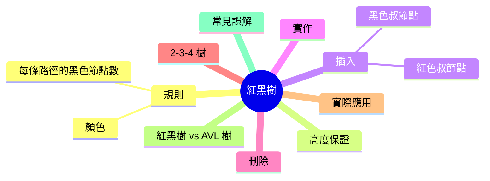

export const metadata = {
  title: '紅黑樹',
  date: '2026-11-19',
  excerpt: '紅黑樹如何只用每個節點一個位元的顏色，讓二元搜尋樹保持平衡：五條規則、它們為什麼能限制高度、插入時如何靠重新著色與旋轉修復樹、刪除要處理哪些情況、紅黑樹與 2-3-4 樹的對應關係，以及它與 AVL 樹的比較。內含 TypeScript、Python 與 Java 範例。',
  tags: ['資料結構'],
};

# 紅黑樹

AVL 樹對形狀管得很嚴：在每個節點上，兩棵子樹的高度最多只能相差 1。紅黑樹的要求低一些。它替每個節點標上一個顏色，紅色或黑色，再用幾條規則限制顏色的排列方式。這些規則讓樹可以比 AVL 樹高一點，但依然保證高度是 O(log n)，而且讓樹在變動之後修復起來更便宜：一次插入最多只要兩次旋轉，一次刪除最多三次。

這樣的取捨，讓紅黑樹成了實務上預設的平衡樹。Java 的 `TreeMap` 與 `TreeSet` 是紅黑樹，主要 C++ 標準函式庫中的 `std::map` 與 `std::set` 也是，Linux 核心更是到處都在用。

本文涵蓋紅黑樹的規則、這些規則為什麼能讓樹保持矮、插入時如何修復樹 (含完整實作)、刪除要處理什麼、紅黑樹與 2-3-4 樹的關係，以及它與 AVL 樹的比較。內容建立在 [二元搜尋樹 BST](./binary-search-tree) 與 [AVL 樹](./avl-tree) 之上。



- [規則](#規則)
- [為什麼高度能維持在對數等級](#為什麼高度能維持在對數等級)
- [插入](#插入)
- [實作插入](#實作插入)
- [刪除](#刪除)
- [紅黑樹與 2-3-4 樹](#紅黑樹與-2-3-4-樹)
- [紅黑樹的實際應用](#紅黑樹的實際應用)
- [紅黑樹 vs. AVL 樹](#紅黑樹-vs-avl-樹)
- [常見誤解](#常見誤解)
- [總結](#總結)

---

## 規則

紅黑樹是一種二元搜尋樹，其中每個節點都是紅色或黑色，而顏色必須遵守五條規則：

1. 每個節點都是紅色或黑色
2. 根節點是黑色
3. 每個空的子節點都視為黑色的葉節點
4. 紅色節點不能有紅色的子節點
5. 從任一節點往下走到空的子節點，每條路徑經過的黑色節點數都相同

規則 1 到 3 大多只是基本的約定。紅色的根節點隨時都能直接改成黑色，不會破壞任何規則；把空的子節點當成黑色葉節點 (常稱為 NIL 葉節點)，也只是為了讓規則 5 比較好描述。真正決定樹的形狀的，是規則 4 與 5。

下面是一棵合法的紅黑樹，紅色節點以括號表示：

```text
          4
        /   \
      2       6
     / \     /
   (1) (3) (5)
```

從根節點檢查規則 5：從 4 往下走到空的子節點，每條路徑都剛好經過兩個黑色節點，也就是 4，以及 2 或 6。經過紅色節點 1、3 或 5，不會改變這個數字。其他節點也都符合規則 5，例如從 2 或 6 往下，每條路徑都經過一個黑色節點。規則 4 也成立，因為紅色節點都是葉節點，它們的子節點是空的，而空的子節點視為黑色。

---

## 為什麼高度能維持在對數等級

把從根節點往下走到空的子節點的路徑上，黑色節點的個數記為 b。依照規則 5，每條這樣的路徑，b 都相同。由此可以推出兩件事：

- 從根節點出發的路徑，節點數都不超過 2b。依照規則 4，紅色節點的子節點一定是黑色，而根節點也是黑色，所以任何路徑上最多只有一半的節點是紅色
- 樹的最上面 b 層一定是全滿的。如果其中任何地方少了一個節點，就會有一個空的子節點出現在不到 b 層深的位置，而通往它的路徑經過的黑色節點會少於 b 個，違反規則 5。全滿的 b 層共有 $2^b - 1$ 個節點，所以 n 至少是 $2^b - 1$，也就是說 b 最多是 log₂(n + 1)

合起來看，從根節點出發的最長路徑最多有 2b 個節點，所以高度最多是 2 log₂(n + 1)。而最短的路徑至少有 b 個節點。樹可以有點歪，但從根節點出發的最長路徑，永遠不會超過最短路徑的兩倍。

這個上限比 AVL 樹寬鬆，有時候也看得出差別。下表是兩種樹放進 1,000 個值的結果：

| 插入順序 | AVL 樹的高度 | 紅黑樹的高度 |
| :--- | :--- | :--- |
| 已排序 (1, 2, 3, …, 1,000) | 9 | 16 |
| 隨機 (200 次的平均) | 約 11 | 約 11 |

隨機輸入時，兩者的高度幾乎一樣。已排序的輸入會讓紅黑樹明顯比較高，但仍然遠遠不到普通 BST 的 999。

---

## 插入

新的值和普通 BST 一樣，以新葉節點的身分加入，並且標成紅色。紅色節點不會改變任何路徑上的黑色節點數，所以規則 5 依然成立。可能被破壞的規則只有兩條。如果新節點是根節點，它會違反規則 2，這時直接把它標成黑色即可。否則唯一的風險是規則 4：如果新節點的父節點也是紅色，就出現了連續兩個紅色。

父節點是黑色，就什麼都不用修。父節點是紅色時，它不可能是根節點，所以一定有祖父節點，而且祖父節點是黑色，因為它有一個紅色的子節點。接下來怎麼做，取決於叔節點 (uncle)，也就是父節點的兄弟節點。以下用 g 代表祖父節點、p 代表父節點、u 代表叔節點、x 代表新節點。

### 紅色叔節點：重新著色

如果叔節點也是紅色，就不需要旋轉。把父節點與叔節點標成黑色，祖父節點標成紅色：

```text
      g              (g)
     / \             / \
   (p) (u)    →     p   u
   /               /
 (x)             (x)
```

經過 g 的每條路徑，在 g、p、u 之中依然只經過一個黑色節點，所以規則 5 成立。但 g 現在是紅色，而它的父節點也可能是紅色。如果是，同樣的問題就往上移了兩層，修正流程改以 g 取代 x 繼續進行。如果 g 是根節點，直接把它標回黑色即可，這會讓每條路徑同時多一個黑色節點。

不論 p 與 x 在哪一側，這種情況的處理方式都一樣。

### 黑色叔節點：旋轉

如果叔節點是黑色 (空的子節點也算黑色)，光靠重新著色是不夠的，但旋轉可以解決。要做哪一種旋轉，取決於從 g 到 p 再到 x 這條路徑的形狀。

如果路徑是一直線，也就是 x 與 p 在同一側，就在 g 往反方向旋轉，再交換 p 與 g 的顏色。當 x 與 p 都是左子節點時，就是在 g 右旋：

```text
       g             p
      / \           / \
    (p)  u   →    (x) (g)
    /                   \
  (x)                    u
```

p 取代了 g 的位置並變成黑色，底下有兩個紅色子節點，所以不再有連續的紅色，而每條路徑經過的黑色節點數也和之前一樣。如果 p 原本有右子樹，它會移過去成為 g 的左子樹，和所有右旋一樣。p 以上的部分完全沒有變，所以修正到此結束。

如果路徑呈鋸齒狀，也就是 x 與 p 在不同側，就先在 p 旋轉，把路徑拉直。當 p 是左子節點、x 是右子節點時，就是在 p 左旋：

```text
      g             g
     / \           / \
   (p)  u    →   (x)  u
     \           /
     (x)       (p)
```

x 與 p 交換了位置，現在排成一直線，接著用前一種情況就能完成，只是這時扮演新節點角色的是 p。

不論哪種情況，一次插入最多只做兩次旋轉。重新著色可能一路往上傳遞，但每一步只改幾個顏色，而且只要遇到黑色的父節點或根節點就會停下。

### 範例

依序把 1、2、3、4 插入一棵空樹：

| 插入 | 發生了什麼 |
| :--- | :--- |
| 1 | 它是根節點，所以標成黑色 |
| 2 | 它的父節點 1 是黑色，不需要修正 |
| 3 | 它的父節點 2 是紅色，叔節點 (1 空著的左側) 是黑色。1、2、3 排成一直線，所以在 1 左旋，讓 2 成為根節點，再交換顏色，2 變成黑色，底下是紅色的 1 與 3 |
| 4 | 它的父節點 3 是紅色，叔節點 1 也是紅色。把 1 與 3 標成黑色、2 標成紅色。2 是根節點，所以再標回黑色 |

下面是插入 3 之後 (a) 與插入 4 之後 (b) 的樹：

```text
(a)          (b)
    2            2
   / \          / \
 (1) (3)       1   3
                    \
                    (4)
```

插入 4 讓每條路徑都多了一個黑色節點：從根節點往下的路徑，原本各經過一個黑色節點，現在各經過兩個。

---

## 實作插入

下面是一棵存放整數的紅黑樹，支援搜尋與插入。和前幾篇的 BST 與 AVL 程式碼不同，這裡每個節點還會記錄指向父節點的指標，因為修正流程要從新節點往上走。空的子節點視為黑色，這件事交給 `isRed` 這個輔助函式處理。

```typescript
// TypeScript
class RBNode {
  red = true; // 新節點一律從紅色開始
  left: RBNode | null = null;
  right: RBNode | null = null;
  parent: RBNode | null = null;

  constructor(public value: number) {}
}

function isRed(node: RBNode | null): boolean {
  return node !== null && node.red; // 空的子節點視為黑色
}

function heightOf(node: RBNode | null): number {
  if (node === null) return -1;
  return 1 + Math.max(heightOf(node.left), heightOf(node.right));
}

class RedBlackTree {
  private root: RBNode | null = null;

  get height(): number {
    return heightOf(this.root);
  }

  contains(value: number): boolean {
    let node = this.root;
    while (node !== null) {
      if (value < node.value) node = node.left;
      else if (value > node.value) node = node.right;
      else return true;
    }
    return false;
  }

  insert(value: number): void {
    // 一般的 BST 插入，同時記住父節點
    let parent: RBNode | null = null;
    let node = this.root;
    while (node !== null) {
      if (value === node.value) return; // 不允許重複
      parent = node;
      node = value < node.value ? node.left : node.right;
    }
    const added = new RBNode(value);
    added.parent = parent;
    if (parent === null) this.root = added;
    else if (value < parent.value) parent.left = added;
    else parent.right = added;
    this.fixAfterInsert(added);
  }

  private fixAfterInsert(x: RBNode): void {
    // 修正連續兩個紅色的問題，最後確保根節點是黑色
    while (isRed(x.parent)) {
      const p = x.parent!;
      const g = p.parent!; // p 是紅色，所以不是根節點
      const u = p === g.left ? g.right : g.left;
      if (isRed(u)) {
        // 紅色叔節點：重新著色，再從祖父節點繼續
        p.red = false;
        u!.red = false;
        g.red = true;
        x = g;
      } else if (p === g.left) {
        if (x === p.right) {
          // 鋸齒狀：在 p 旋轉，拉成一直線
          this.rotateLeft(p);
          x = p;
        }
        x.parent!.red = false;
        g.red = true;
        this.rotateRight(g);
      } else {
        if (x === p.left) {
          this.rotateRight(p);
          x = p;
        }
        x.parent!.red = false;
        g.red = true;
        this.rotateLeft(g);
      }
    }
    this.root!.red = false;
  }

  private rotateLeft(x: RBNode): void {
    const y = x.right!;
    x.right = y.left;
    if (y.left !== null) y.left.parent = x;
    this.replace(x, y);
    y.left = x;
    x.parent = y;
  }

  private rotateRight(y: RBNode): void {
    const x = y.left!;
    y.left = x.right;
    if (x.right !== null) x.right.parent = y;
    this.replace(y, x);
    x.right = y;
    y.parent = x;
  }

  // 把 child 放到 node 原本的位置，接在 node 的父節點下
  private replace(node: RBNode, child: RBNode): void {
    child.parent = node.parent;
    if (node.parent === null) this.root = child;
    else if (node === node.parent.left) node.parent.left = child;
    else node.parent.right = child;
  }
}

const tree = new RedBlackTree();
for (let v = 1; v <= 1000; v++) tree.insert(v);
console.log(tree.height);         // 16
console.log(tree.contains(500));  // true
console.log(tree.contains(1001)); // false
```

```python
# Python
from typing import Optional


class RBNode:
    def __init__(self, value: int) -> None:
        self.value = value
        self.red = True  # 新節點一律從紅色開始
        self.left: Optional[RBNode] = None
        self.right: Optional[RBNode] = None
        self.parent: Optional[RBNode] = None


def is_red(node: Optional[RBNode]) -> bool:
    return node is not None and node.red  # 空的子節點視為黑色


def height_of(node: Optional[RBNode]) -> int:
    if node is None:
        return -1
    return 1 + max(height_of(node.left), height_of(node.right))


class RedBlackTree:
    def __init__(self) -> None:
        self._root: Optional[RBNode] = None

    @property
    def height(self) -> int:
        return height_of(self._root)

    def __contains__(self, value: int) -> bool:
        node = self._root
        while node is not None:
            if value < node.value:
                node = node.left
            elif value > node.value:
                node = node.right
            else:
                return True
        return False

    def insert(self, value: int) -> None:
        # 一般的 BST 插入，同時記住父節點
        parent: Optional[RBNode] = None
        node = self._root
        while node is not None:
            if value == node.value:
                return  # 不允許重複
            parent = node
            node = node.left if value < node.value else node.right
        added = RBNode(value)
        added.parent = parent
        if parent is None:
            self._root = added
        elif value < parent.value:
            parent.left = added
        else:
            parent.right = added
        self._fix_after_insert(added)

    def _fix_after_insert(self, x: RBNode) -> None:
        # 修正連續兩個紅色的問題，最後確保根節點是黑色
        while is_red(x.parent):
            p = x.parent
            g = p.parent  # p 是紅色，所以不是根節點
            u = g.right if p is g.left else g.left
            if is_red(u):
                # 紅色叔節點：重新著色，再從祖父節點繼續
                p.red = False
                u.red = False
                g.red = True
                x = g
            elif p is g.left:
                if x is p.right:
                    # 鋸齒狀：在 p 旋轉，拉成一直線
                    self._rotate_left(p)
                    x = p
                x.parent.red = False
                g.red = True
                self._rotate_right(g)
            else:
                if x is p.left:
                    self._rotate_right(p)
                    x = p
                x.parent.red = False
                g.red = True
                self._rotate_left(g)
        self._root.red = False

    def _rotate_left(self, x: RBNode) -> None:
        y = x.right
        x.right = y.left
        if y.left is not None:
            y.left.parent = x
        self._replace(x, y)
        y.left = x
        x.parent = y

    def _rotate_right(self, y: RBNode) -> None:
        x = y.left
        y.left = x.right
        if x.right is not None:
            x.right.parent = y
        self._replace(y, x)
        x.right = y
        y.parent = x

    # 把 child 放到 node 原本的位置，接在 node 的父節點下
    def _replace(self, node: RBNode, child: RBNode) -> None:
        child.parent = node.parent
        if node.parent is None:
            self._root = child
        elif node is node.parent.left:
            node.parent.left = child
        else:
            node.parent.right = child


tree = RedBlackTree()
for v in range(1, 1001):
    tree.insert(v)
print(tree.height)   # 16
print(500 in tree)   # True
print(1001 in tree)  # False
```

```java
// Java
public class RedBlackTree {
    private static class Node {
        int value;
        boolean red = true; // 新節點一律從紅色開始
        Node left, right, parent;

        Node(int value) {
            this.value = value;
        }
    }

    private Node root;

    private static boolean isRed(Node node) {
        return node != null && node.red; // 空的子節點視為黑色
    }

    private static int heightOf(Node node) {
        if (node == null) return -1;
        return 1 + Math.max(heightOf(node.left), heightOf(node.right));
    }

    public int height() {
        return heightOf(root);
    }

    public boolean contains(int value) {
        Node node = root;
        while (node != null) {
            if (value < node.value) node = node.left;
            else if (value > node.value) node = node.right;
            else return true;
        }
        return false;
    }

    public void insert(int value) {
        // 一般的 BST 插入，同時記住父節點
        Node parent = null;
        Node node = root;
        while (node != null) {
            if (value == node.value) return; // 不允許重複
            parent = node;
            node = value < node.value ? node.left : node.right;
        }
        Node added = new Node(value);
        added.parent = parent;
        if (parent == null) root = added;
        else if (value < parent.value) parent.left = added;
        else parent.right = added;
        fixAfterInsert(added);
    }

    private void fixAfterInsert(Node x) {
        // 修正連續兩個紅色的問題，最後確保根節點是黑色
        while (isRed(x.parent)) {
            Node p = x.parent;
            Node g = p.parent; // p 是紅色，所以不是根節點
            Node u = p == g.left ? g.right : g.left;
            if (isRed(u)) {
                // 紅色叔節點：重新著色，再從祖父節點繼續
                p.red = false;
                u.red = false;
                g.red = true;
                x = g;
            } else if (p == g.left) {
                if (x == p.right) {
                    // 鋸齒狀：在 p 旋轉，拉成一直線
                    rotateLeft(p);
                    x = p;
                }
                x.parent.red = false;
                g.red = true;
                rotateRight(g);
            } else {
                if (x == p.left) {
                    rotateRight(p);
                    x = p;
                }
                x.parent.red = false;
                g.red = true;
                rotateLeft(g);
            }
        }
        root.red = false;
    }

    private void rotateLeft(Node x) {
        Node y = x.right;
        x.right = y.left;
        if (y.left != null) y.left.parent = x;
        replace(x, y);
        y.left = x;
        x.parent = y;
    }

    private void rotateRight(Node y) {
        Node x = y.left;
        y.left = x.right;
        if (x.right != null) x.right.parent = y;
        replace(y, x);
        x.right = y;
        y.parent = x;
    }

    // 把 child 放到 node 原本的位置，接在 node 的父節點下
    private void replace(Node node, Node child) {
        child.parent = node.parent;
        if (node.parent == null) root = child;
        else if (node == node.parent.left) node.parent.left = child;
        else node.parent.right = child;
    }

    public static void main(String[] args) {
        RedBlackTree tree = new RedBlackTree();
        for (int v = 1; v <= 1000; v++) tree.insert(v);
        System.out.println(tree.height());       // 16
        System.out.println(tree.contains(500));  // true
        System.out.println(tree.contains(1001)); // false
    }
}
```

各部分的運作方式：

- `insert` 就是普通的 BST 插入，加上設定新節點的父節點指標，最後再進行修正
- 修正流程會在 x 的父節點是紅色時持續迴圈。叔節點是紅色，就重新著色，並把 x 移到祖父節點；叔節點是黑色，就做一到兩次旋轉，之後 x 的父節點會是黑色，迴圈就此結束。最後再把根節點標成黑色，因為新節點可能就是根節點，重新著色也可能把根節點變成紅色
- 旋轉的做法和 [AVL 樹](./avl-tree) 中一樣，只是還要更新父節點指標，而 `replace` 負責把旋轉後的子樹接回上方的節點
- 範例依序插入 1 到 1,000，樹的高度最後是 16，相較之下 AVL 樹是 9，普通 BST 則是 999

---

## 刪除

刪除一開始是普通的 BST 刪除。如果節點有兩個子節點，就複製中序後繼的值，改成移除後繼。不論哪種情況，真正離開樹的那個節點，最多只有一個子節點。

如果這個節點是紅色，什麼都不會被破壞。移除紅色節點不會改變任何路徑的黑色節點數，也不會讓兩個紅色節點接在一起。如果它是黑色，但它唯一的子節點是紅色，就把這個子節點標成黑色，補上少掉的黑色節點。

困難的情況，是移除一個黑色節點，卻沒有紅色子節點能接手它的顏色。原本經過它的每條路徑，現在都少了一個黑色節點。常見的理解方式是：它留下的位置多背了一個黑色，也就是「雙重黑色」(double black)，這個多出來的黑色必須被吸收，或是往上推。怎麼處理，取決於這個位置的兄弟節點 s：

- s 是紅色：在父節點旋轉，讓 s 往上移，再交換 s 與父節點的顏色。這個位置現在有了黑色的兄弟節點，於是適用下面其中一種情況
- s 是黑色，而且兩個子節點都是黑色：把 s 標成紅色。現在父節點的兩側都少了一個黑色節點，多出來的黑色就移到父節點上。如果父節點是紅色，把它標成黑色就結束；否則從父節點重複這個流程
- s 是黑色，靠近這個位置的子節點是紅色，另一個子節點是黑色：在 s 旋轉，把紅色子節點提上來，並交換兩者的顏色。這個位置的新兄弟節點是黑色，遠側的子節點則是紅色，也就是最後一種情況
- s 是黑色，而且遠側的子節點是紅色：在父節點旋轉，讓 s 往上移，s 改用父節點原本的顏色，父節點與 s 遠側的子節點則標成黑色。這樣就把少掉的黑色節點補回較短的那一側，修正到此結束

只有第二種情況可能重複，而且它從不旋轉。第一種情況會接到其他情況，後兩種則會結束修正。所以一次刪除最多旋轉三次，重新著色則最多往上爬 O(log n) 層。把所有鏡像情況都寫出來，程式碼大約是插入的兩倍長。函式庫的作者早已完成這些工作，想看完整版本的話，《Introduction to Algorithms》(CLRS) 第 13 章有詳細的說明。

---

## 紅黑樹與 2-3-4 樹

2-3-4 樹是一種搜尋樹，每個節點存放一到三個 key，對應二到四個子節點，而且所有葉節點都在同一個深度。它靠著從頂端長高來維持完美平衡：節點滿了就分裂，中間的 key 往上移到父節點。它是每個節點最多有四個子節點的 B 樹，也就是 [二元搜尋樹 BST](./binary-search-tree) 中提到的標準資料庫索引結構。

紅黑樹其實就是用二元節點畫出來的 2-3-4 樹。把每個黑色節點和它的紅色子節點合在一起，當成一個 2-3-4 節點：

- 沒有紅色子節點的黑色節點，是存放一個 key 的 2-節點
- 有一個紅色子節點的黑色節點，是存放兩個 key 的 3-節點
- 有兩個紅色子節點的黑色節點，是存放三個 key 的 4-節點

[規則](#規則) 一節的範例樹會變成：

```text
         [4]
        /   \
  [1 2 3]   [5 6]
```

從這個角度看，規則就說得通了。每個黑色節點代表一個 2-3-4 節點，而 2-3-4 樹的葉節點全都在同一個深度，所以每條路徑經過的黑色節點數都相同：這就是規則 5。紅色節點屬於它的黑色父節點所代表的那個節點，而紅色節點如果有紅色子節點，就等於一個節點存了超過三個 key：這就是規則 4。連插入都對得上。在紅色叔節點的情況中，有兩個紅色子節點的黑色節點變成紅色，並把黑色交給子節點，這正是一個 4-節點分裂，再把中間的 key 往上交給父節點。

這不是巧合。Rudolf Bayer 在 1972 年發明了這種結構，稱為「對稱二元 B 樹」(symmetric binary B-tree)，Leonidas Guibas 與 Robert Sedgewick 則在 1978 年用紅色與黑色重新詮釋了它。

---

## 紅黑樹的實際應用

你很少需要自己寫紅黑樹，但幾乎一定用過：

- Java：`TreeMap` 與 `TreeSet` 是紅黑樹，而 `HashMap` 的某個桶放了太多資料時，也會把它轉成紅黑樹，詳見 [雜湊函數與碰撞處理](./hash-functions-and-collision-handling)
- C++：在三大主要標準函式庫 libstdc++、libc++ 與微軟的 STL 中，`std::map`、`std::set`、`std::multimap` 與 `std::multiset` 都是紅黑樹
- Linux：核心有自己的紅黑樹實作，CPU 排程器、高精度計時器 (high-resolution timer)、epoll 等許多地方都在使用

Python 與 JavaScript 沒有內建類似的結構。如同 [二元搜尋樹 BST](./binary-search-tree) 中提到的，在這兩種語言裡要改用函式庫。

---

## 紅黑樹 vs. AVL 樹

| 特性 | AVL 樹 | 紅黑樹 |
| :--- | :--- | :--- |
| 平衡規則 | 每個節點的子樹高度最多相差 1 | 紅色節點沒有紅色子節點，而且每條路徑的黑色節點數相同 |
| 最大高度 | 約 1.44 log₂ n | 2 log₂(n + 1) |
| 每次插入的旋轉次數 | 最多 2 次 | 最多 2 次 |
| 每次刪除的旋轉次數 | 每層最多一次，O(log n) | 最多 3 次 |
| 每個節點額外的資料 | 高度，或 2 位元的平衡因子 | 1 位元的顏色 |
| 適合的情境 | 查詢遠多於修改 | 通用的預設選擇 |

兩者沒有誰全面勝出，都保證搜尋、插入與刪除為 O(log n)。查詢占大多數時，AVL 樹更嚴格的平衡比較划算；而紅黑樹刪除較便宜、要記錄的資料也較少，這正是函式庫作者通常選擇它的原因。

---

## 常見誤解

| 常見誤解 | 正確觀念 |
| :--- | :--- |
| 紅色節點就是不平衡的節點。 | 節點的顏色和它本身是否平衡無關。紅色代表這個節點和它的黑色父節點是一組的 (以 2-3-4 樹來說，屬於同一個節點)，真正限制高度的，是顏色在整條路徑上的規則。 |
| 紅黑樹和 AVL 樹一樣矮。 | 它可能比較高：最多 2 log₂(n + 1)，而 AVL 樹大約是 1.44 log₂ n。資料隨機時兩者高度差不多，但已排序的輸入可能讓紅黑樹明顯比較高。 |
| 從根節點到葉節點的每條路徑長度都相同。 | 相同的是每條路徑上的黑色節點數。夾在中間的紅色節點，可以讓一條路徑長達另一條的兩倍。 |
| 一次插入可能一路旋轉到根節點。 | 最多只旋轉兩次。可能一路往上傳遞的是重新著色，而每一步只改幾個顏色。 |
| NIL 葉節點是真的節點，會占用記憶體。 | 它只是描述規則的一種方式。實作上會用空的子節點表示 (本文的程式碼就是如此)，或是讓所有地方共用同一個哨兵節點 (sentinel)。 |
| 新節點一開始是黑色。 | 新節點一開始是紅色，因為紅色節點不會改變任何路徑的黑色節點數。它最多只會造成連續兩個紅色，或是紅色的根節點，而修正流程兩者都會處理。 |

---

## 總結

紅黑樹是每個節點都帶有顏色的二元搜尋樹，其中真正重要的規則有兩條：紅色節點沒有紅色子節點，以及從任一節點往下的每條路徑，經過的黑色節點數都相同。兩條規則合起來，讓從根節點出發的最長路徑最多是最短路徑的兩倍，高度最多是 2 log₂(n + 1)。

插入時先加入一個紅色葉節點，再一路往上重新著色，修正連續紅色的問題，最後最多旋轉兩次。刪除比較複雜，但最多也只需要旋轉三次。對數等級的高度，加上便宜而且有上限的修復成本，正是 Java 的 `TreeMap`、C++ 的 `std::map` 與 Linux 核心都採用紅黑樹的原因。
