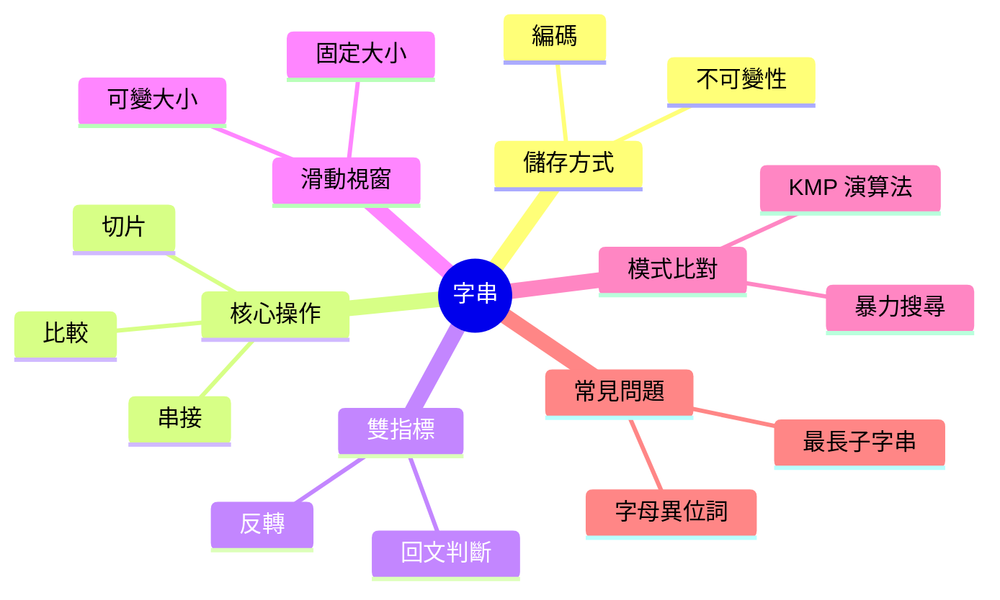

export const metadata = {
  title: '字串 String',
  date: '2026-11-05',
  excerpt: '字串演算法完整指南：字串如何儲存在記憶體中、各種操作的真實成本、解決大多數面試題的雙指標與滑動視窗技巧，以及高效模式比對的 KMP 演算法。',
  tags: ['資料結構'],
};

# 字串 String

字串是一個字元序列。這說法很簡單，但正是對的起點：字串演算法的一切，都源自字串是一個有序序列，而字元可以被比較、計數和重新排列這個事實。

字串在軟體中無所不在，字串問題也是。大多數問題都能歸結為少數幾個技巧：雙指標、滑動視窗、模式比對。理解這些技巧，以及它們底層操作的真實成本，才能真正解決這些問題，而不只是認出它們。



- [字串如何儲存](#字串如何儲存)
- [核心操作與成本](#核心操作與成本)
- [雙指標](#雙指標)
- [滑動視窗](#滑動視窗)
- [模式比對與 KMP](#模式比對與-kmp)
- [常見問題模式](#常見問題模式)
- [總結](#總結)

---

## 字串如何儲存

在底層，字串就是一個字元陣列。在 C 裡，它字面上就是一個以空字元 (`\0`) 結尾的 `char[]`。在 Java 和 JavaScript 裡，字串是包裝了一個不可變字元陣列的物件。

**不可變性 (immutability)** 是最重要的性質。在 Java、Python 和 JavaScript 中，字串無法原地修改。每一個看起來像是在修改字串的操作，實際上都是建立一個新的字串。

```javascript
let s = 'hello';
s[0] = 'H'; // 在 JavaScript 中靜默地什麼都不做
console.log(s); // 'hello'

s = s.toUpperCase(); // 建立一個新字串 'HELLO'，再賦值給 s
```

這對迴圈中的串接有直接影響：

```javascript
// O(n²)：每次 += 都建立一個新字串並複製所有內容
let result = '';
for (const word of words) {
  result += word;
}

// O(n)：收集各部分，最後一次性 join
const result = words.join('');
```

每次 `+=` 都把整個已累積的字串複製到一個新的記憶體空間。`k` 次迭代後，你複製了 1 + 2 + 3 + ... + k 個字元，總計 O(k²)。收集到陣列再一次 join 是 O(n)。

**編碼**在超出 ASCII 範圍時就很重要了。JavaScript 字串是 UTF-16：大多數常見字元佔一個 16 位元的碼元 (code unit)，但基本多文種平面以外的字元 (表情符號、部分 CJK 字元) 佔兩個碼元 (代理對)。`string.length` 計算的是碼元數，不是字元數。

```javascript
const emoji = '😀';
emoji.length;        // 2 (兩個 UTF-16 碼元)
[...emoji].length;   // 1 (一個 Unicode 碼點，展開運算子能正確處理代理對)
```

大多數演算法題可以假設是 ASCII，把每個字元當作一個單位。只是要知道，在處理任意使用者輸入的實際程式碼中，這個假設會失效。

---

## 核心操作與成本

| 操作 | 成本 | 備註 |
| - | - | - |
| 依索引存取 | O(1) | 和陣列一樣 |
| 取得長度 | O(1) | 儲存為欄位 |
| 比較 (`===`) | O(n) | 必須逐字元比較 |
| 串接 (`+`) | O(n) | 把兩個字串複製到新的空間 |
| 切片 / 子字串 | O(k) | k = 切片的長度 |
| 搜尋 (`indexOf`) | O(n·m) | 暴力法；KMP 是 O(n+m) |
| 分割 | O(n) | |
| 取代 | O(n) | |

比較的成本常讓人意外。`s1 === s2` 在最壞情況下是 O(n)，因為引擎必須逐字元比較。短路求值有幫助：如果長度不同，立刻回傳 false。但兩個長度相同、只有最後一個字元不同的字串，需要完整掃描。

---

## 雙指標

雙指標技巧在字串的兩端各放一個指標，讓它們向中間移動。它是處理「對稱位置上的字元對」這類問題的天然工具。

### 回文判斷

回文正讀反讀都一樣。從兩端比較字元，向內移動直到指標相遇。

```javascript
function isPalindrome(s) {
  let lo = 0, hi = s.length - 1;

  while (lo < hi) {
    if (s[lo] !== s[hi]) return false;
    lo++;
    hi--;
  }

  return true;
}

isPalindrome('racecar'); // true
isPalindrome('hello');   // false
```

O(n) 時間，O(1) 空間。不需要反轉字串再比較。

### 忽略非字母數字字元的回文判斷

常見的變形：忽略非字母數字字元，大小寫視為相同。

```javascript
function isPalindrome(s) {
  const clean = s.toLowerCase().replace(/[^a-z0-9]/g, '');
  let lo = 0, hi = clean.length - 1;

  while (lo < hi) {
    if (clean[lo] !== clean[hi]) return false;
    lo++;
    hi--;
  }

  return true;
}
```

### 反轉字串

```javascript
function reverse(s) {
  const arr = s.split('');
  let lo = 0, hi = arr.length - 1;

  while (lo < hi) {
    [arr[lo], arr[hi]] = [arr[hi], arr[lo]];
    lo++;
    hi--;
  }

  return arr.join('');
}
```

因為字串不可變，先轉成陣列，原地交換，再 join 回來。O(n) 時間，O(n) 空間 (用於陣列)。

---

## 滑動視窗

滑動視窗技巧維護一個滿足某個條件的連續子字串，在從左到右掃描時擴展或收縮它。這能把原本 O(n²) 的巢狀迴圈變成單趟 O(n) 的掃描。

### 固定大小的視窗

找長度為 `k` 的子陣列中的最大總和：

```javascript
function maxSumSubarray(arr, k) {
  let windowSum = 0;
  for (let i = 0; i < k; i++) windowSum += arr[i];

  let maxSum = windowSum;
  for (let i = k; i < arr.length; i++) {
    windowSum += arr[i] - arr[i - k]; // 滑動：加入新的，移除舊的
    maxSum = Math.max(maxSum, windowSum);
  }

  return maxSum;
}
```

每一步加入一個元素、移除一個元素，視窗總和的更新是 O(1)。

### 可變大小的視窗

更有趣的情況：找不含重複字元的最長子字串的長度。

```javascript
function lengthOfLongestSubstring(s) {
  const seen = new Map(); // 字元 → 最後出現的索引
  let maxLen = 0;
  let lo = 0;

  for (let hi = 0; hi < s.length; hi++) {
    const c = s[hi];

    // 如果這個字元已出現過，且在目前視窗內，就從左邊收縮
    if (seen.has(c) && seen.get(c) >= lo) {
      lo = seen.get(c) + 1;
    }

    seen.set(c, hi);
    maxLen = Math.max(maxLen, hi - lo + 1);
  }

  return maxLen;
}

lengthOfLongestSubstring('abcabcbb'); // 3 ('abc')
lengthOfLongestSubstring('pwwkew');   // 3 ('wke')
```

`hi` 永遠往前移。`lo` 只往前移 (從不後退)。每個字元最多被加入視窗一次、移出一次，所以總工作量是 O(n)。

### 最小覆蓋子字串

找 `s` 中包含 `t` 所有字元的最小視窗：

```javascript
function minWindow(s, t) {
  const need = new Map();
  for (const c of t) need.set(c, (need.get(c) ?? 0) + 1);

  let have = 0, required = need.size;
  let lo = 0, minLen = Infinity, minStart = 0;
  const window = new Map();

  for (let hi = 0; hi < s.length; hi++) {
    const c = s[hi];
    window.set(c, (window.get(c) ?? 0) + 1);

    if (need.has(c) && window.get(c) === need.get(c)) have++;

    while (have === required) {
      if (hi - lo + 1 < minLen) {
        minLen = hi - lo + 1;
        minStart = lo;
      }
      const left = s[lo];
      window.set(left, window.get(left) - 1);
      if (need.has(left) && window.get(left) < need.get(left)) have--;
      lo++;
    }
  }

  return minLen === Infinity ? '' : s.slice(minStart, minStart + minLen);
}

minWindow('ADOBECODEBANC', 'ABC'); // 'BANC'
```

外層迴圈擴展視窗；內層 `while` 在所有必要字元都存在時從左邊收縮。每個字元最多被處理兩次 (加入一次、移除一次)，所以總計是 O(n + m)，n = `s.length`，m = `t.length`。

---

## 模式比對與 KMP

給定文字 `t` 和模式 `p`，找出 `p` 在 `t` 中出現的所有位置。

### 暴力法

檢查每一個可能的起始位置：

```javascript
function naiveSearch(text, pattern) {
  const positions = [];
  for (let i = 0; i <= text.length - pattern.length; i++) {
    let match = true;
    for (let j = 0; j < pattern.length; j++) {
      if (text[i + j] !== pattern[j]) { match = false; break; }
    }
    if (match) positions.push(i);
  }
  return positions;
}
```

最壞情況是 O(n·m)。對於在 `'aaaa...aaab'` 這樣的文字中搜尋 `'aaab'` 這樣的模式，幾乎每個位置都要把模式掃完才能發現不匹配。

### KMP (Knuth-Morris-Pratt)

KMP 透過預先計算模式的**失敗函式** (也叫前綴函式或部分匹配表)來避免重複比較。失敗函式告訴你：如果在模式的第 `j` 個位置發生不匹配，可以把模式往後移多遠而不漏掉任何匹配？

關鍵洞見：如果模式有一個前綴同時也是目前已匹配部分的後綴，就不需要從模式的開頭重新開始，可以直接跳到那個前綴的末尾。

**第一步：建立失敗函式**

`fail[j]` = `pattern[0..j]` 的最長真前綴同時也是後綴的長度。

```javascript
function buildFailure(pattern) {
  const fail = new Array(pattern.length).fill(0);
  let k = 0; // 前一個最長前綴後綴的長度

  for (let j = 1; j < pattern.length; j++) {
    while (k > 0 && pattern[k] !== pattern[j]) {
      k = fail[k - 1]; // 回退
    }
    if (pattern[k] === pattern[j]) k++;
    fail[j] = k;
  }

  return fail;
}

buildFailure('ababc'); // [0, 0, 1, 2, 0]
// 'a'     → 沒有真前綴後綴 → 0
// 'ab'    → 沒有匹配 → 0
// 'aba'   → 'a' 同時是前綴和後綴 → 1
// 'abab'  → 'ab' 同時是前綴和後綴 → 2
// 'ababc' → 沒有匹配 → 0
```

**第二步：用失敗函式搜尋**

```javascript
function kmpSearch(text, pattern) {
  if (pattern.length === 0) return [0];
  const fail = buildFailure(pattern);
  const positions = [];
  let k = 0; // 目前已匹配的字元數

  for (let i = 0; i < text.length; i++) {
    while (k > 0 && text[i] !== pattern[k]) {
      k = fail[k - 1]; // 不匹配：用失敗函式回退
    }
    if (text[i] === pattern[k]) k++;
    if (k === pattern.length) {
      positions.push(i - pattern.length + 1); // 找到一個匹配
      k = fail[k - 1]; // 繼續尋找下一個匹配
    }
  }

  return positions;
}

kmpSearch('ababcababc', 'ababc'); // [0, 5]
```

**複雜度：** O(n + m)。建立失敗函式是 O(m)；搜尋是 O(n)。搜尋中的 `while` 迴圈看起來可能讓複雜度變成 O(n·m)，但 `k` 每次外層迭代最多增加 1，而整個搜尋過程中 `k` 減少的總次數不超過它增加的總次數，所以 `k` 遞減的總次數以 n 為上界。

**為什麼重要：** 對大多數實際輸入，暴力法已經夠快。KMP 在模式有長重複前綴時 (例如 DNA 序列或二進位字串) 變得重要，或者當你要在許多文字中搜尋同一個模式，希望只付一次 O(m) 的預處理成本時。

---

## 常見問題模式

### 字母異位詞判斷

兩個字串是字母異位詞，如果它們包含相同的字元且各字元的頻率相同。排序後比較，或用頻率表。

```javascript
function isAnagram(s, t) {
  if (s.length !== t.length) return false;

  const count = new Array(26).fill(0);
  for (let i = 0; i < s.length; i++) {
    count[s.charCodeAt(i) - 97]++;
    count[t.charCodeAt(i) - 97]--;
  }

  return count.every((c) => c === 0);
}

isAnagram('anagram', 'nagaram'); // true
isAnagram('rat', 'car');         // false
```

O(n) 時間，O(1) 空間 (陣列大小永遠是 26，對應小寫 ASCII)。

### 字母異位詞分組

給定一個字串列表，把字母異位詞分在一組。關鍵洞見：字母異位詞排序後的結果相同。

```javascript
function groupAnagrams(strs) {
  const map = new Map();

  for (const s of strs) {
    const key = s.split('').sort().join('');
    if (!map.has(key)) map.set(key, []);
    map.get(key).push(s);
  }

  return [...map.values()];
}

groupAnagrams(['eat', 'tea', 'tan', 'ate', 'nat', 'bat']);
// [['eat','tea','ate'], ['tan','nat'], ['bat']]
```

O(n · k log k)，n 是字串數量，k 是最長字串的長度。

### 最長回文子字串

從每個可能的中心向外擴展。回文要麼有一個中心字元 (奇數長度)，要麼有兩個中心字元 (偶數長度)。

```javascript
function longestPalindrome(s) {
  let start = 0, maxLen = 1;

  function expand(lo, hi) {
    while (lo >= 0 && hi < s.length && s[lo] === s[hi]) {
      if (hi - lo + 1 > maxLen) {
        maxLen = hi - lo + 1;
        start = lo;
      }
      lo--;
      hi++;
    }
  }

  for (let i = 0; i < s.length; i++) {
    expand(i, i);     // 奇數長度的回文
    expand(i, i + 1); // 偶數長度的回文
  }

  return s.slice(start, start + maxLen);
}

longestPalindrome('babad'); // 'bab' 或 'aba'
longestPalindrome('cbbd');  // 'bb'
```

O(n²) 時間，O(1) 空間。Manacher 演算法可以做到 O(n)，但從中心向外擴展的方法更容易實作和記憶。

---

## 總結

字串問題表面上看起來千變萬化，但大多數都能歸結為少數幾個技巧：

- **雙指標**：處理對稱位置上的字元對 (回文、反轉)
- **滑動視窗**：找滿足某個條件的最長或最短子字串
- **頻率表**：處理字元計數問題 (字母異位詞、排列)
- **KMP**：需要高效模式比對時，尤其是模式有重複前綴的情況

把這一切串起來的，是底層的成本模型：字串是不可變的序列，所以在迴圈中串接是 O(n²)，任何能避免每一步都從頭重建字串的演算法，都是對的。
