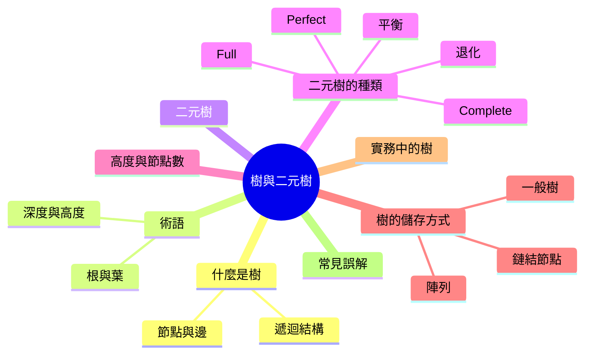
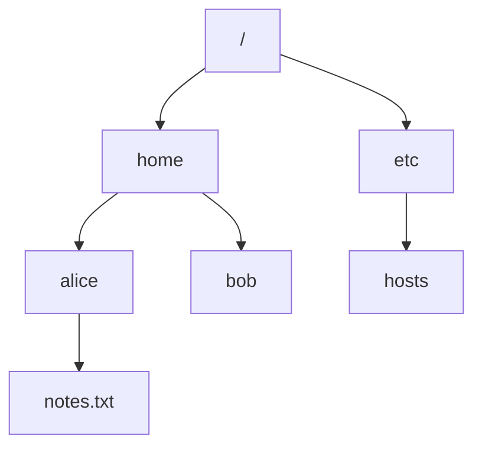
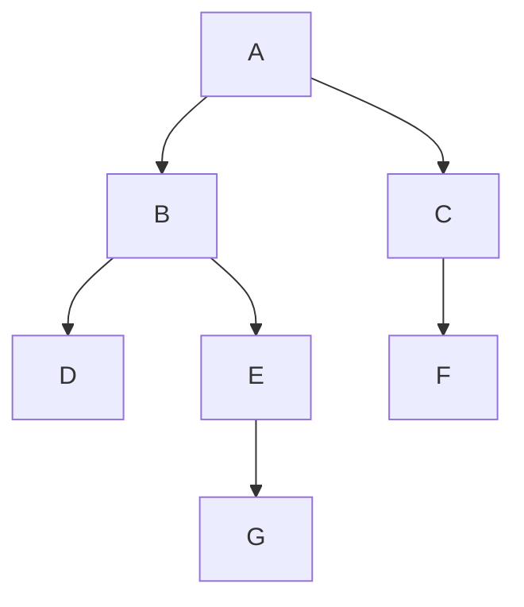

export const metadata = {
  title: '樹與二元樹基礎',
  date: '2026-11-15',
  excerpt: '什麼是樹、樹的基本術語 (根、葉、深度、高度)、什麼樣的樹是二元樹、二元樹常見的幾種形狀、為什麼高度決定了一棵樹有多快，以及樹在記憶體中如何儲存。內含 TypeScript、Python 與 Java 範例。',
  tags: ['資料結構'],
};

# 樹與二元樹基礎

陣列、鏈結串列、Stack 與 Queue 都是線性的：每個元素前面最多一個元素，後面也最多一個。但很多資料不是這種形狀。資料夾裡有檔案，也有其他資料夾；HTML 元素裡包著其他元素；組織圖在每位主管底下分岔出去。這類資料最自然的結構，就是樹 (tree)。

樹也是程式設計中許多實用資料結構的基礎：二元搜尋樹、堆積 (heap)，以及資料庫索引背後的 B 樹 (B-tree)。它們都建立在本文要談的概念上：樹的術語、什麼樣的樹是二元樹、二元樹可能長成哪些形狀、為什麼高度這麼重要，以及樹在記憶體中如何儲存。



- [什麼是樹](#什麼是樹)
- [樹的術語](#樹的術語)
- [二元樹](#二元樹)
- [二元樹的種類](#二元樹的種類)
- [高度與節點數](#高度與節點數)
- [樹在記憶體中的儲存方式](#樹在記憶體中的儲存方式)
- [實務中的樹](#實務中的樹)
- [常見誤解](#常見誤解)
- [總結](#總結)

---

## 什麼是樹

樹是一組由邊 (edge) 連接起來的節點 (node)。最上面的那個節點稱為根節點 (root)，而每個節點底下都可以有任意數量的子節點 (child)。下面把檔案系統的一部分畫成一棵樹：



一個結構要成為樹，必須符合兩條規則：

- 除了根節點，每個節點都恰好有一個父節點 (parent)
- 沒有環 (cycle)。從任何節點沿著父節點一路往上走，最後一定會走到根節點

從這兩條規則可以推出兩個有用的性質。從根節點到任何一個節點都只有一條路徑，所以每個節點在樹中的位置都是明確的。而有 n 個節點的樹一定有 n − 1 條邊：根節點以外的每個節點，各有一條邊連到自己的父節點。

樹也是遞迴的。任取一個節點，連同它底下的所有節點，就是另一棵樹，稱為子樹 (subtree)。所以樹可以用自己來定義：一個根節點，加上零或多棵子樹，每個子節點各對應一棵。這也是處理樹的程式通常寫成遞迴的原因 (見 [遞迴 Recursion](./recursion))：處理目前的節點，並讓同一個函式去處理每一棵子樹。

---

## 樹的術語

樹有很多專有名詞，下表的例子都用這棵樹：



| 術語 | 意思 | 在範例中 |
| :--- | :--- | :--- |
| 根節點 (root) | 最上面的節點，也是唯一沒有父節點的節點 | A |
| 父節點、子節點 (parent, child) | 一個節點的父節點，是直接連在它上方的節點；子節點則是直接連在它下方的節點 | B 是 D 和 E 的父節點 |
| 兄弟節點 (siblings) | 擁有同一個父節點的節點 | D 和 E |
| 葉節點 (leaf) | 沒有子節點的節點 | D、F、G |
| 內部節點 (internal node) | 至少有一個子節點的節點 | A、B、C、E |
| 祖先、子孫 (ancestor, descendant) | 一個節點的祖先，是它的父節點、父節點的父節點，一路往上到根節點；子孫則是它的子節點、子節點的子節點，依此類推 | G 的祖先是 E、B、A；B 的子孫是 D、E、G |
| 子樹 (subtree) | 一個節點加上它所有的子孫 | 以 B 為根的子樹是 B、D、E、G |
| 分支度 (degree) | 一個節點擁有的子節點數 | B 的分支度是 2，C 的分支度是 1 |
| 深度 (depth) | 從根節點往下到這個節點所經過的邊數 | A 的深度是 0，G 的深度是 3 |
| 層 (level) | 深度相同的所有節點 | 第 2 層是 D、E、F |
| 節點的高度 (height) | 從這個節點往下到葉節點，最長路徑上的邊數 | B 的高度是 2，F 的高度是 0 |
| 樹的高度 | 根節點的高度 | 3 |

深度和高度很容易搞混。深度從上面量：一個節點離根節點多遠。高度從下面量：一個節點離它底下最深的葉節點多遠。根節點的深度一定是 0，每個葉節點的高度都是 0，而整棵樹的高度，等於最深那個節點的深度。

本系列以邊數計算，所以根節點的深度是 0 (位在第 0 層)，只有一個節點的樹，高度也是 0。有些教科書和不少程式題目改以節點數計算，深度、層數與高度都會多 1。兩種都沒有錯，但要確認題目用的是哪一種。以邊數計算也代表空樹的高度是 −1。這看起來有點怪，但下一節的遞迴高度函式，就是靠它才算得對。

---

## 二元樹

二元樹 (binary tree) 是每個節點最多只有兩個子節點的樹，這兩個子節點分別稱為左子節點 (left child) 與右子節點 (right child)。

左和右不能互換。(a) 的節點 1 只有左子節點，(b) 的節點 1 只有右子節點。當成一般的樹來看，它們是一樣的；但當成二元樹，它們是兩棵不同的樹：

```text
(a)      (b)
  1        1
 /          \
2            2
```

這個差別之後會很重要。在二元搜尋樹中，一個值落在哪一邊，就代表它比父節點小還是大。

二元樹也有一個簡潔的遞迴定義：二元樹要不是空的，就是一個節點加上一棵左子樹與一棵右子樹，而這兩棵子樹也都是二元樹。在程式中，「空」就是 `null` (或 `None`)，也是每個處理樹的遞迴函式停下來的地方。

下面是三種語言的節點定義，以及兩個最常見的遞迴函式：計算節點數的 `size`，以及計算高度的 `height`。範例建立的是這棵樹：

```text
      1
     / \
    2   3
   / \
  4   5
```

```typescript
// TypeScript
class TreeNode {
  constructor(
    public value: number,
    public left: TreeNode | null = null,
    public right: TreeNode | null = null,
  ) {}
}

function size(node: TreeNode | null): number {
  if (node === null) return 0;
  return 1 + size(node.left) + size(node.right);
}

function height(node: TreeNode | null): number {
  if (node === null) return -1; // 這樣單一節點的高度才會是 0
  return 1 + Math.max(height(node.left), height(node.right));
}

const root = new TreeNode(
  1,
  new TreeNode(2, new TreeNode(4), new TreeNode(5)),
  new TreeNode(3),
);
console.log(size(root));   // 5
console.log(height(root)); // 2
```

```python
# Python
from typing import Optional


class TreeNode:
    def __init__(
        self,
        value: int,
        left: Optional["TreeNode"] = None,
        right: Optional["TreeNode"] = None,
    ) -> None:
        self.value = value
        self.left = left
        self.right = right


def size(node: Optional[TreeNode]) -> int:
    if node is None:
        return 0
    return 1 + size(node.left) + size(node.right)


def height(node: Optional[TreeNode]) -> int:
    if node is None:
        return -1  # 這樣單一節點的高度才會是 0
    return 1 + max(height(node.left), height(node.right))


root = TreeNode(1, TreeNode(2, TreeNode(4), TreeNode(5)), TreeNode(3))
print(size(root))    # 5
print(height(root))  # 2
```

```java
// Java
public class TreeNode {
    int value;
    TreeNode left;
    TreeNode right;

    TreeNode(int value) {
        this.value = value;
    }

    TreeNode(int value, TreeNode left, TreeNode right) {
        this.value = value;
        this.left = left;
        this.right = right;
    }

    static int size(TreeNode node) {
        if (node == null) return 0;
        return 1 + size(node.left) + size(node.right);
    }

    static int height(TreeNode node) {
        if (node == null) return -1; // 這樣單一節點的高度才會是 0
        return 1 + Math.max(height(node.left), height(node.right));
    }

    public static void main(String[] args) {
        TreeNode root = new TreeNode(1,
                new TreeNode(2, new TreeNode(4), new TreeNode(5)),
                new TreeNode(3));
        System.out.println(size(root));   // 5
        System.out.println(height(root)); // 2
    }
}
```

兩個函式都照著遞迴定義走。一棵樹的節點數，是 1 (節點本身) 加上兩棵子樹的節點數；一棵樹的高度，則是較高那棵子樹的高度再加 1。空樹的節點數是 0、高度是 −1，而這個 −1 讓葉節點的高度算出來是 0：1 + max(−1, −1) = 0。

它們都只拜訪每個節點一次，所以都是 O(n) 時間。遞迴的深度和樹的高度一樣，這在樹非常高的時候會出問題。

---

## 二元樹的種類

以下幾個名稱描述的是二元樹被填滿的方式：

- Full：每個節點都只有 0 個或 2 個子節點，沒有任何節點只有一個子節點
- Complete：除了最後一層，每一層都完全填滿，而且最後一層的節點盡可能靠左
- Perfect：每個內部節點都有兩個子節點，而且所有葉節點都在同一個深度，所以每一層都是滿的

```text
(a)             (b)
      1               1
     / \             / \
    2   3           2   3
       / \         /
      4   5       4

(c)
      1
    /   \
   2     3
  / \   / \
 4   5 6   7
```

(a) 是 full，但不是 complete：節點 2 沒有子節點，節點 3 卻有，所以最後一層不是從左邊開始填。(b) 是 complete，但不是 full：節點 2 只有一個子節點。(c) 是 perfect，因此同時是 full 也是 complete。從 (a) 和 (b) 可以看出，full 和 complete 彼此獨立，哪一個都不保證另一個。

這些名稱並沒有完全統一。有些作者把 perfect 稱為 complete，也有人稱它為 full。上面的定義是目前最常見的用法，也是本系列採用的定義。中文名稱又更亂：complete 常譯為「完全二元樹」或「完整二元樹」，但許多中文教科書所說的「滿二元樹」或「完滿二元樹」，指的其實是這裡的 perfect。看到這些名詞時，記得先確認它的定義。

另外兩個名詞講的是高度，而不是每一層怎麼填：

- 平衡 (balanced)：高度維持在 O(log n)，接近這個節點數所能達到的最小值。常見的精確定義是：在每個節點上，左右兩棵子樹的高度相差不超過 1
- 退化 (degenerate)：每個內部節點都只有一個子節點。這棵樹實際上就是一條鏈結串列，高度是 n − 1

```text
(a)                (b)
      2            1
     / \            \
    1   3            2
         \            \
          4            3
                        \
                         4
```

兩棵樹存放的是同樣的四個值。(a) 是平衡的，高度為 2；(b) 是退化的，高度為 3。四個節點時差距只有一層，但節點一多，差距會迅速拉大，下一節就會看到。

---

## 高度與節點數

許多樹的操作，例如在二元搜尋樹中搜尋，或是在堆積中插入，都只沿著根節點與某個葉節點之間的一條路徑走。它們的成本與樹的高度成正比，而不是與節點數成正比。那麼，有 n 個節點的樹，最矮可以多矮，最高又可以多高？

每個節點最多兩個子節點，所以每一層最多只能容納上一層兩倍的節點。第 d 層最多有 $2^d$ 個節點，而高度為 h 的樹最多有 $1 + 2 + 4 + \cdots + 2^h = 2^{h+1} - 1$ 個節點，只有 perfect 二元樹能達到這個上限。

反過來說，有 n 個節點的樹，高度至少約為 log₂ n。更精確地說，最小可能高度是 $\lfloor \log_2 n \rfloor$，complete 二元樹可以達到。另一個極端是退化樹，每一層只放一個節點，高度是 n − 1。

| 節點數 (n) | 最小可能高度 | 最大可能高度 |
| :--- | :--- | :--- |
| 7 | 2 | 6 |
| 1,000 | 9 | 999 |
| 1,000,000 | 19 | 999,999 |

在有一百萬個節點的樹中，從根節點走到最深的葉節點，形狀最好時最多經過 20 個節點，形狀最差時則可能要經過一百萬個。同樣的資料，同樣的節點數。這就是 O(log n) 與 O(n) 的差別，也是「維持樹的平衡」這件事這麼受重視的原因。

---

## 樹在記憶體中的儲存方式

### 鏈結節點

上面的 `TreeNode` 類別是最常見的儲存方式：每個節點都是一個獨立的物件，存放一個值，以及指向子節點的參考 (reference)。它能表示任何形狀，新增或移除節點也只需要改一兩個參考。代價是每個節點多出兩個參考的記憶體，而且節點會散落在記憶體各處，不會彼此相鄰。

### 陣列

如果是 complete 二元樹，可以完全不用參考來儲存：把節點一層一層、由左到右放進陣列。對於索引 i 的節點 (從 0 開始算)：

- 左子節點在索引 $2i + 1$
- 右子節點在索引 $2i + 2$
- 父節點在索引 $\lfloor (i - 1) / 2 \rfloor$

上面程式碼中那棵五個節點的樹，會變成 `[1, 2, 3, 4, 5]`。節點 2 在索引 1，所以它的子節點在索引 3 和 4 (值為 4 和 5)，父節點則在索引 $\lfloor (1 - 1) / 2 \rfloor = 0$，也就是根節點。

由於 complete 二元樹沒有空隙，陣列的每一格都有用到。在父子節點之間移動只需要簡單的算術，而且節點在記憶體中彼此相鄰，對 CPU 快取很友善 (見 [陣列](./array))。二元堆積 (binary heap) 就是這樣儲存的。

但遇到稀疏的樹，這種方式就行不通了，因為缺少的節點仍然會佔掉它的位置。退化樹最能說明問題有多嚴重：一條沿著右側往下、共 20 個節點的鏈，需要一個 $2^{20} - 1$ = 1,048,575 格的陣列，只為了存 20 個值。所以 complete 二元樹適合用陣列，其他情況就用鏈結節點。

### 一般樹

當一個節點可以有任意數量的子節點，固定的 `left` 與 `right` 欄位就不夠用了。最簡單的做法是讓每個節點保存一個子節點串列，遞迴函式改成走訪這個串列，而不是呼叫兩次。

另一種經典的做法是「左子右兄弟」(left-child, right-sibling)：每個節點存一個指向第一個子節點的參考，以及一個指向下一個兄弟節點的參考。每個節點固定只有兩個參考，所以任何樹都能用二元樹的形狀來儲存。DOM 對一個元素的子元素同時提供了這兩種視角：`children` 給你整個串列，`firstElementChild` 搭配 `nextElementSibling` 則能沿著連結，一個一個走過同樣的元素。

---

## 實務中的樹

你其實一直在跟樹打交道，只是不一定這樣稱呼它：

| 在哪裡 | 樹代表什麼 |
| :--- | :--- |
| DOM | 一份 HTML 文件。每個元素都是一個節點，直接包在它裡面的元素就是它的子節點 (見 [DOM](./web-dom)) |
| 檔案系統 | 目錄，以及目錄裡的檔案與子目錄 |
| 編譯器與開發工具 | 原始碼被解析成抽象語法樹 (AST)。TypeScript、Babel、ESLint 與 Prettier 都是在 AST 上運作 |
| UI 框架 | 元件渲染其他元件，例如 React 的元件樹 |
| JSON | 層層巢狀的物件與陣列 |
| 資料結構 | 存放有序資料的二元搜尋樹、實作優先佇列的堆積、資料庫索引用的 B 樹、做前綴搜尋的 trie |

從 AST 可以看出，樹的形狀本身能承載多少資訊。這是 `1 + 2 * 3`：

```text
    +
   / \
  1   *
     / \
    2   3
```

這棵樹不需要運算子優先順序，也不需要括號：`*` 位在 `+` 底下，所以必須先算出 `2 * 3`，加法才能用到它的結果。

---

## 常見誤解

| 常見誤解 | 正確觀念 |
| :--- | :--- |
| 二元樹的每個節點都有兩個子節點。 | 是「最多」兩個。一個節點可以有 0、1 或 2 個子節點。每個節點都只有 0 或 2 個子節點的樹，稱為 full 二元樹。 |
| 二元樹就是每個節點最多兩個子節點的樹。 | 二元樹還會區分左右。只有左子節點的節點與只有右子節點的節點，構成的是兩棵不同的二元樹。 |
| 有 n 個節點的二元樹，高度大約是 log n。 | 只有平衡時才是。高度可以是 $\lfloor \log_2 n \rfloor$ 到 n − 1 之間的任何值，而退化樹並不比鏈結串列快。 |
| 深度和高度是同一件事。 | 深度是從根節點往下數到某個節點，高度是從某個節點往下數到它最深的葉節點。兩者只在一個地方交會：樹的高度等於最深節點的深度。 |
| Complete 與 perfect 二元樹是一樣的。 | Perfect 二元樹每一層都是滿的。Complete 二元樹的最後一層可以沒填滿，只要該層的節點都靠左排列。 |
| 每棵二元樹都是二元搜尋樹。 | 二元搜尋樹是加上排序規則的二元樹。運算式樹和堆積都是二元樹，但都不遵守這條規則。 |

---

## 總結

樹是一組節點：只有一個根節點，其他每個節點各有一個父節點，而且沒有環。這個簡單的結構讓樹從上到下都是遞迴的：每個節點都是自己那棵子樹的根，這也是處理樹的程式這麼常呼叫自己的原因。二元樹在此之上多了兩件事：每個節點最多兩個子節點，而且左右是固定的。

一棵樹最重要的數字是它的高度。許多操作都沿著根節點與某個葉節點之間的一條路徑走，每一層一步，而 n 個節點的樹，高度可能從大約 log₂ n 一路到 n − 1。讓樹保持矮，就是讓樹保持快。
